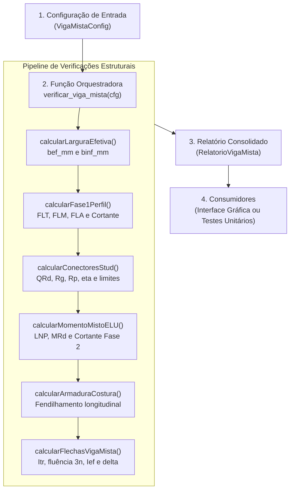

# GUIA TÉCNICO DE ARQUITETURA, MÉTODOS E EXECUÇÃO DO MOTOR DE CÁLCULO DE VIGA MISTA

Este documento apresenta o guia técnico e de desenvolvimento que detalha o funcionamento interno do motor de cálculo em C++20 para dimensionamento e verificação de vigas mistas de aço e concreto segundo a **ABNT NBR 8800:2024**.

---

## 1. VISÃO GERAL DA ARQUITETURA

O motor de cálculo foi concebido de forma **modular, desacoplada e 100% testável**, separando a lógica estrutural da interface gráfica (Raylib / Dear ImGui):



### Arquivos do Módulo
- [modelos_viga_mista.h](file:///C:/Users/Arthur/Documents/GitHub/VMP/include/modelos_viga_mista.h): Definição de enums e todas as estruturas de dados de entrada (`VigaMistaConfig`, `PerfilI`, `DadosLaje`, `DadosStudBolt`, `GeometriaVigaMista`, `AcoesPiso`);
- [rotinas_viga_mista.h](file:///C:/Users/Arthur/Documents/GitHub/VMP/include/rotinas_viga_mista.h): Declaração das rotinas especializadas e estruturas de saída de cada verificação;
- [rotinas_viga_mista.cpp](file:///C:/Users/Arthur/Documents/GitHub/VMP/src/rotinas_viga_mista.cpp): Implementação matemática das equações da norma;
- [catalogo.h](file:///C:/Users/Arthur/Documents/GitHub/VMP/include/catalogo.h): Gerador de perfis padrão (ex: `perfil_w360x51()`, `aco_a572_gr50()`, `concreto_c30()`).

---

## 2. ESTRUTURA DE DADOS DE ENTRADA (`VigaMistaConfig`)

Para rodar as verificações, basta instanciar e preencher um objeto `VigaMistaConfig`:

```cpp
#include "modelos_viga_mista.h"
#include "rotinas_viga_mista.h"
#include "catalogo.h"

using namespace viga_mista;

VigaMistaConfig cfg;
```

### Componentes de `cfg`:

| Membro | Tipo | Descrição e Unidades |
| :--- | :--- | :--- |
| `cfg.norma` | `NormaEdicao` | `NormaEdicao::NBR8800_2024` ou `NormaEdicao::NBR8800_2008` |
| `cfg.perfil` | `PerfilI` | Geometria do perfil metálico ($d, b_f, t_f, t_w$ em mm; $A_a$ em mm²; $I_x$ em mm⁴) |
| `cfg.aco` | `Aco` | Propriedades do aço ($f_y = 345\text{ MPa}$, $f_u = 450\text{ MPa}$, $E_a = 200.000\text{ MPa}$) |
| `cfg.concreto`| `Concreto` | Propriedades do concreto ($f_{ck} = 30\text{ MPa}$, $E_{cs} = 30.672\text{ MPa}$, $\gamma_c = 1,40$) |
| `cfg.laje` | `DadosLaje` | Tipo de laje, espessuras e geometria de *steel deck* |
| `cfg.conector`| `DadosStudBolt` | Diâmetro, altura, resistência e distribuição transversal dos pinos |
| `cfg.geometria`| `GeometriaVigaMista` | Vão $L$, espaçamento entre vigas $S$, condição escorada/não escorada |
| `cfg.acoes` | `AcoesPiso` | Cargas de construção (Fase 1) e sobrecargas de serviço (Fase 2) |

---

## 3. FLUXO DETALHADO DAS FUNÇÕES E MÉTODOS

A função mestre que executa todas as verificações é:
```cpp
RelatorioVigaMista verificar_viga_mista(const VigaMistaConfig& cfg);
```

Internamente, essa função orquestra as seguintes etapas sequenciais:

---

### Passo 1: Largura Efetiva e de Influência
Calcula a largura de laje que colabora para a flexão ($b_{ef}$) e a largura tributária para carregamento superficial ($b_{inf}$):

```cpp
double bef_mm  = calcularLarguraEfetiva(cfg.geometria);
double binf_mm = calcularLarguraInfluencia(cfg.geometria);
```
- **Equação implementada:** $b_{ef} = \min(L/4,\; S_{esq} + S_{dir})$;
- **Retorno:** Valores em milímetros utilizados em todas as etapas subsequentes.

---

### Passo 2: Verificação da Fase 1 - Construção Não Escorada
Avalia o perfil metálico isolado sob peso próprio, concreto fresco e operários:

```cpp
ResultadoFase1Perfil res_fase1 = calcularFase1Perfil(cfg);
```

#### O que esta função verifica:
1. **Cargas e Solicitantes na Fase 1:**
   - $g_1 = (\text{peso próprio perfil}) + (\text{peso concreto fresco} \cdot b_{inf})$;
   - $q_1 = \text{sobrecarga transitória de construção} \cdot b_{inf}$;
   - $M_{Sd1} = \frac{(1,25 \cdot g_1 + 1,30 \cdot q_1) \cdot L^2}{8}$;
   - $V_{Sd1} = \frac{(1,25 \cdot g_1 + 1,30 \cdot q_1) \cdot L}{2}$.
2. **Resistência do Perfil Metálico:**
   - **Flambagem Lateral com Torção (FLT):** Calcula momento crítico elástico $M_{cr}$, índice de esbeltez $\lambda_{LT}$, fator de redução $\chi_{LT}$ e momento resistente $M_{Rd,FLT}$;
   - **Flambagem Local da Mesa (FLM) e Alma (FLA):** Compara $\lambda$ com $\lambda_p$ e $\lambda_r$;
   - **Resistência ao Cortante ($V_{Rd}$):** Avalia plastificação da alma ou flambagem por cisalhamento via coeficiente $k_v$;
   - **Taxa de Utilização:** Compara $M_{Sd1} / M_{Rd}$ e $V_{Sd1} / V_{Rd}$, atribuindo `aprovado_flexao` e `aprovado_cortante`.

---

### Passo 3: Dimensionamento e Verificação dos Conectores Stud Bolt
Calcula a capacidade individual do pino, o número necessário e aplica as restrições da NBR 8800:2024:

```cpp
ResultadoConectoresStud res_conn = calcularConectoresStud(cfg, bef_mm);
```

#### O que esta função calcula:
1. **Resistência do Conector Isolado ($Q_{Rd,base}$):**
   $$Q_{aço} = 0,5 \cdot A_{cs} \cdot \frac{f_u}{1,25}; \quad Q_{conc} = 0,5 \cdot A_{cs} \cdot \frac{\sqrt{f_{ck} \cdot E_{cs}}}{1,40}$$
2. **Aplicação dos Fatores $R_g$ e $R_p$ (NBR 8800:2024):**
   - Laje maciça: $R_g = 1,0$; $R_p = 0,75$;
   - Steel deck perpendicular: $R_g$ varia conforme número de pinos ($1,0$ ou $0,85$); $R_p = 0,67$ (centrado);
   - Steel deck paralelo: $R_g = 1,0$ se $b_F/h_F \ge 1,5$; $R_p = 0,75$;
   - $Q_{Rd} = \min(Q_{aço},\; Q_{conc}) \cdot R_g \cdot R_p$.
3. **Grau de Interação ($\eta$):**
   - Determina a força rasante necessária $F_{hd} = \min(T_{a,max},\; C_{c,max})$;
   - Avalia a quantidade de pinos por semi-vão e total;
   - Se `cfg.conector.espacamento_adotado_mm > 0`, calcula o grau de interação real atingido $\eta = \frac{N_{adotado} \cdot Q_{Rd}}{F_{hd}}$;
   - Compara com o grau mínimo regulamentar $\eta_{min} = \max(0,40,\; 1,0 - 0,025 \cdot L_{metros})$.
4. **Verificações Geométricas Rigorosas do Pino:**
   - Altura mínima: $h_{cs} \ge \max(4 \cdot d_{cs},\; h_F + 40\text{ mm})$ (`altura_atende`);
   - Cobrimento de concreto acima do pino: $c = (t_c + h_F) - h_{cs} \ge 10\text{ mm}$ (`cobrimento_atende`);
   - Diâmetro máximo para solda na mesa: $d_{cs} \le 2,5 \cdot t_f$ (`diametro_mesa_atende`).

---

### Passo 4: Verificação da Fase 2 - Seção Mista no ELU
Calcula a capacidade plástica da seção mista, localiza a Linha Neutra Plástica (LNP) e avalia o momento fletor resistente positivo:

```cpp
ResultadoMomentoMisto res_fase2 = calcularMomentoMistoELU(cfg, bef_mm, binf_mm, res_conn);
```

#### O que esta função calcula:
1. **Solicitantes da Fase 2:**
   - $g_2 = \text{revestimentos/alvenaria} \cdot b_{inf}$;
   - $q_2 = \text{sobrecarga de uso} \cdot b_{inf}$;
   - $q_{Sd2} = 1,25 \cdot g_1 + 1,40 \cdot g_2 + 1,50 \cdot q_2$;
   - $M_{Sd2} = \frac{q_{Sd2} \cdot L^2}{8}$; $V_{Sd2} = \frac{q_{Sd2} \cdot L}{2}$.
2. **Equilíbrio Plástico e Posição da LNP:**
   - Determina a força rasante efetiva $F_{hd} = \eta \cdot \min(T_{a,max},\; C_{c,max})$;
   - **Caso 1: LNP na Laje** ($F_{hd} == T_{a,max}$ com $\eta = 1,0$):
     - $a = \frac{F_{hd}}{0,85 \cdot f_{cd} \cdot b_{ef}} \le t_c$;
     - $M_{Rd} = T_{a,max} \cdot \left(\frac{d}{2} + h_F + t_c - \frac{a}{2}\right)$.
   - **Caso 2: LNP na Mesa de Aço** ($C_{aço} \le b_f \cdot t_f \cdot f_{yd}$):
     - $y_p = \frac{C_{aço}}{b_f \cdot f_{yd}} \le t_f$;
     - Calcula $M_{Rd}$ integrando momentos plásticos em relação à LNP.
   - **Caso 3: LNP na Alma de Aço** ($y_p > t_f$):
     - $y_p = t_f + \frac{C_{aço} - b_f \cdot t_f \cdot f_{yd}}{t_w \cdot f_{yd}}$;
     - Calcula $M_{Rd}$ decompondo mesa superior, alma comprimida e partes tracionadas.
3. **Resistência ao Cortante na Fase 2:**
   - A resistência ao cortante continua sendo absorvida pela alma de aço ($V_{Rd} = V_{Rd,aço}$).

---

### Passo 5: Verificação da Armadura de Costura
Avalia a necessidade de armadura transversal na laje para impedir o fendilhamento longitudinal ao longo da linha de conectores:

```cpp
ResultadoArmaduraCostura res_costura = calcularArmaduraCostura(cfg, bef_mm, res_conn);
```
- Calcula a solicitação de cisalhamento por metro linear $\nu_{Sd} = \frac{F_{hd}}{L/2}$;
- Verifica se a biela comprimida de concreto resiste ($\nu_{Sd} \le \nu_{Rd,max}$);
- Determina a área de aço necessária $A_{sf} / s_f$ (cm²/m).

---

### Passo 6: Verificação de Deformabilidade / Flechas no ELS
Calcula a inércia homogeneizada e as flechas considerando o efeito diferido no tempo da fluência do concreto e a redução por interação parcial:

```cpp
ResultadoFlechasVigaMista res_flechas = calcularFlechasVigaMista(
    cfg, bef_mm, binf_mm, res_conn.grau_interacao_eta
);
```

#### O que esta função calcula:
1. **Relações de Modularidade:**
   - Ações de curta duração: $n_{curta} = E_a / E_{cs}$;
   - Ações de longa duração (fluência $\phi = 2,0$): $n_{longa} = 3 \cdot n_{curta}$.
2. **Inércias Homogeneizadas:**
   - $I_{tr,curto}$ (utilizando $b_{ef} / n_{curta}$) e $I_{tr,longo}$ (utilizando $b_{ef} / n_{longa}$).
3. **Inércia Efetiva com Interação Parcial ($\eta < 1,0$):**
   $$I_{ef} = I_a + \sqrt{\eta} \cdot (I_{tr} - I_a)$$
4. **Parcelas de Flecha no Centro do Vão:**
   - $\delta_{fase1}$: Viga de aço isolada sob peso próprio e concreto fresco;
   - $\delta_{perm}$: Cargas permanentes $g_2$ com inércia de longo prazo ($I_{ef,longo}$);
   - $\delta_{var}$: Sobrecarga de uso $q_2$ com inércia de curto prazo ($I_{ef,curto}$);
   - $\delta_{total} = \delta_{fase1} + \delta_{perm} + \delta_{var}$.
5. **Critério de Conformidade:**
   - $\delta_{total} \le L / 350$ (ou $L / 250$ conforme especificado).

---

### Passo 7: Consolidação do Relatório Global
A função `verificar_viga_mista` monta o vetor `itens` com o diagnóstico de cada verificação (solicitante, resistente, taxa de utilização percentual e status `OK` / `FALHA`):

```cpp
rel.aprovado_global = (todas as taxas <= 1.0) && conn_geom_ok;
```

---

## 4. EXEMPLOS PRÁTICOS DE USO EM C++

### Exemplo 1: Verificação Completa e Impressão no Console

Crie um arquivo de teste (ex: `exemplo_viga.cpp`) ou utilize no seu código:

```cpp
#include <iostream>
#include <iomanip>
#include "modelos_viga_mista.h"
#include "rotinas_viga_mista.h"
#include "catalogo.h"

using namespace viga_mista;

int main() {
    // 1. Instancia configuração padrão da NBR 8800:2024
    VigaMistaConfig cfg;
    cfg.norma = NormaEdicao::NBR8800_2024;
    cfg.perfil = perfil_w360x51();      // W360x51 em ASTM A572 Gr 50
    cfg.aco = aco_a572_gr50();          // fy = 345 MPa
    cfg.concreto = concreto_c30();      // fck = 30 MPa

    // 2. Configura a laje (Maciça de 120 mm)
    cfg.laje.tipo = TipoLajeMista::MACICA;
    cfg.laje.tc_mm = 120.0;

    // 3. Configura os conectores stud bolt (19 mm x 100 mm)
    cfg.conector.d_cs_mm = 19.0;
    cfg.conector.h_cs_mm = 100.0;
    cfg.conector.fu_MPa = 420.0;
    cfg.conector.n_por_linha = 1;
    cfg.conector.espacamento_adotado_mm = 0.0; // 0 = 100% Interação completa automática

    // 4. Geometria e cargas
    cfg.geometria.L_vao_mm = 7000.0;    // Vão de 7 metros
    cfg.geometria.dist_esq_mm = 1750.0;
    cfg.geometria.dist_dir_mm = 1750.0;

    // 5. Roda a verificação integral
    RelatorioVigaMista rel = verificar_viga_mista(cfg);

    // 6. Exibe os resultados
    std::cout << "========================================================\n";
    std::cout << " DIAGNÓSTICO DA VIGA MISTA - NBR 8800:2024\n";
    std::cout << " Status Geral: " << (rel.aprovado_global ? "[APROVADO]" : "[REPROVADO]") << "\n";
    std::cout << "========================================================\n";
    std::cout << "Momento Fase 2: " << rel.fase2.MSd2_kNm << " / " << rel.fase2.MRd_VM_kNm << " kNm\n";
    std::cout << "Posição da LNP: " << (rel.fase2.lnp_na_laje ? "Laje (a = " + std::to_string(rel.fase2.a_bloco_concreto_mm) + " mm)" 
                                                                : "Mesa/Alma (yp = " + std::to_string(rel.fase2.yp_lnp_aco_mm) + " mm)") << "\n";
    std::cout << "Conectores: eta = " << (rel.conectores.grau_interacao_eta * 100.0) << "% (" << rel.conectores.n_total_adotado << " pinos)\n";
    std::cout << "Flecha Total: " << rel.flechas.flecha_total_mm << " mm (Limite: " << rel.flechas.limite_total_mm << " mm)\n";
    std::cout << "--------------------------------------------------------\n";
    std::cout << "Tabela de Itens Verificados:\n";
    for (const auto& it : rel.itens) {
        std::cout << std::left << std::setw(32) << it.item 
                  << " | " << std::setw(8) << it.solicitante 
                  << " / " << std::setw(8) << it.resistente << " " << std::setw(5) << it.unidade
                  << " | Taxa: " << std::setw(6) << std::fixed << std::setprecision(1) << (it.taxa_utilizacao * 100.0) << "%"
                  << " | " << (it.aprovado ? "[OK]" : "[FALHA]") << "\n";
    }
    std::cout << "========================================================\n";

    return 0;
}
```

---

### Exemplo 2: Simulação com Steel Deck e Interação Parcial Customizada

Para simular uma laje mista com fôrma metálica nervurada (*steel deck*) e fixar um espaçamento manual de pinos (interação parcial $\eta \approx 65\%$):

```cpp
VigaMistaConfig cfg;
cfg.norma = NormaEdicao::NBR8800_2024;
cfg.perfil = perfil_w360x51();
cfg.aco = aco_a572_gr50();
cfg.concreto = concreto_c30();

// Configura Steel Deck com nervuras perpendiculares
cfg.laje.tipo = TipoLajeMista::STEEL_DECK;
cfg.laje.orientacao = OrientacaoDeck::PERPENDICULAR_A_VIGA;
cfg.laje.tc_mm = 70.0;            // Capa de concreto acima do deck
cfg.laje.hF_deck_mm = 50.0;       // Altura da nervura
cfg.laje.bF_deck_mm = 120.0;      // Largura da nervura
cfg.laje.passo_deck_mm = 200.0;   // Passo de 200 mm

// Configura 1 pino de 19x100mm a cada nervura (espaçamento de 200 mm)
cfg.conector.d_cs_mm = 19.0;
cfg.conector.h_cs_mm = 100.0;
cfg.conector.n_por_linha = 1;
cfg.conector.espacamento_adotado_mm = 200.0; // Adota 1 conector a cada 200 mm

RelatorioVigaMista rel = verificar_viga_mista(cfg);

// Diagnóstico imediato
std::cout << "Grau de Interação eta: " << rel.conectores.grau_interacao_eta * 100.0 << "%\n";
std::cout << "Grau Mínimo eta_min:  " << rel.conectores.grau_interacao_minimo * 100.0 << "%\n";
std::cout << "Atende Grau Mínimo?   " << (rel.conectores.grau_interacao_atende ? "SIM" : "NÃO") << "\n";
std::cout << "Momento Misto MRd:    " << rel.fase2.MRd_VM_kNm << " kNm\n";
```

---

## 5. COMO COMPILAR E RODAR OS TESTES / APLICAÇÃO

No terminal PowerShell na raiz do repositório:

### 1. Compilar todo o projeto (GUI + Testes Unitários):
```powershell
cmake --build build
```

### 2. Rodar a suíte completa de testes unitários automatizados:
```powershell
./build/vmp_tests.exe
```
*Saída esperada: Todos os 23 testes passando com 100% de aprovação.*

### 3. Executar a interface gráfica interativa (Raylib + ImGui):
```powershell
./build/vmp_gui.exe
```
*Abre a janela gráfica com renderização em tempo real, alternância de temas Claro/Escuro na barra superior e cálculo instantâneo a cada parâmetro editado.*

---

## 6. SÍNTESE DAS ESTRUTURAS DE RETORNO (`RelatorioVigaMista`)

Ao chamar `verificar_viga_mista(cfg)`, você tem acesso a todos os resultados detalhados nos seguintes campos:

```cpp
struct RelatorioVigaMista {
    bool aprovado_global;                  // true se TODOS os estados limites atendem
    std::vector<ItemDiagnostico> itens;    // Lista pronta para tabelas de resultados

    ResultadoFase1Perfil fase1;            // MSd1, MRd_aco, FLT, FLM, FLA, cortante Fase 1
    ResultadoConectoresStud conectores;    // QRd, Rg, Rp, pinos, espacamento, limites geometricos
    ResultadoMomentoMisto fase2;           // MSd2, MRd_VM, a_concreto, yp_LNP, cortante Fase 2
    ResultadoArmaduraCostura costura;      // Area de aco de costura (Asf/sf em cm2/m)
    ResultadoFlechasVigaMista flechas;     // Flechas de cada fase, flecha total e limite L/350
    ResultadoVibracaoPiso vibracao;        // Frequencia natural e aceleracao de pico
};
```

Essa organização permite que você use o motor tanto na interface interativa quanto para gerar scripts de análise paramétrica (gerando tabelas e curvas para seu TCC e para o mestrado).
