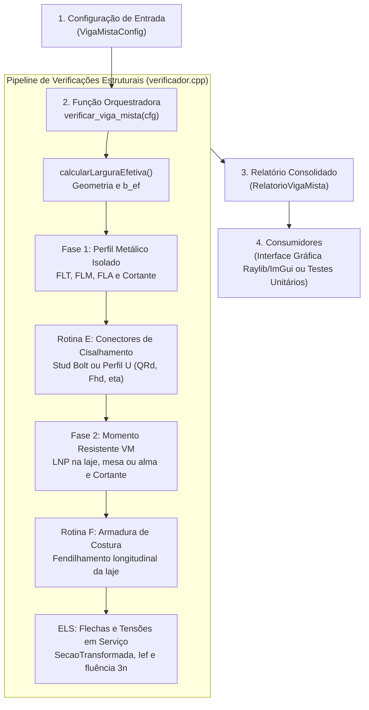
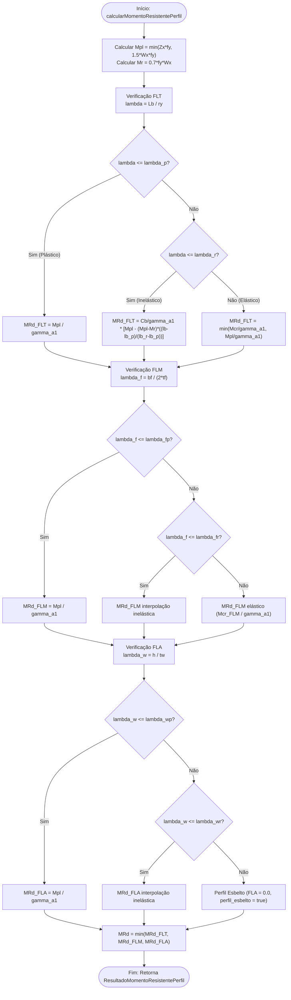
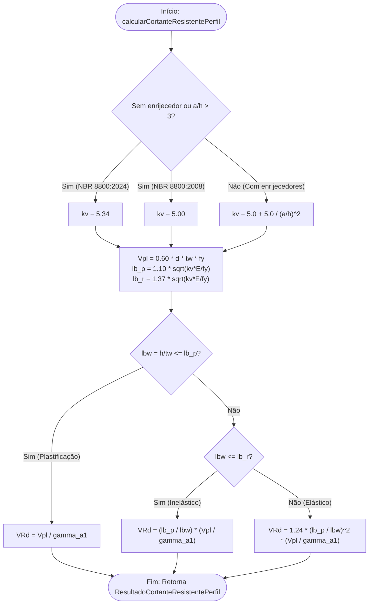
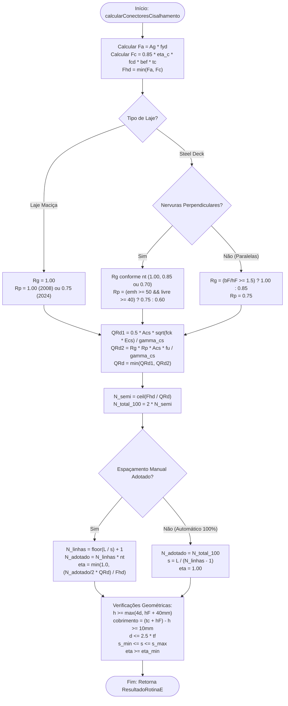
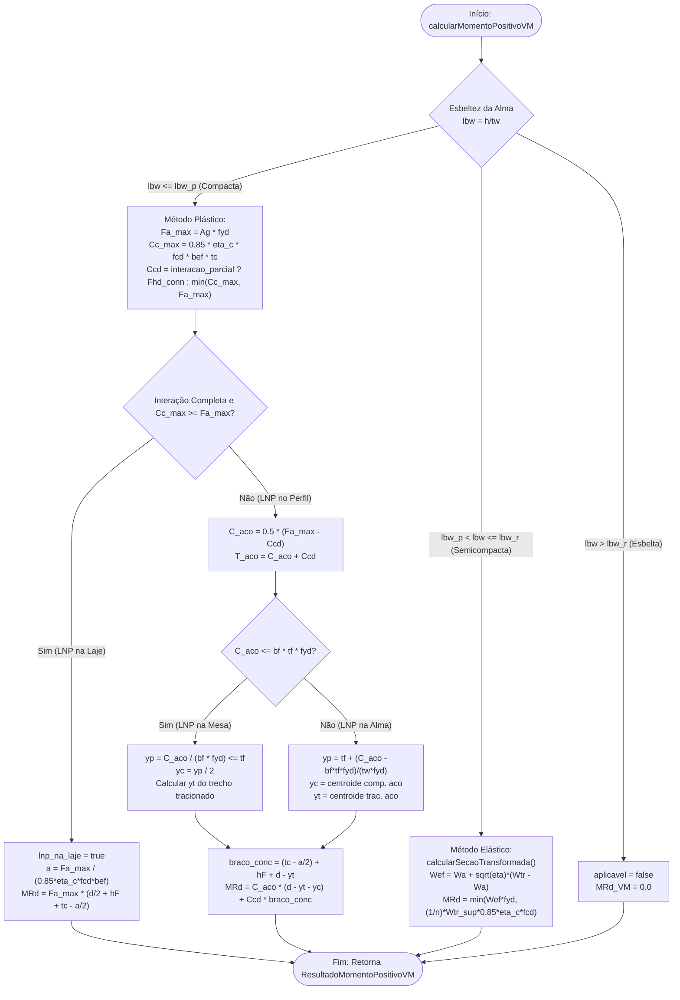
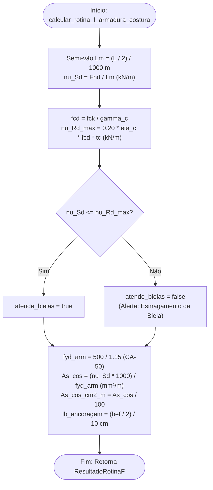
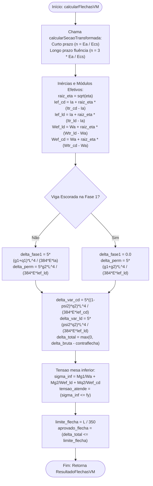
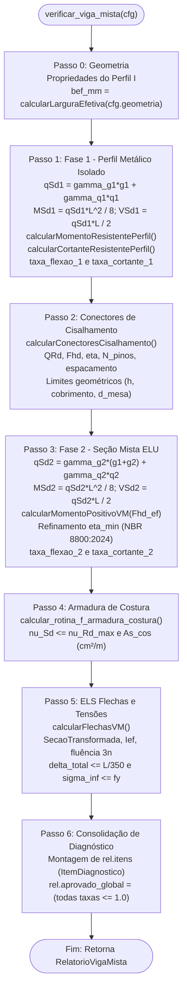

# GUIA TÉCNICO DE ARQUITETURA, MÉTODOS E EXECUÇÃO DO MOTOR DE CÁLCULO DE VIGA MISTA

Este documento apresenta o guia técnico e de engenharia estrutural que detalha a arquitetura consolidada, as formulações matemáticas e o funcionamento interno do motor de cálculo em C++20 para dimensionamento e verificação de vigas mistas de aço e concreto segundo as normas **ABNT NBR 8800:2024** e **ABNT NBR 8800:2008**.

---

## 1. ARQUITETURA CONSOLIDADA E ORGANIZAÇÃO DOS MÓDULOS

No último ciclo de refatoração, a arquitetura do projeto foi unificada e desacoplada, eliminando códigos duplicados e estabelecendo uma clara diferenciação entre as edições normativas:



### Arquivos do Módulo Consolidado
- [modelos.h](file:///C:/Users/Arthur/Documents/GitHub/VMP/include/modelos.h): Definição de enums e estruturas de dados centrais (`NormaEdicao`, `VigaMistaConfig`, `PerfilI`, `Laje`, `ConectorCisalhamento`, `GeometriaVigaMista`, `AcoesPiso`);
- [rotinas_nbr8800.h](file:///C:/Users/Arthur/Documents/GitHub/VMP/include/rotinas_nbr8800.h) e [rotinas_nbr8800.cpp](file:///C:/Users/Arthur/Documents/GitHub/VMP/src/rotinas_nbr8800.cpp): Biblioteca matemática rigorosa dividida nos namespaces `nbr8800::v2008` e `nbr8800::v2024`;
- [rotinas_vmp.h](file:///C:/Users/Arthur/Documents/GitHub/VMP/include/rotinas_vmp.h) e [rotinas_vmp.cpp](file:///C:/Users/Arthur/Documents/GitHub/VMP/src/rotinas_vmp.cpp): Rotinas de seção transformada elástica (`calcularSecaoTransformada`) compartilhadas entre vigas mistas convencionais e vigas mistas protendidas;
- [geometria.h](file:///C:/Users/Arthur/Documents/GitHub/VMP/include/geometria.h) e [geometria.cpp](file:///C:/Users/Arthur/Documents/GitHub/VMP/src/geometria.cpp): Cálculo das propriedades geométricas da seção $I$ e larguras colaborantes efetivas;
- [verificador.h](file:///C:/Users/Arthur/Documents/GitHub/VMP/include/verificador.h) e [verificador.cpp](file:///C:/Users/Arthur/Documents/GitHub/VMP/src/verificador.cpp): Orquestrador do dimensionamento que executa a análise por fases e gera o diagnóstico detalhado em `RelatorioVigaMista`;
- [catalogo.h](file:///C:/Users/Arthur/Documents/GitHub/VMP/include/catalogo.h): Gerador de perfis comerciais e materiais padronizados (ex: `perfil_w360x51()`, `aco_a572_gr50()`, `concreto_c30()`).

---

## 2. ESTRUTURA DE DADOS DE ENTRADA (`VigaMistaConfig`)

O ponto de entrada de dados para a análise é o registro `VigaMistaConfig`, definido em [modelos.h](file:///C:/Users/Arthur/Documents/GitHub/VMP/include/modelos.h):

```cpp
#include "modelos.h"
#include "verificador.h"
#include "catalogo.h"

VigaMistaConfig cfg;
```

### Componentes de `cfg`:

| Membro | Tipo | Descrição e Parâmetros Chave |
| :--- | :--- | :--- |
| `cfg.norma` | `NormaEdicao` | `NormaEdicao::NBR8800_2024` ou `NormaEdicao::NBR8800_2008` |
| `cfg.perfil` | `PerfilI` | Altura $d$, mesa $b_f$, espessuras $t_f, t_w$, raios de giração e propriedades elásticas/plásticas |
| `cfg.aco` | `Aco` | Tensão de escoamento $f_y$ (MPa), ruptura $f_u$ (MPa), módulo elástico $E_a$ (MPa) e Poisson $\nu$ |
| `cfg.concreto` | `Concreto` | Resistência $f_{ck}$ (MPa), módulo secante $E_{cs}$ (MPa), fator de agregado $\alpha_{ag}$ |
| `cfg.laje` | `Laje` | Tipo (`LAJE_MACICA` ou `LAJE_STEEL_DECK`), $t_c$, altura de nervura $h_F$, passo $e_F$, orientação |
| `cfg.conector` | `ConectorCisalhamento` | Tipo (`CONECTOR_STUD_BOLT` ou `CONECTOR_PERFIL_U`), $d$, $h$, $f_u$, conectores por linha $n_t$, $e_{mh}$, espaçamento adotado |
| `cfg.geometria` | `GeometriaVigaMista` | Vão teórico $L$, comprimento destravado $L_b$, distâncias adjacentes $S_{esq}, S_{dir}$, escoramento |
| `cfg.acoes` | `AcoesPiso` | Cargas permanentes e sobrecargas das Fases 1 e 2 ($g_1, q_1, g_2, q_2$), fatores $\gamma$ e $\psi_2$, contraflecha |

---

## 3. PRINCIPAIS FUNÇÕES REESCRITAS: TEORIA, ASSINATURA E FLUXOGRAMAS

As subseções a seguir detalham as funções centrais reescritas no último commit, com suas equações normativas, assinaturas em C++ e fluxogramas representativos.

---

### 3.1 Momento Fletor Resistente do Perfil Isolado ($M_{Rd}$ perfil)

#### Embasamento Teórico (ABNT NBR 8800:2008 Item 5.4.2 / NBR 8800:2024 Item 5.4.2)
Calcula a capacidade resistente do perfil metálico isolado submetido à flexão simples em torno do eixo de maior inércia ($x$), governada pelo menor valor entre três estados limites últimos (ELU):
1. **Flambagem Lateral com Torção (FLT)**;
2. **Flambagem Local da Mesa (FLM)**;
3. **Flambagem Local da Alma (FLA)**.

Momentos de referência:
- Momento de plastificação: $M_{pl} = \min(Z_x \cdot f_y,\; 1,5 \cdot W_x \cdot f_y)$;
- Momento de início de escoamento: $M_r = 0,7 \cdot f_y \cdot W_x$;
- Momento crítico elástico de torção ($M_{cr}$):
  $$M_{cr} = \frac{C_b \cdot \pi^2 \cdot E \cdot I_y}{L_b^2} \sqrt{\frac{C_w}{I_y} \left(1 + 0,039 \frac{I_t \cdot L_b^2}{C_w}\right)}$$

Critérios dos regimes de esbeltez para FLT ($\lambda = L_b / r_y$):
- $\lambda \le \lambda_p = 1,76 \sqrt{E / f_y} \implies M_{Rd,FLT} = M_{pl} / \gamma_{a1}$;
- $\lambda_p < \lambda \le \lambda_r \implies M_{Rd,FLT} = \min\left[\frac{C_b}{\gamma_{a1}} \left(M_{pl} - (M_{pl} - M_r) \frac{\lambda - \lambda_p}{\lambda_r - \lambda_p}\right),\; \frac{M_{pl}}{\gamma_{a1}}\right]$;
- $\lambda > \lambda_r \implies M_{Rd,FLT} = \min\left[\frac{M_{cr}}{\gamma_{a1}},\; \frac{M_{pl}}{\gamma_{a1}}\right]$.

Critérios análogos são aplicados para FLM ($\lambda = b_f / (2 t_f)$) e FLA ($\lambda = h / t_w$). O valor de cálculo é o mínimo:
$$M_{Rd} = \min(M_{Rd,FLT},\; M_{Rd,FLM},\; M_{Rd,FLA})$$

#### Assinatura C++
```cpp
// Em rotinas_nbr8800.h (namespaces v2008 e v2024):
ResultadoMomentoResistentePerfil calcularMomentoResistentePerfil(
    const PerfilI& perfil,
    const Aco& aco,
    double Lb_mm,
    double Cb = 1.0,
    double gamma_a1 = 1.10
);
```

#### Fluxograma de `calcularMomentoResistentePerfil`


---

### 3.2 Força Cortante Resistente do Perfil ($V_{Rd}$ perfil)

#### Embasamento Teórico (NBR 8800:2008 / NBR 8800:2024 Item 5.4.3)
Avalia a capacidade da alma de aço resistir à força cortante vertical:
- Força cortante de plastificação da alma:
  $$V_{pl} = 0,60 \cdot d \cdot t_w \cdot f_y$$
- Coeficiente de flambagem por cisalhamento $k_v$:
  - Sem enrijecedores transversais ($a/h > 3$):
    - **NBR 8800:2008**: $k_v = 5,00$;
    - **NBR 8800:2024**: $k_v = 5,34$;
  - Com enrijecedores espaçados a uma distância $a$:
    $$k_v = 5,0 + \frac{5,0}{(a / h)^2}$$
- Limites de esbeltez da alma:
  $$\lambda_{wp} = 1,10 \sqrt{\frac{k_v \cdot E}{f_y}}; \quad \lambda_{wr} = 1,37 \sqrt{\frac{k_v \cdot E}{f_y}}$$
- Resistência de cálculo $V_{Rd}$:
  - $\lambda_w \le \lambda_{wp}$ (Escoamento): $V_{Rd} = \frac{V_{pl}}{\gamma_{a1}}$;
  - $\lambda_{wp} < \lambda_w \le \lambda_{wr}$ (Flambagem inelástica): $V_{Rd} = \frac{\lambda_{wp}}{\lambda_w} \frac{V_{pl}}{\gamma_{a1}}$;
  - $\lambda_w > \lambda_{wr}$ (Flambagem elástica): $V_{Rd} = 1,24 \left(\frac{\lambda_{wp}}{\lambda_w}\right)^2 \frac{V_{pl}}{\gamma_{a1}}$.

#### Assinatura C++
```cpp
// Em rotinas_nbr8800.h:
ResultadoCortanteResistentePerfil calcularCortanteResistentePerfil(
    const PerfilI& perfil,
    const Aco& aco,
    double a_enrijecedor_mm = 0.0,
    double gamma_a1 = 1.10
);
```

#### Fluxograma de `calcularCortanteResistentePerfil`


---

### 3.3 Conectores de Cisalhamento (`calcularConectoresCisalhamento` / `calcularConectoresVigaMista`)

#### Embasamento Teórico (NBR 8800:2008 Anexo O.4 / NBR 8800:2024 Anexo L.4)
Dimensiona a transferência de cisalhamento longitudinal entre o perfil de aço e a laje de concreto.
1. **Força Horizontal Rasante Total ($F_{hd}$)** para 100% de interação:
   $$F_{hd} = \min(F_a,\; F_c) = \min\left(A_g \cdot f_{yd},\; 0,85 \cdot \eta_c \cdot f_{cd} \cdot b_{ef} \cdot t_c\right)$$
   Onde o coeficiente de fragilidade do concreto é:
   - NBR 8800:2008: $\eta_c = 1,00$;
   - NBR 8800:2024: $\eta_c = \min\left(1,00,\; \left(\frac{40}{f_{ck}}\right)^{1/3}\right)$.
2. **Resistência Nominal de 1 Pino Stud Bolt ($Q_{Rd}$)**:
   $$Q_{Rd1,conc} = \frac{0,5 \cdot A_{cs} \sqrt{f_{ck} \cdot E_{cs}}}{\gamma_{cs}}; \quad Q_{Rd2,aço} = \frac{R_g \cdot R_p \cdot A_{cs} \cdot f_u}{\gamma_{cs}}$$
   $$Q_{Rd} = \min(Q_{Rd1,conc},\; Q_{Rd2,aço})$$
   - Coeficientes $R_g$ e $R_p$:
     - Laje maciça: $R_g = 1,00$; $R_p = 1,00$ (NBR 8800:2008 O.4.2.1.3) ou $R_p = 0,75$ (NBR 8800:2024 L.4.2.1.3);
     - Steel deck perpendicular: $R_g = 1,00$ ($n_t=1$), $0,85$ ($n_t=2$), $0,70$ ($n_t \ge 3$); $R_p = 0,75$ se $e_{mh} \ge 50\text{ mm}$ e $(h - h_F) \ge 40\text{ mm}$, senão $R_p = 0,60$.
3. **Número de Pinos e Grau de Interação ($\eta$)**:
   - $N_{semi} = \lceil F_{hd} / Q_{Rd} \rceil$ por semi-vão; total $N_l = 2 \cdot N_{semi}$;
   - Grau de interação real: $\eta = \min\left(1,00,\; \frac{N_{semi,adotado} \cdot Q_{Rd}}{F_{hd}}\right)$;
   - Grau mínimo regulamentar $\eta_{min}$:
     - NBR 8800:2008 (O.2.3.1.1.2): $\eta_{min} = \max(0,40,\; 1,0 - 0,025 \cdot L_m)$;
     - NBR 8800:2024 (L.2.3.1.1.2): Função refinada $\eta_i = \max(c_p \cdot c_r^2 \cdot \eta_0,\; \eta_{lim})$, onde $c_r = \max(0,70,\; M_{Sd2}/M_{Rd})$.
4. **Verificações Geométricas**:
   - Altura mínima: $h \ge \max(4 \cdot d,\; h_F + 40\text{ mm})$;
   - Cobrimento da cabeça: $c = (t_c + h_F) - h \ge 10\text{ mm}$;
   - Diâmetro máximo soldado à mesa: $d \le 2,5 \cdot t_f$;
   - Espaçamento transversal mínimo entre eixos de pinos (NBR 8800 L.4.3.4): $s_{t,min} = 4 \cdot d$;
   - Distância mínima à borda livre da mesa (NBR 8800 L.4.4.2): $e_{borda,min} = 25\text{ mm}$;
   - Largura mínima da mesa exigida: $b_{f,min} = (n_t - 1) \cdot s_{t,min} + 2 \cdot e_{borda,min}$;
   - Interferência com calha do Steel Deck (nervuras paralelas): $w_{fundo} \ge (n_t - 1) \cdot s_{t,min} + 2 \cdot e_{borda,min}$.

#### Assinatura C++
```cpp
// Verificador mestre:
nbr8800::ResultadoRotinaE calcularConectoresVigaMista(const VigaMistaConfig& cfg, double bef_mm);

// Implementação especializada na NBR 8800:
ResultadoRotinaE nbr8800::v2024::calcularConectoresCisalhamento(
    const PerfilI& perfil,
    const Aco& aco,
    const Laje& laje,
    const Concreto& concreto,
    const ConectorCisalhamento& conector,
    double Lv_mm,
    bool escorada = false,
    double gamma_a1 = 1.10,
    double gamma_c = 1.40,
    double gamma_cs = 1.25
);
```

#### Fluxograma de `calcularConectoresCisalhamento`


---

### 3.4 Momento Resistente da Viga Mista no ELU ($M_{Rd}$ VM)

#### Embasamento Teórico (NBR 8800:2008 Anexo O.2.3 / NBR 8800:2024 Anexo L.6.3)
Calcula o momento resistente positivo de cálculo $M_{Rd,VM}$ no Estádio Plástico ou Elástico:
1. **Esbeltez da Alma ($\lambda_w = h/t_w$)**:
   - $\lambda_w \le \lambda_{wp} = 3,76 \sqrt{E / f_y} \implies$ **Seção Compacta** (Método da Distribuição Plástica de Tensões);
   - $\lambda_{wp} < \lambda_w \le \lambda_{wr} = 5,70 \sqrt{E / f_y} \implies$ **Seção Semicompacta** (Método Elétrico com Seção Transformada);
   - $\lambda_w > \lambda_{wr} \implies$ Não aplicável para flexão plástica direta.

2. **Distribuição Plástica de Tensões (Seção Compacta)**:
   Força rasante efetiva: $F_{hd,ef} = \eta \cdot \min(C_{c,max},\; F_{a,max})$.
   - **Caso 1: Linha Neutra Plástica (LNP) na Laje de Concreto**:
     Ocorre quando $\eta = 1,00$ e $C_{c,max} \ge F_{a,max}$.
     $$a = \frac{F_{a,max}}{0,85 \cdot \eta_c \cdot f_{cd} \cdot b_{ef}} \le t_c; \quad C_{a} = 0$$
     $$M_{Rd,VM} = F_{a,max} \cdot \left(\frac{d}{2} + h_F + t_c - \frac{a}{2}\right)$$
   - **Caso 2: LNP na Mesa Superior do Perfil de Aço**:
     Ocorre quando $C_{cd} = F_{hd,ef} < F_{a,max}$ e a compressão restante no aço $C_a \le b_f \cdot t_f \cdot f_{yd}$:
     $$C_a = 0,5 \cdot (F_{a,max} - C_{cd}); \quad y_p = \frac{C_a}{b_f \cdot f_{yd}} \le t_f$$
     $$M_{Rd,VM} = C_a \cdot (d - y_t - y_c) + C_{cd} \cdot \left(t_c - \frac{a}{2} + h_F + d - y_t\right)$$
   - **Caso 3: LNP na Alma do Perfil de Aço**:
     Ocorre quando $C_a > b_f \cdot t_f \cdot f_{yd}$:
     $$y_p = t_f + \frac{C_a - b_f \cdot t_f \cdot f_{yd}}{t_w \cdot f_{yd}}$$
     Determina os centros de gravidade das áreas comprimidas e tracionadas e integra os momentos plásticos.

3. **Seção Semicompacta**:
   Utiliza a seção transformada homogeneizada (`calcularSecaoTransformada`), com módulo resistente efetivo inferior $W_{ef,inf} = W_a + \sqrt{\eta} (W_{tr,inf} - W_a)$ e limita a tensão no bordo comprimido a $0,85 \cdot \eta_c \cdot f_{cd}$.

#### Assinatura C++
```cpp
// Em rotinas_nbr8800.h:
ResultadoMomentoPositivoVM calcularMomentoPositivoVM(
    const PerfilI& perfil,
    const Aco& aco,
    const Concreto& concreto,
    const Laje& laje,
    double gamma_a1 = 1.10,
    double gamma_c = 1.40,
    double Fhd_conectores_kN = -1.0
);
```

#### Fluxograma de `calcularMomentoPositivoVM`


---

### 3.5 Armadura de Costura contra Fendilhamento Longitudinal

#### Embasamento Teórico (NBR 8800:2008 O.4.4.4 / NBR 8800:2024 L.4.4.4 e NBR 6118)
Garante a integridade da laje de concreto contra o fendilhamento induzido pelo empuxo dos conectores stud bolt:
1. **Fluxo de Cisalhamento Solicitante ($\nu_{Sd}$)** ao longo do semi-vão crítico:
   $$\nu_{Sd} = \frac{F_{hd}}{L / 2} \quad (\text{kN/m})$$
2. **Resistência Máxima das Bielas Comprimidas de Concreto ($\nu_{Rd,max}$)**:
   $$\nu_{Rd,max} = 0,20 \cdot \eta_c \cdot f_{cd} \cdot t_c \cdot 10^3 \quad (\text{kN/m})$$
   Condição mandatória de segurança: $\nu_{Sd} \le \nu_{Rd,max}$.
3. **Área de Aço Transversal Necessária ($A_{sf} / s_f$)**:
   $$\frac{A_{sf}}{s_f} = \frac{\nu_{Sd} \cdot 10^3}{f_{yd,arm}} \cdot 10^{-2} \quad (\text{cm}^2/\text{m})$$
   Para armadura em aço CA-50: $f_{yd,arm} = \frac{500}{1,15} \approx 434,78\text{ MPa}$.
4. **Comprimento de Ancoragem**: A armadura deve se estender por uma largura de ancoragem $l_b \ge b_{ef} / 2$ a cada lado da linha de conectores.

#### Assinatura C++
```cpp
// Em rotinas_nbr8800.h:
ResultadoRotinaF calcular_rotina_f_armadura_costura(
    const Laje& laje,
    const Concreto& concreto,
    double Fhd_kN,
    double Lv_mm,
    double gamma_c = 1.40
);
```

#### Fluxograma de `calcular_rotina_f_armadura_costura`


---

### 3.6 Cálculo de Flechas e Verificação de Tensões no ELS (`calcularFlechasVM`)

#### Embasamento Teórico (NBR 8800:2008 Anexo O.1.2 / NBR 8800:2024 Anexo L.1.2 e L.2.3.2)
Avalia os deslocamentos verticais (flechas) no centro do vão e as tensões nas fibras extremas em serviço sob ações de curta e longa duração:
1. **Relações Modulares e Seção Transformada**:
   - Curta duração: $n_{cd} = E_a / E_{cs}$;
   - Longa duração com efeito de fluência do concreto ($\phi = 2,0$): $n_{ld} = 3 \cdot n_{cd}$;
   - Reutiliza a rotina unificada `calcularSecaoTransformada` para obter as inércias elásticas homogeneizadas $I_{tr,cd}$ e $I_{tr,ld}$, e os módulos $W_{tr,inf,cd}$ e $W_{tr,inf,ld}$.
2. **Inércias e Módulos Efetivos com Interação Parcial**:
   $$I_{ef} = I_a + \sqrt{\eta} \cdot (I_{tr} - I_a)$$
   $$W_{ef,inf} = W_a + \sqrt{\eta} \cdot (W_{tr,inf} - W_a)$$
3. **Parcelas de Flecha no Centro do Vão**:
   - Fase 1 (Construção não escorada): $\delta_{fase1} = \frac{5 \cdot (g_1 + q_1) \cdot L^4}{384 \cdot E_a \cdot I_a}$ (se escorada: $\delta_{fase1} = 0$);
   - Cargas Permanentes Fase 2 (longo prazo): $\delta_{perm,ld} = \frac{5 \cdot g_2 \cdot L^4}{384 \cdot E_a \cdot I_{ef,ld}}$;
   - Sobrecarga Quase Permanente (longo prazo): $\delta_{var,ld} = \frac{5 \cdot (\psi_2 \cdot q_2) \cdot L^4}{384 \cdot E_a \cdot I_{ef,ld}}$;
   - Sobrecarga Rápida (curto prazo): $\delta_{var,cd} = \frac{5 \cdot ((1 - \psi_2) \cdot q_2) \cdot L^4}{384 \cdot E_a \cdot I_{ef,cd}}$;
   - Flecha Total Líquida: $\delta_{total} = \max(0,\; \delta_{bruta} - \delta_{contraflecha}) \le \frac{L}{350}$.
4. **Verificação da Tensão em Serviço na Mesa Inferior**:
   Combinação rara de serviço:
   $$\sigma_{inf} = \frac{M_{g1}}{W_a} + \frac{M_{g2}}{W_{ef,inf,ld}} + \frac{M_{q2}}{W_{ef,inf,cd}} \le f_y$$

#### Assinatura C++
```cpp
// Em rotinas_nbr8800.h:
ResultadoFlechasVM calcularFlechasVM(
    const PerfilI& perfil,
    const Aco& aco,
    const Concreto& concreto,
    const Laje& laje,
    double Lv_mm,
    double g1_kN_m,
    double q1_kN_m,
    double g2_kN_m,
    double q2_kN_m,
    double psi2,
    double grau_interacao_eta,
    bool escorada = false,
    double contraflecha_mm = 0.0
);
```

#### Fluxograma de `calcularFlechasVM`


---

### 3.7 Verificador Orquestrador da Viga Mista (`verificar_viga_mista`)

#### Funcionamento Geral (verificador.cpp)
A função `verificar_viga_mista` é o coração do cálculo. Ela atua como um coordenador sequencial em 6 passos:
1. **Geometria**: Determina a largura efetiva $b_{ef}$ via `calcularLarguraEfetiva(cfg.geometria)`;
2. **Fase 1 (Construção)**: Avalia o perfil isolado antes da cura ($M_{Sd1}, V_{Sd1}$) contra as Rotinas B e D (`calcularMomentoResistentePerfil` e `calcularCortanteResistentePerfil`);
3. **Conectores de Cisalhamento**: Executa `calcularConectoresCisalhamento` para obter $Q_{Rd}, F_{hd}$, grau de interação $\eta$ e valida as restrições geométricas dos pinos;
4. **Fase 2 (Seção Mista no ELU)**: Avalia a viga mista sob ações finais ($M_{Sd2}, V_{Sd2}$) contra as Rotinas C e D (`calcularMomentoPositivoVM`). Na NBR 8800:2024, refina o grau de interação mínimo com base na solicitação real ($c_r = \max(0,70,\; M_{Sd2} / M_{Rd})$);
5. **Armadura de Costura**: Executa `calcular_rotina_f_armadura_costura` para garantir a resistência contra fendilhamento;
6. **ELS**: Executa `calcularFlechasVM` verificando flechas e tensões de serviço;
7. **Consolidação**: Monta o vetor de itens de diagnóstico (`ItemDiagnostico`) e define `aprovado_global`.

#### Fluxograma Geral do Verificador Orquestrador


---

## 4. EXEMPLOS PRÁTICOS DE USO EM C++

### Exemplo 1: Verificação Completa segundo a NBR 8800:2024

```cpp
#include <iostream>
#include <iomanip>
#include "modelos.h"
#include "rotinas_nbr8800.h"
#include "verificador.h"
#include "catalogo.h"

int main() {
    // 1. Instancia configuração padrão
    VigaMistaConfig cfg;
    cfg.norma = NormaEdicao::NBR8800_2024;
    cfg.perfil = perfil_w360x51();      // W360x51 em ASTM A572 Gr 50
    cfg.aco = aco_a572_gr50();          // fy = 345 MPa
    cfg.concreto = concreto_c30();      // fck = 30 MPa

    // 2. Configura a laje maciça de 120 mm
    cfg.laje.tipo = LAJE_MACICA;
    cfg.laje.tc_mm = 120.0;
    cfg.laje.hF_mm = 0.0;

    // 3. Configura os conectores stud bolt (19 mm x 100 mm)
    cfg.conector.tipo = CONECTOR_STUD_BOLT;
    cfg.conector.d = 19.0;
    cfg.conector.h = 100.0;
    cfg.conector.fu = 420.0;
    cfg.conector.nt = 1;
    cfg.conector.espacamento_adotado_mm = 0.0; // 0 = 100% Interação completa automática

    // 4. Geometria e cargas lineares diretas
    cfg.geometria.L_vao_mm = 7000.0;    // Vão de 7 metros
    cfg.geometria.Lb_mm = 3500.0;       // Travamento lateral a meio vão
    cfg.geometria.dist_esq_mm = 1750.0;
    cfg.geometria.dist_dir_mm = 1750.0;
    cfg.geometria.escorada = false;

    cfg.acoes.g1_kN_m = 5.749;
    cfg.acoes.q1_kN_m = 1.750;
    cfg.acoes.g2_kN_m = 7.000;
    cfg.acoes.q2_kN_m = 5.250;
    cfg.acoes.psi2 = 0.40;

    // 5. Executa a verificação consolidada
    RelatorioVigaMista rel = verificar_viga_mista(cfg);

    // 6. Exibe os resultados
    std::cout << "========================================================\n";
    std::cout << " DIAGNÓSTICO DA VIGA MISTA - ABNT NBR 8800:2024\n";
    std::cout << " Status Geral: " << (rel.aprovado_global ? "[APROVADO]" : "[REPROVADO]") << "\n";
    std::cout << "========================================================\n";
    std::cout << "Largura Efetiva: " << rel.fase2.bef_mm << " mm\n";
    std::cout << "Momento Fase 1:  " << rel.fase1.MSd1_kNm << " / " << rel.fase1.flexao_aco.MRd_kNm << " kNm\n";
    std::cout << "Momento Fase 2:  " << rel.fase2.MSd2_kNm << " / " << rel.fase2.momento_misto.MRd_VM_kNm << " kNm\n";
    std::cout << "Posição da LNP:  " << (rel.fase2.momento_misto.lnp_na_laje ? "Laje (a = " + std::to_string(rel.fase2.momento_misto.a_linha_neutra_mm) + " mm)" 
                                                                          : "Perfil Aço (yp = " + std::to_string(rel.fase2.momento_misto.y_lnp_mm) + " mm)") << "\n";
    std::cout << "Conectores: eta = " << (rel.conectores.grau_interacao_eta * 100.0) << "% (" << rel.conectores.n_total_adotado << " pinos)\n";
    std::cout << "Flecha Total:    " << rel.flechas.flecha_total_mm << " mm (Limite: " << rel.flechas.limite_total_mm << " mm)\n";
    std::cout << "--------------------------------------------------------\n";
    std::cout << "Quadro de Diagnóstico:\n";
    for (const auto& it : rel.itens) {
        std::cout << std::left << std::setw(34) << it.item 
                  << " | " << std::setw(8) << it.solicitante 
                  << " / " << std::setw(8) << it.resistente << " " << std::setw(5) << it.unidade
                  << " | Taxa: " << std::setw(6) << std::fixed << std::setprecision(1) << (it.taxa_utilizacao * 100.0) << "%"
                  << " | " << (it.aprovado ? "[OK]" : "[FALHA]") << "\n";
    }
    std::cout << "========================================================\n";

    return 0;
}
```

---

### Exemplo 2: Simulação com Steel Deck e Interação Parcial Customizada

```cpp
VigaMistaConfig cfg;
cfg.norma = NormaEdicao::NBR8800_2024;
cfg.perfil = perfil_w360x51();
cfg.aco = aco_a572_gr50();
cfg.concreto = concreto_c30();

// Configura Steel Deck com nervuras transversais (perpendiculares)
cfg.laje.tipo = LAJE_STEEL_DECK;
cfg.laje.nervura_paralela = false; // transversal à viga
cfg.laje.tc_mm = 65.0;             // Capa de concreto acima do deck
cfg.laje.hF_mm = 50.0;             // Altura da fôrma
cfg.laje.bF_mm = 130.0;            // Largura média da nervura
cfg.laje.eF_mm = 305.0;            // Passo entre nervuras

// Configura 1 pino de 19x100mm a cada 305 mm (1 por vale)
cfg.conector.tipo = CONECTOR_STUD_BOLT;
cfg.conector.d = 19.0;
cfg.conector.h = 100.0;
cfg.conector.nt = 1;
cfg.conector.emh_mm = 60.0;
cfg.conector.espacamento_adotado_mm = 305.0; // Espaçamento fixado

RelatorioVigaMista rel = verificar_viga_mista(cfg);

// Diagnóstico da Interação Parcial
std::cout << "Fator Rg:             " << rel.conectores.Rg << "\n";
std::cout << "Fator Rp:             " << rel.conectores.Rp << "\n";
std::cout << "Grau de Interação eta: " << rel.conectores.grau_interacao_eta * 100.0 << "%\n";
std::cout << "Grau Mínimo eta_min:  " << rel.conectores.grau_interacao_minimo * 100.0 << "%\n";
std::cout << "Atende Grau Mínimo?   " << (rel.conectores.grau_interacao_atende ? "SIM" : "NÃO") << "\n";
std::cout << "Momento Misto MRd:    " << rel.fase2.momento_misto.MRd_VM_kNm << " kNm\n";
```

---

## 5. COMO COMPILAR E RODAR OS TESTES / APLICAÇÃO

No terminal PowerShell ou Bash na raiz do projeto:

### 1. Compilar todo o projeto:
```powershell
cmake --build build
```

### 2. Rodar a suíte completa de testes automatizados:
```powershell
./build/vmp_tests.exe
```
*Saída esperada: Todos os testes (incluindo testes comparativos NBR 8800:2024 vs 2008, aço isolado, conectores com fôrma trapezoidal e vigas mistas protendidas) aprovados com 100% de sucesso.*

### 3. Executar a interface gráfica interativa (Raylib + ImGui):
```powershell
./build/vmp_gui.exe
```
*Permite editar os parâmetros em tempo real, alternar entre as normas NBR 8800:2008 e NBR 8800:2024, visualizar os diagramas de tensões plásticas e inspecionar todas as taxas de trabalho imediatamente.*

---

## 6. SÍNTESE DAS ESTRUTURAS DE RETORNO (`RelatorioVigaMista`)

Ao chamar `verificar_viga_mista(cfg)`, você obtém o relatório completo com todas as estruturas analíticas integradas:

```cpp
struct RelatorioVigaMista {
    bool aprovado_global = true;
    std::vector<ItemDiagnostico> itens;

    ResultadoFase1VM fase1;               // Cargas Fase 1, flexao_aco (Rotina B), cortante_aco (Rotina D)
    nbr8800::ResultadoRotinaE conectores; // QRd, Rg, Rp, pinos, espacamentos, limites geometricos
    ResultadoFase2VM fase2;               // Cargas Fase 2, momento_misto (Rotina C), cortante_misto
    nbr8800::ResultadoRotinaF costura;    // Verificacao de biela e Asf/sf (cm2/m)
    nbr8800::ResultadoFlechasVM flechas;  // Flechas das fases, fluencia 3n, limite L/350, tensao em servico
};
```
