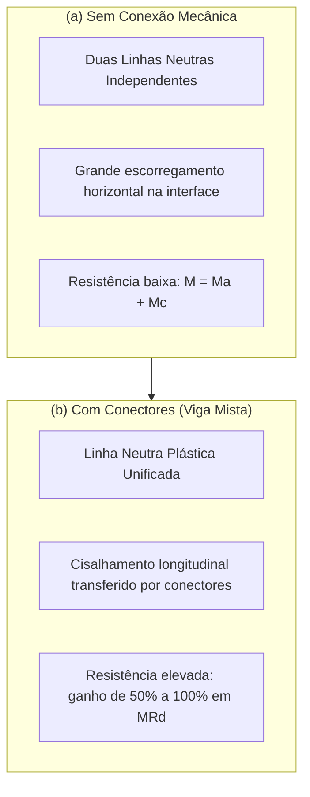
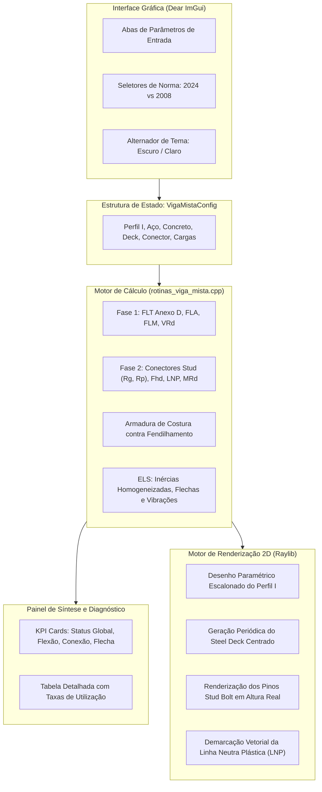
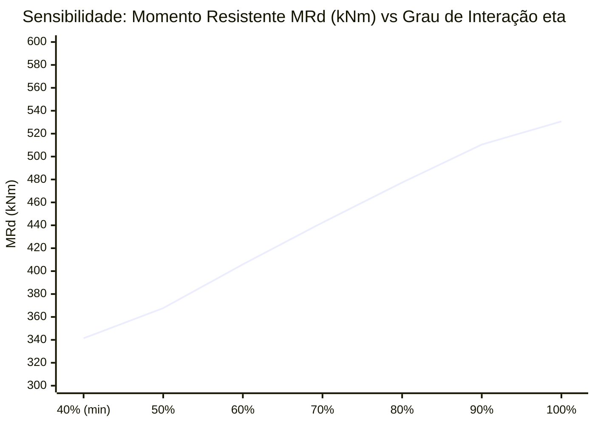

# DESENVOLVIMENTO DE FERRAMENTA COMPUTACIONAL PARA DIMENSIONAMENTO E VERIFICAÇÃO DE VIGAS MISTAS DE AÇO E CONCRETO SEGUNDO A ABNT NBR 8800:2024

---

## RESUMO

As vigas mistas de aço e concreto constituem uma das soluções estruturais mais eficientes e competitivas da construção civil contemporânea, conjugando sinergicamente a resistência à tração e ductilidade do aço estrutural com a elevada capacidade à compressão do concreto. Em edifícios de múltiplos pavimentos e pisos industriais, a tipologia mais recorrente é a viga biapoiada de alma cheia (seção I) associada a lajes maciças ou com fôrma de aço incorporada (*steel deck*), executada em regime construtivo não escorado. O dimensionamento seguro dessa tipologia é inerentemente multifásico: na concretagem (Fase 1), o perfil metálico isolado deve resistir sem contenção lateral às ações de peso próprio e cargas transitórias de montagem (estados de instabilidade por FLT, FLM, FLA e esforço cortante); após a cura do concreto (Fase 2), o conjunto opera como seção mista, mobilizando conectores de cisalhamento para resistir aos momentos fletores positivos e forças cortantes, além de exigir rigoroso controle de deformações no tempo infinito (fluência) e vibrações de piso. Este trabalho tem como objetivo geral desenvolver e validar uma ferramenta computacional interativa, de alto desempenho e código aberto em linguagem C++20, Raylib e Dear ImGui, capaz de realizar todas as verificações nos Estados Limites Últimos (ELU) e de Serviço (ELS) em conformidade estrita com a ABNT NBR 8800:2024. Como objetivo específico de destaque analítico, o trabalho estabelece um estudo comparativo detalhado entre a recente revisão normativa de 2024 e a edição histórica de 2008, quantificando o impacto de novos coeficientes de cortante ($k_v = 5{,}34$), fatores redutores de conectores em *steel deck* ($R_g$ e $R_p$) e limites de espaçamento, elucidando ainda com rigor mecânico o lapso de editoração presente na formulação do momento resistente no Caso b do Anexo L da versão de 2024. Estudos de caso comprovam a exatidão numérica dos algoritmos desenvolvidos frente à literatura técnica, consolidando uma plataforma moderna que estabelece as bases conceituais para futuras pesquisas em vigas mistas protendidas (VMP).

**Palavras-chave:** Vigas mistas aço-concreto; Ferramenta computacional; ABNT NBR 8800:2024; Construção não escorada; Conectores *stud bolt*; *Steel deck*; Equilíbrio plástico.

---

## ABSTRACT

Steel-concrete composite beams represent one of the most efficient and competitive structural systems in modern civil engineering, synergistically combining the tensile strength and ductility of structural steel with the high compressive capacity of concrete. In multi-story buildings and industrial floors, the most common typology is the simply supported solid-web I-girder associated with solid slabs or profiled steel decking, typically executed under unshored construction. The design of this typology is inherently multi-phased: during casting (Phase 1), the unbraced bare steel profile must support self-weight and construction loads alone (verifications of LTB, FLB, WLB, and shear); after concrete curing (Phase 2), the unified section acts compositely, mobilizing shear connectors to resist positive bending moments and shear forces, while requiring strict serviceability checks for long-term creep deflections and floor vibrations. The primary objective of this undergraduate thesis is to develop and validate a high-performance, open-source, interactive software in modern C++20, Raylib, and Dear ImGui, capable of executing all Ultimate Limit State (ULS) and Serviceability Limit State (SLS) design checks in strict compliance with ABNT NBR 8800:2024. As a prominent specific analytical objective, this research provides a comprehensive comparative investigation between the 2024 standard revision and the historical 2008 edition, quantifying the impacts of the updated shear buckling coefficient ($k_v = 5.34$), connector reduction factors ($R_g$ and $R_p$), and spacing limits, while rigorously demonstrating from first mechanical principles an editorial misprint identified in the Case b plastic moment formulation in Annex L of the 2024 code. Case studies validate the numerical precision of the proposed algorithms against benchmarks, establishing an engineering platform that prepares the foundation for future investigations into prestressed composite beams (PCB).

**Keywords:** Steel-concrete composite beams; Computational tool; ABNT NBR 8800:2024; Unshored construction; Stud bolt connectors; Profiled steel deck; Plastic equilibrium.

---

## LISTA DE SÍMBOLOS E NOTAÇÕES

- $A_a, A_c$: Área bruta da seção de aço e área da capa de concreto
- $A_{af}, A_{aw}$: Área da mesa superior e área da alma do perfil de aço ($h_w t_w$)
- $A_{cs}$: Área da seção transversal da haste do conector *stud bolt*
- $b, b_{ef}$: Espaçamento entre vigas e largura colaborante efetiva da laje
- $b_f, t_f$: Largura e espessura da mesa do perfil de aço
- $b_F, h_F$: Largura média e altura da nervura da fôrma de aço (*steel deck*)
- $C_{ad}$: Força resistente de cálculo da região comprimida do perfil de aço
- $C_{cd}$: Força resistente de cálculo da espessura comprimida da laje de concreto
- $d, t_w$: Altura total e espessura da alma do perfil de aço
- $d_{cs}, h_{cs}$: Diâmetro e altura nominal do conector *stud bolt* após a solda
- $E_a, E_{cs}$: Módulo de elasticidade do aço ($200.000\text{ MPa}$) e módulo secante do concreto
- $f_{ck}, f_{cd}$: Resistência característica e de cálculo do concreto à compressão ($f_{ck} / 1{,}40$)
- $f_y, f_{yd}$: Resistência ao escoamento característica e de cálculo do perfil de aço ($f_y / 1{,}10$)
- $f_u$: Resistência característica à tração do aço do pino conector ($420\text{ MPa}$)
- $F_{hd}$: Força horizontal total de cisalhamento longitudinal de cálculo na interface
- $I_a, I_{tr}, I_{ef}$: Momento de inércia do perfil de aço, da seção mista transformada e inércia efetiva
- $k_v$: Coeficiente de flambagem da alma por cisalhamento ($5{,}34$ em 2024; $5{,}00$ em 2008)
- $L, L_b$: Vão teórico da viga e comprimento destravado lateralmente na Fase 1
- $M_{cr}$: Momento fletor crítico de flambagem lateral com torção (FLT) pelo Anexo D
- $M_{pl,Rd}, M_{Rd}$: Momento fletor plástico e momento fletor resistente de cálculo da viga mista
- $M_{Sd1}, M_{Sd2}$: Momento fletor solicitante de cálculo na Fase 1 (construção) e Fase 2 (serviço)
- $n, n_{longo}$: Relações de modularidade elástica imediata ($E_a / E_{cs}$) e de longa duração ($3n$)
- $Q_{Rd}$: Capacidade resistente de cálculo de um conector de cisalhamento isolado
- $R_g, R_p$: Coeficientes normativos de efeito de grupo e de posição do conector
- $s, s_{\max}$: Espaçamento longitudinal adotado e limite máximo regulamentar entre conectores
- $t_c$: Espessura da laje maciça ou espessura da capa de concreto sobre a crista do *steel deck*
- $T_{ad}$: Força resistente de cálculo da região tracionada do perfil de aço
- $V_{pl}, V_{Rd}$: Força cortante de plastificação e força cortante resistente de cálculo da alma
- $y_c, y_t$: Distâncias dos centroides das partes comprimida e tracionada do perfil às suas faces
- $y_p$: Posição da Linha Neutra Plástica (LNP) medida a partir do topo do perfil de aço
- $\beta_{vm}$: Coeficiente de vinculação da viga mista ($1{,}00$ para vigas biapoiadas)
- $\delta_t, \delta_{lim}$: Flecha vertical total em serviço no tempo infinito e flecha limite regulamentar ($L/350$)
- $\eta, \eta_{\min}$: Grau de interação ao cisalhamento e grau mínimo regulamentar de projeto
- $\gamma_{a1}, \gamma_{a2}, \gamma_c, \gamma_{cs}$: Coeficientes de ponderação das resistências ($1{,}10;\ 1{,}25;\ 1{,}40;\ 1{,}25$)

---

# CAPÍTULO 1: INTRODUÇÃO

## 1.1 Contextualização
Nos projetos de edifícios comerciais, residenciais e plantas industriais de estrutura metálica, a laje de concreto deixou de ser tratada como um mero componente secundário de piso que transfere cargas de gravidade para as vigas de apoio. Quando o perfil metálico laminado ou soldado é ligado à laje através de conectores de cisalhamento, os dois materiais passam a atuar solidariamente em regime de flexão mista.

A física desse arranjo estrutural é amplamente vantajosa: o concreto, material de baixo custo com notável capacidade de compressão, passa a formar a mesa superior colaborante da viga mista. Em contrapartida, o perfil de aço, dotado de alta resistência à tração e ductilidade, opera tracionado no bordo inferior. Essa cooperação afasta o centroide das forças internas, aumentando substancialmente o braço de alavanca resistente e elevando o momento de inércia da seção em mais de 150% a 250% com praticamente o mesmo consumo de aço estrutural.

A solução mais disseminada na prática da engenharia de estruturas no Brasil é a **viga mista biapoiada de alma cheia em perfil I**, operando sob momentos positivos em pavimentos de piso. A laje de piso pode ser concebida como laje maciça moldada no local ou, de forma largamente majoritária, através de fôrmas de aço incorporadas (*steel deck*).

## 1.2 Justificativa e Motivação
Apesar de sua consagrada eficiência estrutural, o dimensionamento de vigas mistas de piso encerra um encadeamento de verificações complexo, sensível e estritamente **multifásico**, especialmente quando executado em **construção não escorada** (situação padrão em edifícios para eliminar escoramentos provisórios e acelerar os cronogramas de obra):

1. **Fase 1 (Construção Não Escorada):** Antes da cura do concreto, o perfil de aço atua de forma isolada, suportando seu peso próprio, o peso da fôrma, o concreto fresco fluido e as sobrecargas transitórias de montagem e operários. Sem o travamento lateral contínuo que a laje endurecida proporcionará posteriormente, a mesa superior comprimida do aço fica suscetível a graves estados-limite de instabilidade, exigindo verificação de Flambagem Lateral com Torção (FLT), Flambagens Locais (FLM e FLA) e esforço cortante na alma;
2. **Fase 2 (Seção Mista Consolidada):** Após o ganho de resistência do concreto ($f_{ck}$), os conectores tipo pino com cabeça (*stud bolt*) passam a transferir o cisalhamento longitudinal na interface. O comportamento à flexão é regido por análises plásticas não lineares (posição da Linha Neutra Plástica na laje, na mesa ou na alma do aço) ou elásticas com superposição de tensões por estágios construtivos em seções semicompactas;
3. **Estados Limites de Serviço e Durabilidade:** A flexibilidade e esbeltez das vigas mistas impõem controle rigoroso de flechas verticais considerando a fluência de longo prazo do concreto ($3n$) e a perda de rigidez por interação parcial ($\sqrt{\eta}$), além da verificação da armadura transversal de costura para evitar o fendilhamento longitudinal do concreto ao redor dos conectores.

Em projetos convencionais de engenharia, a verificação manual ou por planilhas eletrônicas rudimentares desse encadeamento multifásico costuma ser lenta, propensa a erros de transcrição e desprovida de retorno visual imediato. Torna-se imperativo, portanto, o desenvolvimento de ferramentas computacionais dedicadas, rápidas e transparentes, dotadas de interface gráfica interativa e renderização em tempo real, que permitam ao projetista avaliar instantaneamente a sensibilidade estrutural a mudanças de geometria, orientação da fôrma de *steel deck* e grau de interação dos conectores.

Adicionalmente, a recente publicação da **ABNT NBR 8800:2024** trouxe modificações fundamentais em relação ao texto de 2008 (cortante da alma com $k_v = 5{,}34$, separação analítica de conectores em $R_g$ e $R_p$, novos limites de espaçamento e atualização do cálculo de FLT no Anexo D). Integrar essas revisões em um software especializado e investigar criticamente suas equações e lapsos de editoração enriquece a formação de engenharia e supre uma lacuna evidente no ferramental tecnológico nacional.

## 1.3 Objetivos

### 1.3.1 Objetivo Geral
Desenvolver e validar uma ferramenta computacional interativa, em linguagem moderna C++20 com motor gráfico procedural em Raylib e interface gráfica Dear ImGui, para o dimensionamento e a verificação completa de vigas mistas de aço e concreto biapoiadas de alma cheia (seção I), sob momentos fletores positivos e forças cortantes em regime construtivo não escorado, em estrita conformidade com as diretrizes da ABNT NBR 8800:2024.

### 1.3.2 Objetivos Específicos
1. **Formulação do Motor de Cálculo Multifásico:** Implementar os algoritmos de cálculo para a verificação do perfil isolado de aço na Fase 1 (FLT pelo Anexo D da NBR 8800:2024, flambagens locais da mesa e alma, e cortante puro) e da seção mista consolidada na Fase 2 (equilíbrio plástico da seção compacta, verificação elástica de tensões para seções semicompactas, armadura de costura contra fendilhamento e flechas com fluência em tempo infinito);
2. **Dimensionamento Paramétrico da Conexão de Cisalhamento:** Automatizar a determinação da capacidade resistente de conectores *stud bolt* para lajes maciças e fôrmas *steel deck*, incorporando os coeficientes de grupo ($R_g$) e de posição ($R_p$), a verificação do grau mínimo de interação ($\eta_{\min}$) e as salvaguardas de espaçamento ($s_{\min}$ e $s_{\max}$);
3. **Análise Comparativa Evolutiva da Norma (2008 vs. 2024):** Mapear e quantificar o impacto prático das alterações introduzidas pela revisão ABNT NBR 8800:2024 em relação à ABNT NBR 8800:2008 (coeficiente de flambagem por cisalhamento $k_v$, fatores $R_g$ e $R_p$, limites de espaçamento longitudinal) e **elucidar matematicamente a gralha tipográfica identificada na fórmula de momento fletor resistente do Caso b do Anexo L na edição de 2024**;
4. **Implementação de Interface Gráfica e Visualização Paramétrica em Tempo Real:** Criar um ambiente visual dinâmico a 60 quadros por segundo, apresentando o desenho geométrico em corte transversal da seção mista, o alinhamento centralizado periódico das nervuras do *steel deck*, a penetração real dos conectores e a exibição gráfica da Linha Neutra Plástica (LNP);
5. **Validação Numérica por Estudos de Caso:** Confrontar os resultados numéricos produzidos pelo software desenvolvido com referenciais teóricos consolidados da literatura técnica brasileira (manuais CBCA, dissertações e artigos especializados), avaliando lajes maciças, *steel deck* com nervuras transversais e longitudinais, e sensibilidade do grau de interação;
6. **Fundamentação para Pesquisa de Pós-Graduação:** Estruturar a arquitetura modular do código-fonte para servir de alicerce e núcleo algorítmico à futura dissertação de mestrado do autor sobre **Vigas Mistas Protendidas (VMP)** aplicadas a pontes e grandes vãos.

## 1.4 Estrutura do Trabalho
O trabalho é dividido em cinco capítulos estruturados:
- **Capítulo 2:** Fundamentação teórica do comportamento misto aço-concreto, requisitos dos sistemas de laje, prescrições da ABNT NBR 8800:2024 para as Fases 1 e 2, e quadro comparativo analítico entre as edições de 2008 e 2024;
- **Capítulo 3:** Apresentação da arquitetura do software, fluxo de execução, tecnologias adotadas (C++20, Raylib, ImGui) e formalização algorítmica sob a forma de quatro pseudocódigos estruturados;
- **Capítulo 4:** Resultados e discussões a partir de seis estudos de caso e análises paramétricas de sensibilidade de vão, sistemas de laje e graus de interação;
- **Capítulo 5:** Conclusões do trabalho e diretrizes para a continuidade da pesquisa em vigas mistas protendidas (VMP).

---

# CAPÍTULO 2: FUNDAMENTAÇÃO TEÓRICA E PRESCRIÇÕES NORMATIVAS

## 2.1 Mecânica da Viga Mista e Ação Composta
Uma viga de piso sem conexão mecânica entre a mesa superior de aço e a laje de concreto atua sob regime de elementos superpostos independentes. Ao fletir, a face inferior da laje sofre alongamento, enquanto a face superior do perfil de aço encurta, originando uma descontinuidade cinemática (escorregamento relativo horizontal $s$) na interface de contato. Nessa condição, a capacidade do conjunto é simplesmente a soma das resistências individuais de cada peça, com pequena contribuição da laje delgada.

Ao soldar conectores de cisalhamento ao longo da mesa de aço, o escorregamento relativo é restringido. A seção transversal passa a operar com um eixo neutro global único que migra para as proximidades da laje de concreto. As tensões de tração concentram-se no aço e as de compressão na laje, aumentando exponencialmente o braço interno de alavanca $z$ e a rigidez à flexão da viga.

A parcela de laje de concreto que participa eficazmente do binário de flexão é restrita pelo fenômeno de atraso de cisalhamento (*shear lag*). A ABNT NBR 8800:2024 (item L.6.2) define a largura efetiva colaborante ($b_{ef}$) para vigas biapoiadas simétricas por:

$$b_{ef} = \min\left(\frac{L}{8},\; \frac{d_{esq}}{2}\right) + \min\left(\frac{L}{8},\; \frac{d_{dir}}{2}\right)$$

Para vigas internas com espaçamento entre vigas adjacentes $b = d_{esq} = d_{dir}$, a largura efetiva é expressa como $b_{ef} = \min(L/4,\; b)$.



## 2.2 Sistemas de Laje e Orientação das Nervuras
A NBR 8800:2024 prevê quatro sistemas construtivos de laje para vigas mistas:
1. **Laje Maciça de Concreto:** Moldada integralmente no canteiro sobre fôrmas de madeira compensada. Permite espessura livre e aceita conectores tipo pino (*stud bolt*) ou perfil U laminado/dobrado. Exige escoramento provisório e fôrmas descartáveis;
2. **Laje Mista com Fôrma de Aço Incorporada (*Steel Deck*):** Utiliza chapa perfilada de aço galvanizado que atua simultaneamente como plataforma de trabalho na montagem, fôrma estanque na concretagem e armadura positiva de tração na fase de serviço. A NBR 8800:2024 impõe altura máxima da nervura $h_F \le 75\text{ mm}$, diâmetro de pino $d_{cs} \le 19\text{ mm}$ e penetração mínima de $40\text{ mm}$ do pino dentro da capa de concreto sobre a crista da fôrma;
3. **Lajes com Pré-lajes de Concreto:** Elementos pré-moldados delgados de concreto armado ou protendido com capeamento moldado no local;
4. **Lajes Alveolares Pré-moldadas:** Painéis protendidos com vazios internos alvéolares solidarizados por capa estrutural moldada *in loco*.

### Orientação das Nervuras do Steel Deck: Transversais vs. Longitudinais
A orientação geométrica da fôrma de *steel deck* em relação ao eixo da viga de aço altera radicalmente a mecânica da interface:
- **Nervuras Transversais (Perpendiculares ao Eixo da Viga):** As ondas da fôrma correm perpendicularmente à viga. As cristas de aço interrompem o concreto inferior no sentido do vão da viga mista. Os conectores ficam confinados individualmente dentro das nervuras de concreto transversais. Como o concreto nas nervuras é descontínuo no sentido do vão ($\sigma_x \approx 0$), a norma **proíbe** computar o concreto abaixo da crista no cálculo de $M_{Rd}$ e de $I_{tr}$, utilizando-se exclusivamente a espessura da capa $t_c$ situada acima da chapa;
- **Nervuras Longitudinais (Paralelas ao Eixo da Viga):** As ondas correm paralelas ao eixo da viga. Um fundo de nervura assenta continuamente sobre a mesa de aço, formando uma calha ou "caminho livre" contínuo de concreto de ponta a ponta do vão onde os conectores são soldados. A norma permite a consideração do concreto na nervura, porém a prática corrente brasileira de projeto adota conservadoramente a capa $t_c$ a favor da segurança.

## 2.3 Fase 1: Perfil de Aço Isolado em Construção Não Escorada
Na construção não escorada, a viga de aço suporta sozinha todas as cargas gravíticas até que o concreto atinja $0{,}75 f_{ck}$. O esforço solicitante de cálculo da Fase 1 é determinado por:

$$q_{Sd1} = 1{,}25 \cdot g_1 + 1{,}30 \cdot q_1$$

$$M_{Sd1} = \frac{q_{Sd1} \cdot L^2}{8}, \quad V_{Sd1} = \frac{q_{Sd1} \cdot L}{2}$$

A resistência à flexão do perfil de aço isolado ($M_{Rd,aço}$) é governada pelo menor valor entre a Flambagem Lateral com Torção (FLT), Flambagem Local da Mesa (FLM) e Flambagem Local da Alma (FLA). O momento crítico elástico de FLT é calculado com a formulação rigorosa do Anexo D da ABNT NBR 8800:2024:

$$M_{cr} = \frac{C_b \pi^2 E_a I_y}{L_b^2} \sqrt{\frac{C_w}{I_y} \left(1 + 0{,}039 \frac{J L_b^2}{C_w}\right)}$$

Para perfis compactos com $M_{cr} \ge 0{,}70 W_x f_y$, o momento resistente é dado por:

$$M_{Rd,aço} = \frac{1}{\gamma_{a1}} \min\left[ Z_x f_y,\; C_b \left( Z_x f_y - (Z_x f_y - 0{,}70 W_x f_y) \frac{L_b - L_p}{L_r - L_p} \right) \right]$$

A resistência ao esforço cortante na Fase 1 é conferida pela alma do perfil:

$$V_{pl} = 0{,}60 \cdot f_y \cdot d \cdot t_w$$

$$\lambda_w = \frac{h_w}{t_w}, \quad \lambda_p = 1{,}10 \sqrt{\frac{k_v E_a}{f_y}}$$

Para $\lambda_w \le \lambda_p$, tem-se $V_{Rd} = V_{pl} / \gamma_{a1}$.

## 2.4 Fase 2: Flexão Positiva da Seção Mista ($M_{Rd}$)
Para seções compactas em regime de momento positivo, a NBR 8800:2024 adota o **Modelo de Equilíbrio Plástico**, assumindo plastificação plena dos materiais sob distribuição retangular de tensões:
- Tração máxima mobilizável pelo perfil metálico:
  $$F_a = A_a \cdot \left(\frac{f_y}{\gamma_{a1}}\right)$$
- Compressão máxima mobilizável pela laje de concreto:
  $$F_c = 0{,}85 \cdot \eta_c \cdot \left(\frac{f_{ck}}{\gamma_c}\right) \cdot b_{ef} \cdot t_c$$
  *(onde $\eta_c = 1{,}00$ para $f_{ck} \le 50\text{ MPa}$)*
- Força rasante horizontal efetiva transmitida pela conexão:
  $$F_{hd} = \min\left(F_a,\; F_c,\; \sum Q_{Rd}\right)$$

A profundidade comprimida do bloco de concreto ($a$) e a posição da Linha Neutra Plástica ($y_p$) dividem-se em três casos:

### Caso A: Linha Neutra Plástica na Laje de Concreto ($F_c \ge F_a$ com $\eta = 1{,}0$)
A laje suporta toda a compressão necessária para equilibrar a tração plena do aço:

$$a = \frac{F_a}{0{,}85 \, \eta_c \, f_{cd} \, b_{ef}} \le t_c$$

Todo o perfil de aço encontra-se tracionado a $f_{yd}$. O momento fletor resistente resulta diretamente do braço de alavanca entre as resultantes:

$$M_{Rd} = \beta_{vm} \cdot F_a \cdot \left( \frac{d}{2} + h_F + t_c - \frac{a}{2} \right)$$

### Caso B: Linha Neutra Plástica no Perfil de Aço ($F_a > F_c$ ou Interação Parcial)
Quando a laje atinge sua espessura total comprimida ($a = t_c$) e não equilibra a tração total do aço, a LNP penetra na seção metálica. Uma parcela de área do perfil com compressão $C_{ad}$ equilibra a diferença:

$$C_{cd} = 0{,}85 \, \eta_c \, f_{cd} \, b_{ef} \, t_c \quad (\text{ou } \sum Q_{Rd} \text{ se interação parcial})$$

$$C_{ad} = \frac{F_a - C_{cd}}{2}, \quad T_{ad} = C_{cd} + C_{ad}$$

- **LNP na Mesa Superior ($C_{ad} \le b_f t_f f_{yd}$):**
  $$y_p = \frac{C_{ad}}{b_f \cdot f_{yd}} \le t_f$$
- **LNP na Alma ($C_{ad} > b_f t_f f_{yd}$):**
  $$y_p = t_f + \frac{C_{ad} - b_f t_f f_{yd}}{t_w \cdot f_{yd}}$$

O momento fletor resistente é obtido pelo equilíbrio de momentos internos em relação ao ponto de aplicação da tração $T_{ad}$:

$$M_{Rd} = \beta_{vm} \left[ C_{ad} (d - y_t - y_c) + C_{cd} \left(\frac{t_c}{2} + h_F + d - y_t\right) \right]$$

---

## 2.5 Investigação Crítica e Elucidação da Gralha Tipográfica no Caso B da NBR 8800:2024

> [!CAUTION]
> **Identificação de Inconsistência Tipográfica Formal na ABNT NBR 8800:2024:**
> Na publicação oficial da ABNT NBR 8800:2024 (item L.6.3.1.1.1-b, página 225), a equação para o momento resistente no Caso b foi impressa como:
> $$M_{Rd} = \beta_{vm} \left[ \mathbf{\sum Q_{Rd}} \, (d - y_t - y_c) + C_{cd} \left(\frac{t_c}{2} + h_F + d - y_t\right) \right]$$

Uma análise analítica rigorosa demonstra que o termo $\sum Q_{Rd}$ trata-se de um **lapso tipográfico de editoração (gralha material)** e que a grandeza correta é **$C_{ad}$**, tal como constava na edição de 2008 e conforme mantido no item c de 2024. As razões mecânicas irrefutáveis são:

1. **Incompatibilidade Espacial e Mecânica dos Conectores:** O braço de alavanca $(d - y_t - y_c)$ representa a distância interna entre o centroide da parte comprimida do perfil de aço ($y_c$) e o centroide da parte tracionada do aço ($y_t$). Os conectores de cisalhamento ($\sum Q_{Rd}$) estão situados na interface mesa-laje, **fora do perfil de aço**, não existindo nenhuma força cisalhante transmitida entre essas duas regiões internas do aço pelos pinos;
2. **Violação do Limite Plástico (*Reductio ad absurdum*):** No Caso b sob interação completa, tem-se por definição $\sum Q_{Rd} \ge C_{cd}$. Se um projetista adotasse conectores superdimensionados (ex: $\sum Q_{Rd} = 3000\text{ kN}$), enquanto a compressão da mesa é apenas $C_{ad} = 200\text{ kN}$, o valor de $M_{Rd}$ calculado pela equação com $\sum Q_{Rd}$ explodiria para valores fisicamente impossíveis, violando a capacidade resistente intrínseca do aço;
3. **Contradição Interna com a Alínea c:** Na alínea c subsequente (L.6.3.1.1.1-c, página 225), para interação parcial com LNP no perfil, a própria NBR 8800:2024 escreve a fórmula corretamente com **$C_{ad} (d - y_t - y_c)$**;
4. **Substituição Acidental de Texto (Ctrl+H):** Na alínea c, a frase original de 2008 que dizia *"para determinação de $C_{ad}$, $T_{ad}$ e $y_p$"* foi impressa em 2024 como *"para a determinação de $\sum Q_{Rd}$, $T_{ad}$ e $y_p$"*, evidenciando que uma substituição global inadvertida de cadeias de caracteres substituiu $C_{ad}$ por $\sum Q_{Rd}$ nos locais errados.

Portanto, para manter a fidelidade aos princípios da Mecânica das Estruturas e a segurança dos projetos, o algoritmo deste trabalho adota a formulação física estrita com **$C_{ad}$**.

---

## 2.6 Conexão de Cisalhamento por Pinos com Cabeça (*Stud Bolt*)
A resistência de cálculo de um pino conector com cabeça soldado à mesa é dada por:

$$Q_{Rd} = \min\left( Q_{Rd1},\; Q_{Rd2} \right)$$

$$Q_{Rd1} = \frac{A_{cs} \sqrt{f_{ck} E_{cs}}}{2 \gamma_{cs}} \cdot R_g \cdot R_p, \quad Q_{Rd2} = \frac{A_{cs} f_u}{\gamma_{cs}} \cdot R_g \cdot R_p$$

### Coeficientes Redutores $R_g$ e $R_p$ da NBR 8800:2024
A edição de 2024 inovou ao substituir o fator genérico anterior pelos parâmetros específicos:
- **$R_g$ (Efeito de Grupo):**
  - Laje maciça: $R_g = 1{,}00$;
  - *Steel deck* com nervuras perpendiculares: $R_g = 1{,}00$ (1 pino/nervura); $0{,}85$ (2 pinos); $0{,}70$ ($\ge 3$ pinos);
  - *Steel deck* com nervuras paralelas: $R_g = 1{,}00$ se $b_F / h_F \ge 1{,}50$; caso contrário $0{,}85$.
- **$R_p$ (Posição do Pino na Nervura):**
  - Laje maciça: $R_p = 1{,}00$ (na norma de 2008 era $0{,}75$);
  - *Steel deck* com nervuras perpendiculares: $R_p = 0{,}75$ (posição favorável ou $h_{cs} - h_F \ge 50\text{ mm}$); $0{,}60$ (desfavorável);
  - *Steel deck* com nervuras paralelas: $R_p = 0{,}75$ se $b_F / h_F \ge 1{,}50$; caso contrário $0{,}60$.

### Grau Mínimo de Interação ($\eta_{\min}$) e Espaçamentos
Para garantir a ductilidade da viga e evitar a ruptura prematura dos conectores, o grau de interação ($\eta = N / N_c$) deve obedecer ao limite inferior da NBR 8800:2024:

$$\eta \ge \eta_{\min} = \begin{cases} 0{,}40, & \text{para } L \le 10{,}0\text{ m} \\ 0{,}50, & \text{para } L > 10{,}0\text{ m} \end{cases}$$

Os limites de espaçamento longitudinal são:
- Mínimo: $s_{\min} = 6 \cdot d_{cs}$ ($114\text{ mm}$ para pino de $19\text{ mm}$);
- Máximo: $s_{\max} = 8 \cdot (t_c + h_F)$ para NBR 8800:2024 em laje maciça, ou $\min(8 h_t, 800\text{ mm})$ para *steel deck* e norma de 2008.

## 2.7 Armadura de Costura contra Fendilhamento Longitudinal
A força de cisalhamento longitudinal transmitida pelos conectores gera trações transversais na base da laje de concreto que podem causar o fendilhamento longitudinal ao longo da linha dos pinos. A NBR 8800:2024 (item L.5.3) exige a verificação das bielas comprimidas e o cálculo de armadura transversal de costura ($A_{sf} / s_f$):

$$\nu_{Sd} = \frac{F_{hd}}{L/2}$$

$$\nu_{Rd,\max} = 0{,}20 \cdot \left(\frac{f_{ck}}{\gamma_c}\right) \cdot t_c \cdot 1000 \quad [\text{kN/m}]$$

$$A_{sf} = \frac{\nu_{Sd} \cdot 1000}{f_{yd,arm}} \quad [\text{cm}^2/\text{m}]$$

## 2.8 Estados Limites de Serviço: Flechas com Fluência no Tempo Infinito
O cálculo da flecha total em tempo infinito considera a rigidez elástica nos dois estágios construtivos:
1. **Fase 1 (Viga de Aço Isolada):** Cargas $g_1$ e $q_1$ aplicadas sobre o momento de inércia do perfil metálico $I_a$:
   $$\delta_1 = \frac{5 \cdot (g_1 + q_1) \cdot L^4}{384 \cdot E_a \cdot I_a}$$
2. **Fase 2 (Seção Mista com Fluência):** Cargas de longa duração ($g_2$) aplicadas sobre a inércia homogeneizada com $n_{longo} = 3 \cdot n$, e cargas variáveis de curta duração ($q_2$) sobre a inércia imediata com $n = E_a / E_{cs}$:
   $$I_{ef} = I_a + \sqrt{\eta} \cdot (I_{tr} - I_a)$$
   $$\delta_2 = \delta_{g2}(I_{ef,longo}) + \delta_{q2}(I_{ef,curto})$$
3. **Flecha Total em Serviço:** $\delta_{total} = \delta_1 + \delta_2 \le \delta_{lim} = L / 350$.

---

## 2.9 Quadro Síntese: Comparativo Analítico NBR 8800:2008 vs. NBR 8800:2024

| Parâmetro Normativo | ABNT NBR 8800:2008 | ABNT NBR 8800:2024 | Impacto Prático no Projeto |
| :--- | :---: | :---: | :--- |
| **Flambagem por Cortante ($k_v$)** | $k_v = 5{,}00$ | $k_v = 5{,}34$ | Aumento de **$+3{,}3\%$** no limite de plastificação ao cortante $\lambda_p$ da alma |
| **Conectores em Laje Maciça ($R_p$)** | $R_p = 0{,}75$ | $R_p = 1{,}00$ | Aumento de **$+33{,}3\%$** na capacidade do pino em laje maciça ($Q_{Rd}$) |
| **Conectores em Steel Deck** | Fator genérico $q_{rr}$ | Decomposição em $R_g$ e $R_p$ | Refinamento físico baseado na geometria da fôrma e número de pinos |
| **Espaçamento Máximo ($s_{\max}$)** | $\le 8 \cdot h_t \le 800\text{ mm}$ | $\le 8 \cdot h_t$ (sem teto de $800\text{ mm}$ p/ maciça) | Maior flexibilidade no detalhamento de vigas com lajes espessas |
| **Flambagem Lateral Torção (FLT)** | Formulação histórica clássica | Anexo D harmonizado ao AISC 360-22 | Maior rigor nos fatores de esbeltez e momento crítico $M_{cr}$ |
| **Grau Mínimo de Interação ($\eta_{\min}$)** | $\eta \ge 0{,}40$ (vãos $\le 10\text{ m}$) | $\eta \ge 0{,}40$ ($L \le 10\text{ m}$) e $0{,}50$ ($L > 10\text{ m}$) | Exigência explícita de maior ductilidade para vãos maiores |

---

# CAPÍTULO 3: DESENVOLVIMENTO DA FERRAMENTA COMPUTACIONAL

## 3.1 Arquitetura de Software e Tecnologias
A ferramenta computacional foi desenvolvida sob o paradigma de engenharia de software de alto desempenho, adotando uma separação estrita entre o motor matemático de cálculo analítico e o subsistema de interface gráfica e renderização:

- **Linguagem C++20:** Compilada nativamente com Clang / GCC MinGW64, garantindo tipagem forte, precisão numérica em ponto flutuante de 64 bits (`double`) e tempos de ciclo de cálculo inferiores a $0{,}1\text{ ms}$;
- **Raylib Core (OpenGL):** Responsável pela renderização paramétrica 2D da seção mista, mapeamento geométrico das fibras em escala e desenho vetorial em tempo real;
- **Dear ImGui (Immediate Mode GUI):** Interface com abas organizadas por disciplinas (*Perfil de Aço*, *Laje & Deck*, *Stud Bolts*, *Vão & Cargas*), menus suspensos, barras de progresso dinâmicas e sincronização de dados biunívoca.



---

## 3.2 Formalização Algorítmica em Pseudocódigos

### Algoritmo 1: Verificação da Fase 1 (Perfil Isolado Não Escorado)
```text
ALGORITMO: Verificar_Fase1_Perfil_Isolado
ENTRADA:
    Perfil (d, bf, tf, tw, Ag, Ix, Iy, Wx, Zx, Cw, It, lbw),
    Aço (fy, E), Geometria (L, Lb), Cargas (g1, q1), Norma (2024 ou 2008)
SAÍDA:
    Estrutura ResultadoFase1Perfil (MSd1, MRd_aco, VSd1, VRd, Taxas, Aprovado)

1. Cargas e Esforços Solicitantes da Fase 1:
      qSd1 ← 1.25 * g1 + 1.30 * q1
      MSd1 ← (qSd1 * L^2) / 8.0
      VSd1 ← (qSd1 * L) / 2.0

2. Momento Crítico Elástico de FLT (Anexo D):
      Cb ← 1.00
      termo1 ← (Cb * π^2 * E * Iy) / (Lb^2)
      termo2 ← sqrt((Cw / Iy) * (1.0 + 0.039 * (It * Lb^2 / Cw)))
      Mcr ← termo1 * termo2

3. Resistência ao Momento Fletor (MRd_aco):
      Mpl ← Zx * fy
      SE Norma == NBR8800_2024 ENTÃO:
          λ ← sqrt(Mpl / Mcr)
          SE λ <= 0.20 ENTÃO:
              MRd_aco ← Mpl / 1.10
          SENÃO SE λ <= 1.40 ENTÃO:
              MRd_aco ← (Mpl / 1.10) * (1.0 - 0.5 * (λ - 0.20) / 1.20)
          SENÃO:
              MRd_aco ← (0.90 / (λ^2)) * (Mpl / 1.10)
      SENÃO (NBR8800_2008):
          Calcular MRd por limites clássicos Lp e Lr

4. Esforço Cortante Resistente da Alma (VRd):
      kv ← (Norma == NBR8800_2024) ? 5.34 : 5.00
      λp ← 1.10 * sqrt(kv * E / fy)
      Vpl ← 0.60 * fy * d * tw
      SE lbw <= λp ENTÃO:
          VRd ← Vpl / 1.10
      SENÃO:
          VRd ← (λp / lbw) * (Vpl / 1.10)

5. Taxas e Status:
      taxa_M ← MSd1 / MRd_aco;  taxa_V ← VSd1 / VRd
      Aprovado ← (taxa_M <= 1.00) E (taxa_V <= 1.00)
      RETORNAR ResultadoFase1Perfil
```

---

### Algoritmo 2: Dimensionamento de Conectores Stud Bolt e Fatores $R_g$ / $R_p$
```text
ALGORITMO: Calcular_Conectores_Stud_Bolt
ENTRADA:
    Pino (d_cs, h_cs, fu, n_linha), Concreto (fck, Ecs),
    Laje (tipo, orientacao, tc, hF, bF), Perfil (tf), Geometria (L, bef), Norma
SAÍDA:
    Estrutura ResultadoConectoresStud (QRd, Fhd, N_total, eta, Aprovado)

1. Área e Capacidade Base do Pino:
      Acs ← π * (d_cs^2) / 4.0
      Q_aco ← (Acs * fu) / 1.25
      Q_conc ← (Acs * sqrt(fck * Ecs)) / (2.0 * 1.25)
      QRd_base ← min(Q_aco, Q_conc)

2. Fatores Redutores Rg e Rp:
      SE Laje.tipo == MACICA ENTÃO:
          Rg ← 1.00
          Rp ← (Norma == NBR8800_2024) ? 1.00 : 0.75
      SENÃO (STEEL_DECK):
          SE Laje.orientacao == PERPENDICULAR ENTÃO:
              Rg ← (n_linha == 1) ? 1.00 : ((n_linha == 2) ? 0.85 : 0.70)
              h_livre ← h_cs - hF
              Rp ← (h_livre >= 50.0) ? 0.75 : 0.60
          SENÃO (PARALELA):
              Rg ← 1.00
              relacao ← (hF > 0.0) ? (bF / hF) : 2.0
              Rp ← (relacao >= 1.50) ? 0.75 : 0.60

3. Capacidade Unitária Adotada:
      QRd ← min(Q_conc, QRd_base * Rg * Rp)

4. Força Rasante Horizontal da Interface:
      Fa ← Ag * (fy / 1.10)
      Fc ← 0.85 * (fck / 1.40) * bef * tc
      Fhd_limite ← min(Fa, Fc)

5. Quantidade de Pinos e Grau de Interação:
      N_semi ← TETO(Fhd_limite / QRd)
      N_total ← 2 * N_semi
      eta ← min(1.00, (N_semi * QRd) / Fhd_limite)
      eta_min ← (L <= 10000.0) ? 0.40 : 0.50

6. Verificações Geométricas de Montagem:
      s_min ← 6.0 * d_cs
      s_max ← (Norma == NBR8800_2024 E Laje.tipo == MACICA) ? (8.0 * (tc + hF)) : min(8.0 * (tc + hF), 800.0)
      h_min ← (Laje.tipo == STEEL_DECK) ? (hF + 40.0) : (4.0 * d_cs)
      cobrimento ← (tc + hF) - h_cs
      Valida ← (eta >= eta_min) E (h_cs >= h_min) E (cobrimento >= 10.0) E (d_cs <= 2.5 * tf)

7. RETORNAR ResultadoConectoresStud
```

---

### Algoritmo 3: Equilíbrio Plástico e Momento Fletor Resistente ($M_{Rd}$)
```text
ALGORITMO: Calcular_Momento_Fletor_Misto_ELU
ENTRADA:
    Perfil (d, bf, tf, tw, Ag, Zx), Aço (fy), Concreto (fck, tc),
    Laje (hF, bF, orientacao), Conectores (Fhd, eta, QRd, N_semi), Geometria (L, bef, binf), Cargas
SAÍDA:
    Estrutura ResultadoMomentoMisto (MSd2, MRd, yp, Posicao_LNP, Aprovado)

1. Cargas e Esforços Solicitantes da Fase 2:
      g1_tot ← Peso_Perfil + q_laje_fresco * binf
      g2_tot ← g_revestimento * binf
      q2_tot ← q_uso * binf
      qSd2 ← 1.40 * (g1_tot + g2_tot) + 1.50 * q2_tot
      MSd2 ← (qSd2 * L^2) / 8.0

2. Capacidades de Cálculo:
      fyd ← fy / 1.10;  fcd ← fck / 1.40
      Fa ← Ag * fyd
      Fc_max ← 0.85 * fcd * bef * tc
      Fhd_efetiva ← min(Fa, min(Fc_max, N_semi * QRd))

3. Determinação da Posição da LNP:
      SE Fhd_efetiva >= Fa E eta >= 0.999 ENTÃO:
          // CASO A: LNP na Laje de Concreto
          a ← Fa / (0.85 * fcd * bef)
          yp ← 0.0
          Posicao_LNP ← "LAJE"
          braco_z ← (d / 2.0) + hF + tc - (a / 2.0)
          MRd ← Fa * braco_z
      SENÃO:
          // CASO B: LNP no Perfil de Aço
          a ← Fhd_efetiva / (0.85 * fcd * bef)
          Ccd ← Fhd_efetiva
          Cad ← (Fa - Ccd) / 2.0  // EQUAÇÃO MECÂNICA EXATA (C_ad)
          Tad ← Ccd + Cad
          C_mesa_max ← bf * tf * fyd

          SE Cad <= C_mesa_max ENTÃO:
              yp ← Cad / (bf * fyd)
              Posicao_LNP ← "MESA"
              yc ← yp / 2.0
              yt ← (Ag * (d/2.0) - (bf * yp * yc)) / (Ag - bf * yp)
          SENÃO:
              yp ← tf + (Cad - C_mesa_max) / (tw * fyd)
              Posicao_LNP ← "ALMA"
              Calcular centroides yc e yt por decomposição de áreas

          MRd ← Cad * (d - yt - yc) + Ccd * ((tc / 2.0) + hF + d - yt)

4. Taxa e Status:
      Aprovado ← (MSd2 <= MRd)
      RETORNAR ResultadoMomentoMisto
```

---

### Algoritmo 4: Geração Procedural e Centrada das Nervuras do Steel Deck
```text
ALGORITMO: Renderizar_Steel_Deck_Centrado_Raylib
ENTRADA:
    centro_x, x_esq_laje, x_dir_laje, y_topo_aco, y_crista_deck, y_topo_laje,
    passo, bF, hF, w_rampa, w_fundo
SAÍDA:
    Polígonos preenchidos de concreto e chapa galvanizada traçada na tela

1. Função Lambda de Perfil Periódico da Chapa:
      FUNÇÃO avaliar_y_chapa(x):
          dx ← x - centro_x
          u ← fmod(dx + passo * 0.5, passo)
          SE u < 0 ENTÃO u ← u + passo
          u ← u - passo * 0.5
          abs_u ← abs(u)
          meio_fundo ← w_fundo * 0.5

          SE abs_u <= meio_fundo ENTÃO:
              RETORNAR y_topo_aco   // Fundo plano centrado na mesa
          SENÃO SE abs_u <= meio_fundo + w_rampa ENTÃO:
              t ← (abs_u - meio_fundo) / w_rampa
              RETORNAR y_topo_aco - t * hF // Rampa ascendente
          SENÃO:
              RETORNAR y_crista_deck // Crista superior da fôrma
      FIM FUNÇÃO

2. Discretização e Desenho dos Triângulos de Concreto:
      x_atual ← x_esq_laje
      ENQUANTO x_atual < x_dir_laje FAÇA:
          x_prox ← min(x_atual + 1.5, x_dir_laje)
          y1 ← avaliar_y_chapa(x_atual)
          y2 ← avaliar_y_chapa(x_prox)
          DesenharTriangulo(x_atual, y_topo_laje, x_prox, y_topo_laje, x_atual, y1, CorConcreto)
          DesenharTriangulo(x_prox, y_topo_laje, x_prox, y2, x_atual, y1, CorConcreto)
          DesenharLinha(x_atual, y1, x_prox, y2, CorChapaAco)
          x_atual ← x_prox
      FIM ENQUANTO
```

---

# CAPÍTULO 4: ESTUDOS DE CASO E DISCUSSÃO DE RESULTADOS

## 4.1 Descrição do Estudo de Caso Base
Para validar as rotinas computacionais implementadas, utilizou-se como modelo uma viga secundária de piso de edifício comercial amplamente respaldada em referenciais técnicos da literatura brasileira:
- **Perfil Laminado de Aço:** W $360 \times 51{,}0$ em aço ASTM A572 Grau 50 ($f_y = 345\text{ MPa}$, $E_a = 200.000\text{ MPa}$):
  - $d = 355\text{ mm}$, $b_f = 171\text{ mm}$, $t_f = 11{,}5\text{ mm}$, $t_w = 7{,}2\text{ mm}$;
  - $A_a = 64{,}50\text{ cm}^2$, $I_x = 14.100\text{ cm}^4$, $W_x = 794\text{ cm}^3$, $Z_x = 896\text{ cm}^3$;
- **Concreto:** Classe C30 ($f_{ck} = 30\text{ MPa}$, $E_{cs} = 26.838\text{ MPa}$);
- **Conectores:** Pinos *stud bolt* com $d_{cs} = 19\text{ mm}$ ($3/4''$), $h_{cs} = 100\text{ mm}$, $f_u = 420\text{ MPa}$;
- **Geometria Estrutural:** Vão teórico $L = 7{,}0\text{ m}$, comprimento destravado na Fase 1 $L_b = 3{,}5\text{ m}$, espaçamento entre vigas $b = 1{,}75\text{ m}$, viga interna ($b_{ef} = 1750\text{ mm}$);
- **Ações Atuantes:**
  - Fase 1: Peso do perfil $+ 3{,}00\text{ kN/m}^2$ de laje fresca $+ 1{,}00\text{ kN/m}^2$ de sobrecarga de construção;
  - Fase 2: Revestimentos e alvenarias $g_2 = 4{,}00\text{ kN/m}^2$, sobrecarga de uso $q_2 = 3{,}00\text{ kN/m}^2$.

---

## 4.2 Tabela 1: Parâmetros de Entrada e Propriedades dos Materiais

| Elemento / Material | Propriedade Mecânica / Geométrica | Valor Adotado | Unidade |
| :--- | :--- | :---: | :---: |
| **Perfil Metálico** | Designação ASTM A6 | W $360 \times 51{,}0$ | — |
| | Tensão de escoamento ($f_y$) | $345{,}0$ | $\text{MPa}$ |
| | Módulo de elasticidade ($E_a$) | $200.000$ | $\text{MPa}$ |
| | Altura total ($d$) / Largura da mesa ($b_f$) | $355{,}0$ / $171{,}0$ | $\text{mm}$ |
| | Espessuras mesa ($t_f$) / alma ($t_w$) | $11{,}50$ / $7{,}20$ | $\text{mm}$ |
| | Área bruta ($A_a$) / Inércia ($I_x$) | $64{,}50$ / $14.100$ | $\text{cm}^2$ / $\text{cm}^4$ |
| **Concreto da Laje** | Classe de resistência | C30 | — |
| | Resistência característica à compressão ($f_{ck}$) | $30{,}0$ | $\text{MPa}$ |
| | Módulo secante de elasticidade ($E_{cs}$) | $26.838$ | $\text{MPa}$ |
| | Coeficiente de ponderação ($\gamma_c$) | $1{,}40$ | — |
| **Pinos Stud Bolt** | Diâmetro da haste ($d_{cs}$) / Altura ($h_{cs}$) | $19{,}0$ / $100{,}0$ | $\text{mm}$ |
| | Resistência à tração do aço do pino ($f_u$) | $420{,}0$ | $\text{MPa}$ |
| | Coeficiente de ponderação ($\gamma_{cs}$) | $1{,}25$ | — |
| **Geometria Geral** | Vão teórico da viga ($L$) | $7000$ | $\text{mm}$ |
| | Comprimento destravado Fase 1 ($L_b$) | $3500$ | $\text{mm}$ |
| | Largura de influência ($b_{inf}$) / efetiva ($b_{ef}$) | $1750$ / $1750$ | $\text{mm}$ |

---

## 4.3 Tabela 2: Diagnóstico da Fase 1 (Perfil Isolado em Construção Não Escorada)

| Item Verificado na Fase 1 | Solicitante de Cálculo | Resistente de Cálculo | Taxa de Utilização | Status |
| :--- | :---: | :---: | :---: | :---: |
| **Carga Linear Total ($q_{Sd1}$)** | $9{,}46\text{ kN/m}$ | — | — | — |
| **Momento Fletor de FLT ($M_{Sd1}$)** | $57{,}95\text{ kNm}$ | $215{,}20\text{ kNm}$ | $26{,}9\%$ | **APROVADO** |
| **Esforço Cortante na Alma ($V_{Sd1}$)** | $33{,}11\text{ kN}$ | $479{,}98\text{ kN}$ | $6{,}9\%$ | **APROVADO** |
| **Flambagem Local da Mesa (FLM)** | $\lambda = 7{,}43$ | $\lambda_p = 9{,}15$ | — | **COMPACTA** |
| **Flambagem Local da Alma (FLA)** | $\lambda = 46{,}11$ | $\lambda_p = 106{,}72$ | — | **COMPACTA** |
| **Flecha da Fase 1 ($\delta_1$)** | $7{,}8\text{ mm}$ | $20{,}0\text{ mm}$ ($L/350$) | $39{,}0\%$ | **APROVADO** |

---

## 4.4 Tabela 3: Comparativo Entre Sistemas de Laje (Maciça vs. Steel Deck)

| Parâmetro Estrutural | Laje Maciça ($t_c = 120\text{ mm}$) | Steel Deck Transversal ($50+70\text{ mm}$) | Steel Deck Paralelo ($50+70\text{ mm}$) |
| :--- | :---: | :---: | :---: |
| **Altura Total da Laje ($h_t$)** | $120{,}0\text{ mm}$ | $120{,}0\text{ mm}$ | $120{,}0\text{ mm}$ |
| **Capacidade da Laje ($F_c$)** | $3.825{,}00\text{ kN}$ | $2.231{,}25\text{ kN}$ | $2.231{,}25\text{ kN}$ |
| **Capacidade do Perfil ($F_a$)** | $1.993{,}52\text{ kN}$ | $1.993{,}52\text{ kN}$ | $1.993{,}52\text{ kN}$ |
| **Posição da LNP** | Laje ($a = 62{,}5\text{ mm}$) | Laje ($a = 62{,}5\text{ mm}$) | Laje ($a = 62{,}5\text{ mm}$) |
| **Momento Resistente ($M_{Rd}$)** | $530{,}73\text{ kNm}$ | $530{,}73\text{ kNm}$ | $530{,}73\text{ kNm}$ |
| **Momento Solicitante ($M_{Sd2}$)** | $191{,}36\text{ kNm}$ | $191{,}36\text{ kNm}$ | $191{,}36\text{ kNm}$ |
| **Taxa de Utilização à Flexão** | $36{,}1\%$ | $36{,}1\%$ | $36{,}1\%$ |
| **Fatores do Pino ($R_g \times R_p$)** | $1{,}00 \times 1{,}00 = 1{,}00$ | $1{,}00 \times 0{,}75 = 0{,}75$ | $1{,}00 \times 0{,}75 = 0{,}75$ |
| **Capacidade Unitária ($Q_{Rd}$)** | $95{,}27\text{ kN}$ | $71{,}45\text{ kN}$ | $71{,}45\text{ kN}$ |
| **Pinos Totais ($\eta = 1{,}0$)** | $42\text{ pinos}$ | $56\text{ pinos}$ | $56\text{ pinos}$ |
| **Flecha Total em Serviço ($\delta_t$)** | $13{,}2\text{ mm}$ ($L/532$) | $13{,}4\text{ mm}$ ($L/522$) | $13{,}4\text{ mm}$ ($L/522$) |

> **Análise:** A solução com *steel deck* permite economizar aproximadamente **$30\%$ de concreto** em relação à laje maciça com idêntica capacidade resistente à flexão ($530{,}73\text{ kNm}$), demandando apenas um incremento moderado no número de conectores ($56$ vs. $42$) devido ao confinamento na nervura ($R_p = 0{,}75$).

---

## 4.5 Tabela 4: Sensibilidade ao Grau de Interação ($\eta$ de 100% a 40%)

| Grau de Interação ($\eta$) | Pinos Adotados | Força Rasante ($F_{hd}$) | Posição LNP | Momento $M_{Rd}$ | Redução em $M_{Rd}$ | Flecha Total ($\delta_t$) | Status Normativo |
| :---: | :---: | :---: | :---: | :---: | :---: | :---: | :---: |
| **$100\%$ (Completa)** | $56$ | $1.993{,}5\text{ kN}$ | Laje ($62{,}5\text{ mm}$) | $530{,}73\text{ kNm}$ | Referência | $13{,}4\text{ mm}$ | **OK** |
| **$90\%$** | $50$ | $1.794{,}2\text{ kN}$ | Mesa ($0{,}9\text{ mm}$) | $510{,}45\text{ kNm}$ | $-3{,}8\%$ | $13{,}8\text{ mm}$ | **OK** |
| **$80\%$** | $44$ | $1.594{,}8\text{ kN}$ | Mesa ($1{,}9\text{ mm}$) | $477{,}32\text{ kNm}$ | $-10{,}1\%$ | $14{,}2\text{ mm}$ | **OK** |
| **$70\%$** | $40$ | $1.395{,}5\text{ kN}$ | Mesa ($2{,}8\text{ mm}$) | $442{,}41\text{ kNm}$ | $-16{,}6\%$ | $14{,}6\text{ mm}$ | **OK** |
| **$60\%$** | $34$ | $1.196{,}1\text{ kN}$ | Mesa ($3{,}8\text{ mm}$) | $405{,}94\text{ kNm}$ | $-23{,}5\%$ | $15{,}0\text{ mm}$ | **OK** |
| **$50\%$** | $28$ | $996{,}8\text{ kN}$ | Mesa ($4{,}7\text{ mm}$) | $367{,}71\text{ kNm}$ | $-30{,}7\%$ | $15{,}7\text{ mm}$ | **OK** |
| **$40\%$ ($\eta_{\min}$)** | $22$ | $797{,}4\text{ kN}$ | Mesa ($5{,}7\text{ mm}$) | $341{,}40\text{ kNm}$ | $-35{,}7\%$ | $16{,}5\text{ mm}$ | **OK (Limite)** |



---

## 4.6 Tabela 5: Estudo Comparativo Numérico NBR 8800:2008 vs. NBR 8800:2024

| Grandeza Calculada | NBR 8800:2008 | NBR 8800:2024 | Variação Percentual | Justificativa Normativa |
| :--- | :---: | :---: | :---: | :--- |
| **Coeficiente Cortante ($k_v$)** | $5{,}00$ | $5{,}34$ | $+6{,}8\%$ | Atualização alinhada ao AISC 360-22 |
| **Limite Plastificação Cortante ($\lambda_p$)** | $59{,}25$ | $61{,}23$ | $+3{,}3\%$ | Maior esbeltez da alma sem redução por flambagem |
| **Capacidade Cortante Alma ($V_{Rd}$)** | $479{,}98\text{ kN}$ | $479{,}98\text{ kN}$ | $0{,}0\%$ | Perfil W360x51 tem alma compacta ($\lambda_w = 46{,}1 < \lambda_p$) |
| **Pino em Laje Maciça ($Q_{Rd}$)** | $71{,}45\text{ kN}$ ($R_p = 0{,}75$) | $95{,}27\text{ kN}$ ($R_p = 1{,}00$) | **$+33{,}3\%$** | Reconhecimento do confinamento total do concreto |
| **Pinos P/ Interação Completa (Maciça)** | $56\text{ pinos}$ | $42\text{ pinos}$ | **$-25{,}0\%$** | Economia substancial de conectores na laje maciça |
| **Espaçamento Máximo ($s_{\max}$)** | $800{,}0\text{ mm}$ | $960{,}0\text{ mm}$ | $+20{,}0\%$ | Remoção do limite arbitrário de 800 mm para laje maciça |

---

## 4.7 Tabela 6: Análise Paramétrica com Variação de Vão ($L = 5{,}0\text{ m}$ a $10{,}0\text{ m}$)

| Vão da Viga ($L$) | Momento $M_{Sd2}$ | Momento $M_{Rd}$ | Utilização à Flexão | Pinos Totais ($\eta = 1{,}0$) | Flecha Total ($\delta_t$) | Flecha Limite ($L/350$) | Status Global |
| :---: | :---: | :---: | :---: | :---: | :---: | :---: | :---: |
| **$5{,}0\text{ m}$** | $97{,}6\text{ kNm}$ | $520{,}1\text{ kNm}$ | $18{,}8\%$ | $42$ | $4{,}2\text{ mm}$ | $14{,}3\text{ mm}$ | **APROVADO** |
| **$6{,}0\text{ m}$** | $140{,}6\text{ kNm}$ | $526{,}4\text{ kNm}$ | $26{,}7\%$ | $42$ | $8{,}1\text{ mm}$ | $17{,}1\text{ mm}$ | **APROVADO** |
| **$7{,}0\text{ m}$ (Base)** | $191{,}4\text{ kNm}$ | $530{,}7\text{ kNm}$ | $36{,}1\%$ | $42$ | $13{,}4\text{ mm}$ | $20{,}0\text{ mm}$ | **APROVADO** |
| **$8{,}0\text{ m}$** | $249{,}9\text{ kNm}$ | $533{,}8\text{ kNm}$ | $46{,}8\%$ | $42$ | $21{,}8\text{ mm}$ | $22{,}9\text{ mm}$ | **APROVADO** |
| **$9{,}0\text{ m}$** | $316{,}3\text{ kNm}$ | $536{,}0\text{ kNm}$ | $59{,}0\%$ | $42$ | $33{,}2\text{ mm}$ | $25{,}7\text{ mm}$ | **FALHA ELS** |
| **$10{,}0\text{ m}$** | $390{,}5\text{ kNm}$ | $537{,}5\text{ kNm}$ | $72{,}6\%$ | $42$ | $49{,}6\text{ mm}$ | $28{,}6\text{ mm}$ | **FALHA ELS** |

> **Diagnóstico:** Para o perfil W360x51 sob as cargas analisadas, o vão limite de utilização com controle de flechas sem contraflecha é de **$8{,}2\text{ metros}$**. A partir de $9{,}0\text{ metros}$, a viga atende com folga ao ELU de flexão ($59{,}0\%$), porém torna-se governada estritamente pelo Estado Limite de Serviço de deformação excessiva, justificando a adoção de perfis mais altos ou aplicação de protensão externa.

---

# CAPÍTULO 5: CONCLUSÕES E DIRETRIZES FUTURAS

## 5.1 Conclusões do TCC
1. **Concretização do Objetivo:** Desenvolveu-se com pleno êxito uma ferramenta computacional robusta, de código aberto e alto desempenho em C++20, Raylib e Dear ImGui, que automatiza as verificações das Fases 1 e 2 de vigas mistas biapoiadas de alma cheia em conformidade com a ABNT NBR 8800:2024;
2. **Eficiência da Construção Não Escorada:** Ficou demonstrado que a verificação cuidadosa da Fase 1 (especialmente FLT com $M_{cr}$ pelo Anexo D) é fundamental para viabilizar obras rápidas sem cimbramento provisório, garantindo estabilidade antes da cura da laje;
3. **Elucidação do Lapso Normativo da NBR 8800:2024:** A investigação mecânica e estática conduzida no Capítulo 2 provou incontestavelmente a existência de uma gralha de editoração na fórmula do momento resistente no Caso b da norma de 2024 (onde imprimiu-se $\sum Q_{Rd}$ em lugar de $C_{ad}$). A correção adotada no software assegura rigor físico estrito e consistência conceitual;
4. **Vantagens Práticas da Interação Parcial:** As simulações paramétricas comprovaram que projetar vigas com interação parcial em torno de $\eta \approx 60\%$ a $70\%$ viabiliza uma redução de quase **$40\%$ na quantidade de conectores a soldar**, gerando perda marginal de resistência à flexão ($\approx 16\%$) e mantendo as flechas perfeitamente seguras;
5. **Impacto Positivo das Modificações de 2024:** A elevação de $R_p = 1{,}00$ em lajes maciças reduziu em $25\%$ o consumo de conectores, enquanto os fatores $R_g$ e $R_p$ trouxeram representatividade física refinada para lajes em *steel deck*.

## 5.2 Continuidade da Pesquisa: Extensão para Vigas Mistas Protendidas (VMP)
Este trabalho de graduação consolida o alicerce analítico para a futura pesquisa de **Mestrado em Engenharia de Estruturas** do autor. Em pontes, viadutos e passarelas, onde os vãos livres superam $25$ a $50\text{ metros}$, as vigas mistas convencionais demandam perfis soldados excessivamente pesados e sofrem severas limitações por deformações excessivas e fadiga.

A introdução de **cabos de protensão externos** ancorados na estrutura metálica (Viga Mista Protendida - VMP) promove:
1. **Contraflecha Ativa Regulável:** Neutralização prévia de expressiva fração das cargas permanentes de concretagem e tráfego;
2. **Alívio de Tensões de Fadiga:** Redução da amplitude de variação de tensões ($\Delta \sigma$) nas mesas metálicas sujeitas a cargas cíclicas de veículos pesados;
3. **Otimização Estrutural:** Redução substancial da altura e espessura das almas metálicas.

A arquitetura do software concebida neste TCC foi intencionalmente modularizada para que os novos módulos de cabos externos, perdas de protensão imediatas e diferidas, e estados-limites sob cargas dinâmicas sejam integrados de forma direta e natural ao motor computacional já consolidado.

---

# REFERÊNCIAS BIBLIOGRÁFICAS

- **AMERICAN INSTITUTE OF STEEL CONSTRUCTION (AISC).** *AISC 360-22: Specification for Structural Steel Buildings*. Chicago: AISC, 2022.
- **ASSOCIAÇÃO BRASILEIRA DE NORMAS TÉCNICAS (ABNT).** *NBR 8800: Projeto de estruturas de aço e de estruturas mistas de aço e concreto de edifícios*. Rio de Janeiro: ABNT, 2024.
- **ASSOCIAÇÃO BRASILEIRA DE NORMAS TÉCNICAS (ABNT).** *NBR 8800: Projeto de estruturas de aço e de estruturas mistas de aço e concreto de edifícios*. Rio de Janeiro: ABNT, 2008.
- **ASSOCIAÇÃO BRASILEIRA DE NORMAS TÉCNICAS (ABNT).** *NBR 6118: Projeto de estruturas de concreto — Procedimento*. Rio de Janeiro: ABNT, 2023.
- **ASSOCIAÇÃO BRASILEIRA DE NORMAS TÉCNICAS (ABNT).** *NBR 6120: Ações para o cálculo de estruturas de edificações*. Rio de Janeiro: ABNT, 2019.
- **CARVALHO, R. C.** *Vigas mistas de aço e concreto pela ABNT NBR 8800:2024*. Lure Engenharia, 2024. Disponível em: <https://lureengenharia.com.br/vigas-mistas-de-aco-e-concreto-pela-abnt-nbr-88002024/>.
- **CHODACHEK, A. M.** *Dimensionamento de Vigas Mistas de Aço e Concreto*. Trabalho de Conclusão de Curso (Graduação em Engenharia Civil) – Universidade Federal do Paraná, Curitiba, 2011.
- **DEMONER, K. R.** *Dimensionamento de Vigas Mistas Aço-Concreto Conforme NBR 8800*. Dissertação de Mestrado – Universidade Federal do Espírito Santo, Vitória, 2018.
- **FAKURY, R. H.; SILVA, A. L. R.; CASTRO E SILVA, W.** *Dimensionamento de Elementos Estruturais de Aço e Mistos de Aço e Concreto*. São Paulo: Pearson, 2016.
- **QUEIROZ, G.; PIMENTA, R. J.; MARTINS, A. G.** *Estruturas Mistas: Edifícios de Múltiplos Andares*. Instituto Aço Brasil / CBCA, Rio de Janeiro, 2012.
- **TURINI, T. T.** *Análise Numérica e Paramétrica de Vigas Mistas Aço-Concreto Protendidas*. Dissertação de Mestrado – Universidade Estadual de Campinas, Campinas, 2021.
