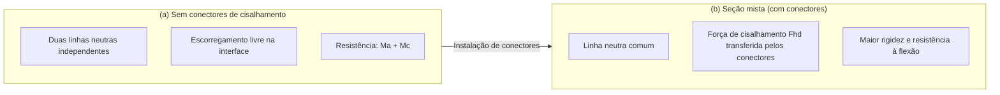
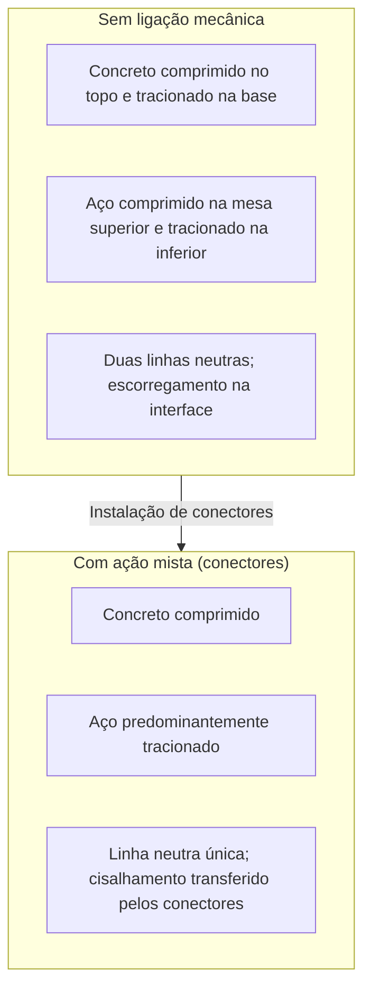
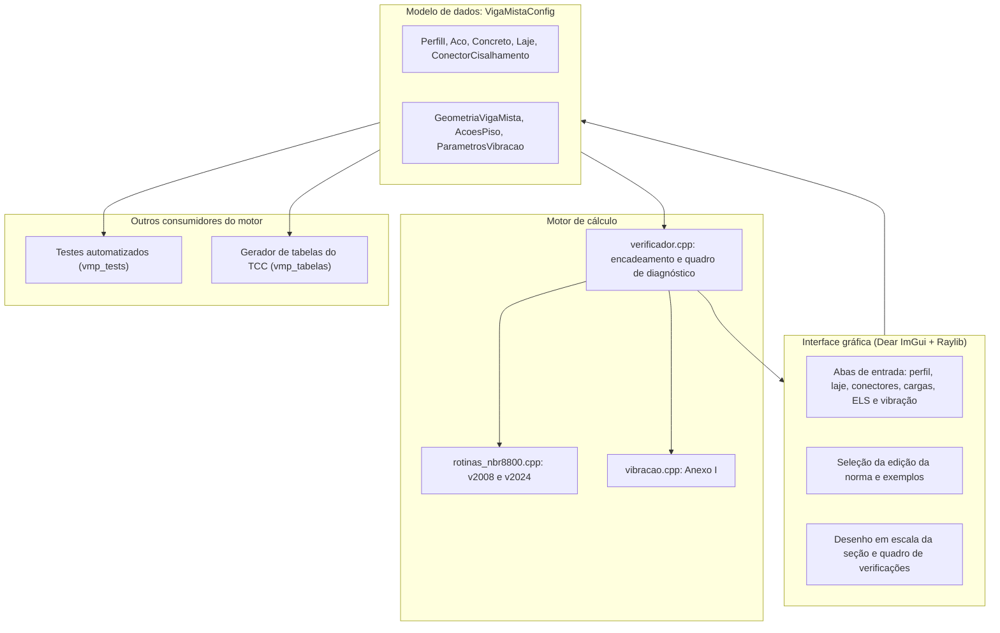

# DESENVOLVIMENTO DE FERRAMENTA COMPUTACIONAL PARA DIMENSIONAMENTO E VERIFICAÇÃO DE VIGAS MISTAS DE AÇO E CONCRETO SEGUNDO A ABNT NBR 8800:2024

---

## RESUMO

As vigas mistas de aço e concreto biapoiadas, associadas a lajes com fôrma de aço incorporada (*steel deck*) ou a lajes maciças e executadas sem escoramento, são a solução predominante para pisos de edifícios comerciais no Brasil. O seu dimensionamento é multifásico: na concretagem (Fase 1) o perfil de aço resiste isoladamente ao peso próprio, ao concreto fresco e à sobrecarga de construção; após a cura (Fase 2) a seção trabalha como mista, com a transferência do fluxo de cisalhamento longitudinal feita por conectores. A verificação envolve estados-limites últimos (flexão, força cortante e grau de interação da conexão) e de serviço (deslocamentos com fluência e retração e, a partir da edição de 2024 da ABNT NBR 8800, vibração do piso pelo caminhar de pessoas, no Anexo I). Este trabalho desenvolve uma ferramenta computacional de código aberto, escrita em C++20 com interface gráfica em Dear ImGui e Raylib, que automatiza esse encadeamento para as edições de 2008 e de 2024 da norma, mantendo as duas implementações separadas para permitir a comparação direta. O trabalho apresenta a fundamentação do Anexo L, a formalização dos algoritmos e a estratégia de verificação do software por testes automatizados. Para validação, adotou-se o exemplo de um piso de escritórios com viga W460×52,0, *steel deck* MF-75 e vão de 9,0 m, resolvido em uma planilha de referência. O software reproduziu as 25 grandezas comparadas (esforços, resistências, grau de interação, inércias efetivas, flechas e parâmetros de vibração) com diferença relativa máxima de $2{,}4 \times 10^{-15}$; o procedimento de vibração foi conferido também contra um segundo exemplo independente. Os estudos paramétricos mostraram que, no caso analisado, a edição de 2024 reduz o grau de interação mínimo de 0,519 para 0,280, mas, em lajes maciças, exige cerca de 30% mais conectores para a interação completa, em razão do novo coeficiente $R_p = 0{,}75$; mostraram também que o critério indireto de vibração da edição de 2008 reprova a viga do estudo de caso, enquanto a avaliação pelo Anexo I a aprova pelo critério da aceleração de pico. A arquitetura modular adotada serve de base para a extensão futura a vigas mistas protendidas.

**Palavras-chave:** Vigas mistas aço-concreto; ABNT NBR 8800:2024; Ferramenta computacional; Construção não escorada; *Steel deck*; Grau de interação; Vibração de pisos.

---

## ABSTRACT

Simply supported steel-concrete composite beams with profiled steel deck or solid slabs, built without shoring, are the prevailing floor solution in Brazilian commercial buildings. Their design is multi-phase: during casting (Phase 1) the bare steel beam carries its self-weight, the wet concrete and the construction load; after hardening (Phase 2) the section acts compositely, with longitudinal shear transferred by connectors. The verification covers ultimate limit states (bending, shear and degree of shear connection) and serviceability limit states (deflections including creep and shrinkage and, since the 2024 edition of ABNT NBR 8800, walking-induced floor vibration in Annex I). This work develops an open-source computational tool, written in C++20 with a Dear ImGui and Raylib graphical interface, that automates this chain for both the 2008 and the 2024 editions of the code, keeping the two implementations separate so that they can be compared directly. The theoretical background of Annex L, the formalisation of the algorithms and the software verification strategy based on automated tests are presented. The tool was validated against an office-floor example (W460×52.0 beam, MF-75 steel deck, 9.0 m span) solved in a reference spreadsheet: the 25 compared quantities (internal forces, resistances, degree of connection, effective inertias, deflections and vibration parameters) agreed within a maximum relative difference of $2.4 \times 10^{-15}$, and the vibration procedure was also checked against a second, independent example. Parametric studies showed that, for the case analysed, the 2024 edition lowers the minimum degree of shear connection from 0.519 to 0.280 but, for solid slabs, requires about 30% more connectors for full interaction because of the new $R_p = 0.75$ factor; they also showed that the indirect vibration criterion of the 2008 edition rejects the case-study beam, while the Annex I assessment accepts it under the peak-acceleration criterion. The modular architecture lays the groundwork for a future extension to prestressed composite beams.

**Keywords:** Steel-concrete composite beams; ABNT NBR 8800:2024; Computational tool; Unshored construction; Steel deck; Degree of shear connection; Floor vibration.

---

## LISTA DE SÍMBOLOS E NOTAÇÕES

### Geometria e Propriedades do Perfil de Aço
- $A_a$: Área bruta da seção transversal do perfil de aço
- $A_{af}$: Área da mesa superior do perfil ($b_f t_f$)
- $A_{aw}$: Área da alma do perfil ($h_w t_w$)
- $A_c, A_t$: Áreas das partes comprimida e tracionada do perfil na plastificação
- $A_{fb}, A_{ft}$: Áreas das mesas inferior e superior do perfil
- $b_f, t_f$: Largura e espessura da mesa
- $C_w$: Constante de empenamento
- $d$: Altura total do perfil
- $h$: Altura plana da alma usada na esbeltez ($d'$ do catálogo)
- $h_w$: Altura da alma entre faces internas das mesas ($d - 2t_f$)
- $I_t$ ($J$): Constante de torção de Saint-Venant
- $I_x, I_y$: Momentos de inércia em relação aos eixos de maior e menor inércia
- $r_y$: Raio de giração em relação ao eixo de menor inércia
- $t_w$: Espessura da alma
- $W_x, Z_x$: Módulos de resistência elástico e plástico em relação ao eixo x
- $\rho$: Parâmetro de assimetria da seção de aço, $\rho = \frac{1}{2}(A_{fb}/A_{ft} - 1)$

### Laje e Materiais
- $b$: Distância entre vigas secundárias (largura de influência)
- $b_{ef}$: Largura efetiva da laje
- $b_F, h_F$: Largura média e altura das nervuras da fôrma de aço
- $e_F$: Passo das nervuras da fôrma
- $E_a$: Módulo de elasticidade do aço (200 000 MPa)
- $E_c, E_{ci}$: Módulo de elasticidade secante e tangente inicial do concreto
- $E_{c,din}$: Módulo de elasticidade dinâmico do concreto (vibração)
- $f_{ck}, f_{cd}$: Resistência característica e de cálculo do concreto à compressão
- $f_y, f_{yd}$: Resistência ao escoamento característica e de cálculo do aço
- $t_c$: Espessura de concreto considerada (total na laje maciça; acima da fôrma no *steel deck*)
- $\alpha_{ag}$: Coeficiente do agregado graúdo
- $\alpha_E$: Razão modular $E_a/E_c$
- $\eta_c$: Coeficiente de fragilidade do concreto, $\eta_c = \min[1{,}0;\ (40/f_{ck})^{1/3}]$

### Conectores e Grau de Interação
- $A_{cs}$: Área da seção do fuste do conector pino com cabeça
- $c_p, c_r$: Coeficientes do tipo de construção e da utilização à flexão no grau mínimo
- $d_{cs}, h_{cs}$: Diâmetro e altura do conector após a instalação
- $e_{mh}$: Distância da borda do fuste à alma da nervura, à meia altura da nervura
- $F_{hd}$: Força de cisalhamento de cálculo entre o componente de aço e a laje
- $f_{ucs}$: Resistência à ruptura do aço do conector
- $k$: Número de nervuras entre conectores consecutivos (conector a cada $k$ nervuras)
- $L_e$: Comprimento do trecho de momento positivo ($L$ em vigas biapoiadas), em metros
- $n$: Número de conectores entre o apoio e o meio do vão
- $n_{compl}, n_{min}$: Conectores por meio vão para interação completa e para o grau mínimo
- $n_t$: Número de conectores por nervura (ou por linha transversal)
- $Q_{Rd}$: Resistência de cálculo de um conector
- $R_g, R_p$: Coeficientes de grupo e de posição do conector
- $s, s_{min}, s_{max}$: Espaçamento longitudinal adotado, mínimo e máximo
- $\eta$: Grau de interação, $\eta = \min(1;\ \sum Q_{Rd}/F_{hd})$
- $\eta_0, \eta_i, \eta_{lim}$: Grau de interação básico, mínimo e limite inferior

### Estados-Limites Últimos e de Serviço
- $a$: Altura do bloco comprimido de concreto
- $C_{cd}, C_{ad}, T_{ad}$: Forças resultantes de compressão no concreto, de compressão no aço e de tração no aço
- $C_b$: Fator de modificação para diagrama de momento não uniforme
- $I_{tr}, I_{ef}$: Momentos de inércia da seção homogeneizada e efetivo (interação parcial)
- $k_v$: Coeficiente de flambagem da alma por cisalhamento
- $M_{Sd}, M_{Rd}$: Momento fletor solicitante e resistente de cálculo
- $M_{cr}, M_{pl}, M_r$: Momentos crítico elástico, de plastificação e de início de escoamento
- $V_{Sd}, V_{Rd}$: Força cortante solicitante e resistente de cálculo
- $y_p$: Posição da linha neutra plástica, medida a partir do topo do perfil
- $y_c$: Distância do topo do perfil ao centroide da parte comprimida
- $y_t$: Distância da face inferior do perfil ao centroide da parte tracionada
- $\beta_{vm}$: Coeficiente da viga mista (1,00 em vigas biapoiadas)
- $\delta_{g1}$: Flecha de $g_1$ no perfil isolado
- $\delta_1, \delta_2, \delta_3$: Flechas das permanentes, dos efeitos de longa duração e das variáveis
- $\delta_0$: Contraflecha considerada
- $\delta_{max}$: Flecha máxima final
- $\gamma_{a1}, \gamma_c, \gamma_{cs}$: Coeficientes de ponderação das resistências do aço (1,10), do concreto (1,40) e do conector (1,25)

### Vibração do Piso (Anexo I)
- $a_p$: Aceleração de pico
- $a_{w,rms}$: Valor eficaz da aceleração ponderada
- $B_b$: Largura colaborante do piso relativa à viga secundária
- $f_0$: Frequência fundamental do piso
- $I_b$: Momento de inércia da viga mista secundária (concreto não fissurado, $E_{c,din}$)
- $I_s$: Momento de inércia da laje por unidade de largura, homogeneizado em aço
- $k_b$: Coeficiente da largura colaborante (2,0 para vigas internas)
- $M$: Massa modal do piso
- $m$: Massa distribuída do piso
- $P_0$: Peso de uma pessoa (750 N)
- $R$: Fator de resposta
- $W$: Fator de ponderação da aceleração
- $\beta$: Razão de amortecimento crítico
- $\zeta$: Coeficiente dinâmico
- $\psi_{vib}$: Fator de redução da ação variável para vibração

---

# CAPÍTULO 1: INTRODUÇÃO

## 1.1 Contextualização
A crescente demanda por rapidez de montagem e racionalização de materiais consolidou os sistemas mistos de aço e concreto como solução frequente para edifícios comerciais de múltiplos andares, garagens, hospitais e centros logísticos. Em pisos estruturados em aço, a laje de concreto deixou há décadas de ser tratada apenas como um elemento que transmite cargas ao vigamento.

Ao ligar a mesa superior do perfil à laje por meio de conectores de cisalhamento, impede-se o escorregamento relativo na interface e os dois componentes passam a fletir em conjunto. Esse mecanismo aproveita as propriedades de cada material:
- o concreto, resistente à compressão e de baixo custo por unidade de volume, forma a mesa comprimida da seção;
- o perfil de aço, de elevada resistência à tração e ductilidade, trabalha predominantemente tracionado.

O resultado é uma viga com resistência e rigidez à flexão significativamente maiores que as do perfil isolado, o que permite especificar perfis mais baixos e mais leves para o mesmo vão e carregamento. No estudo de caso deste trabalho, por exemplo, o momento resistente da seção mista (607,7 kN·m) é 1,77 vez o do perfil isolado com a mesa contida (343,7 kN·m), e a inércia homogeneizada de curta duração (76 609 cm⁴) é 3,6 vezes a do perfil (21 370 cm⁴).

No cenário brasileiro, a solução mais empregada é a **viga mista biapoiada de alma cheia** (perfil I laminado ou soldado) associada a lajes moldadas sobre fôrmas de aço perfiladas incorporadas (*steel deck*). A fôrma atua como plataforma de trabalho durante a montagem, como fôrma na concretagem e como armadura positiva da laje em serviço, dispensando o escoramento nas modulações usuais de 2,5 m a 3,5 m entre vigas secundárias.



## 1.2 Justificativa e Motivação
Apesar da eficiência estrutural, o dimensionamento de uma viga mista de piso é um encadeamento multifásico, sensível e cheio de interdependências. Quando se adota a **construção não escorada** — método predominante em edificações, por liberar os pavimentos inferiores e reduzir prazos —, a viga atravessa duas fases com modelos de comportamento distintos:

1. **Fase 1 (perfil de aço isolado):** antes da cura do concreto, o perfil resiste sozinho ao peso próprio, à fôrma, ao concreto fresco e à sobrecarga de construção (no mínimo 1,0 kN/m², item N.4.1.3 da NBR 8800). Conforme a contenção lateral da mesa comprimida, o perfil fica sujeito à flambagem lateral com torção (FLT, Anexo D), às flambagens locais da mesa (FLM) e da alma (FLA) e à força cortante;
2. **Fase 2 (seção mista):** após a cura, os conectores tipo pino com cabeça transmitem a força de cisalhamento longitudinal ($F_{hd}$). O momento resistente positivo depende da esbeltez da alma e da posição da linha neutra plástica (na laje, na mesa superior ou na alma). Se a quantidade de conectores não alcançar a interação completa, a viga trabalha com **interação parcial**, o que exige verificar o grau de interação mínimo ($\eta_i$) e reduz a rigidez efetiva ($I_{ef}$);
3. **Estados-limites de serviço:** por serem leves e esbeltas, as vigas mistas são frequentemente governadas pelos deslocamentos em serviço (com fluência, retração e interação parcial) e pelo conforto humano quanto à **vibração pelo caminhar de pessoas**, que a ABNT NBR 8800:2024 passou a tratar em procedimento próprio no Anexo I.

Conduzir esse encadeamento manualmente ou em planilhas sem padronização expõe o projeto a erros de interpretação, sobretudo na geometria do *steel deck* (coeficientes $R_g$ e $R_p$) e na escolha das combinações de serviço. Ferramentas computacionais dedicadas, com o cálculo transparente e verificado, reduzem esse risco.

Além disso, a publicação da **ABNT NBR 8800:2024** trouxe mudanças relevantes para vigas mistas:
- migração dos requisitos do antigo Anexo O para o **Anexo L**;
- consideração do tipo de agregado graúdo ($\alpha_{ag}$) no módulo de elasticidade do concreto;
- coeficiente de fragilidade $\eta_c = (40/f_{ck})^{1/3} \le 1{,}0$ no bloco de compressão (L.1.3.4);
- nova formulação do grau de interação mínimo ($\eta_i$), dependente da assimetria do perfil ($\rho$), do tipo de construção ($c_p$) e da utilização à flexão ($c_r$);
- coeficiente $R_p = 0{,}75$ também para conectores soldados diretamente no perfil, sem fôrma (era 1,00);
- coeficiente de flambagem da alma por cisalhamento $k_v = 5{,}34$ para almas sem enrijecedores (era 5,00);
- procedimento de avaliação de vibração de pisos no **Anexo I**.

Observou-se ainda, na expressão do momento resistente do caso b do item L.2.3.1.1.1, um termo que não é compatível com o equilíbrio da seção (ver 2.7). Integrar essas mudanças em uma ferramenta de cálculo aberta, verificada contra exemplos resolvidos, é a contribuição pretendida por este trabalho.

## 1.3 Objetivos do Trabalho

### 1.3.1 Objetivo Geral
Desenvolver, formalizar e validar uma ferramenta computacional interativa, escrita em C++20 com interface em Dear ImGui e Raylib, para a verificação de vigas mistas de aço e concreto biapoiadas de alma cheia, em construção escorada ou não escorada, segundo as edições de 2008 e de 2024 da ABNT NBR 8800.

### 1.3.2 Objetivos Específicos
1. **Verificação multifásica:** implementar a Fase 1 (FLT, FLM, FLA e força cortante do perfil isolado) e a Fase 2 (momento resistente plástico nos casos a, b e c do item L.2.3.1.1.1, verificação elástica de seções semicompactas e força cortante);
2. **Conexão de cisalhamento:** implementar a disposição real dos conectores — $n_t$ pinos por nervura a cada $k$ nervuras no *steel deck* perpendicular ($s = k \cdot e_F$) e espaçamento contínuo nos demais casos —, com $R_g$, $R_p$, $s_{min}$, $s_{max}$, $n_{compl}$, $n_{min}$ e a verificação $\eta \ge \eta_i$;
3. **Estados-limites de serviço:** implementar as flechas por fases (com fluência, retração opcional, contraflecha e as combinações de serviço do Anexo B) e a tensão na face inferior do perfil em serviço;
4. **Vibração do piso:** implementar a avaliação simplificada do Anexo I (modo A) — frequência fundamental, largura colaborante, massa modal, aceleração de pico e fator de resposta — e o critério indireto da edição de 2008 (L.3.2);
5. **Interface gráfica:** construir uma interface interativa com desenho em escala da seção mista e quadro de verificações atualizado a cada alteração dos dados;
6. **Validação:** verificar os resultados do software contra o exemplo resolvido da planilha `Viga_Mista_NBR8800-2024.xlsx` e contra um segundo exemplo independente de vibração, por meio de testes automatizados;
7. **Comparação entre edições:** quantificar, no estudo de caso e em estudos paramétricos, o efeito das mudanças da edição de 2024 em relação à de 2008;
8. **Base para pesquisa futura:** organizar o código de forma modular, para permitir a extensão a vigas mistas protendidas.

## 1.4 Estrutura do Documento
- **Capítulo 2 (Fundamentação teórica e prescrições normativas):** mecânica da viga mista, sistemas de laje, largura efetiva, Fase 1, conexão de cisalhamento e grau de interação, momento resistente na Fase 2, flechas, vibração e quadro comparativo entre as edições de 2008 e 2024;
- **Capítulo 3 (Desenvolvimento da ferramenta computacional):** arquitetura do software, organização do código, algoritmos em pseudocódigo, verificação por testes automatizados e interface gráfica;
- **Capítulo 4 (Estudo de caso, validação e estudos paramétricos):** resolução do estudo de caso V1, confronto com a planilha de referência, comparação entre as edições e estudos paramétricos de vão, densidade de conectores e resistência do concreto;
- **Capítulo 5 (Conclusões e trabalhos futuros):** síntese dos resultados, limitações e extensão para vigas mistas protendidas.

---

# CAPÍTULO 2: FUNDAMENTAÇÃO TEÓRICA E PRESCRIÇÕES NORMATIVAS

## 2.1 Mecânica da Viga Mista e Ação Composta
Considere-se uma viga de piso formada por um perfil de alma cheia sobre o qual se apoia uma laje de concreto. Sem ligação mecânica na interface, cada elemento flete em torno do seu próprio eixo neutro:
- a face inferior da laje se alonga, enquanto a face superior do perfil se encurta;
- essa incompatibilidade gera um escorregamento relativo ao longo da interface;
- a rigidez do conjunto se reduz à soma das rigidezes individuais ($I_a + I_c$), sendo pequena a contribuição de uma laje delgada.

Com conectores de cisalhamento soldados ao topo do perfil e embutidos no concreto, restringe-se o escorregamento e o fluxo de cisalhamento longitudinal passa a ser transferido entre os materiais. Com interação completa, as deformações tornam-se contínuas na interface e a seção passa a ter uma única linha neutra: a resultante de compressão se situa no concreto e a de tração no perfil, com braço de alavanca interno bem maior que o do perfil isolado.



## 2.2 Sistemas de Laje e Orientação das Nervuras
Segundo o item L.1.1.1 da ABNT NBR 8800:2024, as lajes que podem compor vigas mistas são:
1. **Laje maciça moldada no local:** admite conectores tipo pino com cabeça ou perfil U laminado ou formado a frio;
2. **Laje com fôrma de aço incorporada (*steel deck*):** chapa perfilada de aço galvanizado (espessuras usuais de 0,80 mm a 1,25 mm) com mossas que garantem a aderência ao concreto. Aplicam-se os limites $h_F \le 75$ mm, $b_F \ge 50$ mm, diâmetro do pino soldado através da fôrma $d_{cs} \le 19$ mm e altura do conector de pelo menos $h_F + 40$ mm;
3. **Laje com pré-laje de concreto pré-moldada:** pré-lajes com capa de concreto moldada no local;
4. **Laje alveolar pré-moldada:** painéis protendidos com alvéolos longitudinais e capa estrutural.

A ferramenta desenvolvida trata as tipologias 1 e 2.

### Influência da orientação das nervuras do *steel deck*
- **Nervuras perpendiculares à viga:** caso usual das **vigas secundárias**, em que a fôrma vence o vão entre vigas adjacentes e se apoia na mesa do perfil. O concreto das nervuras é desprezado no cálculo da seção (L.2.6.2-a): considera-se apenas a capa $t_c$ acima da fôrma. Os conectores ficam dentro das nervuras, com a resistência reduzida por $R_g$ e $R_p$, e o espaçamento longitudinal é necessariamente múltiplo do passo da fôrma;
- **Nervuras paralelas à viga:** caso típico das **vigas principais**, em que uma nervura contínua se apoia sobre a mesa do perfil. Nesta ferramenta, por simplicidade e a favor da segurança, também se considera apenas a capa $t_c$ acima da fôrma.

| Parâmetro | Laje maciça | *Steel deck* perpendicular | *Steel deck* paralelo |
| :--- | :---: | :---: | :---: |
| **Concreto considerado** | Espessura total $t_c$ | Capa acima da fôrma ($t_c$) | Capa acima da fôrma ($t_c$) |
| **Conector permitido** | Pino com cabeça ou perfil U | Pino com cabeça ($d_{cs} \le 19$ mm) | Pino com cabeça ($d_{cs} \le 19$ mm) |
| **$R_g$** | 1,00 | 1,00 (1 pino); 0,85 (2); 0,70 ($\ge$ 3) | 1,00 se $b_F/h_F \ge 1{,}5$; senão 0,85 |
| **$R_p$ (2024)** | 0,75 | 0,75 ($e_{mh} \ge 50$ mm); 0,60 ($e_{mh} < 50$ mm) | 0,75 |
| **$R_p$ (2008)** | 1,00 | 0,75 ($e_{mh} \ge 50$ mm); 0,60 ($e_{mh} < 50$ mm) | 0,75 |
| **Espaçamento longitudinal** | Informado ($s$) | $s = k \cdot e_F$ | Informado ($s$) |

## 2.3 Largura Efetiva da Laje ($b_{ef}$)
A compressão na mesa de concreto não é uniforme na largura: é máxima sobre o perfil e decresce com a distância a ele (*shear lag*). Na prática, substitui-se a distribuição real por uma largura efetiva $b_{ef}$ com tensão uniforme.

Conforme o item L.2.2 da ABNT NBR 8800:2024, a largura efetiva de vigas biapoiadas é a soma das parcelas de cada lado do eixo do perfil:

$$b_{ef} = b_1 + b_2$$

- **Lado com viga adjacente:** $b_{1,2} = \min\left( \dfrac{L}{8};\; \dfrac{e_{1,2}}{2} \right)$
- **Lado com borda livre:** $b_{1,2} = \min\left( \dfrac{L}{8};\; \text{balanço} \right)$

Para vigas internas com espaçamento uniforme $e$, resulta $b_{ef} = \min(L/4;\ e)$.

## 2.4 Fase 1: Perfil de Aço Isolado em Construção Não Escorada

### 2.4.1 Ações e combinações
A ação permanente da Fase 1 ($g_1$) é formada pelo peso do concreto fresco, da fôrma e do perfil:

$$g_1 = (g_c + g_F) \cdot b + g_a$$

em que $g_c$ é o peso do concreto por unidade de área (no *steel deck*, consumo de concreto do catálogo × 25 kN/m³), $g_F$ o peso da fôrma, $g_a$ o peso linear do perfil e $b$ a largura de influência. A sobrecarga de construção é $q_1 = q_c \cdot b$, com $q_c \ge 1{,}0$ kN/m² (N.4.1.3).

Na combinação última de construção, cada parcela recebe o coeficiente da Tabela 1 da norma: 1,25 para o concreto moldado no local, 1,15 para as estruturas de aço (perfil e fôrma) e 1,30 para a sobrecarga de construção:

$$q_{Sd,c} = 1{,}25 \, g_c b + 1{,}15 \, (g_F b + g_a) + 1{,}30 \, q_1, \qquad M_{Sd,c} = \frac{q_{Sd,c} L^2}{8}, \qquad V_{Sd,c} = \frac{q_{Sd,c} L}{2}$$

No software, os coeficientes de cada parcela são reduzidos a um coeficiente equivalente aplicado a $g_1$.

### 2.4.2 Momento fletor resistente do perfil isolado (Anexo D)
O momento resistente de cálculo é o menor entre os obtidos para FLT, FLM e FLA, limitado a $1{,}5 W_x f_y / \gamma_{a1}$. Para a FLT de perfis I duplamente simétricos (Anexo D, Tabela D.1):

$$\lambda = \frac{L_b}{r_y}, \qquad \lambda_p = 1{,}76\sqrt{\frac{E_a}{f_y}}, \qquad \beta_1 = \frac{0{,}7 f_y W_x}{E_a I_t}$$

$$\lambda_r = \frac{1{,}38\, C_b \sqrt{I_y I_t}}{r_y I_t \beta_1}\sqrt{1 + \sqrt{1 + \frac{27\, C_w \beta_1^2}{C_b^2 I_y}}}$$

$$M_{cr} = \frac{C_b \pi^2 E_a I_y}{L_b^2}\sqrt{\frac{C_w}{I_y}\left(1 + 0{,}039\,\frac{I_t L_b^2}{C_w}\right)}$$

$$M_{Rd} = \begin{cases} \dfrac{M_{pl}}{\gamma_{a1}}, & \lambda \le \lambda_p \\[2mm] \dfrac{1}{\gamma_{a1}}\left[M_{pl} - (M_{pl} - M_r)\dfrac{\lambda - \lambda_p}{\lambda_r - \lambda_p}\right], & \lambda_p < \lambda \le \lambda_r \\[2mm] \dfrac{M_{cr}}{\gamma_{a1}}, & \lambda > \lambda_r \end{cases}$$

com $M_{pl} = Z_x f_y$ e $M_r = 0{,}7 f_y W_x$. Na edição de 2024, $C_b$ aparece dentro da expressão de $\lambda_r$; na de 2008, $C_b$ multiplicava a expressão de interpolação. As FLM e FLA seguem a mesma forma, com $\lambda = b_f/(2t_f)$, $\lambda_p = 0{,}38\sqrt{E_a/f_y}$ (FLM) e $\lambda = h/t_w$, $\lambda_p = 3{,}76\sqrt{E_a/f_y}$, $\lambda_r = 5{,}70\sqrt{E_a/f_y}$ (FLA). Para a FLA, nas duas edições, $M_r = f_y W_x$, sem a tensão residual.

**Contenção lateral pelo *steel deck*.** Quando a fôrma de aço é fixada à mesa superior do perfil (por pinos ou soldas tampão), ela impede o deslocamento lateral da mesa comprimida durante a concretagem e a FLT não governa. Nesse caso, adota-se $L_b = 0$ e o momento resistente é governado por $M_{pl}$ ou pelas flambagens locais. Em lajes maciças sobre fôrmas provisórias, $L_b$ é a distância entre travamentos.

### 2.4.3 Força cortante resistente
A alma resiste à força cortante com $V_{pl} = 0{,}60\, d\, t_w f_y$ e a esbeltez $\lambda = h/t_w$:

$$\lambda_p = 1{,}10\sqrt{\frac{k_v E_a}{f_y}}, \qquad \lambda_r = 1{,}37\sqrt{\frac{k_v E_a}{f_y}}$$

$$V_{Rd} = \frac{V_{pl}}{\gamma_{a1}} \ (\lambda \le \lambda_p); \qquad V_{Rd} = \frac{\lambda_p}{\lambda}\frac{V_{pl}}{\gamma_{a1}} \ (\lambda_p < \lambda \le \lambda_r); \qquad V_{Rd} = 1{,}24\left(\frac{\lambda_p}{\lambda}\right)^2 \frac{V_{pl}}{\gamma_{a1}} \ (\lambda > \lambda_r)$$

Para almas sem enrijecedores transversais, a edição de 2024 adota $k_v = 5{,}34$ (5,00 na edição de 2008). Em vigas mistas de alma cheia, a força cortante é resistida apenas pelo perfil, inclusive na Fase 2.

## 2.5 Conexão de Cisalhamento e Grau de Interação

### 2.5.1 Resistência de um conector pino com cabeça ($Q_{Rd}$)
Conforme o item L.4.2.1.1, a resistência de cálculo de um pino com cabeça é a menor entre a do concreto e a do aço do conector:

$$Q_{Rd} = \min\left( \frac{A_{cs}\sqrt{f_{ck} E_c}}{2\,\gamma_{cs}};\ \frac{R_g R_p A_{cs} f_{ucs}}{\gamma_{cs}} \right), \qquad A_{cs} = \frac{\pi d_{cs}^2}{4}, \quad \gamma_{cs} = 1{,}25$$

### 2.5.2 Coeficientes de grupo ($R_g$) e de posição ($R_p$)
**$R_g$ (L.4.2.1.2):**
- 1,00 para um conector por nervura perpendicular; para qualquer número de conectores em uma linha soldados diretamente no perfil; e para qualquer número de conectores em uma linha em nervura paralela com $b_F/h_F \ge 1{,}5$;
- 0,85 para dois conectores por nervura perpendicular, e para um conector em nervura paralela com $b_F/h_F < 1{,}5$;
- 0,70 para três ou mais conectores por nervura perpendicular.

O caso de mais de um conector em nervura paralela com $b_F/h_F < 1{,}5$ não é explicitado pela norma; a ferramenta adota 0,85, a favor da segurança.

**$R_p$ (L.4.2.1.3):**
- 0,75 para conectores soldados diretamente no perfil (na edição de 2008, 1,00);
- 0,75 para conectores em laje mista com nervuras perpendiculares e $e_{mh} \ge 50$ mm, e para conectores em nervuras paralelas;
- 0,60 para nervuras perpendiculares com $e_{mh} < 50$ mm.

A altura mínima do conector ($h_{cs} \ge h_F + 40$ mm) é uma exigência geométrica independente (2.5.6) e não altera $R_p$.

### 2.5.3 Força de cisalhamento para interação completa ($F_{hd}$)
Entre a seção de momento nulo e a de momento máximo, a força de cisalhamento de cálculo é a menor entre a resistência à tração do perfil e a resistência à compressão da laje:

$$F_{hd} = \min\left( A_a f_{yd};\ 0{,}85\,\eta_c f_{cd}\, b_{ef}\, t_c \right), \qquad n_{compl} = \left\lceil \frac{F_{hd}}{Q_{Rd}} \right\rceil$$

### 2.5.4 Disposição dos conectores e grau de interação ($\eta$)
No *steel deck* perpendicular, os pinos são soldados nas nervuras, a cada $k$ nervuras ($s = k\, e_F$). Nos demais casos, $s$ é informado. O número de linhas entre o apoio e o meio do vão e o grau de interação são:

$$n_{lin} = \left\lfloor \frac{L/2}{s} \right\rfloor, \qquad n = n_{lin}\, n_t, \qquad \sum Q_{Rd} = n\, Q_{Rd}, \qquad \eta = \min\left(1;\ \frac{\sum Q_{Rd}}{F_{hd}}\right)$$

Com $\eta = 1$ há interação completa; com $\eta < 1$, interação parcial.

### 2.5.5 Grau de interação mínimo ($\eta_i$)
Com interação parcial, o escorregamento na interface exige capacidade de deformação dos conectores. Para que essa capacidade não se esgote antes de a viga atingir o momento resistente, a norma impõe um grau mínimo.

**Edição de 2024 (L.2.3.1.1.2):**

$$\eta_i = \min\left[ 1;\ \max\left( c_p\, c_r^2\, \eta_0;\ \eta_{lim} \right) \right]$$

$$\eta_0 = 1 - \frac{E_a}{580 f_y}\left[0{,}75 - 0{,}45\rho - (0{,}030 - 0{,}015\rho) L_e\right], \qquad \eta_{lim} = 0{,}40\, c_r (1 + 0{,}8\rho)$$

com $c_p = 0{,}85$ (não escorada) ou 1,00 (escorada), $c_r = \max(0{,}70;\ M_{Sd}/M_{Rd})$, $L_e$ em metros e $\rho = 0$ para perfis duplamente simétricos.

**Edição de 2008 (O.2.3.1.1.2), perfis de mesas iguais e $L_e \le 25$ m:**

$$\eta_i = 1 - \frac{E_a}{578 f_y}(0{,}75 - 0{,}03 L_e) \ge 0{,}40$$

Em ambos os casos, $n_{min} = \lceil \eta_i F_{hd} / Q_{Rd} \rceil$. Se $\eta < \eta_i$, a conexão não atende e é preciso aumentar $n_t$ ou reduzir $k$.

### 2.5.6 Limites geométricos
Conforme os itens L.4.1, L.4.3 e L.4.4 (O.4.1, O.4.3 e O.4.4 em 2008, com os mesmos valores):
- **espaçamento mínimo:** $6\,d_{cs}$ ao longo do vão, reduzido para $4\,d_{cs}$ com fôrma de aço; $4\,d_{cs}$ na direção transversal;
- **espaçamento máximo:** $8$ vezes a espessura total da laje e, com nervuras perpendiculares, no máximo 915 mm;
- **altura do conector:** $h_{cs} \ge 4\,d_{cs}$ e, com fôrma, $h_{cs} \ge h_F + 40$ mm; cobrimento superior mínimo de 10 mm;
- **diâmetro:** $d_{cs} \le 19$ mm através da fôrma; $d_{cs} \le 2{,}5\,t_f$, a menos que o conector esteja sobre a alma;
- **ancoragem da fôrma:** com nervuras perpendiculares e $s > 450$ mm, a fôrma deve receber fixações adicionais à mesa;
- **largura da mesa:** para $n_t$ conectores lado a lado, a ferramenta exige $(n_t - 1)\cdot 4\,d_{cs} + 2 \cdot 25\ \text{mm} \le b_f$, combinando o espaçamento transversal mínimo com o cobrimento lateral de 25 mm (L.4.4.2). Este é o critério adotado pelo autor; a norma não fixa explicitamente a distância do conector à borda da mesa.

## 2.6 Fase 2: Momento Fletor Resistente Positivo
Para vigas biapoiadas com alma compacta ($h/t_w \le 3{,}76\sqrt{E_a/f_y}$), o momento resistente é obtido pela distribuição plástica de tensões, com o concreto a $0{,}85\,\eta_c f_{cd}$ e o aço a $f_{yd}$. O item L.2.3.1.1.1 distingue três casos.

### Caso a — interação completa, linha neutra plástica na laje
Ocorre quando $\sum Q_{Rd} \ge A_a f_{yd}$ e $0{,}85\,\eta_c f_{cd} b_{ef} t_c \ge A_a f_{yd}$. Todo o perfil está tracionado:

$$T_{ad} = A_a f_{yd}, \qquad a = \frac{T_{ad}}{0{,}85\,\eta_c f_{cd} b_{ef}} \le t_c, \qquad M_{Rd} = \beta_{vm}\, T_{ad}\left(\frac{d}{2} + h_F + t_c - \frac{a}{2}\right)$$

### Caso b — interação completa, linha neutra plástica no perfil
Ocorre quando $\sum Q_{Rd} \ge 0{,}85\,\eta_c f_{cd} b_{ef} t_c$ e $A_a f_{yd} > 0{,}85\,\eta_c f_{cd} b_{ef} t_c$. Toda a laje está comprimida ($a = t_c$):

$$C_{cd} = 0{,}85\,\eta_c f_{cd} b_{ef} t_c, \qquad C_{ad} = \frac{A_a f_{yd} - C_{cd}}{2}, \qquad T_{ad} = C_{cd} + C_{ad}$$

A linha neutra plástica, medida a partir do topo do perfil, fica na mesa superior se $C_{ad} \le A_{af} f_{yd}$, ou na alma, caso contrário:

$$y_p = \frac{C_{ad}}{A_{af} f_{yd}}\, t_f \quad \text{(mesa)}, \qquad y_p = t_f + h_w\,\frac{C_{ad} - A_{af} f_{yd}}{A_{aw} f_{yd}} \quad \text{(alma)}$$

$$M_{Rd} = \beta_{vm}\left[ C_{ad}\,(d - y_t - y_c) + C_{cd}\left(\frac{t_c}{2} + h_F + d - y_t\right) \right]$$

### Caso c — interação parcial
Ocorre quando $\sum Q_{Rd}$ é menor que $A_a f_{yd}$ e que $0{,}85\,\eta_c f_{cd} b_{ef} t_c$, atendido o grau mínimo. A compressão na laje fica limitada pela conexão, $C_{cd} = \sum Q_{Rd}$, e o bloco comprimido não ocupa toda a espessura:

$$a = \frac{C_{cd}}{0{,}85\,\eta_c f_{cd} b_{ef}}, \qquad M_{Rd} = \beta_{vm}\left[ C_{ad}\,(d - y_t - y_c) + C_{cd}\left(t_c - \frac{a}{2} + h_F + d - y_t\right) \right]$$

com $C_{ad}$ e $y_p$ calculados como no caso b, usando o novo $C_{cd}$.

### Centroides das partes comprimida e tracionada
O centroide da parte comprimida vale $y_c = y_p/2$ com a linha neutra na mesa, ou é obtido pela composição da mesa com o trecho comprimido da alma. A área comprimida é $A_c = b_f y_p$ (mesa) ou $A_c = b_f t_f + t_w (y_p - t_f)$ (alma). O centroide da parte tracionada, medido a partir da face inferior, é obtido pela diferença de momentos estáticos entre o perfil inteiro e a parte comprimida:

$$y_t = \frac{A_a\,\dfrac{d}{2} - A_c\,(d - y_c)}{A_a - A_c}$$

Essa forma usa a mesma área $A_a$ de catálogo que entra nas forças plásticas. Na versão inicial do software, $y_t$ era calculado pelo modelo de três retângulos (sem os raios de concordância), cuja área difere da área de catálogo; isso gerava, no estudo de caso, um momento resistente 0,4% maior. A forma acima elimina essa inconsistência.

### Almas semicompactas
Para $3{,}76\sqrt{E_a/f_y} < h/t_w \le 5{,}70\sqrt{E_a/f_y}$, o momento resistente é obtido em regime elástico (L.2.3.1.2), limitando a tensão de tração na face inferior do aço a $f_{yd}$ (com o módulo efetivo $W_{ef}$ da interação parcial) e a tensão de compressão no topo da laje a $0{,}85\,\eta_c f_{cd}$, sobre a seção homogeneizada de 2.8.1.

---

## 2.7 Observação sobre o Caso b do Item L.2.3.1.1.1 da ABNT NBR 8800:2024

Na expressão do momento resistente do caso b (L.2.3.1.1.1-b, p. 203 da edição de 2024), o primeiro termo dentro dos colchetes aparece multiplicado por $\sum Q_{Rd}$, e não por $C_{ad}$:

$$M_{Rd} = \beta_{vm}\left[ \sum Q_{Rd}\,(d - y_t - y_c) + C_{cd}\left(\frac{t_c}{2} + h_F + d - y_t\right) \right] \quad \text{(como impresso)}$$

Duas verificações elementares indicam que o termo deve ser $C_{ad}$, como na edição de 2008:

1. **Braço de alavanca.** A distância $(d - y_t - y_c)$ vai do centroide da parte tracionada ao centroide da parte comprimida *do perfil de aço*. A força que atua nesse braço é a compressão no aço, $C_{ad}$. A força dos conectores atua na interface e já está representada, no equilíbrio, por $C_{cd}$ no segundo termo;
2. **Consistência com o equilíbrio.** No caso b, a interação é completa e $\sum Q_{Rd} \ge C_{cd}$ pode ser muito maior que $C_{ad}$. Com a expressão impressa, acrescentar conectores além do necessário aumentaria o momento resistente indefinidamente, o que não é compatível com o equilíbrio da seção plastificada.

A planilha de referência usada na validação faz a mesma observação e também adota $C_{ad}$. O software implementa a expressão com $C_{ad}$. Trata-se da interpretação adotada neste trabalho; recomenda-se acompanhar eventuais erratas da norma.

---

## 2.8 Estados-Limites de Serviço

### 2.8.1 Seção homogeneizada
As propriedades elásticas são calculadas com a laje homogeneizada em aço, com largura $b_{ef}/n$:
- **curta duração:** $n = \alpha_E = E_a/E_c$;
- **longa duração:** $n = 3\,\alpha_E$, considerando de forma simplificada a fluência (L.1.2).

O concreto tracionado é desprezado. Supondo toda a capa comprimida, a linha neutra elástica, medida da face inferior do perfil, é:

$$y_0 = \frac{A_a\,d/2 + (b_{ef}/n)\,t_c\,(d + h_F + t_c/2)}{A_a + (b_{ef}/n)\,t_c}$$

Se $y_0 \le d + h_F$, a linha neutra está fora da laje e toda a capa é considerada:

$$I_{tr} = I_a + A_a\left(y_0 - \frac{d}{2}\right)^2 + \frac{b_{ef}}{n}\frac{t_c^3}{12} + \frac{b_{ef}}{n}\,t_c\left(d + h_F + \frac{t_c}{2} - y_0\right)^2$$

Se $y_0 > d + h_F$, a linha neutra corta a laje e a profundidade comprimida $x$ sai do equilíbrio de momentos estáticos:

$$\frac{b_{ef}}{n}\frac{x^2}{2} = A_a\left(t_c + h_F + \frac{d}{2} - x\right), \qquad I_{tr} = \frac{b_{ef}}{n}\frac{x^3}{3} + I_a + A_a\left(t_c + h_F + \frac{d}{2} - x\right)^2$$

### 2.8.2 Interação parcial
Com interação parcial, a flexibilidade da conexão reduz a rigidez. Conforme L.1.2.2.1:

$$I_{ef} = I_a + \sqrt{\eta}\,(I_{tr} - I_a), \qquad W_{ef} = W_a + \sqrt{\eta}\,(W_{tr} - W_a)$$

### 2.8.3 Flechas por fases
Com $k = 5L^4/(384\,E_a)$ e as ações lineares em serviço, as parcelas de flecha em construção não escorada são:

| Parcela | Expressão | Significado |
| :--- | :--- | :--- |
| $\delta_{g1}$ | $k\, g_1 / I_a$ | $g_1$ sobre o perfil isolado (0 se escorada) |
| $\delta_1$ | $\delta_{g1} + k\, g_2 / I_{ef}$ | Permanentes, sem efeitos de longa duração |
| $\delta_{fl}$ | $k\, g_2\left(\dfrac{1}{I_{ef,\infty}} - \dfrac{1}{I_{ef}}\right)$ | Acréscimo por fluência das permanentes aplicadas à seção mista |
| $\delta_{sh}$ | $\dfrac{P_{sh}\, e_{sh}\, L^2}{8\, E_a I_{ef,\infty}}$ | Retração (opcional) |
| $\delta_2$ | $\delta_{fl} + \delta_{sh}$ | Efeitos de longa duração |
| $\delta_3$ | $k\,\psi\, q / I_{ef} + k\,\psi_2\, q\left(\dfrac{1}{I_{ef,\infty}} - \dfrac{1}{I_{ef}}\right)$ | Ações variáveis |

Na construção escorada, $\delta_{g1} = 0$ e $g_1 + g_2$ atuam na seção mista. Para a retração, adota-se o modelo do comentário I3 da AISC 360-16 (a NBR 8800 não fornece expressão): $P_{sh} = \varepsilon_{sh} (E_c/3)\, b_{ef}\, t_c$, com $\varepsilon_{sh} = 0{,}0002$ na falta de dados, e $e_{sh}$ igual à distância do centro da laje à linha neutra de longa duração.

O fator $\psi$ de $\delta_3$ depende da combinação: $\psi_2$ (quase permanente), $\psi_1$ (frequente) ou 1,0 (rara). Seguindo o item B.2.4 do Anexo B, verificam-se:
- **aspecto visual:** $\delta_{max} = \delta_1 + \delta_2 + \delta_3 - \delta_0 \le L/350$, com $\delta_3$ na combinação quase permanente e a contraflecha considerada limitada às permanentes, $\delta_0 = \min(\text{contraflecha};\ \delta_1)$;
- **danos a elementos não estruturais:** $\delta_2 + \delta_3 \le L/350$, com $\delta_3$ na combinação rara (ou frequente, conforme o caso). Havendo alvenaria solidarizada à viga, o limite passa a $\min(L/350;\ 15\ \text{mm})$ (Tabela B.1).

A contraflecha sugerida pela ferramenta é o maior múltiplo de 5 mm que não excede $\delta_{g1}$.

### 2.8.4 Tensão na face inferior do perfil em serviço
Para validar a hipótese de comportamento elástico em serviço (L.2.3.2-b), a tensão na face inferior do perfil na combinação rara, em construção não escorada, deve atender a:

$$\sigma = \frac{M_{g1}}{W_a} + \frac{M_{g2}}{W_{ef,\infty}} + \frac{M_q}{W_{ef}} \le f_y$$

## 2.9 Vibração do Piso pelo Caminhar de Pessoas

### 2.9.1 Edição de 2024 — Anexo I
O Anexo I traz uma avaliação simplificada (I.2) para pisos com frequência fundamental entre 3 Hz e 9 Hz. Neste trabalho avalia-se o modo A, controlado pela rigidez das vigas secundárias.

**Rigidez e carregamento.** As vigas podem ser consideradas mistas, com o concreto não fissurado e o módulo dinâmico $E_{c,din} = 38$ GPa para concreto de densidade normal (I.1.7). Usa-se a combinação frequente com $\psi_{vib} = 0{,}1$, ou $\psi_{vib} = 0$ em garagens, escadas, passarelas e áreas de circulação de público (I.1.5):

$$w = g_1 + g_2 + \psi_{vib}\, q, \qquad m = \frac{w}{g\, b}$$

**Frequência fundamental (I.2.2 e Tabela I.1).** O deslocamento do modo A soma a flexão da viga secundária biapoiada e a flexibilidade da laje entre vigas:

$$\delta = \frac{w}{384\, E_a}\left(\frac{5 L^4}{I_b} + \frac{b^3}{I_s}\right), \qquad f_0 = \frac{18}{\sqrt{\delta}} \quad (\delta \text{ em mm})$$

em que $I_b$ é a inércia da viga mista com $E_{c,din}$ e $I_s$ a inércia da laje por unidade de largura homogeneizada em aço: $t_c^3/(12\, n_{din})$ em lajes maciças, ou a inércia da laje mista do catálogo do fabricante para *steel deck* com nervuras perpendiculares à viga. Recomenda-se $f_0 \ge 3$ Hz (I.1.6).

**Massa modal (I.2.3).**

$$B_b = k_b\, L \left(\frac{I_s}{I_b/b}\right)^{0{,}25} \le \frac{2}{3}\,(n_p L_p), \qquad M = 0{,}5\, m\, L\, B_b$$

com $k_b = 2{,}0$ para vigas internas e $n_p L_p$ a largura do piso perpendicular às vigas secundárias.

**Resposta (I.2.4 e I.2.5).** Com $P_0 = 750$ N e a razão de amortecimento $\beta$ obtida pela soma dos componentes da Tabela I.2 (estrutura 0,010; forros e instalações suspensos 0,010; ocupação; divisórias de piso a teto 0,020 a 0,050):

$$a_p = \frac{0{,}55\, P_0\, e^{-0{,}35 f_0}}{2\,\beta\, M}, \qquad a_{w,rms} = \frac{W\,\zeta\, P_0}{2\sqrt{2}\,\beta\, M}, \qquad R = \frac{a_{w,rms}}{0{,}005}$$

com $\zeta = 0{,}15$ para $f_0 \le 5$ Hz e 0,10 nos demais casos, e $W = 0{,}5\sqrt{f_0}$ ($f_0 < 4$ Hz), 1,0 ($4 \le f_0 \le 8$ Hz) ou $8/f_0$ ($f_0 > 8$ Hz). A critério do responsável técnico, compara-se $a_p$ com a aceleração de pico-limite ou $R$ com o fator de resposta máximo da Tabela I.3 (por exemplo, 0,050 m/s² e $R \le 8$ para escritórios, residências e escolas; 0,15 m/s² e $R \le 24$ para garagens e áreas de circulação de público).

> **Nota sobre a expressão de $a_p$.** O denominador $2\beta M$ é coerente com a expressão de $a_{w,rms}$ (o valor eficaz de uma resposta harmônica de amplitude $\zeta P_0/(2\beta M)$ é essa amplitude dividida por $\sqrt{2}$) e reproduz os dois exemplos de referência usados na validação (Capítulo 4). **[Conferir na versão impressa da norma e remover esta nota.]**

### 2.9.2 Edição de 2008 — critério indireto (L.3.2)
A edição de 2008 exige, em pisos onde as pessoas caminham regularmente, frequência natural não inferior a 4 Hz. A exigência é considerada satisfeita se o deslocamento vertical total do piso causado pelas ações permanentes (excluindo a parcela dependente do tempo) e pelas variáveis, na combinação frequente e considerando as vigas biapoiadas, não superar 20 mm. Na ferramenta: $\delta_1 + k\,\psi_1\, q / I_{ef} \le 20$ mm.

## 2.10 Síntese Comparativa: NBR 8800:2008 × NBR 8800:2024

| Aspecto | ABNT NBR 8800:2008 | ABNT NBR 8800:2024 | Efeito prático |
| :--- | :---: | :---: | :--- |
| **Localização** | Anexo O | Anexo L | Reorganização da norma |
| **Módulo do concreto** | $E_c = 4760\sqrt{f_{ck}}$ | $E_c = 0{,}85\,\alpha_{ag}\, 5600\sqrt{f_{ck}}$ | Idênticos para granito e gnaisse ($\alpha_{ag} = 1{,}0$) |
| **Bloco de compressão** | $0{,}85\, f_{cd}$ | $0{,}85\,\eta_c f_{cd}$ | Redução só para $f_{ck} > 40$ MPa |
| **$R_p$ com pino soldado no perfil** | 1,00 | 0,75 | $Q_{Rd}$ até 25% menor em laje maciça |
| **Grau de interação mínimo** | $1 - \frac{E_a}{578 f_y}(0{,}75 - 0{,}03L_e) \ge 0{,}40$ | $\min[1;\ \max(c_p c_r^2 \eta_0;\ \eta_{lim})]$ | Menor em vigas pouco solicitadas e não escoradas |
| **FLT ($C_b$)** | $C_b$ multiplica a interpolação | $C_b$ dentro de $\lambda_r$ | Difere apenas quando $C_b > 1$ |
| **Cortante ($k_v$ sem enrijecedores)** | 5,00 | 5,34 | $\lambda_p$ cerca de 3% maior |
| **Vibração** | $f \ge 4$ Hz, verificada por $\delta \le 20$ mm (L.3.2) | Anexo I: $f_0$, $M$, $\beta$, $a_p$ ou $R$ | Critério explícito de conforto |
| **Espaçamento dos conectores** | $4d$ a $6d$; $\le 8h$ e $\le 915$ mm (deck ⊥) | Igual | Sem alteração |

---

# CAPÍTULO 3: DESENVOLVIMENTO DA FERRAMENTA COMPUTACIONAL

## 3.1 Arquitetura e Tecnologias
A ferramenta foi escrita em **C++20**, em precisão dupla, e é compilada com CMake (≥ 3.20) e Ninja, com os compiladores Clang ou GCC da distribuição MinGW-w64 para Windows. Os principais critérios de projeto foram:
- **motor de cálculo independente da interface:** as rotinas normativas não dependem de bibliotecas gráficas, o que permite usá-las na interface, nos testes automatizados e no gerador de tabelas;
- **edições da norma lado a lado:** as rotinas de 2008 e de 2024 ficam em *namespaces* distintos (`nbr8800::v2008` e `nbr8800::v2024`), e o verificador escolhe a edição em tempo de execução;
- **resultados intermediários expostos:** cada rotina devolve uma estrutura com todas as grandezas intermediárias (por exemplo, $y_p$, $y_c$, $y_t$, $C_{ad}$, $R_g$, $R_p$, $\eta_i$), o que facilita a conferência manual e a geração de memoriais;
- **desempenho:** uma verificação completa do estudo de caso (Fase 1, conectores, Fase 2, flechas e vibração) leva cerca de 1,9 µs com otimização `-O2` (GCC 15.2) e cerca de 9 µs sem otimização, medidos no computador do autor como média de 20 000 execuções. Isso permite recalcular a viga a cada quadro da interface (60 quadros por segundo) e torna viável, no futuro, a busca exaustiva em catálogos de perfis.

A interface usa **Dear ImGui** (interface em modo imediato) sobre **Raylib** (desenho 2D acelerado por OpenGL), integradas pela biblioteca rlImGui.



## 3.2 Organização do Código

| Arquivo | Responsabilidade |
| :--- | :--- |
| `include/modelos.h` | Estruturas de dados de entrada: perfil, aço, concreto, laje, conector, geometria, ações e parâmetros de vibração |
| `include/catalogo.h`, `include/catalogo_completo.h` | Perfis W e VS, aço A572 Gr. 50 e catálogo Metform MF-50/MF-75 (com a inércia da laje mista) |
| `include/calculadora_cargas.h` | Assistente de cargas da NBR 6120:2019 (ocupação, revestimentos, forros, divisórias, paredes) |
| `src/geometria.cpp` | Propriedades geométricas de perfis I a partir das dimensões nominais |
| `src/rotinas_nbr8800.cpp` | Rotinas normativas por edição: FLT/FLM/FLA, força cortante, conectores, momento positivo, seção homogeneizada de serviço e flechas |
| `src/vibracao.cpp` | Avaliação simplificada do Anexo I e tabela de ocupações (Tabelas I.2 e I.3) |
| `src/verificador.cpp` | Encadeamento Fase 1 → conectores → Fase 2 → serviço e montagem do quadro de verificações |
| `include/estudo_caso.h` | Dados do estudo de caso V1, usados nos testes, no gerador de tabelas e na interface |
| `src/gerar_tabelas_tcc.cpp` | Gera `docs/DADOS_NUMERICOS_E_TABELAS_TCC.md` com todas as tabelas numéricas deste trabalho |
| `gui/app_gui.cpp` | Interface gráfica |
| `tests/` | Testes automatizados |
| `src/rotinas_vmp.cpp` | Rotinas de vigas mistas protendidas (em desenvolvimento, fora do escopo deste trabalho) |

## 3.3 Algoritmos

### Algoritmo 1 — Conectores e grau de interação (edição de 2024)
```text
ENTRADA: perfil, aço, concreto (fck, Ec), laje (tipo, nervura_paralela, tc, hF, bF, eF, bef),
         conector (d, h, fu, nt, k, emh, s_informado), L, escorada
SAÍDA:   QRd, Fhd, s, n, η, n_compl, ηi, n_min e verificações

1. ηc ← min(1; (40/fck)^(1/3))
   Fhd ← min(Aa·fy/1,10 ; 0,85·ηc·(fck/1,40)·bef·tc)

2. Acs ← π·d²/4
   SE laje maciça:                Rg ← 1,00 ; Rp ← 0,75
   SENÃO SE nervuras perpendiculares:
       Rg ← 1,00 (nt = 1) | 0,85 (nt = 2) | 0,70 (nt ≥ 3)
       Rp ← 0,75 se emh ≥ 50 mm, senão 0,60
   SENÃO (nervuras paralelas):
       Rg ← 1,00 se bF/hF ≥ 1,5, senão 0,85 ; Rp ← 0,75

3. QRd ← min( Acs·√(fck·Ec)/(2·1,25) ; Rg·Rp·Acs·fu/1,25 )

4. SE steel deck perpendicular:  s ← k·eF
   SENÃO SE s_informado > 0:     s ← s_informado
   SENÃO:                        dimensiona para interação completa
   n ← ⌊(L/2)/s⌋ · nt

5. η ← min(1; n·QRd/Fhd) ;  n_compl ← ⌈Fhd/QRd⌉

6. (após o cálculo de MRd — Algoritmo 2)
   cp ← 1,00 se escorada, senão 0,85 ;  cr ← max(0,70; MSd/MRd)
   η0 ← 1 − Ea/(580·fy)·(0,75 − 0,030·L[m])          (ρ = 0)
   ηi ← min(1; max(cp·cr²·η0 ; 0,40·cr)) ;  n_min ← ⌈ηi·Fhd/QRd⌉

7. s_min ← 4d (steel deck) ou 6d (maciça)
   s_max ← min(8·(tc+hF); 915) (deck perpendicular) ou 8·(tc+hF)
   h_min ← max(4d; hF + 40 se steel deck) ; cobrimento ← tc + hF − h ≥ 10 mm
   alerta de ancoragem da fôrma ← deck perpendicular E s > 450 mm
```

### Algoritmo 2 — Momento fletor resistente positivo
```text
ENTRADA: perfil, aço, concreto, laje, Fhd_conexão = η·Fhd
SAÍDA:   MRd, caso, yp, Cad, a

1. fyd ← fy/1,10 ; fcd ← fck/1,40 ; Cc,max ← 0,85·ηc·fcd·bef·tc ; Fa ← Aa·fyd
2. parcial ← Fhd_conexão < min(Cc,max; Fa)
3. SE h/tw ≤ 3,76·√(E/fy):                                   (alma compacta)
     SE NÃO parcial E Cc,max ≥ Fa:                           (caso a)
         a ← Fa/(0,85·ηc·fcd·bef) ; MRd ← Fa·(d/2 + hF + tc − a/2)
     SENÃO:                                                  (casos b e c)
         Ccd ← Fhd_conexão se parcial, senão Cc,max
         a   ← Ccd/(0,85·ηc·fcd·bef) se parcial, senão tc
         Cad ← (Fa − Ccd)/2
         SE Cad ≤ bf·tf·fyd:  yp ← Cad/(bf·fyd) ; yc ← yp/2 ; Ac ← bf·yp
         SENÃO:               yp ← tf + hw·(Cad − bf·tf·fyd)/(hw·tw·fyd)
                              Ac ← bf·tf + tw·(yp − tf) ; yc ← centroide de Ac
         yt  ← (Aa·d/2 − Ac·(d − yc))/(Aa − Ac)
         MRd ← Cad·(d − yt − yc) + Ccd·(tc − a/2 + hF + d − yt)
4. SENÃO SE h/tw ≤ 5,70·√(E/fy):                             (alma semicompacta)
     seção homogeneizada (n = Ea/Ec) ; Wef ← Wa + √η·(Wtr,i − Wa)
     MRd ← min(Wef·fyd ; n·Wtr,s·0,85·ηc·fcd)
5. SENÃO: não aplicável (alma esbelta)
```

### Algoritmo 3 — Flechas em serviço
```text
ENTRADA: perfil, laje, Ec, L, g1, g2, q, ψ1, ψ2, η, escorada, contraflecha,
         combinações (δmax e dano), alvenaria, retração (εsh)
SAÍDA:   parcelas de flecha, δmax, δ2+δ3 e verificações

1. Seções homogeneizadas (2.8.1): curta (n = Ea/Ec) e longa (n = 3·Ea/Ec)
2. Ief ← Ia + √η·(Itr − Ia) ; Ief,∞ ← Ia + √η·(Itr,∞ − Ia) ; k ← 5L⁴/(384·Ea)
3. δg1 ← (escorada ? 0 : k·g1/Ia)
   δ1  ← (escorada ? k·(g1+g2)/Ief : δg1 + k·g2/Ief)
   δfl ← k·(escorada ? g1+g2 : g2)·(1/Ief,∞ − 1/Ief)
   δsh ← (retração ? Psh·esh·L²/(8·Ea·Ief,∞) : 0) ; δ2 ← δfl + δsh
4. Para cada combinação c ∈ {δmax, dano}: ψ ← ψ2 | ψ1 | 1,0
   δ3(c) ← k·ψ·q/Ief + k·ψ2·q·(1/Ief,∞ − 1/Ief)
5. δ0 ← min(contraflecha; δ1) ; δmax ← δ1 + δ2 + δ3(δmax) − δ0 ≤ L/350
   δ2 + δ3(dano) ≤ L/350 (≤ 15 mm com alvenaria solidarizada)
```

### Algoritmo 4 — Vibração do piso (Anexo I, modo A)
```text
ENTRADA: perfil, laje, L, b, g1, g2, q, ψvib, Ec,din, Is (0 = automático),
         componentes de β, kb, largura do piso, critério, limites da Tabela I.3
SAÍDA:   f0, Bb, M, β, ap, aw,rms, R, utilização e aprovação

1. ndin ← Ea/Ec,din ; Ib ← inércia da seção homogeneizada NÃO fissurada com ndin
2. Is ← (Is informado > 0 ? Is : tc³/(12·ndin))
3. w ← g1 + g2 + ψvib·q ; m ← w/(9,81·b)
4. δ ← w/(384·Ea)·(5L⁴/Ib + b³/Is) ; f0 ← 18/√δ
5. Bb ← min(kb·L·(Is·b/Ib)^0,25 ; 2/3·largura do piso) ; M ← 0,5·m·L·Bb
6. β ← 0,010 + (forros ? 0,010 : 0) + β_ocupação + β_divisórias
7. ap ← 0,55·750·e^(−0,35·f0)/(2·β·M)
   W ← (f0 < 4 ? 0,5·√f0 : f0 ≤ 8 ? 1 : 8/f0) ; ζ ← (f0 ≤ 5 ? 0,15 : 0,10)
   aw,rms ← W·ζ·750/(2·√2·β·M) ; R ← aw,rms/0,005
8. utilização ← (critério = ap ? ap/ap,lim : R/Rmax)
   aprovado ← f0 ≥ 3 Hz E (f0 > 9 Hz OU utilização ≤ 1)
```

## 3.4 Verificação do Software
O código é verificado por uma suíte de **36 testes automatizados** (executável `vmp_tests`, registrado no CTest), escrita com um mini-framework próprio (`tests/test_framework.h`) que compara resultados por erro relativo (`ASSERT_PERCENT`) ou absoluto (`ASSERT_NEAR`). Os testes se dividem em três grupos:
1. **Calibração ponta a ponta contra a planilha de referência** (`tests/test_estudo_caso.cpp`): o estudo de caso V1 completo é executado pelo verificador e 49 grandezas — da Fase 1 à vibração — são comparadas com os valores do memorial da planilha, com tolerância de 0,01%;
2. **Gabarito independente de vibração:** o exemplo de laje maciça (W360×51,0, vão de 7 m, garagem) de um memorial de cálculo distinto da planilha é reproduzido em $\delta$, $f_0$, $B_b$, $M$, $a_p$, $a_{w,rms}$ e $R$;
3. **Testes unitários das rotinas:** compressão, flexão e cortante do perfil, momento positivo e negativo, regras de $R_g$, $R_p$ e espaçamentos, seção homogeneizada com a linha neutra no perfil e na laje, limite de 15 mm com alvenaria, critério de vibração de 2008 e diferenças entre as edições.

A suíte foi usada também para **regressão**: quando uma correção alterava um resultado, o valor esperado só foi atualizado depois de conferido à mão ou contra a norma. Foi o caso do momento resistente de uma seção semicompacta com a linha neutra elástica dentro da laje (395,01 kN·m na versão inicial, que não recalculava a linha neutra; 383,97 kN·m após a correção, conferido à mão).

Todas as tabelas numéricas dos Capítulos 4 e 5 são produzidas pelo executável `vmp_tabelas` a partir do mesmo motor de cálculo, o que garante que o texto corresponda à versão do código.

## 3.5 Interface Gráfica
A janela é dividida em um painel de entrada, à esquerda, e uma área de resultados, à direita. O painel de entrada tem cinco abas:
- **Perfil de Aço:** perfis rápidos (incluindo o do estudo de caso), catálogo completo Gerdau W/VS ou perfil paramétrico, com recálculo automático das propriedades;
- **Laje & Deck:** laje maciça ou *steel deck* (catálogo Metform com 42 combinações de altura e espessura), orientação das nervuras, concreto e tipo de agregado; $E_c$ é calculado pela edição selecionada;
- **Stud Bolts:** diâmetro, altura, $f_u$, $n_t$, $k$ e $e_{mh}$;
- **Vão & Cargas:** vão, $L_b$, distâncias às vigas adjacentes, assistente de cargas da NBR 6120 e coeficientes de ponderação;
- **ELS & Vibração:** combinações de flecha, contraflecha, alvenaria, retração e os parâmetros do Anexo I (ocupação, amortecimento, largura do piso e critério).

A área de resultados mostra o desenho em escala da seção (perfil, nervuras, conectores, linha neutra plástica e bloco comprimido), indicadores resumidos (situação global, momento, conexão, flecha e vibração) e o quadro de verificações com barras de utilização. O menu **Exemplos** carrega o estudo de caso V1 e o menu **Norma** alterna entre as edições.

---

# CAPÍTULO 4: ESTUDO DE CASO, VALIDAÇÃO E ESTUDOS PARAMÉTRICOS

> Todos os valores deste capítulo foram gerados pelo executável `vmp_tabelas` (arquivo `docs/DADOS_NUMERICOS_E_TABELAS_TCC.md`).

## 4.1 Caracterização do Estudo de Caso (V1)
Adotou-se o exemplo resolvido na planilha `Viga_Mista_NBR8800-2024.xlsx`, que acompanha o texto de apoio de Carvalho (2024): uma viga secundária interna de piso de escritórios.
- **Vão:** $L = 9{,}00$ m, biapoiada; vigas adjacentes a 2,80 m de cada lado ($b = 2{,}80$ m);
- **Largura efetiva:** $b_{ef} = \min(9000/8;\ 2800/2) \cdot 2 = 2250$ mm;
- **Perfil:** W460×52,0 (Gerdau), ASTM A572 Gr. 50 ($f_y = 345$ MPa): $d = 450$ mm, $b_f = 152$ mm, $t_f = 10{,}8$ mm, $t_w = 7{,}6$ mm, $h = d' = 404$ mm, $A_a = 66{,}6$ cm², $I_x = 21\,370$ cm⁴, $W_x = 949{,}8$ cm³, $Z_x = 1\,095{,}9$ cm³;
- **Laje:** *steel deck* Metform MF-75, chapa de 0,80 mm, nervuras perpendiculares à viga, altura total de 140 mm ($h_F = 75$ mm, $t_c = 65$ mm, $e_F = 274$ mm, $b_F = 137$ mm);
- **Concreto:** C30, agregado de granito ($\alpha_{ag} = 1{,}0$): $E_c = 0{,}85 \cdot 5600\sqrt{30} = 26\,072$ MPa, $\eta_c = 1{,}00$;
- **Conectores:** pinos Ø19 × 125 mm, $f_{ucs} = 415$ MPa, um pino por nervura ($n_t = 1$) em todas as nervuras ($k = 1$), $e_{mh} = 59$ mm;
- **Construção:** não escorada; a fôrma fixada à mesa contém o perfil durante a concretagem ($L_b = 0$); contraflecha de 15 mm;
- **Ações:** concreto com consumo de 0,1025 m³/m² (2,5625 kN/m²), fôrma 0,092 kN/m², perfil 0,510 kN/m; revestimento 1,00, forro 0,25 e instalações 0,30 kN/m²; escritórios 2,50 kN/m² e divisórias 0,75 kN/m² ($\psi_1 = 0{,}6$; $\psi_2 = 0{,}4$); sobrecarga de construção 1,00 kN/m². Em cargas lineares: $g_1 = 7{,}942$ kN/m, $q_1 = 2{,}80$ kN/m, $g_2 = 4{,}34$ kN/m e $q = 9{,}10$ kN/m;
- **Flechas:** $\delta_{max}$ na combinação quase permanente; $\delta_2 + \delta_3$ na combinação rara, sem alvenaria solidarizada; retração considerada com $\varepsilon_{sh} = 0{,}0002$;
- **Vibração:** escritórios, forros e instalações suspensos, sem divisórias de piso a teto, viga interna, largura do piso de 20 m, critério da aceleração de pico, $I_s = 13{,}17 \times 10^6$ mm⁴/m (catálogo, MF-75 com 140 mm e 0,80 mm).

## 4.2 Resolução Passo a Passo (NBR 8800:2024)

### Etapa 1 — Fase 1 (construção)
$$q_{Sd,c} = 1{,}25 \cdot 7{,}175 + 1{,}15\,(0{,}257 + 0{,}510) + 1{,}30 \cdot 2{,}80 = 13{,}49\ \text{kN/m}$$
$$M_{Sd,c} = 136{,}60\ \text{kN·m}, \qquad V_{Sd,c} = 60{,}71\ \text{kN}$$

Com $L_b = 0$, a FLT não governa. As flambagens locais também não: $b_f/(2t_f) = 7{,}04 < 9{,}15$ e $h/t_w = 53{,}16 < 90{,}53$. Assim, $M_{pl} = Z_x f_y = 378{,}09$ kN·m ($< 1{,}5\, W_x f_y$) e:

$$M_{Rd,a} = \frac{378{,}09}{1{,}10} = 343{,}71\ \text{kN·m} \quad \Rightarrow \quad \frac{136{,}60}{343{,}71} = 39{,}7\%$$

Força cortante: $h/t_w = 53{,}16 \le \lambda_p = 61{,}20$ ($k_v = 5{,}34$), logo $V_{Rd} = V_{pl}/\gamma_{a1} = 707{,}94/1{,}10 = 643{,}58$ kN.

### Etapa 2 — Conectores e grau de interação
- $A_{cs} = 283{,}5$ mm²; $Q_{Rd1} = 283{,}5\sqrt{30 \cdot 26\,072}/(2 \cdot 1{,}25) = 100{,}30$ kN;
- um pino por nervura ⇒ $R_g = 1{,}00$; $e_{mh} = 59$ mm $\ge 50$ mm ⇒ $R_p = 0{,}75$;
- $Q_{Rd2} = 1{,}00 \cdot 0{,}75 \cdot 283{,}5 \cdot 415/1{,}25 = 70{,}60$ kN ⇒ $Q_{Rd} = 70{,}60$ kN;
- $F_{hd} = \min(6660 \cdot 313{,}64;\ 0{,}85 \cdot 21{,}43 \cdot 2250 \cdot 65) = \min(2088{,}82;\ 2663{,}84) = 2088{,}82$ kN;
- $s = 274$ mm; $n = \lfloor 4500/274 \rfloor = 16$ conectores por meio vão (32 na viga); $n_{compl} = \lceil 2088{,}82/70{,}60 \rceil = 30$;
- $\eta = 16 \cdot 70{,}60/2088{,}82 = 0{,}541$ ⇒ interação parcial.

Grau mínimo, com $M_{Sd}$ e $M_{Rd}$ da Etapa 3:
- $c_r = \max(0{,}70;\ 311{,}91/607{,}73 = 0{,}513) = 0{,}70$; $c_p = 0{,}85$;
- $\eta_0 = 1 - \dfrac{200\,000}{580 \cdot 345}(0{,}75 - 0{,}030 \cdot 9) = 0{,}520$;
- $\eta_i = \max(0{,}85 \cdot 0{,}70^2 \cdot 0{,}520;\ 0{,}40 \cdot 0{,}70) = \max(0{,}217;\ 0{,}280) = 0{,}280$; $n_{min} = 9$;
- $\eta = 0{,}541 \ge 0{,}280$: **atende**.

Limites geométricos: $s_{min} = 4 \cdot 19 = 76$ mm $\le 274$ mm $\le s_{max} = \min(8 \cdot 140;\ 915) = 915$ mm; $h_{cs} = 125 \ge \max(76;\ 75 + 40) = 115$ mm; cobrimento $140 - 125 = 15 \ge 10$ mm; $s = 274 \le 450$ mm (a fôrma fica ancorada pelos próprios conectores).

### Etapa 3 — Momento resistente da viga mista (caso c)
$$q_{Sd} = 1{,}35 \cdot 7{,}175 + 1{,}25 \cdot 0{,}767 + 1{,}50 \cdot 4{,}34 + 1{,}50 \cdot 9{,}10 = 30{,}81\ \text{kN/m}, \qquad M_{Sd} = 311{,}91\ \text{kN·m}, \qquad V_{Sd} = 138{,}63\ \text{kN}$$

- $C_{cd} = \sum Q_{Rd} = 1129{,}58$ kN; $a = 1129{,}58/(0{,}85 \cdot 21{,}43 \cdot 2250) = 27{,}56$ mm;
- $C_{ad} = (2088{,}82 - 1129{,}58)/2 = 479{,}62$ kN $\le A_{af} f_{yd} = 514{,}87$ kN ⇒ LNP na mesa superior;
- $y_p = 479{,}62/514{,}87 \cdot 10{,}8 = 10{,}06$ mm; $y_c = 5{,}03$ mm; $A_c = 1529{,}2$ mm²;
- $y_t = (6660 \cdot 225 - 1529{,}2 \cdot 444{,}97)/5130{,}8 = 159{,}44$ mm;
- $M_{Rd} = 479{,}62 \cdot 285{,}53 + 1129{,}58 \cdot (65 - 13{,}78 + 75 + 450 - 159{,}44) = 136{,}95 + 470{,}78 = 607{,}73$ kN·m;
- $M_{Sd}/M_{Rd} = 51{,}3\%$; $V_{Sd}/V_{Rd} = 138{,}63/643{,}58 = 21{,}5\%$.

### Etapa 4 — Flechas e tensão em serviço
- Curta duração ($\alpha_E = 7{,}67$): $y_0 = 471{,}4$ mm $< d + h_F = 525$ mm ⇒ linha neutra no perfil; $I_{tr} = 76\,609$ cm⁴;
- longa duração ($3\alpha_E = 23{,}01$): $I_{tr,\infty} = 57\,546$ cm⁴;
- $\sqrt{\eta} = 0{,}735$ ⇒ $I_{ef} = 61\,991$ cm⁴ e $I_{ef,\infty} = 47\,973$ cm⁴.

| Parcela | Valor (mm) |
| :--- | ---: |
| $\delta_{g1}$ (perfil isolado) | 15,88 |
| $\delta_1$ (permanentes) | 18,87 |
| $\delta_{fl}$ (fluência) | 0,87 |
| $\delta_{sh}$ (retração) | 4,56 |
| $\delta_3$ (variáveis, quase permanente) | 3,24 |
| $\delta_0$ (contraflecha considerada) | 15,00 |
| **$\delta_{max}$** | **12,55** $\le 25{,}71$ (48,8%) |
| **$\delta_2 + \delta_3$** (rara) | **12,44** $\le 25{,}71$ (48,4%) |

A contraflecha de 15 mm coincide com a sugerida pela ferramenta (maior múltiplo de 5 mm abaixo de $\delta_{g1} = 15{,}88$ mm). A tensão na face inferior do perfil em serviço é $\sigma = 181{,}1$ MPa $\le f_y = 345$ MPa (52,5%).

### Etapa 5 — Vibração do piso (Anexo I)
- $n_{din} = 200/38 = 5{,}26$; $I_b = 81\,743$ cm⁴ (concreto não fissurado);
- $w = 7{,}942 + 4{,}34 + 0{,}1 \cdot 9{,}10 = 13{,}19$ kN/m; $m = 480{,}3$ kg/m²;
- $\delta = 7{,}18$ mm ⇒ $f_0 = 18/\sqrt{7{,}18} = 6{,}72$ Hz (dentro de 3–9 Hz);
- $B_b = 2 \cdot 9 \cdot (13\,170/291\,940)^{0{,}25} = 8{,}30$ m $\le 13{,}33$ m; $M = 0{,}5 \cdot 480{,}3 \cdot 9 \cdot 8{,}30 = 17\,929$ kg;
- $\beta = 0{,}010 + 0{,}010 + 0{,}010 = 0{,}030$;
- $a_p = 0{,}55 \cdot 750 \cdot e^{-0{,}35 \cdot 6{,}72}/(2 \cdot 0{,}030 \cdot 17\,929) = 0{,}0365$ m/s² $\le 0{,}050$ m/s² (73,1%): **atende**;
- $W = 1{,}0$; $\zeta = 0{,}10$; $a_{w,rms} = 0{,}0493$ m/s²; $R = 9{,}86$.

Pelo critério do fator de resposta, a mesma viga **não atenderia** ($R = 9{,}86 > 8$). Como o Anexo I deixa a escolha do critério ao responsável técnico (I.2.4), o resultado da verificação de conforto depende dessa escolha.

### Quadro de verificações

| Verificação | Solicitante | Resistente / limite | Utilização | Situação |
| :--- | ---: | ---: | ---: | :---: |
| Flexão, Fase 1 | 136,60 kN·m | 343,71 kN·m | 39,7% | Atende |
| Cortante, Fase 1 | 60,71 kN | 643,58 kN | 9,4% | Atende |
| Grau de interação | $\eta_i$ = 0,280 | $\eta$ = 0,541 | 51,8% | Atende |
| Espaçamento dos conectores | 274 mm | 915 mm | 29,9% | Atende |
| Altura e cobrimento do conector | 115 mm (mín.) | 125 mm | 92,0% | Atende |
| Geometria transversal | 50 mm (mín.) | 152 mm | 32,9% | Atende |
| Flexão, Fase 2 | 311,91 kN·m | 607,73 kN·m | 51,3% | Atende |
| Cortante, Fase 2 | 138,63 kN | 643,58 kN | 21,5% | Atende |
| Tensão em serviço | 181,07 MPa | 345,00 MPa | 52,5% | Atende |
| Flecha máxima | 12,55 mm | 25,71 mm | 48,8% | Atende |
| Flecha pós-cura | 12,44 mm | 25,71 mm | 48,4% | Atende |
| Vibração ($a_p$) | 0,0365 m/s² | 0,050 m/s² | 73,1% | Atende |

## 4.3 Confronto com a Planilha de Referência

| Grandeza | Planilha | Software | Diferença relativa |
| :--- | ---: | ---: | ---: |
| $M_{Sd,c}$ (kN·m) | 136,60 | 136,60 | 0 |
| $M_{Rd,a}$ (kN·m) | 343,71 | 343,71 | $3{,}3 \times 10^{-16}$ |
| $V_{Rd}$ (kN) | 643,58 | 643,58 | $3{,}5 \times 10^{-16}$ |
| $Q_{Rd}$ (kN) | 70,60 | 70,60 | $2{,}0 \times 10^{-16}$ |
| $F_{hd}$ (kN) | 2088,82 | 2088,82 | $6{,}5 \times 10^{-16}$ |
| $n$ (meio vão) | 16 | 16 | 0 |
| $\eta$ | 0,5408 | 0,5408 | $6{,}2 \times 10^{-16}$ |
| $\eta_i$ | 0,280 | 0,280 | $2{,}0 \times 10^{-16}$ |
| $n_{min}$ | 9 | 9 | 0 |
| $M_{Sd}$ (kN·m) | 311,91 | 311,91 | 0 |
| $C_{ad}$ (kN) | 479,62 | 479,62 | 0 |
| $M_{Rd}$ (kN·m) | 607,73 | 607,73 | $3{,}7 \times 10^{-16}$ |
| $I_{ef}$ (cm⁴) | 61 991 | 61 991 | $3{,}5 \times 10^{-16}$ |
| $I_{ef,\infty}$ (cm⁴) | 47 973 | 47 973 | $1{,}1 \times 10^{-15}$ |
| $\delta_1$ (mm) | 18,87 | 18,87 | $2{,}1 \times 10^{-15}$ |
| $\delta_2$ (mm) | 5,44 | 5,44 | $4{,}9 \times 10^{-16}$ |
| $\delta_3$ (mm) | 3,24 | 3,24 | $5{,}5 \times 10^{-16}$ |
| $\delta_{max}$ (mm) | 12,55 | 12,55 | $9{,}9 \times 10^{-16}$ |
| $\delta_2 + \delta_3$ (mm) | 12,44 | 12,44 | $2{,}4 \times 10^{-15}$ |
| $\sigma$ (MPa) | 181,1 | 181,1 | $4{,}7 \times 10^{-16}$ |
| $f_0$ (Hz) | 6,72 | 6,72 | $5{,}3 \times 10^{-16}$ |
| $B_b$ (m) | 8,30 | 8,30 | $6{,}4 \times 10^{-16}$ |
| $M$ (kg) | 17 929 | 17 929 | $2{,}2 \times 10^{-15}$ |
| $a_p$ (m/s²) | 0,0365 | 0,0365 | $1{,}5 \times 10^{-15}$ |
| $R$ | 9,86 | 9,86 | $1{,}8 \times 10^{-16}$ |

As diferenças são da ordem do erro de arredondamento em precisão dupla. Isso mostra que **o software implementa o mesmo modelo de cálculo da planilha**; não constitui, por si só, prova de que o modelo esteja correto em relação à norma. Por isso, a validação foi complementada por:
- **verificação independente da vibração**, contra o exemplo de laje maciça de um memorial distinto (W360×51,0, vão de 7 m, garagem): o software reproduziu $\delta = 4{,}023$ mm, $f_0 = 8{,}97$ Hz, $B_b = 7{,}790$ m, $M = 20\,249$ kg, $a_p = 0{,}0176$ m/s² e $R = 9{,}34$;
- **conferência manual** das etapas da seção 4.2 e do caso semicompacto descrito em 3.4;
- **leitura direta dos itens normativos** para $R_g$, $R_p$, espaçamentos, $M_r$ da FLA e critério de vibração de 2008, que motivou correções no código (Capítulo 5).

Durante a calibração, três divergências entre a versão inicial do software e a planilha foram rastreadas até a sua origem:
1. o centroide $y_t$ calculado com a área do modelo de chapas (diferença de 0,4% em $M_{Rd}$; ver 2.6);
2. o modelo de flechas, que incluía a sobrecarga de construção na flecha final e não separava fluência e retração;
3. a ausência da verificação de vibração.

## 4.4 O Mesmo Caso nas Duas Edições

| Grandeza | NBR 8800:2008 | NBR 8800:2024 | Variação |
| :--- | ---: | ---: | ---: |
| $E_c$ (MPa) | 26 072 | 26 072 | 0,0% |
| $Q_{Rd}$ (kN) | 70,60 | 70,60 | 0,0% |
| $\eta$ | 0,541 | 0,541 | 0,0% |
| $\eta_i$ | 0,519 | 0,280 | −46,0% |
| $n_{min}$ (meio vão) | 16 | 9 | −43,8% |
| $M_{Rd}$ (kN·m) | 607,73 | 607,73 | 0,0% |
| $V_{Rd}$ (kN) | 643,58 | 643,58 | 0,0% |
| $\delta_{max}$ (mm) | 12,55 | 12,55 | 0,0% |

Neste caso as resistências não mudam: com *steel deck* perpendicular, $R_p = 0{,}75$ nas duas edições; com $f_{ck} = 30$ MPa, $\eta_c = 1$; e a alma é compacta ao cisalhamento com $k_v$ = 5,00 ou 5,34. A diferença está no grau mínimo: pela edição de 2008, os 16 conectores por meio vão adotados seriam exatamente o mínimo ($\eta = 0{,}541 \ge 0{,}519$, com folga de 4%); pela de 2024, bastariam 9.

Na vibração, as edições divergem no resultado. Pelo critério indireto de 2008, o deslocamento frequente sem a parcela diferida é 22,63 mm $> 20$ mm, e a viga **não atende**. Pelo Anexo I de 2024, $a_p = 0{,}0365 \le 0{,}050$ m/s² e a viga **atende**. O critério de 2008 depende só da rigidez; o de 2024 considera também a massa mobilizada e o amortecimento, que favorecem este piso.

## 4.5 Estudos Paramétricos

### 4.5.1 Variação do vão
Mantidos os demais dados do V1 (conectores em todas as nervuras e contraflecha de 15 mm):

| $L$ (m) | $\eta$ | $\eta_i$ 2008 | $\eta_i$ 2024 | $M_{Sd}/M_{Rd}$ | $\delta_{max}/\delta_{lim}$ | $f_0$ (Hz) | $a_p$ (m/s²) | Global 2024 |
| ---: | ---: | ---: | ---: | ---: | ---: | ---: | ---: | :---: |
| 6,0 | 0,398 | 0,428 | 0,280 | 25,8% | 17,3% | 13,62 | 0,0072 | Atende |
| 7,0 | 0,409 | 0,458 | 0,280 | 33,4% | 22,7% | 10,54 | 0,0157 | Atende |
| 8,0 | 0,473 | 0,488 | 0,280 | 41,9% | 28,0% | 8,33 | 0,0262 | Atende |
| 9,0 | 0,541 | 0,519 | 0,280 | 51,3% | 48,8% | 6,72 | 0,0365 | Atende |
| 10,0 | 0,608 | 0,549 | 0,280 | 61,4% | 87,3% | 5,52 | 0,0452 | Atende |
| 11,0 | 0,676 | 0,579 | 0,289 | 72,2% | 130,8% | 4,61 | 0,0515 | **Não atende** |
| 12,0 | 0,710 | 0,609 | 0,373 | 84,8% | 182,3% | 3,89 | 0,0557 | **Não atende** |

Observações:
- os estados-limites de serviço governam: a 11 m a flexão ainda está a 72% da capacidade, mas a flecha e a aceleração de pico já excedem os limites;
- a flecha cresce rapidamente com o vão porque a contraflecha foi mantida em 15 mm; ela compensa uma fração cada vez menor de $\delta_1$;
- até 8 m, o grau de interação obtido com conectores em todas as nervuras ($\eta \le 0{,}473$) seria **insuficiente pela edição de 2008**, mas suficiente pela de 2024 ($\eta_i = 0{,}280$). Para vãos menores, a mudança da norma permite conexões mais leves;
- com o vão, $c_r$ deixa de ser limitado em 0,70 (a partir de 11 m) e $\eta_i$ de 2024 começa a crescer.

### 4.5.2 Densidade de conectores
Com $L = 9$ m, variando o número de nervuras entre conectores:

| $k$ | $s$ (mm) | $n$ | $\eta$ | $\eta_i$ 2008 | $\eta_i$ 2024 | Atende 2008 | Atende 2024 | $M_{Rd}$ (kN·m) | $\delta_{max}$ (mm) |
| ---: | ---: | ---: | ---: | ---: | ---: | :---: | :---: | ---: | ---: |
| 1 | 274 | 16 | 0,541 | 0,519 | 0,280 | Atende | Atende | 607,7 | 12,55 |
| 2 | 548 | 8 | 0,270 | 0,519 | 0,280 | Não | Não | 508,6 | 14,81 |
| 3 | 822 | 5 | 0,169 | 0,519 | 0,280 | Não | Não | 452,4 | 16,32 |
| 4 | 1096 | 4 | 0,135 | 0,519 | 0,289 | Não | Não | 431,3 | 17,02 |

Com um conector a cada duas nervuras, $\eta = 0{,}270$ fica pouco abaixo do mínimo de 2024 (0,280). Como a modulação da fôrma é discreta, não há configuração intermediária com um pino por nervura. Mesmo assim, o momento resistente com $k = 2$ (508,6 kN·m) ainda superaria $M_{Sd}$ com folga: no V1 a conexão é governada pelo grau mínimo, e não pela resistência. A redução de $\eta$ também aumenta a flecha (de 12,55 para 14,81 mm), pelo fator $\sqrt{\eta}$ de $I_{ef}$.

### 4.5.3 Resistência do concreto
Para isolar o efeito de $\eta_c$ e de $R_p$, usou-se laje maciça de 120 mm com conectores dimensionados para interação completa:

| $f_{ck}$ (MPa) | $\eta_c$ (2024) | $Q_{Rd}$ 2008 (kN) | $Q_{Rd}$ 2024 (kN) | $n_{compl}$ 2008 | $n_{compl}$ 2024 | $M_{Rd}$ 2008 (kN·m) | $M_{Rd}$ 2024 (kN·m) |
| ---: | ---: | ---: | ---: | ---: | ---: | ---: | ---: |
| 25 | 1,000 | 87,48 | 70,60 | 24 | 30 | 656,8 | 656,8 |
| 30 | 1,000 | 94,13 | 70,60 | 23 | 30 | 667,4 | 667,4 |
| 35 | 1,000 | 94,13 | 70,60 | 23 | 30 | 675,0 | 675,0 |
| 40 | 1,000 | 94,13 | 70,60 | 23 | 30 | 680,7 | 680,7 |
| 45 | 0,961 | 94,13 | 70,60 | 23 | 30 | 685,2 | 683,7 |
| 50 | 0,928 | 94,13 | 70,60 | 23 | 30 | 688,7 | 686,2 |

- O coeficiente $\eta_c$ só atua acima de 40 MPa e, como o perfil governa $F_{hd}$, o seu efeito em $M_{Rd}$ é pequeno (−0,4% a 50 MPa).
- O efeito mais relevante é o de $R_p = 0{,}75$ em lajes maciças: a resistência do conector passa a ser governada pelo aço (70,60 kN) e a interação completa exige **30 conectores por meio vão, contra 23 pela edição de 2008 (+30%)**, para o mesmo momento resistente.

---

# CAPÍTULO 5: CONCLUSÕES E TRABALHOS FUTUROS

## 5.1 Conclusões
1. **Ferramenta e validação.** Foi desenvolvida uma ferramenta de código aberto que verifica vigas mistas biapoiadas nas Fases 1 e 2 e nos estados-limites de serviço, incluindo a vibração do piso, segundo as edições de 2008 e 2024 da ABNT NBR 8800. No estudo de caso V1, as 25 grandezas comparadas coincidiram com a planilha de referência dentro do erro de arredondamento em precisão dupla. O procedimento de vibração foi conferido também contra um exemplo independente.
2. **Verificação contínua.** A suíte de 36 testes automatizados e a geração das tabelas do texto a partir do próprio código mantêm o documento e o software consistentes entre si.
3. **Correções identificadas.** A confrontação com a norma, com a planilha e com cálculos manuais levou a correções na versão inicial do código:
   - $M_r = f_y W_x$ na FLA também em 2008;
   - $R_p$ dependente apenas de $e_{mh}$;
   - $R_g = 0{,}85$ em nervuras paralelas com $b_F/h_F < 1{,}5$;
   - espaçamentos de 2008 (4d com fôrma e 915 mm);
   - recálculo da linha neutra elástica quando ela corta a laje;
   - centroide $y_t$ consistente com a área de catálogo;
   - modelo de flechas por fases;
   - $G = 77\,000$ MPa no catálogo de aços;
   - fatores de redução $Q_s$ e $Q_a$ da compressão em 2008.

   Essas correções ilustram o valor de testes contra referências independentes no desenvolvimento de software de engenharia.
4. **Caso b do item L.2.3.1.1.1.** A expressão impressa com $\sum Q_{Rd}$ no primeiro termo não é compatível com o equilíbrio da seção; adotou-se $C_{ad}$, como na edição de 2008 e na planilha de referência.
5. **Efeito da edição de 2024.** No V1, o grau mínimo caiu de 0,519 para 0,280 (9 em vez de 16 conectores por meio vão). Em lajes maciças, por outro lado, $R_p = 0{,}75$ aumenta em cerca de 30% os conectores necessários para a interação completa. O coeficiente $\eta_c$ teve efeito pequeno nos casos estudados.
6. **Estados-limites de serviço governam.** No V1 e nos vãos maiores do estudo paramétrico, a flecha e a vibração governaram o dimensionamento antes da resistência. O critério indireto de vibração de 2008 reprovou o V1, que o Anexo I de 2024 aprova pela aceleração de pico, mas reprovaria pelo fator de resposta: a escolha do critério, deixada ao projetista, é decisiva.

## 5.2 Limitações
- Apenas vigas biapoiadas de alma cheia sob carga uniformemente distribuída; vigas contínuas e semicontínuas, cargas concentradas e aberturas na alma não são tratadas (as rotinas de momento negativo existem, mas não fazem parte do verificador);
- no *steel deck* com nervuras paralelas, despreza-se o concreto da nervura;
- na vibração, avalia-se apenas o modo A (vigas secundárias); o modo B (vigas principais) exige dados da viga principal;
- a verificação elástica de seções semicompactas não faz a superposição de tensões das fases construtivas (L.2.3.2-c);
- a armadura de costura é estimada de forma simplificada e não integra o quadro de verificações.

## 5.3 Trabalhos Futuros: Vigas Mistas Protendidas (VMP)
Este trabalho é a base de uma pesquisa futura sobre **vigas mistas protendidas com cabos externos**. Em grandes vãos, as vigas mistas convencionais são limitadas por flecha e vibração, como mostrou o estudo paramétrico, e a protensão externa permite:
1. impor uma contraflecha ativa, que compensa as flechas da concretagem e de serviço;
2. reduzir a seção de aço necessária;
3. aumentar a rigidez em serviço.

O repositório já contém rotinas preliminares de protensão (seção transformada, força de protensão, perdas e tensão no cabo em ELU), que deverão passar pelo mesmo processo de verificação por testes antes de serem integradas ao verificador.

---

# REFERÊNCIAS BIBLIOGRÁFICAS

- AMERICAN INSTITUTE OF STEEL CONSTRUCTION (AISC). *AISC 360-16: Specification for Structural Steel Buildings*. Chicago: AISC, 2016.
- ASSOCIAÇÃO BRASILEIRA DE NORMAS TÉCNICAS (ABNT). *ABNT NBR 6118: Projeto de estruturas de concreto — Procedimento*. Rio de Janeiro: ABNT, 2023.
- ASSOCIAÇÃO BRASILEIRA DE NORMAS TÉCNICAS (ABNT). *ABNT NBR 6120: Ações para o cálculo de estruturas de edificações*. Rio de Janeiro: ABNT, 2019.
- ASSOCIAÇÃO BRASILEIRA DE NORMAS TÉCNICAS (ABNT). *ABNT NBR 8800: Projeto de estruturas de aço e de estruturas mistas de aço e concreto de edifícios*. Rio de Janeiro: ABNT, 2008.
- ASSOCIAÇÃO BRASILEIRA DE NORMAS TÉCNICAS (ABNT). *ABNT NBR 8800: Projeto de estruturas de aço e de estruturas mistas de aço e concreto de edifícios*. Rio de Janeiro: ABNT, 2024.
- CARVALHO, R. C. *Vigas mistas de aço e concreto pela ABNT NBR 8800:2024*. Texto de apoio didático e planilha de cálculo. Lure Engenharia, 2024. Disponível em: <https://lureengenharia.com.br/vigas-mistas-de-aco-e-concreto-pela-abnt-nbr-88002024/>.
- FAKURY, R. H.; CASTRO E SILVA, A. L. R.; CALDAS, R. B. *Dimensionamento de elementos estruturais de aço e mistos de aço e concreto*. São Paulo: Pearson, 2016.
- METFORM. *Catálogo técnico Steel Deck Metform MF-50 e MF-75*. Metform, 2023.
- MURRAY, T. M.; ALLEN, D. E.; UNGAR, E. E.; DAVIS, D. B. *Vibrations of Steel-Framed Structural Systems Due to Human Activity*. 2. ed. Chicago: AISC, 2016. (Steel Design Guide 11).
- QUEIROZ, G.; PIMENTA, R. J.; MARTINS, A. G. *Estruturas mistas*. 2. ed. Rio de Janeiro: Instituto Aço Brasil / CBCA, 2012. v. 2. (Manual de Construção em Aço).
- TURINI, T. T. *Análise numérica e paramétrica de vigas mistas aço-concreto protendidas*. Dissertação (Mestrado) – Universidade Estadual de Campinas (UNICAMP), Campinas, 2021. **[Conferir título e instituição]**
