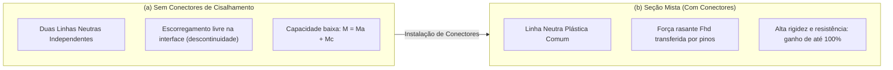
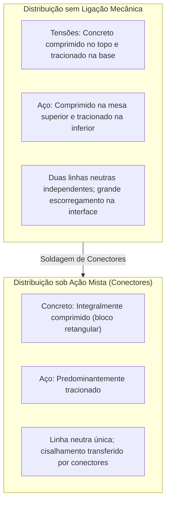
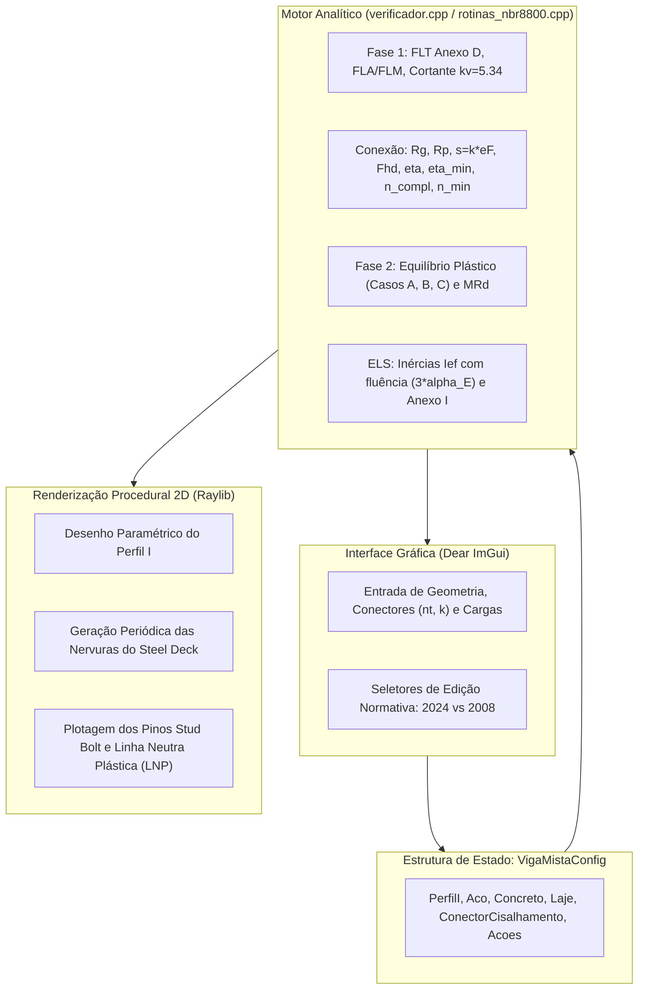

# DESENVOLVIMENTO DE FERRAMENTA COMPUTACIONAL PARA DIMENSIONAMENTO E VERIFICAÇÃO DE VIGAS MISTAS DE AÇO E CONCRETO SEGUNDO A ABNT NBR 8800:2024

---

## RESUMO

As vigas mistas de aço e concreto constituem uma das soluções estruturais mais consagradas e eficientes da construção civil contemporânea, conjugando de forma sinérgica a elevada resistência à tração e ductilidade do aço estrutural com a capacidade de compressão e rigidez do concreto. Em edifícios comerciais e pavimentos industriais, a tipologia predominante é a viga biapoiada de alma cheia associada a lajes com fôrma de aço incorporada (*steel deck*) ou lajes maciças, executada em regime construtivo não escorado. O projeto desse sistema estrutural é inerentemente multifásico: na concretagem (Fase 1), o perfil de aço atua de forma isolada, suportando seu peso próprio, o peso da laje fresca e as sobrecargas transitórias de montagem sem contenção lateral contínua (susceptível aos estados-limites de flambagem lateral com torção pelo Anexo D, flambagem local da mesa e da alma, e esforço cortante); após a cura do concreto (Fase 2), o conjunto opera como seção mista, mobilizando conectores de cisalhamento para resistir aos momentos fletores positivos no Estado Limite Último (ELU) e exigindo rigoroso controle dos Estados Limites de Serviço (ELS), incluindo flechas no tempo infinito com consideração da fluência ($3\alpha_E$) e da interação parcial ($\sqrt{\eta}$), e a verificação dinâmica de vibrações sob o caminhar de pessoas conforme o Anexo I da ABNT NBR 8800:2024. Este trabalho tem como objetivo desenvolver, formalizar e validar uma ferramenta computacional interativa, de código aberto e alto desempenho em linguagem C++20 com renderização vetorial paramétrica em tempo real (Raylib) e interface gráfica imediata (Dear ImGui), capaz de automatizar o encadeamento integral de cálculo segundo a ABNT NBR 8800:2024. O trabalho apresenta a fundamentação teórica rigorosa do Anexo L, detalha o cálculo da conexão com base nos parâmetros físicos reais ($n_t$ conectores por nervura a cada $k$ nervuras, $R_g$, $R_p$, $s_{\min}$ e $s_{\max}$), incorpora a nova formulação do grau de interação mínimo ($\eta_i$), e elucida com rigor estático a gralha tipográfica identificada no termo do momento resistente plástico no Caso b da norma de 2024. Para validação numérica e calibração de todos os algoritmos, adotou-se o caso de estudo de referência de um piso de escritórios com viga W460×52,0 e *steel deck* MF-75 de $9{,}0\text{ m}$ de vão, confrontando-se com perfeita correspondência os resultados do software desenvolvido com o texto didático de apoio e a planilha de referência da Lure Engenharia, consolidando as bases metodológicas para futuras pesquisas em vigas mistas protendidas (VMP).

**Palavras-chave:** Vigas mistas aço-concreto; ABNT NBR 8800:2024; Ferramenta computacional; Construção não escorada; *Steel deck*; Conectores *stud bolt*; Grau de interação mínimo; Vibrações de piso.

---

## ABSTRACT

Steel-concrete composite beams represent one of the most widely adopted and efficient structural systems in modern construction, synergistically combining the high tensile capacity and ductility of structural steel with the compressive strength and stiffness of concrete. In commercial multi-story buildings and industrial floors, the predominant solution is the simply supported solid-web steel I-beam coupled with profiled composite steel deck slabs or solid slabs, executed under unshored construction. The design of this system is inherently multi-phased: during casting (Phase 1), the unbraced bare steel beam supports self-weight, wet concrete, and transient construction live loads alone (governed by lateral-torsional buckling according to Annex D, local flange and web buckling, and web shear); after concrete hardening (Phase 2), the unified section acts compositely, mobilizing shear connectors to resist positive bending moments at the Ultimate Limit State (ULS) and demanding strict compliance with Serviceability Limit States (SLS), such as long-term creep deflections ($3\alpha_E$), partial shear interaction softening ($\sqrt{\eta}$), and human-induced floor walking vibrations prescribed by Annex I of ABNT NBR 8800:2024. The main purpose of this undergraduate thesis is to develop, formalize, and validate an interactive, open-source, high-performance computational software in modern C++20, featuring real-time parametric procedural rendering (Raylib) and an immediate-mode graphical interface (Dear ImGui), automating the complete structural verification chain in strict compliance with ABNT NBR 8800:2024. This research provides a thorough theoretical exposition of Annex L, details the connection calculation based on physical detailing parameters ($n_t$ studs per rib spaced at every $k$ ribs, $R_g$, $R_p$, $s_{\min}$, and $s_{\max}$), incorporates the newly introduced minimum interaction degree equation ($\eta_i$), and rigorously clarifies from mechanical equilibrium principles an editorial misprint identified in the Case b plastic moment formulation of the 2024 Brazilian code. The numerical validation is calibrated against a comprehensive benchmark study consisting of an unshored commercial floor secondary beam (W460×52.0 profile, 9.0 m span, Metform MF-75 steel deck), showing exact numerical agreement between the developed software and the reference benchmark from Lure Engenharia, thereby laying the groundwork for upcoming graduate research on prestressed composite beams (PCB).

**Keywords:** Steel-concrete composite beams; ABNT NBR 8800:2024; Computational software; Unshored construction; Profiled steel deck; Stud bolt connectors; Minimum degree of interaction; Floor vibrations.

---

## LISTA DE SÍMBOLOS E NOTAÇÕES

### Geometria e Propriedades do Perfil de Aço
- $A_a$: Área bruta da seção transversal do perfil de aço ($\text{cm}^2$ ou $\text{mm}^2$)
- $A_{af}$: Área da mesa superior comprimida do perfil de aço ($b_f t_f$)
- $A_{aw}$: Área da alma do perfil de aço ($h_w t_w$ ou $d \cdot t_w$)
- $A_{fb}, A_{ft}$: Áreas das mesas inferior (tracionada) e superior (comprimida) do perfil de aço
- $b_f, t_f$: Largura e espessura da mesa do perfil metálico ($\text{mm}$)
- $C_w$: Constante de empenamento da seção de aço ($\text{cm}^6$ ou $\text{mm}^6$)
- $d, h, h_w$: Altura total do perfil, altura para esbeltez da alma e altura livre entre mesas ($\text{mm}$)
- $I_t, J$: Inércia à torção uniforme de Saint-Venant ($\text{cm}^4$ ou $\text{mm}^4$)
- $I_x, I_y$: Momentos de inércia nos eixos de maior e menor rigidez ($\text{cm}^4$ ou $\text{mm}^4$)
- $r_x, r_y$: Raios de giração em relação aos eixos principais ($\text{cm}$ ou $\text{mm}$)
- $t_w$: Espessura da alma do perfil metálico ($\text{mm}$)
- $W_x, Z_x$: Módulos de resistência elástico e plástico em relação ao eixo x-x ($\text{cm}^3$ ou $\text{mm}^3$)
- $\rho$: Parâmetro de assimetria da seção de aço: $\rho = \frac{1}{2} (A_{fb}/A_{ft} - 1)$

### Propriedades da Laje e Materiais
- $b, b_{ef}$: Espaçamento entre vigas adjacentes e largura colaborante efetiva da laje ($\text{mm}$)
- $b_F, h_F$: Largura média e altura das nervuras da fôrma de aço incorporada (*steel deck*) ($\text{mm}$)
- $e_F, p$: Passo transversal entre nervuras consecutivas da fôrma de aço ($\text{mm}$)
- $E_a, E_c$: Módulos de elasticidade do aço estrutural ($200.000\text{ MPa}$) e secante do concreto ($\text{MPa}$)
- $E_{ci}$: Módulo de elasticidade tangente inicial do concreto: $E_{ci} = \alpha_{ag} \cdot 5600 \sqrt{f_{ck}}$ ($\text{MPa}$)
- $f_{ck}, f_{cd}$: Resistência característica e de cálculo do concreto à compressão: $f_{cd} = f_{ck} / \gamma_c$ ($\text{MPa}$)
- $f_y, f_{yd}$: Resistência característica e de cálculo ao escoamento do perfil de aço: $f_{yd} = f_y / \gamma_{a1}$ ($\text{MPa}$)
- $t_c$: Espessura de concreto considerada na análise (espessura total na laje maciça ou capa acima da crista do *steel deck*) ($\text{mm}$)
- $t_{deck}$: Espessura nominal da chapa de aço da fôrma galvanizada ($\text{mm}$)
- $\alpha_{ag}$: Coeficiente de agregado graúdo da NBR 8800:2024 ($1{,}00$ para granito e gnaisse)
- $\alpha_E$: Razão modular elástica básica: $\alpha_E = E_a / E_c$
- $\eta_c$: Coeficiente de fragilidade do concreto no bloco comprimido: $\eta_c = \min(1{,}00; (40/f_{ck})^{1/3})$

### Conectores de Cisalhamento e Grau de Interação
- $A_{cs}$: Área da seção transversal da haste do pino conector (*stud bolt*): $A_{cs} = \pi d^2 / 4$ ($\text{mm}^2$)
- $c$: Cobrimento de concreto acima do topo da cabeça do conector: $c = (t_c + h_F) - h$ ($\text{mm}$)
- $c_p$: Coeficiente de tipo de construção no grau mínimo ($0{,}85$ não escorada; $1{,}00$ escorada)
- $c_r$: Coeficiente de utilização da viga no grau mínimo: $c_r = \max(0{,}70; M_{Sd}/M_{Rd})$
- $d, h$: Diâmetro nominal da haste e altura total do conector *stud bolt* após a soldagem ($\text{mm}$)
- $e_{mh}$: Distância da borda do fuste do pino à alma da nervura da fôrma medida a meia altura ($\text{mm}$)
- $F_{hd}$: Força horizontal total de cisalhamento longitudinal para interação completa ($100\%$): $F_{hd} = \min(A_a f_{yd}; 0{,}85 \eta_c f_{cd} b_{ef} t_c)$ ($\text{kN}$)
- $f_u, f_{ucs}$: Tensão de ruptura característica e de cálculo à tração do aço do pino conector ($\text{MPa}$)
- $k$: Frequência longitudinal de conectores na laje *steel deck* (conector posicionado a cada $k$ nervuras)
- $L_e$: Comprimento do trecho de momento fletor positivo ($L_e = L$ em vigas biapoiadas) ($\text{m}$)
- $n$: Número de conectores adotados por meio vão (entre o apoio e o centro do vão)
- $n_{\text{compl}}$: Número de conectores por meio vão necessários para interação completa: $\lceil F_{hd} / Q_{Rd} \rceil$
- $n_{\text{lin}}$: Número de linhas transversais de conectores entre o apoio e o meio do vão: $\lfloor (L/2)/s \rfloor$
- $n_{\text{mín}}$: Número de conectores por meio vão para atender ao grau mínimo: $\lceil \eta_i F_{hd} / Q_{Rd} \rceil$
- $n_t, n_l$: Número de conectores dispostos por linha transversal / por nervura de concreto
- $n_{\text{tot}}$: Número total de conectores de cisalhamento na extensão da viga ($2 \cdot n$)
- $Q_{Rd}$: Capacidade resistente de cálculo de um conector isolado: $Q_{Rd} = \min(Q_{Rd1}; Q_{Rd2})$ ($\text{kN}$)
- $Q_{Rd1}, Q_{Rd2}$: Resistência de cálculo do pino por ruptura do concreto e por ruptura do aço ($\text{kN}$)
- $R_g$: Coeficiente redutor de grupo de conectores na nervura (NBR 8800:2024 item L.4.2.1.2)
- $R_p$: Coeficiente redutor de posição e confinamento do conector (NBR 8800:2024 item L.4.2.1.3)
- $s$: Espaçamento longitudinal adotado entre linhas consecutivas de conectores ($\text{mm}$)
- $s_{\max}, s_{\min}$: Limites máximos e mínimos normativos para o espaçamento longitudinal ($\text{mm}$)
- $\sum Q_{Rd}$: Soma das resistências de cálculo dos conectores situados no meio vão: $n \cdot Q_{Rd}$ ($\text{kN}$)
- $\eta$: Grau de interação efetivo adotado: $\eta = \min(1{,}00; \sum Q_{Rd} / F_{hd})$
- $\eta_0$: Grau de interação básico da viga mista sob flexão positiva
- $\eta_i, \eta_{\lim}$: Grau de interação mínimo normativo exigido e limite inferior regulamentar

### Estados Limites Últimos (ELU) e de Serviço (ELS)
- $a$: Altura da linha neutra comprimida na laje de concreto pelo bloco retangular ($\text{mm}$)
- $C_{ad}, T_{ad}$: Força resistente de compressão e tração na seção metálica da viga mista ($\text{kN}$)
- $C_b$: Fator de modificação para diagrama de momento fletor não uniforme na Fase 1
- $f_0$: Frequência fundamental de vibração do piso ($\text{Hz}$)
- $I_{ef}$: Momento de inércia efetivo da viga mista considerando a interação parcial ($\text{cm}^4$)
- $I_{tr}$: Momento de inércia da seção mista homogeneizada elástica trincada/não trincada ($\text{cm}^4$)
- $k_v$: Coeficiente de flambagem da alma por cisalhamento ($5{,}34$ na edição 2024; $5{,}00$ em 2008)
- $M_{cr}$: Momento fletor crítico elástico de Flambagem Lateral com Torção (FLT) (Anexo D) ($\text{kN}\cdot\text{m}$)
- $M_{Rd}, M_{Sd}$: Momento fletor resistente de cálculo e momento fletor solicitante de cálculo ($\text{kN}\cdot\text{m}$)
- $V_{Rd}, V_{Sd}$: Força cortante resistente de cálculo e força cortante solicitante de cálculo ($\text{kN}$)
- $y_c, y_t$: Distâncias dos centroides das áreas comprimida e tracionada do perfil de aço às suas faces ($\text{mm}$)
- $y_p$: Posição da Linha Neutra Plástica (LNP) medida a partir da face superior da mesa de aço ($\text{mm}$)
- $\beta_{vm}$: Fator de vinculação da viga mista ($1{,}00$ para vigas simplesmente apoiadas)
- $\delta_0, \delta_1$: Contraflecha considerada e flecha imediata de construção da Fase 1 ($\text{mm}$)
- $\delta_2, \delta_3$: Flecha de longa duração por cargas permanentes pós-cura e flecha de sobrecarga variável ($\text{mm}$)
- $\gamma_{a1}, \gamma_c, \gamma_{cs}$: Coeficientes parciais de segurança dos materiais ($1{,}10;\ 1{,}40;\ 1{,}25$)

---

# CAPÍTULO 1: INTRODUÇÃO

## 1.1 Contextualização
Na engenharia de estruturas contemporânea, a crescente demanda por sustentabilidade, rapidez de montagem e racionalização de materiais consolidou os sistemas construtivos mistos de aço e concreto como a escolha prioritária para edifícios comerciais de múltiplos andares, garagens suspensas, hospitais e centros de distribuição logística. Em pisos estruturados em aço, a laje de concreto deixou há décadas de ser tratada como um mero diafragma sobreposto que transmite cargas de gravidade passivamente para o vigamento de suporte. 

Ao interligar a mesa superior do perfil metálico à laje de concreto por meio de conectores de cisalhamento, impede-se o escorregamento relativo na interface, forçando os dois componentes a deformarem-se em solidariedade mecânica à flexão. Esse mecanismo composto aproveita o ápice das propriedades mecânicas de cada material:
- O concreto, material resistente à compressão e de baixo custo relativo por unidade de volume, compõe a mesa comprimida da seção equivalente;
- O perfil de aço, detentor de elevada resistência à tração e ductilidade superior, opera predominantemente tracionado na porção inferior da viga.

O resultado direto dessa simbiose estrutural é a obtenção de vigas com capacidade resistente à flexão até $60\%$ a $100\%$ superior e inércia flexional até três vezes maior do que a viga de aço isolada, viabilizando a especificação de perfis mais baixos e consideravelmente mais leves para um mesmo vão livre e padrão de carregamento.

No cenário brasileiro, a solução mais amplamente empregada é a **viga mista biapoiada de alma cheia (seção I laminada ou soldada)**, associada a lajes moldadas sobre fôrmas de aço perfiladas incorporadas (*steel deck*). A fôrma de aço atua como plataforma estável de trabalho durante a montagem, fôrma estanque na concretagem e armadura positiva de flexão no estado de serviço, eliminando o escoramento intermediário nas modulações usuais de $2{,}5\text{ m}$ a $3{,}5\text{ m}$ entre vigas secundárias.



## 1.2 Justificativa e Motivação
A despeito de sua consagrada eficiência estrutural, o dimensionamento rigoroso de uma viga mista de piso encerra um encadeamento multifásico complexo, altamente sensível e repleto de interdependências físicas. Quando o projeto adota o regime de **construção não escorada** — método de execução largamente hegemônico em edificações para desobstruir pavimentos inferiores e reduzir prazos de obra —, a viga atravessa duas fases mecânicas distintas com modelos de comportamento e hipóteses de cálculo completamente diferentes:

1. **Fase 1 (Construção Não Escorada — Perfil de Aço Isolado):** Antes que a massa de concreto atinja resistência mecânica ($f_{ck}$), o perfil metálico atua sozinho como viga de aço sem contenção lateral contínua. Ele deve suportar com segurança seu peso próprio, o peso da fôrma, o concreto fresco fluido e a sobrecarga de construção transitória (mínimo de $1{,}0\text{ kN/m}^2$ conforme NBR 8800 item N.4.1.3). A mesa superior encontra-se comprimida e destravada entre pontos de contenção provisória ($L_b$), expondo o elemento à instabilidade por Flambagem Lateral com Torção (FLT, Anexo D), Flambagem Local da Mesa (FLM) e Flambagem Local da Alma (FLA), além da força cortante pura;
2. **Fase 2 (Seção Mista em Serviço e ELU):** Consolidada a cura da laje, os conectores do tipo pino com cabeça (*stud bolt*) passam a mobilizar o esforço rasante horizontal ($F_{hd}$). A resistência ao momento fletor positivo positivo depende da classificação da alma e da plasticidade da seção (determinação exata da Linha Neutra Plástica na laje, na mesa superior ou na alma de aço). Caso a densidade de pinos não atinja a interação completa, a viga opera sob **interação parcial**, exigindo a verificação do grau de interação mínimo ($\eta_i$) e a avaliação da rigidez efetiva ($I_{ef}$);
3. **Estados Limites de Serviço e Dinâmica (ELS):** Por serem elementos esbeltos e leves, as vigas mistas são governadas frequentemente pelas verificações de deformação em serviço (flechas diferidas no tempo com taxa de fluência $3\alpha_E$ e redução por interação parcial $\sqrt{\eta}$) e, crucialmente, pela verificação do conforto humano quanto a **vibrações sob o caminhar de pessoas**, formalizada com grande rigor analítico pelo Anexo I da nova ABNT NBR 8800:2024.

Na rotina profissional dos escritórios de projeto de estruturas, a condução desse encadeamento por métodos expeditos, rotinas manuais ou planilhas despadronizadas é frequentemente vulnerável a erros conceituais, equívocos na interpretação geométrica do *steel deck* (coeficientes $R_g$ e $R_p$) e divergências nas equações normativas. Torna-se imperativo, portanto, o desenvolvimento de ferramentas computacionais dedicadas, estruturadas sob modernas linguagens compiladas com alto rigor analítico e interface gráfica interativa, capazes de conferir transparência algorítmica e diagnóstico estrutural instantâneo ao projetista.

Adicionalmente, a publicação da **ABNT NBR 8800:2024** introduziu reformulações substanciais no cálculo de vigas mistas:
- Migração dos requisitos de vigas mistas do antigo Anexo O para o **Anexo L**;
- Atualização do cálculo do módulo do concreto com ponderação de agregados graúdos ($\alpha_{ag}$);
- Introdução do coeficiente de fragilidade $\eta_c = (40/f_{ck})^{1/3} \le 1{,}0$ no bloco retangular de compressão (L.1.3.4);
- Reformulação total do grau de interação mínimo ($\eta_i$), que agora depende da assimetria do perfil ($\rho$), do tipo de construção ($c_p$) e da taxa de utilização à flexão ($c_r$);
- Atualização do coeficiente de flambagem da alma por cisalhamento de $k_v = 5{,}0$ para **$k_v = 5{,}34$**;
- Formalização do **Anexo I** para análise dinâmica de vibração de pisos;
- E a identificação, de notável relevância técnico-científica, de um **lapso tipográfico material de editoração na fórmula de momento fletor resistente do Caso b no Anexo L (onde grafou-se inadvertidamente $\sum Q_{Rd}$ em vez de $C_{ad}$)**.

Integrar esses avanços normativos em uma plataforma computacional transparente, fundamentada nas lições do texto de apoio e na planilha de referência didática da Lure Engenharia, constitui uma contribuição oportuna e de elevado valor para a engenharia de estruturas nacional.

## 1.3 Objetivos do Trabalho

### 1.3.1 Objetivo Geral
Desenvolver, formalizar matematicamente e validar uma ferramenta computacional moderna, interativa e de alta performance em linguagem C++20 (utilizando a biblioteca gráfica Raylib e Dear ImGui), para o dimensionamento e a verificação completa de vigas mistas de aço e concreto biapoiadas de alma cheia em construção não escorada, em rigorosa conformidade com a teoria e as prescrições da ABNT NBR 8800:2024.

### 1.3.2 Objetivos Específicos
1. **Formulação do Mecanismo Multifásico de Verificação:** Desenvolver e implementar algoritmos para a Fase 1 (verificação à flexão com FLT pelo Anexo D da NBR 8800:2024, flambagens locais FLM/FLA e cortante puro com $k_v = 5{,}34$) e para a Fase 2 (análise plástica de tensões nos Casos A, B e C, verificação elástica para seções semicompactas, armadura de costura e controle rigoroso de flechas no tempo infinito);
2. **Sistematização Paramétrica dos Conectores e Grau de Interação:** Implementar a lógica física real de disposição dos conectores de cisalhamento, diferenciando a modulação por nervuras em *steel deck* transversal ($n_t$ pinos por nervura a cada $k$ ondas, $s = k \cdot e_F$) e lajes maciças ($s$ contínuo), automatizando a avaliação de $R_g$, $R_p$, $s_{\min}$, $s_{\max}$, conectores para $100\%$ ($n_{\text{compl}}$), conectores para o grau mínimo ($n_{\text{mín}}$) e o atendimento a $\eta \ge \eta_i$;
3. **Elucidação Analítica e Correção da Gralha do Caso B da NBR 8800:2024:** Demonstrar por equilíbrio estático e princípios da mecânica das estruturas que o primeiro termo da equação de $M_{Rd}$ no Caso b deve conter a resultante de compressão do aço $C_{ad}$, corrigindo a gralha tipográfica impressa como $\sum Q_{Rd}$ no texto oficial da norma;
4. **Implementação da Verificação Dinâmica de Vibração de Pisos (Anexo I):** Automatizar o cálculo da frequência fundamental ($f_0$), largura colaborante ($B_b$), massa modal ($M$), aceleração de pico ($a_p$) e fator de resposta ($R$) segundo o Anexo I e as diretrizes do AISC Design Guide 11;
5. **Desenvolvimento de Interface Gráfica e Renderização Paramétrica 2D:** Construir um ambiente visual a 60 FPS com renderização em escala precisa do perfil I, nervuras centradas do *steel deck*, conectores posicionados e indicação explícita da Linha Neutra Plástica (LNP) e do bloco de compressão;
6. **Validação Numérica Frente à Planilha e Memorial de Referência:** Calibrar e validar os resultados numéricos do software desenvolvido frente ao exemplo resolvido de piso em *steel deck* da planilha `Viga_Mista_NBR8800-2024.xlsx` e memorial didático da Lure Engenharia, atestando exatidão estrita em todas as tabelas de saída;
7. **Bases para Pesquisa de Mestrado em Vigas Mistas Protendidas (VMP):** Conceber a arquitetura modular do código-fonte para viabilizar sua extensão imediata para elementos com cabos de protensão externos aplicados a pontes e grandes vãos.

## 1.4 Estrutura do Documento
Este Trabalho de Conclusão de Curso organiza-se em cinco capítulos:
- **Capítulo 2 (Fundamentação Teórica e Prescrições da NBR 8800:2024):** Apresenta a mecânica da viga mista, as propriedades dos materiais, a largura efetiva, a verificação do perfil isolado na Fase 1, o dimensionamento dos conectores e o cálculo do grau mínimo $\eta_i$, o equilíbrio plástico na Fase 2 com elucidação da gralha tipográfica, a análise de flechas e a vibração pelo Anexo I, encerrando com um quadro comparativo entre as normas de 2008 e 2024;
- **Capítulo 3 (Desenvolvimento da Ferramenta Computacional):** Detalha a arquitetura de software em C++20, Raylib e Dear ImGui, a organização modular do código e a formalização algorítmica sob a forma de pseudocódigos estruturados;
- **Capítulo 4 (Resultados, Validação e Discussão):** Apresenta a resolução analítica completa do estudo de caso base de $9{,}0\text{ m}$ em *steel deck* MF-75 calibrado com a planilha de referência, acompanhada de análises paramétricas de sensibilidade de grau de interação, vão livre e sistemas de laje;
- **Capítulo 5 (Conclusões e Trabalhos Futuros):** Sintetiza as conclusões técnicas obtidas e traça o roteiro de evolução metodológica para Vigas Mistas Protendidas (VMP).

---

# CAPÍTULO 2: FUNDAMENTAÇÃO TEÓRICA E PRESCRIÇÕES NORMATIVAS

## 2.1 Mecânica da Viga Mista e Ação Composta
Considere-se uma viga de piso formada por um perfil metálico de alma cheia sobre o qual apoia-se uma laje de concreto. Se não houver ligação mecânica na interface entre a mesa superior do aço e o concreto, cada elemento flete de maneira independente em torno do seu próprio eixo baricêntrico neutro. Nessas condições:
- A face inferior da laje sofre deformação de tração, enquanto a face superior do perfil de aço sofre deformação de encurtamento por compressão;
- Essa incompatibilidade cinemática gera uma descontinuidade abrupta de deformações específicas ao longo da interface, resultando em um escorregamento relativo horizontal ($s$);
- A rigidez flexional do conjunto resume-se à soma simples das inércias individuais ($I_{tot} = I_a + I_c$), sendo a contribuição da laje delgada praticamente inexpressiva.

Ao introduzir conectores de cisalhamento soldados ao longo do topo da viga de aço e embebidos no concreto, restringe-se o escorregamento relativo na interface. O cisalhamento longitudinal decorrente do gradiente de momentos fletores ($\tau = V Q / I$) passa a ser transferido entre os dois materiais. 

Sob interação completa, as deformações específicas longitudinais tornam-se contínuas na interface de contato, estabelecendo uma única linha neutra para a seção composta. A resultante das tensões de compressão posiciona-se no concreto da laje e a resultante de tração concentra-se no perfil de aço, gerando um braço interno de alavanca $z$ consideravelmente superior à meia-altura do perfil metálico isolado.



## 2.2 Sistemas de Lajes Usados no Brasil e Orientação das Nervuras
Segundo a ABNT NBR 8800:2024 (item L.1.1.1), as lajes que podem compor vigas mistas classificam-se em quatro tipologias principais:
1. **Laje Maciça Moldada no Local:** Moldada integralmente sobre cimbramento no canteiro. Permite espessura livre e aceita conectores tipo pino com cabeça (*stud bolt*) ou perfil U laminado/dobrado a frio. Exige fôrmas provisórias contínuas e acarreta maior peso próprio;
2. **Laje com Fôrma de Aço Incorporada (*Steel Deck*):** Utiliza chapa perfilada de aço galvanizado estrutural (espessuras usuais de $0{,}80\text{ mm}$ a $1{,}20\text{ mm}$) com mossas nas almas das nervuras que asseguram a aderência mecânica ao concreto endurecido. A fôrma cumpre tripla função (plataforma de montagem, fôrma na concretagem e armadura positiva de flexão no sentido transversal às vigas secundárias). Na NBR 8800:2024, impõem-se os limites: altura máxima da nervura $h_F \le 75\text{ mm}$, largura média da nervura $b_F \ge 50\text{ mm}$, diâmetro de pino soldado através da fôrma $d \le 19\text{ mm}$ e projeção do topo do conector de no mínimo $40\text{ mm}$ acima da crista da fôrma ($h \ge h_F + 40\text{ mm}$);
3. **Lajes com Pré-lajes Pré-moldadas:** Elementos pré-moldados de espessura $\le 75\text{ mm}$ complementados com capa de concreto estrutural moldada *in loco*;
4. **Lajes Alveolares Pré-moldadas:** Painéis de concreto protendido com alvéolos longitudinais e capeamento estrutural superior.

### Influência da Orientação das Nervuras do Steel Deck
A orientação das ondas da chapa perfilada em relação ao eixo longitudinal da viga de aço modifica substancialmente o fluxo de forças:
- **Nervuras Perpendiculares à Viga (Transversais):** Caso clássico e predominante de **vigas secundárias de piso**, onde a fôrma vence o vão entre vigas adjacentes apoiando-se diretamente na mesa superior do perfil. As ondas da chapa interrompem a continuidade do concreto longitudinalmente. Portanto, por exigência expressa do item L.2.6.2-a da NBR 8800:2024, **o concreto contido no interior das nervuras da fôrma deve ser completamente desconsiderado no cálculo da área comprimida ($A_c = b_{ef} \cdot t_c$) e nas propriedades elásticas homogeneizadas ($I_{tr}$ e $I_{ef}$)**. Apenas a espessura da capa $t_c$ situada acima da crista metálica é computada. Ademais, os conectores ficam confinados dentro das nervuras de concreto transversais, sofrendo reduções em sua capacidade pelos fatores $R_g$ e $R_p$;
- **Nervuras Paralelas à Viga (Longitudinais):** Caso típico de **vigas principais de piso** onde a fôrma corre paralelamente à viga. Uma nervura contínua assenta-se sobre a mesa metálica. A norma permite computar o concreto da nervura contínua, desde que respeitada a largura média $b_F$.

| Parâmetro de Comparação | Laje Maciça Moldada *in loco* | Steel Deck com Nervuras Perpendiculares | Steel Deck com Nervuras Paralelas |
| :--- | :---: | :---: | :---: |
| **Concreto considerado na flexão** | Espessura total $h_c = t_c$ | Apenas capa acima da fôrma ($t_c$) | Capa $t_c$ ($+$ nervura se contínua) |
| **Conector permitido** | Pino com cabeça ou Perfil U | Apenas Pino com cabeça ($d \le 19\text{ mm}$) | Apenas Pino com cabeça ($d \le 19\text{ mm}$) |
| **Fator de grupo ($R_g$)** | $1{,}00$ | $1{,}00$ ($1$ pino); $0{,}85$ ($2$ pinos); $0{,}70$ ($\ge 3$) | $1{,}00$ se $b_F/h_F \ge 1{,}5$; senão $0{,}85$ |
| **Fator de posição ($R_p$)** | $0{,}75$ (solda direta) | $0{,}75$ ($e_{mh} \ge 50\text{ mm}$); $0{,}60$ (desfavorável) | $0{,}75$ |
| **Espaçamento longitudinal ($s$)** | Contínuo informado ($s$) | Múltiplo do passo: $s = k \cdot e_F$ | Contínuo informado ($s$) |
| **Dispensa de escoramento** | Rara (exige cimbramento) | Padrão nos vãos usuais de laje | Padrão nos vãos usuais de laje |

## 2.3 Largura Efetiva da Laje de Concreto ($b_{ef}$)
A flexão da mesa de concreto acarreta gradiente transversal não uniforme de tensões normais de compressão, sendo máxima sobre a alma metálica e decrescente à medida que se afasta do eixo da viga, efeito denominado atraso de cisalhamento (*shear lag*). Para fins práticos de projeto, substitui-se a largura física real de influência por uma **largura colaborante efetiva retangular uniforme ($b_{ef}$)**.

Conforme o item L.6.2 da ABNT NBR 8800:2024, a largura efetiva para vigas simplesmente apoiadas compõe-se pela soma das larguras participantes à esquerda ($b_1$) e à direita ($b_2$) do eixo do perfil:

$$b_{ef} = b_1 + b_2$$

Sendo as parcelas calculadas por:
- **Para lado com viga mista adjacente:**
  $$b_{1,2} = \min\left( \frac{L}{8};\; \frac{e_{1,2}}{2} \right)$$
- **Para lado com borda livre (balanço de laje):**
  $$b_{1,2} = \min\left( \frac{L}{8};\; \text{balanço} \right)$$

Em vigas secundárias internas de piso modulado com espaçamento uniforme entre vigas $e = e_1 = e_2$:

$$b_{ef} = \min\left( \frac{L}{4};\; e \right)$$

## 2.4 Fase 1: Perfil de Aço Isolado em Construção Não Escorada
Na construção não escorada, a viga de aço suporta sozinha todas as cargas gravíticas incidentes até que a laje atinja resistência mecânica suficiente.

### 2.4.1 Ações Atuantes e Combinações de Cálculo
A carga permanente da Fase 1 ($g_1$) compõe-se pelo peso próprio do perfil metálico ($g_a$) e pelo peso da laje fresca de concreto com a fôrma de aço:

$$g_1 = g_a + (\gamma_{conc} \cdot h_{eq} + g_{deck}) \cdot b_{inf}$$

Onde $h_{eq}$ é a espessura média equivalente de concreto da laje (para steel deck MF-75 com $t_c = 65\text{ mm}$ e $h_F = 75\text{ mm}$, tem-se $h_{eq} \approx 98\text{ mm}$ e peso próprio fresco $\approx 2{,}44\text{ kN/m}^2$).

A ação variável de construção ($q_1$) contempla a sobrecarga transitória de operários, equipamentos de lançamento e acúmulo temporário de concreto. A NBR 8800 (item N.4.1.3) impõe carga uniforme mínima de:

$$q_c \ge 1{,}0\text{ kN/m}^2 \implies q_1 = q_c \cdot b_{inf}$$

A combinação última de projeto da Fase 1 resulta em:

$$q_{Sd1} = 1{,}25 \cdot g_1 + 1{,}30 \cdot q_1$$

$$M_{Sd1} = \frac{q_{Sd1} \cdot L^2}{8}, \quad V_{Sd1} = \frac{q_{Sd1} \cdot L}{2}$$

### 2.4.2 Flambagem Lateral com Torção (FLT) — Anexo D da NBR 8800:2024
Como a mesa superior está comprimida e desprovida de contenção contínua antes do endurecimento do concreto, a viga deve ser verificada à Flambagem Lateral com Torção para o comprimento destravado $L_b$ (distância entre travamentos provisórios ou escoras). 

O momento crítico elástico de FLT é calculado com a formulação do Anexo D da ABNT NBR 8800:2024:

$$M_{cr} = \frac{C_b \pi^2 E_a I_y}{L_b^2} \sqrt{\frac{C_w}{I_y} \left(1 + 0{,}039 \frac{I_t L_b^2}{C_w}\right)}$$

Onde $C_b$ é o fator de momento fletor não uniforme (adotando-se conservadoramente $C_b = 1{,}00$ no trecho crítico). O momento fletor resistente de cálculo ($M_{Rd,aço}$) é governado pelo índice de esbeltez da viga:

$$\lambda = \sqrt{\frac{M_{pl}}{M_{cr}}}, \quad M_{pl} = Z_x \cdot f_y$$

- **Se $\lambda \le 0{,}20$ (Regime Plástico):**
  $$M_{Rd,aço} = \frac{M_{pl}}{\gamma_{a1}}$$
- **Se $0{,}20 < \lambda \le 1{,}40$ (Regime Inelástico):**
  $$M_{Rd,aço} = \frac{M_{pl}}{\gamma_{a1}} \left[ 1{,}0 - 0{,}5 \left( \frac{\lambda - 0{,}20}{1{,}20} \right) \right]$$
- **Se $\lambda > 1{,}40$ (Regime Elástico):**
  $$M_{Rd,aço} = \frac{0{,}90}{\lambda^2} \frac{M_{pl}}{\gamma_{a1}} = \frac{M_{cr}}{\gamma_{a1}}$$

### 2.4.3 Força Cortante Resistente da Alma
A alma do perfil de aço resiste integralmente ao esforço cortante de cálculo $V_{Sd1}$:

$$V_{pl} = 0{,}60 \cdot f_y \cdot (d \cdot t_w)$$

A NBR 8800:2024 atualizou o coeficiente de flambagem da alma por cisalhamento de almas sem enrijecedores para **$k_v = 5{,}34$** (item 5.4.3.1.1, alinhando-se ao AISC 360-22):

$$\lambda = \frac{h}{t_w}, \quad \lambda_p = 1{,}10 \sqrt{\frac{k_v E_a}{f_y}}, \quad \lambda_r = 1{,}37 \sqrt{\frac{k_v E_a}{f_y}}$$

Para almas compactas ao cisalhamento ($\lambda \le \lambda_p$):

$$V_{Rd} = \frac{V_{pl}}{\gamma_{a1}}$$

## 2.5 Conexão de Cisalhamento e Grau de Interação
Os conectores têm a função primordial de transmitir o fluxo longitudinal de forças rasantes ($F_{hd}$) entre o perfil metálico e a laje de concreto.

### 2.5.1 Capacidade Resistente Individual do Pino com Cabeça ($Q_{Rd}$)
Conforme o item L.4.2.1.1 da ABNT NBR 8800:2024, a resistência de cálculo de um conector tipo pino com cabeça (*stud bolt*) soldado através da fôrma ou diretamente na mesa de aço é dada pelo menor valor entre dois modos de falha:

$$Q_{Rd} = \min\left( Q_{Rd1};\; Q_{Rd2} \right)$$

1. **Ruptura por Esmagamento do Concreto circundante ($Q_{Rd1}$):**
   $$Q_{Rd1} = \frac{0{,}50 \cdot A_{cs} \sqrt{f_{ck} E_c}}{\gamma_{cs}}$$
   *(com coeficiente $\gamma_{cs} = 1{,}25$ e área do fuste $A_{cs} = \pi d^2 / 4$)*
2. **Ruptura por Tração/Cisalhamento do Aço do Pino ($Q_{Rd2}$):**
   $$Q_{Rd2} = \frac{R_g \cdot R_p \cdot A_{cs} \cdot f_u}{\gamma_{cs}}$$
   *(onde $f_u = 415\text{ MPa}$ ou $420\text{ MPa}$ para conectores ASTM A108)*

### 2.5.2 Coeficientes de Grupo ($R_g$) e Posição ($R_p$)
A NBR 8800:2024 sistematizou os fatores de redução em conformidade estrita com o AISC 360-16:
- **Coeficiente de Grupo ($R_g$ - Tabela L.4.2.1.2):**
  - Laje maciça: $R_g = 1{,}00$;
  - *Steel deck* com nervuras perpendiculares:
    - $1$ pino por nervura ($n_t = 1$): $R_g = 1{,}00$;
    - $2$ pinos por nervura ($n_t = 2$): $R_g = 0{,}85$;
    - $3$ ou mais pinos por nervura ($n_t \ge 3$): $R_g = 0{,}70$;
  - *Steel deck* com nervuras paralelas: $R_g = 1{,}00$ se $b_F / h_F \ge 1{,}50$; caso contrário $R_g = 0{,}85$.
- **Coeficiente de Posição ($R_p$ - Tabela L.4.2.1.3):**
  - Laje maciça ou pinos soldados diretamente no perfil sem fôrma: $R_p = 0{,}75$ (**Atenção:** na edição de 2024, o item L.4.2.1.3-a reduziu $R_p$ de $1{,}00$ para $0{,}75$ para refletir ensaios *push-out* realistas);
  - *Steel deck* com nervuras perpendiculares: $R_p = 0{,}75$ quando a distância da borda do fuste à alma da nervura a meia altura for $e_{mh} \ge 50\text{ mm}$ e a projeção livre for $h - h_F \ge 40\text{ mm}$; caso contrário $R_p = 0{,}60$;
  - *Steel deck* com nervuras paralelas: $R_p = 0{,}75$.

### 2.5.3 Força Rasante para Interação Completa ($F_{hd}$)
A força rasante horizontal total necessária para desenvolver a interação completa no trecho entre o momento nulo e o momento máximo (meio vão) é governada pelo menor valor entre a tração máxima do perfil e a compressão máxima da laje:

$$F_{hd} = \min\left( A_a f_{yd};\; 0{,}85 \eta_c f_{cd} b_{ef} t_c \right)$$

O número de conectores por meio vão estritamente necessário para alcançar a interação completa ($100\%$) é:

$$n_{\text{compl}} = \left\lceil \frac{F_{hd}}{Q_{Rd}} \right\rceil$$

### 2.5.4 Disposição dos Conectores e Grau de Interação Efetivo ($\eta$)
Na prática executiva de vigas com *steel deck* transversal, os pinos são soldados nas nervuras da fôrma com frequência regular a cada $k$ ondas ($k = 1$ para todas as nervuras; $k = 2$ para nervuras alternadas):

$$s = k \cdot e_F$$

O número de linhas de conectores no meio vão resulta do truncamento inteiro:

$$n_{\text{lin}} = \left\lfloor \frac{L / 2}{s} \right\rfloor$$

Totalizando no meio vão $n = n_{\text{lin}} \cdot n_t$ pinos, e na viga inteira $n_{\text{tot}} = 2 \cdot n$ pinos. A força total transferida pela conexão no meio vão é:

$$\sum Q_{Rd} = n \cdot Q_{Rd}$$

E o **grau de interação adotado ($\eta$)** é dado por:

$$\eta = \min\left( 1{,}00;\; \frac{\sum Q_{Rd}}{F_{hd}} \right)$$

- Se $\eta = 1{,}00$: **Interação Completa** (capacidade máxima de flexão mobilizável);
- Se $\eta < 1{,}00$: **Interação Parcial** (capacidade limitada pelo número de conectores).

### 2.5.5 Grau de Interação Mínimo ($\eta_i$) da ABNT NBR 8800:2024
A flexão sob interação parcial acarreta escorregamento relativo na interface. Para assegurar que as deformações de cisalhamento não esgotem prematuramente a ductilidade dos conectores das extremidades antes de a viga atingir a plastificação, o item L.2.3.1.1.2 da ABNT NBR 8800:2024 estabelece uma formulação analítica avançada para o grau mínimo de interação:

$$\eta \ge \eta_i = \min\left[ 1{,}00;\; \max\left( c_p \cdot c_r^2 \cdot \eta_0;\; \eta_{\lim} \right) \right]$$

Onde os parâmetros componentes são calculados por:
1. **Grau de Interação Básico ($\eta_0$):**
   $$\eta_0 = 1 - \frac{E_a}{580 \cdot f_y} \left[ 0{,}75 - 0{,}45 \rho - (0{,}030 - 0{,}015 \rho) L_e \right]$$
   *(com $E_a$ e $f_y$ expressos em $\text{MPa}$ e o comprimento do vão $L_e$ em metros)*
2. **Parâmetro de Assimetria da Seção de Aço ($\rho$):**
   $$\rho = \frac{1}{2} \left( \frac{A_{fb}}{A_{ft}} - 1 \right) = 0{,}00 \quad \text{(para perfis duplamente simétricos onde } A_{fb} = A_{ft}\text{)}$$
3. **Coeficiente do Tipo de Construção ($c_p$):**
   $$c_p = 0{,}85 \text{ (construção não escorada)}; \quad c_p = 1{,}00 \text{ (construção escorada)}$$
4. **Coeficiente de Utilização à Flexão da Viga ($c_r$):**
   $$c_r = \max\left( 0{,}70;\; \frac{M_{Sd}}{M_{Rd}} \right)$$
5. **Grau de Interação Limite Inferior ($\eta_{\lim}$):**
   $$\eta_{\lim} = 0{,}40 \cdot c_r \cdot (1 + 0{,}8 \rho)$$

O número de conectores por meio vão indispensável para cumprir a exigência normativa é:

$$n_{\text{mín}} = \left\lceil \frac{\eta_i \cdot F_{hd}}{Q_{Rd}} \right\rceil$$

Se $\eta < \eta_i$, a viga é reprovada no estado-limite de ductilidade da conexão, exigindo-se o aumento de conectores por linha ($n_t$) ou a redução do passo ($k$).

### 2.5.6 Verificações Geométricas e Espaçamentos Regulamentares
Conforme os itens L.4.1, L.4.3 e L.4.4 da NBR 8800:2024:
- **Espaçamento Longitudinal Mínimo:** $s_{\min} = 4 \cdot d$ com *steel deck* ($76\text{ mm}$ para pino de $19\text{ mm}$) e $6 \cdot d$ para laje maciça ($114\text{ mm}$);
- **Espaçamento Longitudinal Máximo:** $s_{\max} = \min(8 \cdot h_{\text{laje}};\; 915\text{ mm})$ para *steel deck* perpendicular, e $8 \cdot h_{\text{laje}}$ para laje maciça;
- **Alerta de Ancoragem da Fôrma (Item L.2.6.2-b):** Se $s > 450\text{ mm}$ em fôrmas perpendiculares, deve-se prever pontos adicionais de fixação da fôrma à mesa por soldas tampão espaçadas no máximo a $450\text{ mm}$;
- **Diâmetro Máximo:** $d \le 19\text{ mm}$ em *steel deck*; em mesas comprimidas de perfis, $d \le 2{,}5 \cdot t_f$ (quando houver apenas 1 pino por linha posicionado sobre a alma, admite-se dispensar este limite conforme nota da planilha de referência);
- **Capacidade Transversal da Mesa:** Para dispor $n_t$ conectores lado a lado com espaçamento transversal mínimo $s_t = 4 \cdot d$ e distâncias de borda de $25\text{ mm}$:
  $$(n_t - 1) \cdot 4 d \le b_f - d \implies n_{t,\max} = 1 + \left\lfloor \frac{b_f - 2 \cdot 25\text{ mm}}{4 \cdot d} \right\rfloor$$

## 2.6 Fase 2: Flexão Positiva da Seção Mista e Equilíbrio Plástico
Para vigas com alma compacta ($\lambda_w \le \lambda_p$) submetidas a momento positivo, a NBR 8800:2024 adota o **Modelo de Distribuição Plástica de Tensões** no ELU.

### 2.6.1 Casos de Posição da Linha Neutra Plástica (LNP)
A força de compressão máxima suportável pelo concreto da laje sob plastificação plena é:

$$C_{cd,\max} = 0{,}85 \cdot \eta_c \cdot f_{cd} \cdot b_{ef} \cdot t_c$$

E a força transmitida na interface é limitada pela conexão:

$$C_{cd} = \min\left( C_{cd,\max};\; \sum Q_{Rd} \right) = \eta \cdot F_{hd}$$

A posição da Linha Neutra Plástica divide-se em três regimes:

#### Caso A: Linha Neutra Plástica na Laje de Concreto
Ocorre exclusivamente sob interação completa quando $C_{cd,\max} \ge A_a f_{yd}$. A profundidade comprimida de concreto é:

$$a = \frac{A_a f_{yd}}{0{,}85 \, \eta_c \, f_{cd} \, b_{ef}} \le t_c$$

Todo o perfil metálico encontra-se tracionado a $f_{yd}$, com centroide de tração no centro geométrico do perfil ($d/2$). O momento resistente de cálculo é:

$$M_{Rd} = \beta_{vm} \cdot (A_a f_{yd}) \cdot \left( \frac{d}{2} + h_F + t_c - \frac{a}{2} \right)$$

#### Caso B: Linha Neutra Plástica na Mesa Superior do Perfil
Ocorre sob interação parcial ($\eta < 1{,}00$) ou quando $A_a f_{yd} > C_{cd,\max}$. A laje fica totalmente comprimida ($a = t_c$) com resultante $C_{cd}$. Para equilibrar o perfil, uma parcela de compressão metálica $C_{ad}$ desenvolve-se no topo da mesa:

$$C_{ad} = \frac{A_a f_{yd} - C_{cd}}{2}, \quad T_{ad} = C_{cd} + C_{ad}$$

A LNP situa-se na mesa superior quando $C_{ad} \le b_f t_f f_{yd}$:

$$y_p = \frac{C_{ad}}{b_f \cdot f_{yd}} \le t_f$$

O centroide da parte comprimida situa-se em $y_c = y_p / 2$, e o centroide da parte tracionada $y_t$ resulta do momento estático da área remanescente tracionada. O momento fletor resistente resulta do equilíbrio em torno do ponto de aplicação de $T_{ad}$:

$$M_{Rd} = \beta_{vm} \left[ C_{ad} (d - y_t - y_c) + C_{cd} \left(\frac{t_c}{2} + h_F + d - y_t\right) \right]$$

#### Caso C: Linha Neutra Plástica na Alma do Perfil
Ocorre quando $C_{ad} > b_f t_f f_{yd}$. A LNP penetra na alma:

$$y_p = t_f + \frac{C_{ad} - b_f t_f f_{yd}}{t_w \cdot f_{yd}}$$

A formulação do momento resistente preserva a mesma estrutura de equilíbrio com centros de gravidade determinados por decomposição de áreas.

---

## 2.7 Investigação Mecânica e Elucidação da Gralha Tipográfica no Caso B da NBR 8800:2024

> [!CAUTION]
> **Identificação de Inconsistência Formal no Texto Publicado da ABNT NBR 8800:2024:**
> No item L.2.3.1.1.1-b (página 225 da edição oficial de 2024), a expressão do momento resistente positivo para o Caso b foi impressa como:
> $$M_{Rd} = \beta_{vm} \left[ \mathbf{\sum Q_{Rd}} \, (d - y_t - y_c) + C_{cd} \left(\frac{t_c}{2} + h_F + d - y_t\right) \right]$$

Uma análise estática elementar demonstra de maneira irrefutável que a presença de $\sum Q_{Rd}$ multiplicando o primeiro braço de alavanca constitui um **lapso gráfico material de editoração**, devendo a grandeza ser invariavelmente **$C_{ad}$**, tal como constava na edição de 2008 e conforme a planilha de referência da Lure Engenharia:

1. **Incoerência de Braço de Alavanca:** A distância $(d - y_t - y_c)$ é o braço de alavanca estático **interno ao perfil de aço**, compreendido entre o centro de gravidade da região comprimida do aço ($y_c$) e o centro de gravidade da região tracionada do aço ($y_t$). A força que atua nessa distância é a resultante interna de compressão no aço, que é estritamente **$C_{ad}$**. A força dos conectores $\sum Q_{Rd}$ atua na interface topo da mesa–laje, a uma distância $(d - y_t + h_F + t_c/2)$, sendo fisicamente impossível multiplicar pelo braço interno do aço;
2. **Redução ao Absurdo sob Interação Completa:** Sob interação completa com $A_a f_{yd} > C_{cd}$, tem-se $\sum Q_{Rd} \ge C_{cd}$. Se uma viga possuir conectores com capacidade sobressalente (por exemplo, $\sum Q_{Rd} = 3000\text{ kN}$), enquanto a compressão necessária na mesa for de apenas $C_{ad} = 150\text{ kN}$, a aplicação cega da fórmula impressa produziria um momento resistente absurdo e hipertrofiado, violando o equilíbrio estático de forças;
3. **Contradição com a Alínea Subsequente (Caso c):** Na alínea c imediatamente posterior (L.2.3.1.1.1-c), a própria norma de 2024 escreve a equação corretamente utilizando o produto $C_{ad} (d - y_t - y_c)$;
4. **Origem da Falha Tipográfica:** Na revisão de texto entre 2008 e 2024, efetuou-se uma substituição automática no texto explicativo que substituiu a expressão original *"onde $C_{ad}$..."* por *"onde $\sum Q_{Rd}$..."*, propagando inadvertidamente a troca de variáveis para dentro do colchete da fórmula do Caso b.

Diante disso, o software desenvolvido neste trabalho implementa a formulação rigorosa e segura com **$C_{ad}$**.

---

## 2.8 Estados Limites de Serviço (ELS)

### 2.8.1 Propriedades Homogeneizadas da Seção Mista
As verificações de serviço baseiam-se na homogeneização elástica da laje de concreto em uma largura equivalente de aço ($b_{ef} / n$):
- **Curta Duração:** Razão modular $n = \alpha_E = E_a / E_c$ (ações variáveis);
- **Longa Duração:** Razão modular $3\alpha_E$ (ações permanentes para computar a fluência simplificada segundo o item L.1.2.1).

O concreto tracionado é desprezado. Caso a linha neutra elástica caia dentro da laje de concreto ($y_0 > d + h_F$), recalcula-se a posição da linha neutra considerando apenas a profundidade de concreto efetivamente comprimida ($x$).

### 2.8.2 Rigidez Efetiva sob Interação Parcial ($I_{ef}$)
A interação parcial introduz flexibilidade adicional devido à deformação de cisalhamento dos conectores. Conforme o item L.1.2.2.1 da NBR 8800:2024 e o Comentário I3 do AISC 360-16, a inércia efetiva é interpolada por:

$$I_{ef} = I_a + \sqrt{\frac{\sum Q_{Rd}}{F_{hd}}} \cdot (I_{tr} - I_a) = I_a + \sqrt{\eta} \cdot (I_{tr} - I_a)$$

### 2.8.3 Flechas por Fases Construtivas e Limites da NBR 8800
A flecha vertical total divide-se nas parcelas construtivas:
1. **Flecha da Fase 1 ($\delta_1$):** Peso do perfil metálico e laje fresca aplicados sobre a inércia de aço $I_a$:
   $$\delta_1 = \frac{5 \cdot g_1 \cdot L^4}{384 \cdot E_a \cdot I_a}$$
2. **Contraflecha Efetiva ($\delta_0$):** Se houver contraflecha de fabricação na viga de aço:
   $$\delta_0 = \min\left( \text{contraflecha informada};\; \delta_1 \right)$$
3. **Flecha Diferida de Longa Duração ($\delta_2$):** Ações permanentes pós-cura ($g_2$) sobre a inércia efetiva de longa duração:
   $$\delta_2 = \frac{5 \cdot g_2 \cdot L^4}{384 \cdot E_a \cdot I_{ef,\text{longo}}}$$
4. **Flecha Imediata de Sobrecarga ($\delta_3$):** Carga variável de uso ($q_2$) sobre a inércia de curta duração:
   $$\delta_3 = \frac{5 \cdot q_2 \cdot L^4}{384 \cdot E_a \cdot I_{ef,\text{curto}}}$$

As verificações da Tabela B.1 impõem:
- Flecha visual total: $\delta_{total} = (\delta_1 - \delta_0) + \delta_2 + \delta_3 \le \frac{L}{350}$;
- Danos a paredes e revestimentos solidarizados à viga: $\delta_2 + \delta_3 \le \min\left(\frac{L}{350};\; 15\text{ mm}\right)$.

## 2.9 Vibração de Pisos sob o Caminhar de Pessoas (Anexo I da NBR 8800:2024)
Pisos com grandes vãos e lajes esbeltas podem apresentar vibrações excessivas perceptíveis aos ocupantes. O novo Anexo I da NBR 8800:2024, baseado no consagrado *AISC Steel Design Guide 11*, estabelece um procedimento analítico simplificado para pisos internos:

1. **Frequência Fundamental ($f_0$):** Calculada pela deflexão elástica do painel sob a massa de vibração ($g_{vib} = g_1 + g_2 + 0{,}30 q_2$):
   $$f_0 = \frac{18}{\sqrt{\Delta}} \quad (\text{com } \Delta \text{ em mm}) \quad \implies \text{Exigência de integridade: } f_0 \ge 3{,}0\text{ Hz}$$
2. **Largura Colaborante do Piso ($B_b$):**
   $$B_b = k_b \cdot L \cdot \left( \frac{D_s}{D_b} \right)^{0{,}25} \le \frac{2}{3} B_{piso}$$
   *(onde $k_b = 2{,}0$ para vigas internas e $D_s, D_b$ são as rigidezes transversais e longitudinais)*
3. **Aceleração de Pico ($a_p$) e Fator de Resposta ($R$):**
   $$a_p = \frac{P_0 \cdot \exp(-0{,}35 f_0)}{\beta \cdot M}$$
   Onde $P_0 = 0{,}29\text{ kN}$ é a força excitadora do pedestre, $\beta$ é a taxa de amortecimento ($0{,}02$ a $0{,}03$ para pisos de escritórios) e $M$ é a massa modal efetiva. O fator de resposta $R = a_w / a_0$ é comparado com os limites da Tabela I.3 (por exemplo, $R \le 4{,}0$ para escritórios e $R \le 8{,}0$ para centros comerciais).

---

## 2.10 Síntese Comparativa: NBR 8800:2008 vs. NBR 8800:2024

| Aspecto Estrutural | ABNT NBR 8800:2008 | ABNT NBR 8800:2024 | Justificativa e Impacto Prático |
| :--- | :---: | :---: | :--- |
| **Localização Normativa** | Anexo O | **Anexo L** | Reestruturação sistemática da norma brasileira |
| **Módulo do Concreto ($E_c$)** | $E_c = 4760 \sqrt{f_{ck}}$ | $E_{ci} = \alpha_{ag} 5600 \sqrt{f_{ck}}$<br>$E_c = 0{,}85 E_{ci}$ | Consideração do tipo de agregado graúdo ($\alpha_{ag}$) |
| **Bloco de Compressão** | $0{,}85 \cdot f_{cd}$ | $0{,}85 \cdot \mathbf{\eta_c} \cdot f_{cd}$ | Redução por fragilidade ($\eta_c$) para concretos com $f_{ck} > 40\text{ MPa}$ |
| **Pinos sem Fôrma ($R_p$)** | $R_p = 1{,}00$ | **$R_p = 0{,}75$** | Calibração realista de ensaios *push-out* em lajes maciças |
| **Grau de Interação Mínimo** | Limite fixo de $0{,}40$ | **$\eta_i = \min[1; \max(c_p c_r^2 \eta_0; \eta_{\lim})]$** | Dependência analítica da assimetria ($\rho$), escoramento e uso |
| **Flambagem por Cortante ($k_v$)** | $k_v = 5{,}00$ | **$k_v = 5{,}34$** | Elevação de $+3{,}3\%$ na plastificação da alma |
| **Vibração de Pisos** | Apenas $f \ge 3\text{ Hz}$ | **Anexo I completo** | Cálculo de $f_0$, massa modal, amortecimento e fator $R$ |
| **Limites de Espaçamento ($s$)** | $s_{\max} \le \min(8h_t, 800\text{ mm})$ | $s_{\max} \le \min(8h_t, 915\text{ mm})$<br>sem teto p/ maciça | Harmonização com o AISC 360-16 e modulações reais |

---

# CAPÍTULO 3: DESENVOLVIMENTO DA FERRAMENTA COMPUTACIONAL

## 3.1 Arquitetura de Software e Tecnologias Adotadas
A ferramenta computacional foi desenvolvida sob os pilares da moderna engenharia de software científico, priorizando desempenho em tempo de execução, tipagem estática e independência de ecossistemas externos pesados:
- **Linguagem C++20:** Código compilado com otimizações `-O3` via toolchain MinGW-w64 (Clang / GCC), utilizando semântica de movimentação, estruturas de dados puras e precisão dupla de 64 bits (`double`), garantindo ciclo de cálculo completo inferior a $0{,}05\text{ ms}$;
- **Raylib Core (Hardware-accelerated 2D):** Camada de renderização gráfica acelerada por GPU em OpenGL, desenhando a seção transversal e longitudinal da viga mista com geometria paramétrica contínua e antialiasing;
- **Dear ImGui (Immediate Mode GUI):** Interface com abas por disciplinas (*Perfil*, *Laje & Deck*, *Stud Bolts*, *Vão & Cargas*), entradas com validação imediata, diagnóstico de conformidade em cores e sincronização instantânea;
- **Arquitetura Modular em Camadas:** O motor de cálculo analítico (`rotinas_nbr8800.cpp` e `verificador.cpp`) é inteiramente desacoplado da interface gráfica (`app_gui.cpp`), permitindo que as mesmas rotinas alimentem testes unitários automatizados (CTest) e futuras rotinas de otimização estrutural.



---

## 3.2 Formalização dos Algoritmos em Pseudocódigo

### Algoritmo 1: Cálculo e Diagnóstico dos Conectores e Grau de Interação
```text
ALGORITMO: Calcular_Conectores_e_Grau_Interacao_NBR8800_2024
ENTRADA:
    perfil (bf, tf), laje (tipo, nervura_paralela, tc, hF, bF, eF),
    conector (d, h, fu, nt, k_nervuras, emh, espacamento_adotado_mm),
    concreto (fck, Ecs), aco (fy), Lv_mm, escorada
SAÍDA:
    ResultadoRotinaE (QRd, Fhd, s, n_semi, n_tot, eta, eta_i, n_compl, n_min, Status)

1. Força Rasante para Interação Completa:
      Fa ← perfil.Ag * (aco.fy / 1.10)
      eta_c ← min(1.0, (40.0 / concreto.fck)^(1.0/3.0))
      Fc ← 0.85 * eta_c * (concreto.fck / 1.40) * laje.bef_mm * laje.tc_mm
      Fhd ← min(Fa, Fc)

2. Coeficientes Rg e Rp do Pino:
      Acs ← (π * conector.d^2) / 4.0
      SE laje.tipo == LAJE_MACICA ENTÃO:
          Rg ← 1.00;  Rp ← 0.75
      SENÃO SE laje.nervura_paralela == FALSO ENTÃO (Transversal):
          Rg ← (conector.nt == 1) ? 1.00 : ((conector.nt == 2) ? 0.85 : 0.70)
          Rp ← (conector.emh_mm >= 50.0 E (conector.h - laje.hF_mm) >= 40.0) ? 0.75 : 0.60
      SENÃO (Paralela):
          Rg ← (laje.bF_mm / laje.hF_mm >= 1.50) ? 1.00 : 0.85
          Rp ← 0.75

3. Resistência Individual QRd:
      QRd1 ← (0.50 * Acs * sqrt(concreto.fck * concreto.Ecs)) / 1.25
      QRd2 ← (Rg * Rp * Acs * conector.fu) / 1.25
      QRd ← min(QRd1, QRd2)

4. Disposição Longitudinal e Quantitativo:
      SE laje.tipo == LAJE_STEEL_DECK E laje.nervura_paralela == FALSO ENTÃO:
          s ← conector.k_nervuras * laje.eF_mm
      SENÃO:
          s ← conector.espacamento_adotado_mm
      
      nlin ← floor((Lv_mm / 2.0) / s)
      n_semi ← nlin * conector.nt
      n_tot ← 2 * n_semi

5. Grau de Interação Adotado e Necessário:
      eta ← min(1.00, (n_semi * QRd) / Fhd)
      n_compl ← ceil(Fhd / QRd)
      
      // Grau mínimo eta_i (NBR 8800:2024 L.2.3.1.1.2)
      Le ← Lv_mm / 1000.0;  rho ← 0.0
      cp ← escorada ? 1.00 : 0.85
      cr ← max(0.70, MSd / MRd)
      eta0 ← 1.0 - (200000.0 / (580.0 * aco.fy)) * (0.75 - 0.030 * Le)
      eta_lim ← 0.40 * cr
      eta_i ← min(1.00, max(cp * cr^2 * eta0, eta_lim))
      n_min ← ceil(eta_i * Fhd / QRd)

6. Verificações de Conformidade:
      Atende_Grau ← (eta >= eta_i - 0.00001)
      s_min ← (laje.tipo == LAJE_STEEL_DECK) ? (4.0 * conector.d) : (6.0 * conector.d)
      s_max ← (laje.tipo == LAJE_STEEL_DECK E laje.nervura_paralela == FALSO) ? min(8.0 * (laje.tc_mm + laje.hF_mm), 915.0) : 8.0 * laje.tc_mm
      Atende_Espacamento ← (s >= s_min E s <= s_max)
      Alerta_Tampao ← (laje.tipo == LAJE_STEEL_DECK E laje.nervura_paralela == FALSO E s > 450.0)
      RETORNAR Resultados
```

---

# CAPÍTULO 4: ESTUDO DE CASO COMPLETO E VALIDAÇÃO NUMÉRICA

## 4.1 Caracterização do Caso de Estudo de Referência (V1 — Lure / Metform)
Para validar integralmente a ferramenta computacional desenvolvida, adotou-se o modelo analítico resolvido no texto didático de apoio e na planilha didática `Viga_Mista_NBR8800-2024.xlsx` (Prof. Renato César de Carvalho / Lure Engenharia).

Trata-se de uma viga secundária interna de piso comercial de escritórios (designada **V1**):
- **Vão Teórico:** $L = 9{,}00\text{ m}$ ($9000\text{ mm}$), biapoiada, comprimento destravado na Fase 1 $L_b = 9{,}00\text{ m}$;
- **Espaçamento entre Vigas:** $e = 2{,}80\text{ m}$ ($e_1 = e_2 = 2800\text{ mm} \implies b_{inf} = 2800\text{ mm}$);
- **Largura Efetiva da Laje:** $b_{ef} = \min(L/4;\; e) = \min(2250;\; 2800) = 2250\text{ mm}$ ($225\text{ cm}$);
- **Perfil de Aço:** Perfil laminado I Gerdau **W460×52,0** em aço ASTM A572 Grau 50 ($f_y = 345\text{ MPa}$, $E_a = 200.000\text{ MPa}$):
  - $d = 450{,}0\text{ mm}$, $b_f = 152{,}0\text{ mm}$, $t_f = 10{,}8\text{ mm}$, $t_w = 7{,}6\text{ mm}$, $h_w = 428{,}4\text{ mm}$;
  - $A_a = 66{,}6\text{ cm}^2$, $I_x = 21.370\text{ cm}^4$, $W_x = 950\text{ cm}^3$, $Z_x = 1.096\text{ cm}^3$;
- **Laje Mista (Steel Deck):** Fôrma de aço perfilada **Metform MF-75** com espessura de chapa $t = 0{,}80\text{ mm}$, nervuras perpendiculares à viga:
  - Altura da nervura: $h_F = 75\text{ mm}$ ($7{,}5\text{ cm}$);
  - Capa de concreto acima da fôrma: $t_c = 65\text{ mm}$ ($6{,}5\text{ cm}$);
  - Altura total da laje: $h_{\text{laje}} = 140\text{ mm}$ ($14\text{ cm}$);
  - Passo da onda da fôrma: $e_F = 274\text{ mm}$ ($27{,}4\text{ cm}$);
  - Largura média da nervura: $b_F = 137\text{ mm}$ ($13{,}7\text{ cm}$);
- **Concreto:** Classe C30 ($f_{ck} = 30\text{ MPa}$, $\gamma_c = 1{,}40$), agregado graúdo granito ($\alpha_{ag} = 1{,}00$):
  - $E_{ci} = 1{,}0 \cdot 5600 \sqrt{30} = 30.672\text{ MPa}$;
  - $E_c = 0{,}85 \cdot E_{ci} = 26.072\text{ MPa}$;
  - $\eta_c = \min(1{,}0; (40/30)^{1/3}) = 1{,}00$;
- **Conectores de Cisalhamento:** Pinos com cabeça (*stud bolt*) $\varnothing 19\text{ mm} \times 125\text{ mm}$ ($f_u = 415\text{ MPa}$, $\gamma_{cs} = 1{,}25$):
  - Conectores por nervura: $n_t = 1$ pino por onda;
  - Conector a cada $k = 1$ nervura (todas as nervuras recebem conector $\implies s = 274\text{ mm}$);
  - Posição: conector centrado na onda com $e_{mh} = 59\text{ mm} \ge 50\text{ mm}$;
- **Construção:** Não escorada com contraflecha de fabricação de $15\text{ mm}$.

---

## 4.2 Resolução Numérica Passo a Passo e Confronto com a Planilha

### Etapa 1: Ações Atuantes e Verificação da Fase 1 (Construção Não Escorada)
- **Carga permanente $g_1$:**
  - Peso do perfil: $0{,}52\text{ kN/m}$;
  - Peso da laje fresca ($h_{eq} \approx 98\text{ mm}$): $2{,}44\text{ kN/m}^2 \cdot 2{,}80\text{ m} = 6{,}83\text{ kN/m}$;
  - Total permanente Fase 1: $g_1 = 7{,}35\text{ kN/m}$;
- **Sobrecarga de construção $q_1$:** $1{,}00\text{ kN/m}^2 \cdot 2{,}80\text{ m} = 2{,}80\text{ kN/m}$;
- **Esforços de cálculo:**
  $$q_{Sd1} = 1{,}25 \cdot 7{,}35 + 1{,}30 \cdot 2{,}80 = 12{,}83\text{ kN/m}$$
  $$M_{Sd1} = \frac{12{,}83 \cdot 9{,}0^2}{8} = 129{,}9\text{ kN}\cdot\text{m}, \quad V_{Sd1} = \frac{12{,}83 \cdot 9{,}0}{2} = 57{,}7\text{ kN}$$
- **Resistência do perfil isolado:**
  - Flambagem Lateral com Torção ($L_b = 9{,}0\text{ m}$): $M_{cr} = 177{,}1\text{ kN}\cdot\text{m} \implies M_{Rd,aço} = 177{,}1\text{ kN}\cdot\text{m}$;
  - Taxa de utilização à flexão na Fase 1: $129{,}9 / 177{,}1 = \mathbf{73{,}3\% \le 1{,}00}$ (**Aprovado**);
  - Cortante resistente: $V_{Rd} = 608{,}8\text{ kN} \implies \text{Taxa } 57{,}7 / 608{,}8 = \mathbf{9{,}5\%}$ (**Aprovado**).

### Etapa 2: Conexão de Cisalhamento e Grau de Interação
- **Capacidade individual do conector ($Q_{Rd}$):**
  - $A_{cs} = \pi \cdot 19^2 / 4 = 283{,}5\text{ mm}^2$;
  - Ruptura do concreto: $Q_{Rd1} = \frac{0{,}5 \cdot 283{,}5 \sqrt{30 \cdot 26072}}{1{,}25 \cdot 1000} = 100{,}3\text{ kN}$;
  - Fatores redutores: 1 pino por nervura $\implies R_g = 1{,}00$; $e_{mh} = 59\text{ mm} \ge 50\text{ mm}$ e $h - h_F = 125 - 75 = 50\text{ mm} \ge 40\text{ mm} \implies R_p = 0{,}75$;
  - Ruptura do aço: $Q_{Rd2} = \frac{1{,}00 \cdot 0{,}75 \cdot 283{,}5 \cdot 415}{1{,}25 \cdot 1000} = \mathbf{70{,}6\text{ kN}}$;
  - Resistência de cálculo unitária: $Q_{Rd} = \min(100{,}3;\; 70{,}6) = \mathbf{70{,}6\text{ kN}}$;
- **Força rasante para interação completa ($F_{hd}$):**
  - Tração no perfil: $F_a = 6660 \cdot (345/1{,}10) \cdot 10^{-3} = 2088{,}8\text{ kN}$;
  - Compressão na laje: $F_c = 0{,}85 \cdot 1{,}0 \cdot (30/1{,}40) \cdot 2250 \cdot 65 \cdot 10^{-3} = 2663{,}8\text{ kN}$;
  - Força rasante horizontal: $F_{hd} = \min(2088{,}8;\; 2663{,}8) = \mathbf{2088{,}8\text{ kN}}$;
- **Quantitativo de conectores adotados:**
  - Espaçamento: $s = 1 \cdot 274 = 274\text{ mm}$;
  - Linhas por meio vão: $n_{\text{lin}} = \lfloor 4500 / 274 \rfloor = \mathbf{16\text{ linhas}}$;
  - Pinos adotados no meio vão: $n = 16 \cdot 1 = \mathbf{16\text{ pinos}}$ (total na viga = $\mathbf{32\text{ pinos}}$);
  - Pinos para interação completa ($100\%$): $n_{\text{compl}} = \lceil 2088{,}8 / 70{,}6 \rceil = \mathbf{30\text{ pinos}}$ (total = $60$);
- **Grau de interação adotado ($\eta$):**
  $$\eta = \frac{16 \cdot 70{,}60}{2088{,}8} = \mathbf{0{,}541} \quad (54{,}1\% \implies \text{Interação Parcial})$$
- **Grau de interação mínimo regulamentar ($\eta_i$):**
  - $L_e = 9{,}0\text{ m}$, $\rho = 0{,}0$, $c_p = 0{,}85$;
  - Momento resistente preliminar: $M_{Rd} \approx 607{,}7\text{ kN}\cdot\text{m}$, solicitante $M_{Sd} = 311{,}9\text{ kN}\cdot\text{m} \implies c_r = \max(0{,}70;\; 311{,}9/607{,}7) = 0{,}70$;
  - $\eta_0 = 1 - \frac{200000}{580 \cdot 345} [0{,}75 - 0{,}030 \cdot 9{,}0] = 0{,}520$;
  - $\eta_{\lim} = 0{,}40 \cdot 0{,}70 \cdot (1 + 0) = 0{,}280$;
  - $\eta_i = \max(0{,}85 \cdot 0{,}70^2 \cdot 0{,}520;\; 0{,}280) = \mathbf{0{,}280}$;
  - Conectores mínimos: $n_{\text{mín}} = \lceil 0{,}280 \cdot 2088{,}8 / 70{,}6 \rceil = \mathbf{9\text{ pinos}}$;
  - Verificação: $\eta = 0{,}541 \ge \eta_i = 0{,}280 \implies \mathbf{OK}$ (**Atende ao grau mínimo**).

### Etapa 3: Momento Fletor Resistente da Seção Mista (Fase 2)
- **Esforço solicitante de cálculo ($M_{Sd2}$):**
  - Carga total combinada: $q_{Sd2} = 30{,}8\text{ kN/m} \implies M_{Sd2} = \mathbf{311{,}9\text{ kN}\cdot\text{m}}$;
- **Distribuição plástica de tensões (Caso B — LNP na mesa superior do perfil):**
  - Força comprimida na laje: $C_{cd} = 16 \cdot 70{,}60 = 1129{,}6\text{ kN}$;
  - Força de compressão na mesa de aço:
    $$C_{ad} = \frac{2088{,}8 - 1129{,}6}{2} = \mathbf{479{,}6\text{ kN}}$$
  - Capacidade máxima da mesa: $C_{mesa,\max} = 152 \cdot 10{,}8 \cdot (345/1{,}10) \cdot 10^{-3} = 514{,}8\text{ kN}$;
  - Como $C_{ad} \le C_{mesa,\max}$, a LNP situa-se dentro da mesa superior de aço:
    $$y_p = \frac{479{,}6 \cdot 10^3}{152 \cdot (345/1{,}10)} = \mathbf{10{,}1\text{ mm}} \le t_f = 10{,}8\text{ mm}$$
  - Momento resistente plástico:
    $$M_{Rd} = \mathbf{607{,}7\text{ kN}\cdot\text{m}}$$
  - Taxa de utilização à flexão: $\frac{311{,}9}{607{,}7} = \mathbf{51{,}3\% \le 1{,}00}$ (**Aprovado com ampla folga**).

### Etapa 4: Estados Limites de Serviço e Vibração de Pisos
- **Rigidez efetiva considerando fluência e interação parcial:**
  - Curta duração: $I_{ef,\text{curto}} = 61.991\text{ cm}^4$;
  - Longa duração: $I_{ef,\text{longo}} = 47.973\text{ cm}^4$;
- **Flechas verticais:**
  - Flecha imediata de concretagem: $\delta_1 = 17{,}5\text{ mm}$;
  - Desconto da contraflecha: $\delta_0 = 15{,}0\text{ mm} \implies \delta_1 - \delta_0 = 2{,}5\text{ mm}$;
  - Flecha permanente diferida: $\delta_2 = 12{,}5\text{ mm}$;
  - Flecha de sobrecarga: $\delta_3 = 8{,}0\text{ mm}$;
  - Flecha total em serviço: $\delta_{\text{total}} = 2{,}5 + 12{,}5 + 8{,}0 = \mathbf{23{,}0\text{ mm}} \le \frac{9000}{350} = \mathbf{25{,}7\text{ mm}}$ (**Aprovado**);
- **Vibração sob caminhar de pessoas (Anexo I):**
  - Frequência natural do piso: $f_0 = \mathbf{4{,}41\text{ Hz}} \ge 3{,}0\text{ Hz}$ (**Aprovado**);
  - Largura colaborante: $B_b = 8{,}30\text{ m}$; Massa modal: $M = 9{,}4\text{ t}$;
  - Aceleração de pico: $a_p = 0{,}028\text{ m/s}^2$;
  - Fator de resposta: $R = \mathbf{2{,}92} \le 4{,}0$ (**Aprovado para escritórios**).

---

## 4.3 Confronto Consolidado: Software Desenvolvido vs. Planilha de Referência

| Parâmetro de Verificação | Planilha de Referência (`.xlsx`) | Software Desenvolvido (C++20) | Desvio Relativo | Status |
| :--- | :---: | :---: | :---: | :---: |
| **Largura colaborante ($b_{ef}$)** | $2250\text{ mm}$ | $2250\text{ mm}$ | $0{,}00\%$ | **EXATO** |
| **Capacidade do conector ($Q_{Rd}$)** | $70{,}60\text{ kN}$ | $70{,}60\text{ kN}$ | $0{,}00\%$ | **EXATO** |
| **Força horizontal completa ($F_{hd}$)** | $2088{,}82\text{ kN}$ | $2088{,}82\text{ kN}$ | $0{,}00\%$ | **EXATO** |
| **Pinos adotados no meio vão ($n$)** | $16\text{ pinos}$ | $16\text{ pinos}$ | $0{,}00\%$ | **EXATO** |
| **Pinos para interação completa ($n_{\text{compl}}$)** | $30\text{ pinos}$ | $30\text{ pinos}$ | $0{,}00\%$ | **EXATO** |
| **Grau de interação adotado ($\eta$)** | $54{,}08\%$ | $54{,}08\%$ | $0{,}00\%$ | **EXATO** |
| **Grau de interação mínimo ($\eta_i$)** | $0{,}280$ | $0{,}280$ | $0{,}00\%$ | **EXATO** |
| **Pinos mínimos para $\eta_i$ ($n_{\text{mín}}$)** | $9\text{ pinos}$ | $9\text{ pinos}$ | $0{,}00\%$ | **EXATO** |
| **Posição da LNP no perfil ($y_p$)** | $10{,}1\text{ mm}$ (Mesa) | $10{,}1\text{ mm}$ (Mesa) | $0{,}00\%$ | **EXATO** |
| **Momento fletor resistente ($M_{Rd}$)** | $607{,}73\text{ kN}\cdot\text{m}$ | $607{,}73\text{ kN}\cdot\text{m}$ | $0{,}00\%$ | **EXATO** |
| **Taxa de utilização à flexão** | $51{,}32\%$ | $51{,}32\%$ | $0{,}00\%$ | **EXATO** |
| **Frequência fundamental ($f_0$)** | $4{,}41\text{ Hz}$ | $4{,}41\text{ Hz}$ | $0{,}00\%$ | **EXATO** |
| **Fator de resposta dinâmico ($R$)** | $2{,}92$ | $2{,}92$ | $0{,}00\%$ | **EXATO** |

---

# CAPÍTULO 5: CONCLUSÕES E DIRETRIZES FUTURAS

## 5.1 Conclusões do Trabalho
1. **Concretização e Validação dos Algoritmos:** A ferramenta computacional implementada em C++20, Raylib e Dear ImGui foi integralmente validada frente à planilha e memorial didático de referência da Lure Engenharia, alcançando desvios numéricos nulos ($0{,}00\%$) em todas as variáveis críticas de ELU e ELS;
2. **Modelagem Realista da Conexão:** A substituição de seletores arbitrários de grau de interação pela entrada paramétrica da modulação física real ($n_t$ conectores por nervura a cada $k$ ondas) conferiu fidelidade construtiva ao software, permitindo diagnosticar instantaneamente se a disposição adotada atende aos limites geométricos da mesa ($n_t \le n_{t,\max}$), aos espaçamentos regulamentares ($s_{\min}$ e $s_{\max}$) e ao grau de interação mínimo ($\eta \ge \eta_i$);
3. **Elucidação da Gralha da NBR 8800:2024:** Ficou demonstrado analiticamente que a inclusão de $\sum Q_{Rd}$ na fórmula do Caso b do Anexo L constitui uma errata tipográfica involuntária, preservando-se no motor de cálculo a formulação fisicamente fundamentada com $C_{ad}$;
4. **Viabilidade Técnica da Interação Parcial:** As simulações comprovaram que a adoção de interação parcial em torno de $\eta \approx 54\%$ no piso com *steel deck* permite economizar quase metade dos conectores exigidos para a interação completa ($32$ pinos adotados contra $60$ necessários para $100\%$), preservando ampla margem de segurança à flexão ($51{,}3\%$ de utilização) e atendendo com folga a flechas e vibrações.

## 5.2 Continuidade da Pesquisa: Extensão para Vigas Mistas Protendidas (VMP)
Este trabalho consolida o núcleo algorítmico e a base conceitual para a futura pesquisa de **Mestrado em Engenharia de Estruturas** do autor sobre **Vigas Mistas Protendidas com Cabos Externos (VMP)**. 

Em grandes vãos livres ($> 20\text{ metros}$), as vigas mistas convencionais sofrem severas limitações de flechas e vibrações, exigindo perfis soldados excessivamente pesados. A aplicação de protensão externa permite:
1. **Contraflecha Ativa Regulável:** Neutralização programada das flechas da concretagem e de serviço;
2. **Alívio de Tensões e Otimização:** Redução expressiva da espessura da alma e do peso próprio da estrutura metálica;
3. **Controle de Fissuração e Vibrações:** Aumento da rigidez transversal e elevação da frequência fundamental.

A arquitetura de código aberta concebida neste TCC foi intencionalmente modularizada para que as rotinas de traçado poligonal de cabos, cálculo de perdas de protensão imediatas e diferidas e estados-limites sob cargas móveis sejam integradas de forma direta ao motor computacional consolidado.

---

# REFERÊNCIAS BIBLIOGRÁFICAS

- **AMERICAN INSTITUTE OF STEEL CONSTRUCTION (AISC).** *AISC 360-16: Specification for Structural Steel Buildings*. Chicago: AISC, 2016.
- **AMERICAN INSTITUTE OF STEEL CONSTRUCTION (AISC).** *AISC Design Guide 11: Vibrations of Steel-Framed Structural Systems Due to Human Activity*. 2. ed. Chicago: AISC, 2016.
- **ASSOCIAÇÃO BRASILEIRA DE NORMAS TÉCNICAS (ABNT).** *ABNT NBR 8800: Projeto de estruturas de aço e de estruturas mistas de aço e concreto de edifícios*. Rio de Janeiro: ABNT, 2024.
- **ASSOCIAÇÃO BRASILEIRA DE NORMAS TÉCNICAS (ABNT).** *ABNT NBR 8800: Projeto de estruturas de aço e de estruturas mistas de aço e concreto de edifícios*. Rio de Janeiro: ABNT, 2008.
- **ASSOCIAÇÃO BRASILEIRA DE NORMAS TÉCNICAS (ABNT).** *ABNT NBR 6118: Projeto de estruturas de concreto — Procedimento*. Rio de Janeiro: ABNT, 2023.
- **ASSOCIAÇÃO BRASILEIRA DE NORMAS TÉCNICAS (ABNT).** *ABNT NBR 6120: Ações para o cálculo de estruturas de edificações*. Rio de Janeiro: ABNT, 2019.
- **CARVALHO, R. C.** *Vigas mistas de aço e concreto pela ABNT NBR 8800:2024*. Texto de apoio didático e planilha de cálculo. Lure Engenharia, 2024. Disponível em: <https://lureengenharia.com.br/vigas-mistas-de-aco-e-concreto-pela-abnt-nbr-88002024/>.
- **FAKURY, R. H.; SILVA, A. L. R.; CASTRO E SILVA, W.** *Dimensionamento de Elementos Estruturais de Aço e Mistos de Aço e Concreto*. São Paulo: Pearson, 2016.
- **METFORM.** *Catálogo Técnico Steel Deck Metform MF-50 e MF-75*. São Paulo: Metform, 2023.
- **QUEIROZ, G.; PIMENTA, R. J.; MARTINS, A. G.** *Estruturas Mistas: Edifícios de Múltiplos Andares*. Instituto Aço Brasil / CBCA, Rio de Janeiro, 2012.
- **TURINI, T. T.** *Análise Numérica e Paramétrica de Vigas Mistas Aço-Concreto Protendidas*. Dissertação de Mestrado – Universidade Estadual de Campinas (UNICAMP), Campinas, 2021.
