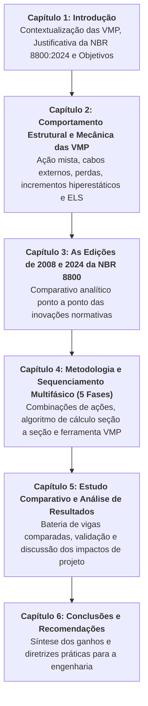
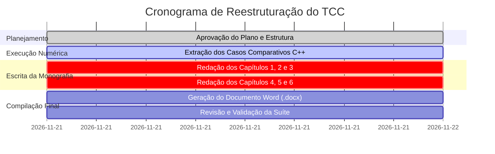

# PLANO DE REESTRUTURAÇÃO DO TCC: COMPARATIVO ABNT NBR 8800:2008 vs. NBR 8800:2024 EM VIGAS MISTAS PROTENDIDAS

> **Tema Central:** Avaliação do Impacto das Atualizações da ABNT NBR 8800:2024 no Comportamento Estrutural e Dimensionamento de Vigas Mistas de Aço e Concreto Protendidas (VMP)  
> **Status:** Aprovado para Execução  
> **Base Analítica e Bibliográfica:** Turini (2021), Ribeiro (2018), ABNT NBR 8800:2008, ABNT NBR 8800:2024 e ABNT NBR 6118.

---

## 1. Avaliação Crítica e Justificativa da Mudança de Foco

A mudança de foco proposta — transformando o TCC em um **estudo comparativo aprofundado entre a ABNT NBR 8800:2008 e a ABNT NBR 8800:2024 aplicado a vigas mistas protendidas** — eleva substancialmente o nível acadêmico e a relevância profissional da monografia.

### 1.1 Ineditismo no Cenário Nacional
A ABNT NBR 8800:2024 foi publicada recentemente após dezesseis anos de vigência da edição de 2008. Até o momento, as pesquisas de referência na área desenvolvidas no Brasil (notadamente as dissertações de mestrado de Turini em 2021 e Ribeiro em 2018 na UFES) foram fundamentadas exclusivamente na norma de 2008. O presente trabalho será um dos **primeiros estudos monográficos no país** a investigar e quantificar os impactos práticos da nova revisão sobre vigas mistas protendidas.

### 1.2 Estrutura da Narrativa de Engenharia
A nova abordagem constrói uma linha lógica perfeita para uma monografia de graduação em Engenharia Civil:
1. **Fundamentação Mecânica**: Descreve a interação mista aço-concreto e a mecânica da protensão externa com cabos não aderentes;
2. **Sequenciamento Multifásico**: Formaliza o roteiro temporal em 5 Fases (Montagem, Curta duração, Longa duração, ELS Deformação e ELS Vibração);
3. **Mapeamento Normativo**: Isola e analisa ponto a ponto as 5 grandes inovações da ABNT NBR 8800:2024 aplicáveis à VMP;
4. **Bateria Comparativa de Resultados**: Apresenta comparações paramétricas entre vigas estratégicas, provando onde as duas normas coincidem e onde a nova edição traz ganhos de capacidade ou novas restrições.

---

## 2. Nova Arquitetura e Ementa dos Capítulos

### Capítulo 1 — Introdução
- **1.1 Contextualização**: O papel das estruturas mistas protendidas no vencimento de grandes vãos e controle de alturas de pavimentos;
- **1.2 Justificativa**: A publicação da NBR 8800:2024 e a carência de referências comparativas para vigas mistas protendidas;
- **1.3 Objetivos**:
  - *Geral*: Avaliar comparativamente os critérios de dimensionamento da ABNT NBR 8800:2008 e da ABNT NBR 8800:2024 aplicados a vigas mistas protendidas por meio de uma modelagem multifásica e estudo de casos;
  - *Específicos*:
    1. Formular analiticamente o ciclo de vida em 5 fases (3 de ELU e 2 de ELS);
    2. Identificar e comparar analiticamente as equações modificadas pela edição de 2024;
    3. Desenvolver e aplicar ferramenta computacional para automação das verificações seção a seção;
    4. Conduzir análise comparativa paramétrica sobre uma matriz de vigas representativas.
- **1.4 Organização do Trabalho**.

### Capítulo 2 — Comportamento Estrutural e Mecânica das Vigas Mistas Protendidas
- **2.1 Princípios da Ação Mista**: Homogeneização elástica da seção ($t=0$ e $t=\infty$), largura efetiva estática e interação completa;
- **2.2 Mecânica da Protensão Externa**:
  - Cinética dos cabos não aderentes e excentricidade;
  - Limite superior da força de protensão inicial ($P_{0,máx}$ por flexo-compressão do perfil e por tensões de serviço);
  - Perdas imediatas (ancoragem) e diferidas (relaxação do aço);
  - Efeito hiperestático: incremento de tração nos cabos ($\Delta P$) por flexão da viga;
- **2.3 Estados Limites Últimos (ELU)**:
  - Estabilidade do perfil metálico isolado na montagem ($N_{Rd,I}$, $M_{Rd,I}$, $V_{Rd}$ e interação flexo-compressão);
  - Resistência à flexão positiva da seção mista ($M_{Rd,VMP}^+$);
  - Resistência à flexão negativa e Flambagem Lateral com Distorção ($M_{Rd,VMP}^-$ sob modelo de rigidez rotacional $k_r$);
- **2.4 Estados Limites de Serviço (ELS)**:
  - Verificação de regime elástico linear da fibra inferior do aço ($\sigma_{inf} \le f_y$);
  - Deformação excessiva: cálculo analítico de parcelas de flecha ($\delta_{PP}, \delta_{conc}, \delta_{CPN}, \delta_{CVN}, \delta_{prot}$) e contraflecha executiva para $\delta_{total} \le L/350$;
  - Vibração em pisos (Anexo L da NBR 8800): largura colaborante dinâmica ($L_v/5$), acréscimo de 35% no $E_{cs}$ para *steel deck* e limite de conforto ($\delta_{total,vib} \le 20\text{ mm}$).

### Capítulo 3 — Quadro Comparativo Normativo: ABNT NBR 8800:2008 vs. NBR 8800:2024
- **3.1 Visão Geral da Atualização Normativa**: Histórico e motivações da revisão;
- **3.2 Compressão Axial de Perfis Metálicos**:
  - *2008*: Fator de redução $Q = Q_s \cdot Q_a$ aplicado sobre o índice de esbeltez global $\lambda_0 = \sqrt{Q A_g f_y / N_e}$;
  - *2024*: Método unificado da largura efetiva de Winter ($A_{ef}$), com esbeltez global calculada sempre com a área bruta $A_g$ e seções reduzidas avaliadas na tensão crítica $f_n = \chi f_y$;
- **3.3 Esforço Cortante de Almas Não Enrijecidas**:
  - *2008*: Coeficiente simplificado $k_v = 5{,}0$;
  - *2024*: Coeficiente teórico exato de placas sob cisalhamento puro $k_v = 5{,}34$, com ampliação de $3{,}34\%$ nos limites $\lambda_{p,v}$ e $\lambda_{r,v}$ e ganho de $6{,}80\%$ no cortante elástico;
- **3.4 Resistência à Flexão Positiva da Seção Mista**:
  - Nova equação para LNP no perfil de aço sob interação completa: substituição de $C_{ad}(d - y_t - y_c)$ por $\sum Q_{Rd}(d - y_t - y_c)$ (Item L.6.3.1.1.1-b);
  - Fator de fragilidade do concreto $\eta_c = (40/f_{ck})^{1/3} \le 1{,}0$ para concretos com $f_{ck} > 40\text{ MPa}$;
- **3.5 Seções Semicompactas e Flambagem Lateral com Distorção (FLD)**:
  - Redução da tensão admissível de compressão no concreto em seções semicompactas de $1{,}00 f_{cd}$ (2008) para $0{,}85 f_{cd}$ (2024);
  - Atualização da Tabela L.1 para coeficientes de momento $C_{dist}$ na determinação do momento crítico distorcional $M_{cr,dist}$;
- **3.6 Preservação dos Critérios de Serviço (ELS)**: Confirmação da equivalência nos limites de flecha e nas diretrizes dinâmicas do Anexo L.

### Capítulo 4 — Metodologia e Sequenciamento Multifásico em 5 Fases
- **4.1 O Sequenciamento Multifásico**:
  - *Fase 1 (ELU Construtivo)*: Combinação especial $1{,}3 (q_1 + q_2) + 1{,}2 q_s$;
  - *Fase 2 (ELU Curta Duração, $t=0$)*: Combinação normal $1{,}4 q_{perm} + 1{,}4 q_{uso}$ com relação modular $n$;
  - *Fase 3 (ELU Longa Duração, $t=\infty$)*: Combinação normal com relação modular $3n$ e perdas por relaxação;
  - *Fase 4 (ELS Deformação Excessiva)*: Combinação quase permanente e contraflecha executiva;
  - *Fase 5 (ELS Vibração de Piso)*: Combinação frequente dinâmica no tempo imediato;
- **4.2 Discretização Longitudinal e Verificação Seção a Seção**: Malha de $X$ seções ao longo de $[0, L]$;
- **4.3 Apresentação da Ferramenta Computacional `VMP`**: Arquitetura em C++20, interface gráfica (*Dear ImGui* + *Raylib*) e motor duplo de normas (`nbr8800::v2008` e `nbr8800::v2024`).

### Capítulo 5 — Estudo Comparativo e Análise de Resultados
- **5.1 Validação do Modelo**: Confronto detalhado dos Estudos de Caso 1 e 2 com a dissertação de Turini (2021);
- **5.2 Análise da Matriz de Vigas**: Apresentação e discussão dos resultados comparativos 2008 vs. 2024 para as 5 vigas estratégicas;
- **5.3 Análise Paramétrica de Sensibilidade**:
  - Efeito da esbeltez da alma ($\lambda_w$) sobre $N_{Rd,I}$ e $V_{Rd}$;
  - Efeito do vão livre ($L$) e da contraflecha no ELS de deformação;
  - Efeito da tipologia de laje (maciça vs. *steel deck*) no ELS de vibração;
- **5.4 Síntese Prática dos Impactos no Dimensionamento**.

### Capítulo 6 — Conclusões e Sugestões para Trabalhos Futuros
- Síntese das conclusões técnicas e recomendações de projeto;
- Sugestões para investigações futuras.

---

## 3. Matriz de Vigas Estratégicas para o Estudo Comparativo

| Viga | Processo de Protensão | Perfil Metálico | Esbeltez da Alma ($\lambda_w$) | Laje de Concreto | Vão ($L$) | Hipótese e Objetivo da Comparação |
| :---: | :---: | :---: | :---: | :---: | :---: | :--- |
| **Viga A** | Pré-tração | W 360 x 57,8 (Laminado compacto) | $38{,}98 \le \lambda_p$ | Maciça $130\text{ mm}$ (C30) | $12\text{ m}$ | **Equivalência em Perfis Compactos:** Comprova que para perfis laminados compactos usuais, as resistências em ELU e os deslocamentos em ELS são idênticos entre a NBR 8800:2008 e a NBR 8800:2024. |
| **Viga B** | Pré-tração | Perfil Soldado (Alma delgada $t_w = 3\text{ mm}$) | $102{,}67 > \lambda_p$ | Maciça $130\text{ mm}$ (C30) | $12\text{ m}$ | **Impacto da Seção Efetiva ($A_{ef}$) e $k_v = 5{,}34$:** Demonstra ganho de $+2{,}88\%$ na compressão da Fase 1 e $+6{,}80\%$ no cortante sob a norma de 2024. |
| **Viga C** | Pós-tração | W 460 x 89 (Laminado) | $45{,}2 \le \lambda_p$ | *Steel deck* $h_F = 50\text{ mm}$ (C30) | $15\text{ m}$ | **Estudo de FLD e Conforto Dinâmico:** Analisa a restrição por momento negativo da protensão na Fase 2 e o excelente amortecimento dinâmico de vibrações (+35% no $E_{cs}$). |
| **Viga D** | Pós-tração | Perfil Semicompacto Adaptado | $95{,}0$ (Semicompacta) | Maciça $130\text{ mm}$ (C30) | $14\text{ m}$ | **Impacto da Plastificação em Seções Semicompactas:** Avalia o impacto da redução de $1{,}00 f_{cd}$ (2008) para $0{,}85 f_{cd}$ (2024) no momento resistente positivo. |
| **Viga E** | Pré-tração / Pós-tração | W 360 x 57,8 | $38{,}98$ | Concreto C50 | $12\text{ m}$ | **Concreto de Alta Resistência e Fragilidade:** Avalia a influência do fator $\eta_c = (40/f_{ck})^{1/3} = 0{,}928$ introduzido na NBR 8800:2024 sobre o bloco de compressão. |

---

## 4. Cronograma de Execução e Entregáveis

### Entregáveis Finais:
1. **`plan/plano_reestruturacao_tcc_vmp.md`**: Este documento de planejamento estratégico;
2. **`plan/tcc_completo_base.md`**: Texto monográfico integral atualizado com os 6 capítulos;
3. **`plan/TCC_Vigas_Mistas_Protendidas_NBR8800_2024.docx`**: Documento Word oficial com formatação ABNT, sumário, tabelas e equações nativas do Microsoft Word OMML;
4. **`build/vmp_tests.exe`**: Suíte de testes unitários automatizada validando todos os casos analíticos e comparativos.
