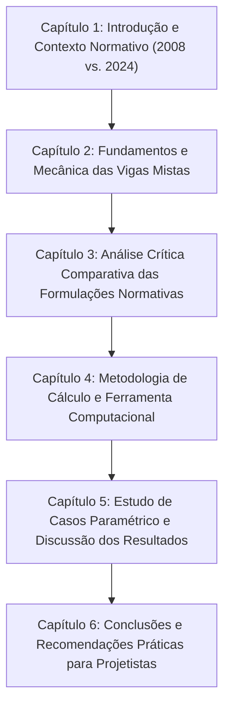

# Plano de Transição de Tema de TCC: Análise Comparativa do Dimensionamento de Vigas Mistas de Aço e Concreto Convencionais (ABNT NBR 8800:2008 vs. ABNT NBR 8800:2024)

## 1. Descrição do Objetivo e Avaliação da Ideia

O objetivo deste plano é avaliar e estruturar a mudança integral do escopo do Trabalho de Conclusão de Curso (TCC), substituindo o tema de **Vigas Mistas Protendidas (VMP)** por um tema focado exclusivamente no **Dimensionamento de Vigas Mistas Convencionais de Aço e Concreto (sem protensão)**, confrontando de forma aprofundada a **ABNT NBR 8800:2008** e a nova **ABNT NBR 8800:2024**.

### Diagnóstico de Viabilidade e Vantagens da Mudança
> [!TIP] **Veredito Acadêmico e Prático**: A mudança de tema é **extremamente vantajosa**, oportuna e de alto impacto tanto no meio acadêmico quanto profissional:
> 1. **Relevância de Mercado (95%+ dos Projetos)**: Vigas mistas protendidas são um nicho raro de pontes e casos especiais. Vigas mistas convencionais (com laje maciça ou *steel deck*) são a solução predominante em quase todos os edifícios de múltiplos andares, galpões, shoppings e hospitais no Brasil;
> 2. **Transição Normativa Crítica**: Engenheiros de estruturas de todo o país estão neste momento se adaptando às mudanças da ABNT NBR 8800:2024 (publicada recentemente após 16 anos). Um TCC que compara detalhadamente as formulações, impactos econômicos de aço e segurança tem altíssimo interesse prático e de publicação;
> 3. **Código C++ Pronto**: O nosso software `VMP` já possui o motor completo de vigas mistas convencionais implementado (`nbr8800::v2008` e `nbr8800::v2024`), incluindo flexão positiva (`calcularMomentoPositivoVM`), flexão negativa com FLD (`calcularMomentoNegativoVM`), esforço cortante ($k_v = 5{,}0$ vs $5{,}34$) e vigas semicompactas;
> 4. **Foco e Clareza**: Remove a sobrecarga de equações de cabos externos, perdas por relaxação e ancoragem, permitindo focar 100% no comportamento viga mista: interação completa e parcial, conectores de cisalhamento, tipo de laje (*steel deck* vs maciça), construção escorada vs não escorada, e ELS (flechas e conforto dinâmico).

---

## 2. Decisões do Usuário e Perguntas Abertas (User Review Required)

> [!IMPORTANT] **Decisões de Escopo a Validar**:
> 1. **Preservação dos Arquivos Atuais**: Manteremos os arquivos de VMP preservados na pasta `plan/` (`tcc_comparativo_nbr8800_2008_2024.md` e `TCC_Comparativo_NBR8800_2008_vs_2024_VMP_Completo.docx`) como backup histórico? *(Recomendado: Sim)*;
> 2. **Abrangência de Interação Mecânica**: Deseja comparar apenas **interação completa** ou incluir um caso específico de **interação parcial** (avaliando o grau de interação $\alpha = \sum Q_{Rd} / F_{hd}$)? *(Recomendado: Incluir interação parcial, pois foi uma das áreas onde a NBR 8800:2024 trouxe grande refinamento)*;
> 3. **Processo Construtivo**: Comparar construção **não escorada** (perfil suporta concreto fresco na montagem) vs. **escorada** (escoras temporárias removem o momento de montagem)? *(Recomendado: Sim, pois impacta diretamente as tensões residuais e flechas)*.

---

## 3. Estrutura Proposta para a Nova Versão do TCC

### Novo Título Proposto:
> **"ANÁLISE COMPARATIVA DO DIMENSIONAMENTO DE VIGAS MISTAS DE AÇO E CONCRETO SEGUNDO AS PRESCRIÇÕES DA ABNT NBR 8800:2008 E DA ABNT NBR 8800:2024"**



### Detalhamento dos Capítulos:

* **Capítulo 1 — Introdução e Objetivos**:
  * Justificativa da revisão da NBR 8800 (transição 2008 $\to$ 2024);
  * Por que vigas mistas são tão econômicas (sinergia compressão do concreto + tração do aço);
  * Objetivos gerais e específicos do comparativo.

* **Capítulo 2 — Fundamentos Teóricos do Comportamento Misto**:
  * Cinemática da interface e fluxo de cisalhamento longitudinal;
  * Mecânica dos conectores de cisalhamento (*stud bolts* e perfis U);
  * Diferença entre lajes maciças e lajes mistas com fôrma de aço incorporada (*steel deck*);
  * Sequenciamento executivo: construções escoradas vs. não escoradas;
  * Estados-Limites Últimos (ELU): Flexão positiva plástica e elasto-plástica, flexão negativa e instabilidade por Flambagem Lateral com Distorção (FLD), esforço cortante;
  * Estados-Limites de Serviço (ELS): Deformação vertical com consideração de fluência ($n$ para curta duração e $3n$ para longa duração) e vibrações de piso sob caminhada.

* **Capítulo 3 — Quadro Comparativo Analítico: NBR 8800:2008 vs. NBR 8800:2024**:
  1. **Momento Resistente Positivo ($M_{Rd}^+$)**:
     * LNP na laje vs. LNP no perfil de aço;
     * Análise crítica e denúncia da **gralha tipográfica do Item L.6.3.1.1.1-b** (termo $\sum Q_{Rd}$ vs $C_{ad}$ e o risco de duplicação da compressão do concreto);
     * Fator de fragilidade do concreto $\eta_c = (40/f_{ck})^{1/3} \le 1{,}00$ para concretos de alto desempenho ($f_{ck} > 40\text{ MPa}$);
     * Tensão limite no concreto para seções semicompactas: redução de $1{,}00 f_{cd}$ para $0{,}85 f_{cd}$ (Efeito Rüsch);
  2. **Esforço Cortante ($V_{Rd}$)**:
     * Evolução do coeficiente de placa de $k_v = 5{,}00$ para $k_v = 5{,}34$ em almas não enrijecidas (+6,80% no regime elástico);
     * Novos limites de compacidade ao cisalhamento $\lambda_{p,v}$ e $\lambda_{r,v}$;
  3. **Compressão e Flambagem na Montagem (Construção Não Escorada)**:
     * Substituição do fator de redução $Q$ (AISI) pelo método de larguras efetivas unificado de Winter ($A_{ef}$);
  4. **Momento Resistente Negativo e Flambagem Lateral com Distorção (FLD)**:
     * Nova formulação de momento crítico $M_{cr}$ e atualização dos coeficientes da Tabela L.1 ($C_{dist}$);
  5. **Conectores de Cisalhamento em *Steel Deck***:
     * Introdução dos fatores $R_g$ (efeito de grupo) e $R_p$ (posição na nervura: favorável, central, desfavorável), harmonizados com o AISC 360-16/22.

* **Capítulo 4 — Metodologia de Dimensionamento e Software Desenvolvido**:
  * Algoritmo de cálculo bifásico (Fase 1: Perfil isolado na concretagem; Fase 2: Seção mista final sob sobrecargas);
  * Apresentação dos módulos `nbr8800::v2008` e `nbr8800::v2024`.

* **Capítulo 5 — Estudo de Casos Paramétrico e Discussão dos Resultados**:
  * Matriz paramétrica com **cinco vigas mistas convencionais estratégicas**:
    1. **Viga 1 (Caso Padrão Comercial)**: Perfil laminado compacto W 410 x 38,8, vão $L = 10\text{ m}$, laje maciça C25 ($t_c = 12\text{ cm}$), construção não escorada. Avalia o comportamento de projetos usuais de edifícios de escritórios;
    2. **Viga 2 (Laje sobre *Steel Deck*)**: Perfil laminado W 460 x 52, vão $L = 12\text{ m}$, fôrma de aço incorporada $h_F = 50\text{ mm}$ com capa de $80\text{ mm}$ (total $130\text{ mm}$), comparando conectores com fatores $R_g, R_p$ vs 2008 e vibração de piso;
    3. **Viga 3 (Perfil Soldado com Alma Esbelta)**: Viga soldada VS $450 \times 38$ com alma fina ($t_w = 3{,}75\text{ mm}$, $\lambda_w = 115$), vão $L = 12\text{ m}$. Demonstra os ganhos combinados de $A_{ef}$ na montagem e $k_v = 5{,}34$ no cortante;
    4. **Viga 4 (Interação Parcial de Conectores)**: Viga W 360 x 44, vão $L = 9\text{ m}$, avaliando a flexão positiva sob diferentes graus de conexão ($\alpha = 50\%, 75\%, 100\%$);
    5. **Viga 5 (Concreto de Alto Desempenho C50 vs C25)**: Perfil W 410 x 46,1, vão $L = 10\text{ m}$, quantificando o efeito isolado do fator de fragilidade $\eta_c = 0{,}9283$ no momento positivo.

* **Capítulo 6 — Conclusões e Diretrizes para Engenheiros de Estruturas**.

---

## 4. Plano de Implementação Passo a Passo

### Etapa 1: Criação dos Arquivos do Novo TCC
- Criar `plan/tcc_vigas_mistas_nbr8800_2008_vs_2024.md` com a monografia integral do novo tema;
- Criar script ou rotina de geração em Word para compilar em `plan/TCC_Vigas_Mistas_NBR8800_2008_vs_2024.docx`.

### Etapa 2: Simulação e Extração dos Dados Numéricos
- Configurar no código `VMP` as 5 vigas mistas convencionais (usando os métodos `calcularMomentoPositivoVM`, `calcularMomentoNegativoVM`, `calcularCortante`, etc.);
- Gerar tabelas precisas de inputs e outputs de 2008 vs. 2024.

### Etapa 3: Validação e Entrega
- Garantir formatação ABNT rigorosa, equações em OMML, numeração de tabelas e referências completas.

---

## 5. Plano de Verificação

### Testes Automatizados no Código
Executar a suíte de testes existente e adicionar casos de vigas mistas puras:
```powershell
ctest --test-dir build --output-on-failure
```

### Validação do Documento Gerado
Verificar parse de XML e geração do `.docx`:
```powershell
C:\Users\Arthur\AppData\Local\Programs\Python\Python313\python.exe plan/gerar_docx.py plan/tcc_vigas_mistas_nbr8800_2008_vs_2024.md plan/TCC_Vigas_Mistas_NBR8800_2008_vs_2024.docx
```
