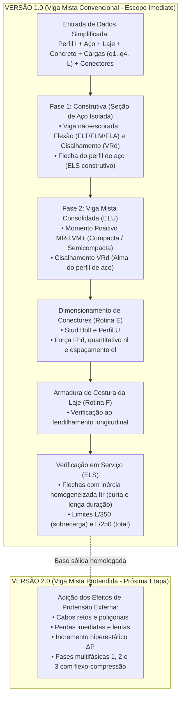
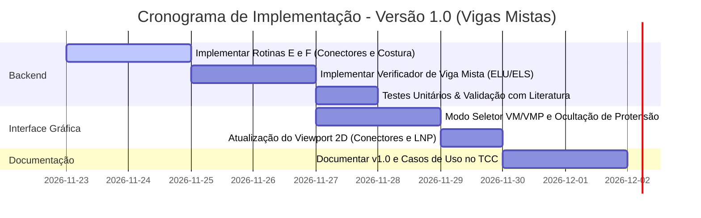

# Plano de Implementação: Versão 1.0 — Módulo de Vigas Mistas Convencionais (Sem Protensão)
**Normas de Referência:** ABNT NBR 8800:2008, ABNT NBR 8800:2024 e ABNT NBR 6118:2023  
**Escopo:** Adaptação da arquitetura e da interface gráfica para fornecer uma primeira versão funcional, enxuta e robusta focada exclusivamente no dimensionamento e verificação de **Vigas Mistas de Aço e Concreto**, deixando a protensão externa desacoplada para a Versão 2.0.

---

## 1. Visão Geral e Justificativa da Adaptação

### 1.1. Contexto Estrutural e de Engenharia
Uma **Viga Mista Protendida (VMP)** é, estruturalmente, uma **Viga Mista Convencional** submetida a um esforço hiperestático de autoequilíbrio introduzido por cabos de protensão externos ($P$ e $P \cdot e_p$).

Isolar e fechar primeiramente uma **Versão 1.0 dedicada exclusivamente às Vigas Mistas Convencionais (VM)** traz ganhos decisivos:
1. **MVP Funcional Imediato (Produto Mínimo Viável):** Permite entregar uma ferramenta completa e prática para o cálculo de vigas de piso/cobertura em edifícios de múltiplos andares e galpões industriais.
2. **Homologação da Base Normativa:** Valida 100% da geometria de perfis I (série W), lajes (maciças e *steel deck*), vigas compactas e semicompactas, conectores de cisalhamento, armadura de costura e flechas de serviço, comparando `NBR 8800:2008` vs `NBR 8800:2024`.
3. **Desacoplamento e Segurança para a VMP (Versão 2.0):** Quando os cabos de protensão forem reincorporados, o motor de cálculo da viga mista já estará blindado por dezenas de testes unitários aprovados, facilitando a depuração dos efeitos exclusivos da protensão (perdas, atrito, incrementos $\Delta P$).



---

## 2. O Que Já Está Pronto vs. O Que Falta Implementar

| Componente de Cálculo | Status Atual | O Que Falta para a Versão 1.0 (Vigas Mistas) |
| :--- | :---: | :--- |
| **Geometria & Perfis W** | ✅ **Pronto** | Perfis W Gerdau e soldadas com propriedades geométricas completas. |
| **Compressão do Perfil (Rotina A)** | ✅ **Pronto** | Já validado para NBR 8800:2008 e NBR 8800:2024. |
| **Flexão do Perfil Isolado (Rotina B)** | ✅ **Pronto** | FLT, FLM e FLA implementados (usado na fase de montagem/construção). |
| **Cortante da Alma (Rotina D)** | ✅ **Pronto** | $V_{Rd}$ com limites de plastificação e flambagem da alma (2008 e 2024). |
| **Momento Positivo Viga Mista (Rotina C)** | ✅ **Pronto** | $M_{Rd,VM}^+$ plástico para seções compactas (LNP na laje, mesa ou alma) e elástico para semicompactas em 2008 e 2024. |
| **Momento Negativo Viga Mista (Rotina C.3)** | ✅ **Pronto** | Plastificação com armadura negativa e FLD (Flambagem Lateral com Distorção) 2008 e 2024. |
| **Conectores de Cisalhamento (Rotina E)** | ⚠️ **Pendente** | Implementar `calcular_rotina_e_conectores`: dimensionamento completo de **Stud Bolt** (pino com cabeça) e **Perfil U**, cálculo de $F_{hd}$, $Q_{Rd}$, quantidade $n_l$ e espaçamento longitudinal $e_l$. |
| **Armadura de Costura (Rotina F)** | ⚠️ **Pendente** | Implementar `calcular_rotina_f_armadura_costura`: tensão de cisalhamento longitudinal e taxa de armadura transversal contra fendilhamento. |
| **Verificação ELS de Flechas** | ⚠️ **Ajustar** | Implementar cálculo direto de flechas para vigas mistas escoradas e não escoradas ($I_{tr}$ de curta e longa duração). |
| **Interface Gráfica (Dear ImGui + Raylib)** | 🔄 **Adaptar** | Criar seletor de modo `[ Viga Mista Convencional | Viga Mista Protendida ]` (ou configurar modo padrão Viga Mista), ocultando abas e parâmetros de protensão, e redesenhando o viewport sem cabos de protensão. |

---

## 3. Plano de Modificações Detalhado

### 3.1. Módulo de Modelos e Dados (`include/modelos.h`)
- Adicionar ou consolidar a estrutura de modo de cálculo:
  ```cpp
  enum ModoCalculoViga {
      MODO_VIGA_MISTA_CONVENCIONAL = 0,
      MODO_VIGA_MISTA_PROTENDIDA   = 1
  };
  ```
- Estruturar os dados de entrada de modo que os campos de protensão (`CaboProtensao cabo`, `P0_adotado`, etc.) sejam opcionais ou desconsiderados quando `modo == MODO_VIGA_MISTA_CONVENCIONAL`.
- Adicionar presets de exemplos reais de Vigas Mistas sem protensão (ex: Viga Mista do livro do Fakury et al. / NBR 8800).

### 3.2. Implementação das Rotinas E e F (`src/rotinas_nbr8800.cpp` e `include/rotinas_nbr8800.h`)

#### Rotina E: Conectores de Cisalhamento (Stud Bolt e Perfil U)
Conforme ABNT NBR 8800:2008 (Anexo O, Item O.2) e NBR 8800:2024:
1. **Força Horizontal Total de Cisalhamento ($F_{hd}$):**
   $$F_{hd} = \min\left(\frac{A_a f_y}{\gamma_{a1}},\, \frac{0{,}85 f_{ck} b_{\text{ef}} t_c}{\gamma_c}\right)$$
   *(para lajes com steel deck com nervuras perpendiculares à viga, desconta-se a altura da forma $h_F$ na espessura colaborante).*
2. **Resistência do Conector Stud Bolt ($Q_{Rd}$):**
   $$Q_{Rd} = \frac{1}{\gamma_{cs}} \min\left(0{,}5 A_{cs} \sqrt{f_{ck} E_{cs}},\, R_g R_p A_{cs} f_u\right)$$
   Onde $\gamma_{cs} = 1{,}25$, $A_{cs} = \frac{\pi d^2}{4}$. Para laje maciça, $R_g = 1{,}0$ e $R_p = 0{,}75$.
3. **Resistência do Conector Perfil U ($Q_{Rd}$):**
   $$Q_{Rd} = \frac{0{,}3 (t_f + 0{,}5 t_w) L_{cs} \sqrt{f_{ck} E_{cs}}}{\gamma_{cs}}$$
4. **Quantitativo e Espaçamento:**
   - Número de conectores entre a seção de momento máximo e o apoio: $N = \frac{F_{hd}}{Q_{Rd}}$.
   - Número total no vão: $N_{total} = 2N$.
   - Espaçamento médio: $e_l = \frac{L / 2}{N}$.
   - Verificação dos limites normativos: $e_l \ge 6d$ e $e_l \le \min(8 t_c, 800\text{ mm})$.

#### Rotina F: Armadura de Costura Transversal
- Verificação do fendilhamento longitudinal do concreto ao longo da linha de conectores conforme NBR 8800.
- Cálculo da área de armadura transversal mínima $A_{s,cos}$ por metro de viga.

### 3.3. Verificador Específico de Vigas Mistas (`include/verificador_vm.h` e `src/verificador_vm.cpp`)
Criar uma função executora dedicada:
```cpp
RelatorioVigaMista verificar_viga_mista_convencional(const VigaVMP& viga);
```
O relatório conterá exatamente o que a engenharia de estruturas exige:
1. **Fase 1: Fase de Construção (Viga isolada de aço)**:
   - Se `cargas.escorada == false`:
     - $q_{sd,const} = 1{,}35 (q_1 + q_2) + 1{,}50 q_s$;
     - $M_{Sd,const} = \frac{q_{sd,const} L^2}{8}$;
     - $V_{Sd,const} = \frac{q_{sd,const} L}{2}$;
     - Verificação à flexão: $M_{Sd,const} \le M_{Rd,I}$ (Rotina B com $L_b$);
     - Verificação ao cisalhamento: $V_{Sd,const} \le V_{Rd}$ (Rotina D);
     - Flecha na construção: $\delta_{const} = \frac{5 (q_1 + q_2) L^4}{384 E_a I_x} \le \frac{L}{350}$.
   - Se `cargas.escorada == true`:
     - Dispensada verificação crítica de esforços no aço na montagem.
2. **Fase 2: Fase Mista Consolidada (ELU)**:
   - Carregamento total: $q_{sd} = 1{,}35 (q_1 + q_2 + q_3) + 1{,}50 q_4$;
   - $M_{Sd,pos} = \frac{q_{sd} L^2}{8}$;
   - $V_{Sd} = \frac{q_{sd} L}{2}$;
   - Verificação à flexão mista: $M_{Sd,pos} \le M_{Rd,VM}^+$ (Rotina C);
   - Verificação ao cortante: $V_{Sd} \le V_{Rd}$ (Rotina D);
   - Verificação dos conectores de cisalhamento (Rotina E) e costura (Rotina F).
3. **Fase 3: Estado Limite de Serviço (ELS - Flechas)**:
   - Inércia homogeneizada da seção mista: $I_{tr,0}$ (curta duração, $n$) e $I_{tr,\infty}$ (longa duração, $3n$).
   - Viga não escorada: $\delta_{total} = \delta_{const} + \delta_{rev,longa} + \delta_{uso,curta}$.
   - Viga escorada: todas as cargas atuam sobre a seção mista.
   - Verificação dos limites normativos ($\delta_{uso} \le L/350$ e $\delta_{total} \le L/250$).

### 3.4. Adaptação da Interface Gráfica (`gui/app_gui.cpp`)
1. **Seletor de Modo na Barra Superior / Ribbon**:
   - Um botão alternador em destaque:
     `Modo: [ Viga Mista Convencional (v1.0) ]  [ Viga Mista Protendida (v2.0) ]`
2. **Experiência Limpa e Otimizada no Modo Viga Mista**:
   - A aba "Protensão" da Ribbon é **oculta**.
   - As abas ativas passam a ser:
     - `1. Geometria (Perfil I & Laje)`
     - `2. Conectores de Cisalhamento`
     - `3. Carregamentos & Escoramento`
     - `4. Análise & Verificações`
     - `5. Resultados & Memória de Cálculo`
3. **Viewport Gráfico 2D Atualizado**:
   - Desenho da seção transversal focado na viga mista:
     - Perfil I cotado;
     - Laje de concreto (maciça ou sobre telha de *steel deck*);
     - Representação gráfica dos **conectores de cisalhamento Stud Bolt** soldados na mesa superior e embutidos na laje;
     - Linhas tracejadas da Linha Neutra Plástica (LNP) e Linha Neutra Elástica (LNE);
     - Remoção dos cabos de protensão externos do desenho no modo viga mista.
   - Desenho longitudinal da viga:
     - Distribuição uniforme dos conectores de cisalhamento ao longo da mesa superior;
     - Diagrama de Momento Fletor gravitacional $M_{Sd}(x)$ comparado com a linha reta horizontal de capacidade $M_{Rd,VM}^+$.

---

## 4. Plano de Verificação e Testes

### 4.1. Testes Automatizados (Unit Tests)
- Criar `tests/test_viga_mista_nbr8800.cpp` cobrindo:
  1. **Exemplo canônico de Viga Mista de Piso (Fakury / NBR 8800)**:
     - Perfil laminado com laje maciça sob interação completa;
     - Teste da Rotina E (Stud Bolt e Perfil U): valores exatos de $Q_{Rd}$, $F_{hd}$, quantidade $N$ e espaçamento $e_l$;
     - Teste da Rotina F (Armadura de costura $A_{s,cos}$);
     - Teste das flechas em serviço (curta e longa duração).
  2. **Viga Mista com Steel Deck**:
     - Avaliação com nervuras perpendiculares e paralelas.
  3. **Estudo Comparativo NBR 8800:2008 vs NBR 8800:2024 para Vigas Mistas**:
     - Comparação direta das capacidades resistentes $M_{Rd,VM}$ e $V_{Rd}$ entre as duas edições de norma.

### 4.2. Verificação Manual e Visual
1. Compilar os alvos `vmp_tests.exe`, `vmp_demo.exe` e `vmp_gui.exe` com Ninja/CMake.
2. Executar `vmp_tests.exe` e conferir 100% de sucesso.
3. Abrir `vmp_gui.exe`, alternar para o modo "Viga Mista Convencional", carregar o exemplo de viga mista e verificar:
   - Visualização 2D sem cabos e com conectores visíveis;
   - Memória de cálculo apresentando Fase Construtiva, Fase Mista e Flechas ELS.

---

## 5. Cronograma de Ação Sugerido


