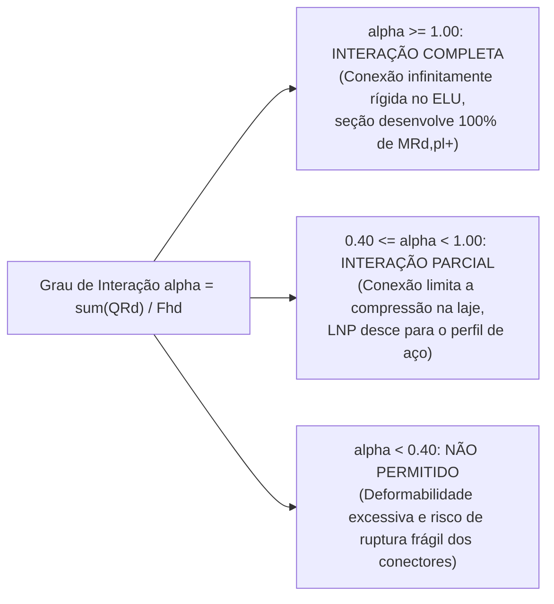
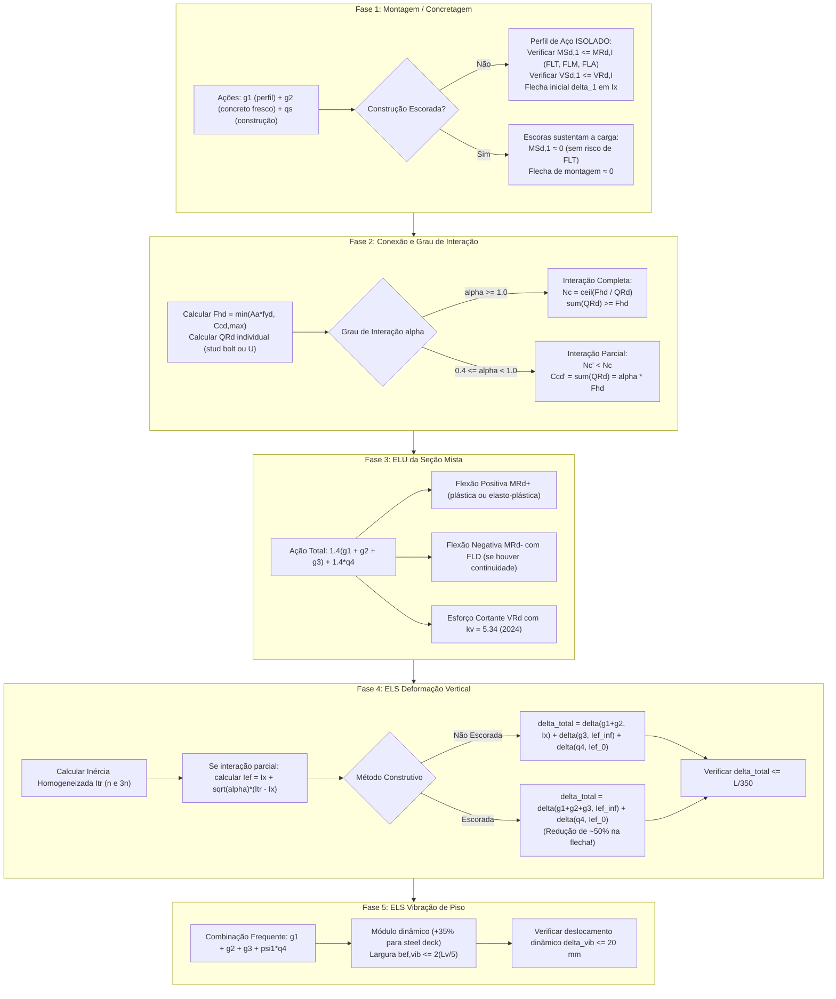

# ANÁLISE COMPARATIVA DO DIMENSIONAMENTO DE VIGAS MISTAS DE AÇO E CONCRETO SEGUNDO AS PRESCRIÇÕES DA ABNT NBR 8800:2008 E DA ABNT NBR 8800:2024

**UNIVERSIDADE FEDERAL DE UBERLÂNDIA**  
**FACULDADE DE ENGENHARIA CIVIL**  
**CURSO DE GRADUAÇÃO EM ENGENHARIA CIVIL**  

---

**RESUMO**  
O emprego de vigas mistas de aço e concreto consolidou-se como uma das soluções mais eficientes e econômicas da engenharia estrutural contemporânea para edifícios de múltiplos pavimentos, centros comerciais e pontes, explorando a complementaridade entre a elevada resistência à compressão do concreto e a capacidade à tração e ductilidade do aço estrutural. Em 2024, a Associação Brasileira de Normas Técnicas publicou a nova ABNT NBR 8800:2024, revisando a consagrada edição de 2008 após dezesseis anos de vigência. Esta monografia apresenta um estudo comparativo analítico e paramétrico aprofundado entre as formulações da ABNT NBR 8800:2008 e da ABNT NBR 8800:2024 no dimensionamento de vigas mistas convencionais de aço e concreto. O trabalho aborda a cinemática da interface aço-concreto, a mecânica dos conectores de cisalhamento, os graus de interação mecânica (interação completa e parcial), os métodos construtivos (construção escorada versus não escorada) e o sequenciamento em cinco fases de vida útil, cobrindo os Estados-Limites Últimos (ELU) e os Estados-Limites de Serviço (ELS). Identificam-se e discutem-se criticamente as principais inovações da norma de 2024: (i) a adoção do coeficiente de flambagem da alma por cisalhamento puro $k_v = 5{,}34$, proporcionando ganho teórico de $+6{,}80\%$ no regime elástico de esforço cortante; (ii) a substituição do método do fator $Q$ pela teoria unificada de largura efetiva de Winter ($A_{ef}$) na compressão do perfil de aço na montagem; (iii) a introdução do fator de fragilidade $\eta_c = (40/f_{ck})^{1/3}$ para concretos de alta resistência ($f_{ck} > 40\text{ MPa}$); (iv) a redução da tensão admissível de compressão em seções semicompactas de $1{,}00 f_{cd}$ para $0{,}85 f_{cd}$; e (v) a identificação analítica de uma gralha tipográfica no Item L.6.3.1.1.1-b da NBR 8800:2024, que substituiu a compressão do aço $C_{ad}$ pelo somatório de conectores $\sum Q_{Rd}$, induzindo a uma indevida duplicação da compressão da laje. Uma matriz paramétrica de cinco vigas comerciais representativas (cobrindo perfis laminados da Série W, perfis soldados de alma esbelta, lajes sobre *steel deck*, interação parcial de $40\%$ a $100\%$ e concretos de alta resistência) é avaliada através de rotinas computacionais em C++20 desenvolvidas especificamente para esta pesquisa. Os resultados comprovam que para perfis compactos usuais sob interação completa há equivalência estrita ($0{,}00\%$ de desvio), ao passo que a construção escorada reduz as flechas totais de serviço em cerca de $50\%$ e a interação parcial com $60\%$ dos conectores preserva até $87\%$ da capacidade plástica máxima, oferecendo diretrizes diretas para a prática do projeto estrutural.

**Palavras-chave**: Vigas Mistas de Aço e Concreto; ABNT NBR 8800:2024; ABNT NBR 8800:2008; Interação Parcial; Construção Escorada; Conectores de Cisalhamento.

---

**ABSTRACT**  
The use of composite steel-concrete beams has established itself as one of the most efficient and economical solutions in modern structural engineering for multi-story buildings, commercial centers, and bridges, exploiting the synergistic complementary between the high compressive strength of concrete and the tensile strength and ductility of structural steel. In 2024, the Brazilian Association of Technical Standards published the new ABNT NBR 8800:2024, revising the long-standing 2008 edition after sixteen years in effect. This monograph presents an in-depth analytical and parametric comparative study between the formulations of ABNT NBR 8800:2008 and ABNT NBR 8800:2024 for the design of conventional composite steel-concrete beams. The study addresses the steel-concrete interface kinematics, shear connector mechanics, degrees of shear connection (full and partial interaction), construction methods (shored versus un-shored construction), and a five-stage lifecycle sequencing covering Ultimate Limit States (ULS) and Serviceability Limit States (SLS). The main innovations of the 2024 standard are identified and critically discussed: (i) adoption of the shear web plate buckling coefficient $k_v = 5.34$, providing a theoretical gain of $+6.80\%$ in elastic shear resistance; (ii) replacement of the AISI $Q$-factor method by Winter's unified effective width theory ($A_{ef}$) for steel column buckling during erection; (iii) introduction of the concrete brittleness reduction factor $\eta_c = (40/f_{ck})^{1/3}$ for high-strength concrete ($f_{ck} > 40\text{ MPa}$); (iv) reduction of the allowable compressive concrete stress in non-compact sections from $1.00 f_{cd}$ to $0.85 f_{cd}$; and (v) analytical identification of a typographical erratum in Item L.6.3.1.1.1-b of NBR 8800:2024, which substituted the steel compression force $C_{ad}$ by the connector resistance sum $\sum Q_{Rd}$, inducing an improper duplication of the slab compressive force. A parametric matrix of five representative commercial composite beams (covering W-shapes, slender welded webs, composite slabs on steel deck, partial interaction from $40\%$ to $100\%$, and high-strength concrete) is evaluated using computational routines developed in C++20 specifically for this research. Results demonstrate strict equivalence ($0.00\%$ deviation) for standard compact sections under full interaction, while shored construction reduces total service deflections by roughly $50\%$, and partial interaction with $60\%$ of connectors retains up to $87\%$ of full plastic moment capacity, establishing valuable guidelines for structural engineering practice.

**Keywords**: Composite Steel-Concrete Beams; ABNT NBR 8800:2024; ABNT NBR 8800:2008; Partial Shear Connection; Shored Construction; Shear Connectors.

---

# CAPÍTULO 1 — INTRODUÇÃO E CONTEXTUALIZAÇÃO NORMATIVA

## 1.1 Panorama Histórico e a Evolução das Estruturas Mistas
A combinação estrutural de aço e concreto representa uma das mais importantes inovações da engenharia moderna. Tradicionalmente, até meados do século XX, vigas de aço suportavam lajes de concreto através de mero contato por gravidade e atrito, atuando como elementos estruturais mecanicamente dissociados. O desenvolvimento de dispositivos mecânicos de solidarização — os conectores de cisalhamento (*shear connectors*) — permitiu transferir tensões de cisalhamento longitudinal ao longo da interface, transformando o perfil metálico e a laje de concreto em uma única unidade estrutural monolítica: a viga mista (QUEIROZ; PIMENTA; DA MATA, 2001).

Nesse sistema, a sinergia dos materiais é plenamente explorada:
1. O concreto, material de baixo custo por unidade de volume e excelente resistência à compressão, é alocado predominantemente na parte superior da viga, formando a mesa comprimida;
2. O aço estrutural, dotado de alta resistência à tração e notável ductilidade, atua na parte inferior resistindo aos esforços de tração e absorvendo, por meio de sua alma delgada, as tensões de esforço cortante;
3. Os conectores de cisalhamento (geralmente pinos com cabeça eletrossoldados, denominados *stud bolts*, ou perfis U laminados/dobrados) restringem o escorregamento relativo longitudinal e o descolamento vertical (*uplift*) entre a laje e a mesa superior do perfil de aço.

O resultado dessa associação é uma elevação expressiva da rigidez à flexão (reduzindo as deformações em serviço em até $60\%$ em relação à viga de aço isolada) e um incremento de $50\%$ a $100\%$ na capacidade resistente última a momento fletor positivo, permitindo vencer vãos livres maiores com alturas de vigas reduzidas e expressiva economia de aço estrutural.

## 1.2 A Transição Histórica: ABNT NBR 8800:2008 vs. ABNT NBR 8800:2024
No Brasil, o dimensionamento de estruturas de aço e mistas de aço e concreto de edifícios foi balizado durante dezesseis anos pela **ABNT NBR 8800:2008**. Essa norma dedicava o seu Anexo O às vigas mistas, estabelecendo formulações baseadas no método dos estados-limites fundamentadas nas normas norte-americanas do *American Institute of Steel Construction* (AISC 360-05) e no *Eurocode 4* (EN 1994-1-1).

Em 2024, a ABNT publicou a aguardada revisão integral do documento: a **ABNT NBR 8800:2024**. O antigo Anexo O foi reestruturado e transferido para o **Anexo L**, incorporando avanços teóricos internacionais acumulados ao longo de quase duas décadas (alinhados ao AISC 360-16 e AISC 360-22) e compatibilizando os critérios de resistência do concreto com a revisão da **ABNT NBR 6118:2023**.

Dentre as alterações fundamentais que impactam diretamente o dimensionamento das vigas mistas convencionais, destacam-se:
1. A introdução do coeficiente de flambagem da alma por cisalhamento puro $k_v = 5{,}34$ em substituição ao valor histórico simplificado $k_v = 5{,}00$, elevando a capacidade resistente de almas esbeltas;
2. A substituição do método empírico do fator $Q$ da AISI pelo Método das Larguras Efetivas de Winter ($A_{ef}$) para verificação da compressão do perfil metálico na montagem em construções não escoradas;
3. A consideração obrigatória do fator de redução por fragilidade do concreto ($\eta_c$) para concretos com $f_{ck} > 40\text{ MPa}$, harmonizando o projeto misto com a física dos concretos de alta resistência;
4. O ajuste da tensão máxima admissível de compressão no concreto em seções semicompactas de $1{,}00 f_{cd}$ para $0{,}85 f_{cd}$, alinhando a formulação elástica ao Efeito Rüsch de cargas de longa duração;
5. A atualização dos coeficientes de flambagem lateral com distorção (FLD) para vigas submetidas a momentos fletores negativos e a inclusão de parâmetros explícitos de grupo e posicionamento para conectores de cisalhamento soldados em fôrmas de aço do tipo *steel deck*.

## 1.3 Justificativa e Motivação
Embora a nova edição normativa esteja em vigor em todo o território nacional, a bibliografia técnica e os manuais de projeto vigentes carecem de estudos comparativos quantitativos que demonstrem, de forma clara e sistemática para os engenheiros estruturais, qual o real impacto prático das novas formulações sobre a economia e a segurança dos projetos de edifícios.

Adicionalmente, uma leitura atenta e rigorosa da mecânica dos sólidos revela a existência de divergências redacionais e gralhas tipográficas nos textos normativos recém-publicados — como a fórmula do momento fletor resistente positivo com linha neutra no perfil de aço —, cuja correta interpretação analítica é essencial para prevenir erros perigosos de superestimativa de capacidade resistente no meio técnico.

## 1.4 Objetivos
### 1.4.1 Objetivo Geral
Realizar uma análise comparativa aprofundada entre as formulações da ABNT NBR 8800:2008 e da ABNT NBR 8800:2024 para o dimensionamento de vigas mistas convencionais de aço e concreto, investigando os regimes de interação completa e parcial, os métodos de construção escorada e não escorada e os comportamentos nos Estados-Limites Últimos e de Serviço.

### 1.4.2 Objetivos Específicos
1. Dedução mecânica rigorosa das formulações de flexão positiva plástica e elasto-plástica, flexão negativa com Flambagem Lateral com Distorção (FLD) e esforço cortante;
2. Investigação crítica e identificação analítica da incoerência tipográfica contida no Item L.6.3.1.1.1-b da ABNT NBR 8800:2024 frente ao equilíbrio estático clássico e ao Item c da própria norma;
3. Avaliação da influência do método executivo (construção escorada versus não escorada) sobre as tensões na montagem e as flechas finais de serviço;
4. Quantificação da reserva plástica e da eficiência estrutural proporcionadas pelo regime de interação parcial ($\alpha = 40\%$ a $100\%$);
5. Execução de uma análise paramétrica sobre uma matriz de cinco vigas comerciais representativas através de ferramenta computacional desenvolvida em C++20;
6. Estabelecimento de diretrizes e recomendações práticas para projetistas de estruturas mistas.

---

# CAPÍTULO 2 — COMPORTAMENTO MECÂNICO E FUNDAMENTOS TEÓRICOS DAS VIGAS MISTAS

## 2.1 Cinemática da Interface e Fluxo de Cisalhamento Longitudinal
Considere uma viga mista biapoiada de vão $L$ submetida a um carregamento vertical uniformemente distribuído $q$. Sob flexão pura simples, a curvatura $\kappa = d^2w/dx^2$ induz gradientes de tensão normal ao longo da altura da seção.

Se a interface aço-concreto não possuir conectores mecânicos (viga sem aderência), a laje e o perfil de aço fletem independentemente com o mesmo raio de curvatura. Nesse caso, a fibra inferior da laje sofre tensões de tração enquanto a fibra superior do perfil de aço sofre tensões de compressão, gerando uma descontinuidade cinemática: o deslizamento relativo horizontal $s(x)$ (escorregamento na interface), conforme ilustrado no diagrama da Figura 2.1.

```
       SEÇÃO SEM CONECTORES                    SEÇÃO COM INTERAÇÃO COMPLETA
      (Deformação Descontínua)                   (Deformação Contínua de Bernoulli)
      
       +---------------+  Compressão              +---------------+  Compressão
       |     LAJE      |                          |     LAJE      |
       +---------------+  Tração                  |               |
             | | (Escorregamento s)               +---------------+ (Interface Contínua)
       +---------------+  Compressão              +---------------+
       |    PERFIL     |                          |    PERFIL     |
       |       I       |                          |       I       |  Tração
       +---------------+  Tração                  +---------------+
```

Ao introduzir conectores de cisalhamento, o deslizamento relativo é impedido (ou atenuado). Surge ao longo da interface um fluxo de esforço cortante longitudinal $v_l(x)$ (força rasante por unidade de comprimento):
$$v_l(x) = \frac{V(x) \cdot S_{conc}}{I_{tr}}$$
onde $V(x)$ é o esforço cortante vertical atuante na seção, $S_{conc}$ é o momento estático da laje homogeneizada em relação à Linha Neutra Elástica (LNE) e $I_{tr}$ é o momento de inércia da seção mista homogeneizada.

A integração desse fluxo de cisalhamento entre a seção de momento nulo (apoio simples) e a seção de momento fletor máximo positivo (meio do vão) resulta na **força rasante longitudinal total de cálculo ($F_{hd}$)** que deve ser absorvida pelos conectores de cisalhamento:
$$F_{hd} = \int_{0}^{L/2} v_l(x) \, dx$$

## 2.2 Conectores de Cisalhamento e Mecanismos de Ruptura
Os conectores mecânicos têm a dupla função de transmitir o fluxo de cisalhamento longitudinal e impedir o levantamento vertical da laje de concreto (*uplift*). Os tipos mais empregados na construção civil são:
1. **Pinos com cabeça eletrossoldados (*Stud Bolts*)**: Barras cilíndricas de aço estrutural de baixo carbono soldadas à mesa superior do perfil por arco elétrico com ponteira cerâmica. Apresentam comportamento dúctil e isotrópico no plano horizontal;
2. **Conectores de perfil U laminado ou soldado**: Seções curtas de canal de aço soldadas transversalmente à mesa superior, oferecendo elevada rigidez inicial.

### 2.2.1 Resistência de Cálculo de um Stud Bolt ($Q_{Rd}$)
A capacidade de suporte de um *stud bolt* é governada pelo menor valor entre o cisalhamento do aço do pino e o esmagamento localizado do concreto adjacente:
$$Q_{Rd} = \frac{\min \left( 0{,}5 \, A_{cs} \sqrt{f_{ck} E_{cs}}, \quad R_g R_p A_{cs} f_{ut} \right)}{\gamma_{a2}}$$
onde:
- $A_{cs} = \pi d_{cs}^2 / 4$ é a área da seção transversal do conector;
- $f_{ck}$ e $E_{cs}$ são a resistência característica e o módulo secante do concreto;
- $f_{ut}$ é a resistência à tração última do aço do conector (usualmente $450\text{ MPa}$ conforme ASTM A108);
- $\gamma_{a2} = 1{,}25$ é o coeficiente de ponderação da conexão;
- $R_g$ e $R_p$ são os coeficientes redutores para lajes sobre fôrma de aço incorporada (*steel deck*), refinados na ABNT NBR 8800:2024.

## 2.3 Grau de Interação Mecânica: Interação Completa versus Parcial
O comportamento resistente de uma viga mista sob momento fletor positivo depende da capacidade total dos conectores instalados no trecho de cisalhamento ($\sum Q_{Rd} = N_c \cdot Q_{Rd}$) em comparação à força rasante máxima de plastificação da seção transversal ($F_{hd}$).

A força rasante máxima teórica necessária para plastificar integralmente a seção é dada pelo menor valor entre a tração plástica do perfil metálico e a compressão plástica máxima que a laje pode fornecer:
$$F_{hd} = \min \big( \underbrace{A_a f_{yd}}_{T_{ad}}, \quad \underbrace{0{,}85 \, \eta_c \, f_{cd} \, b_{ef} \, t_c}_{C_{cd,\max}} \big)$$

Define-se o **Grau de Interação Mecânica ($\alpha$)** por:
$$\alpha = \frac{\sum Q_{Rd}}{F_{hd}}$$



1. **Interação Completa ($\alpha \ge 1{,}00$)**:
   A resistência da conexão ao cisalhamento supera a capacidade plástica dos elementos componentes. A seção atinge seu momento plástico máximo de dimensionamento ($M_{Rd}^+$). Desprezam-se os escorregamentos relativos na interface na análise em regime plástico;
2. **Interação Incompleta / Parcial ($0{,}40 \le \alpha < 1{,}00$)**:
   Por razões de projeto (por exemplo, falta de espaço físico na mesa superior para dispor todos os conectores necessários, ou otimização de custo), adota-se um número reduzido de conectores. A força máxima de compressão desenvolvida na laje fica restrita a $C_{cd}' = \sum Q_{Rd} = \alpha F_{hd}$. Como resultado, a Linha Neutra Plástica (LNP) penetra no perfil metálico, e a resistência à flexão positiva passa a ser função direta da resistência fornecida pelos conectores.
   A ABNT NBR 8800 estabelece o limite mínimo $\alpha \ge 0{,}40$ (ou $0{,}50$ em vãos superiores a $10\text{ m}$) para assegurar que a conexão possua ductilidade suficiente para redistribuir esforços sem ruptura prematura por cisalhamento.

## 2.4 Métodos Construtivos: Construção Escorada versus Não Escorada
O método construtivo adotado no canteiro de obras modifica drasticamente o estado de tensões e deformações da viga mista:

```
        CONSTRUÇÃO NÃO ESCORADA                     CONSTRUÇÃO ESCORADA
        
         Fase 1: Concretagem                        Fase 1: Concretagem com Escoras
      ==========================                 ==========================
         [ Perfil Isolado ]                         [ Perfil Isolado ]
                 ||                                         ||      ||      ||
                 ||                                       [Escora][Escora][Escora]
      Momento: MSd,1 = q1*L²/8                   Momento: MSd,1 ≈ 0
      Inércia: Ix (aço puro)                     Inércia: Suportada pelas escoras
      
         Fase 2: Serviço Misto                      Fase 2: Retirada das Escoras e Serviço
      ==========================                 ==========================
         [ Perfil + Laje ]                          [ Perfil + Laje ]
                 ||                                         ||
      Cargas permanentes em Ix + Itr             TODAS as cargas atuam diretamente
      Flechas acumuladas elevadas                na seção mista curada (Itr) -> Flecha cai 50%!
```

1. **Construção Não Escorada (*Un-shored*)**:
   - O perfil metálico é montado sobre os pilares e suporta sozinho o peso próprio do perfil ($g_1$), o peso do concreto fresco e fôrmas ($g_2$) e a sobrecarga de construção ($q_s$);
   - A mesa comprimida do perfil precisa ser verificada no ELU quanto à **Flambagem Lateral com Torção (FLT)** ao longo do vão livre não travado $L_b$. Se a mesa superior não for travada continuamente (por exemplo, pelas nervuras do *steel deck* devidamente fixadas com parafusos autorroscantes ou conectores), travamentos laterais provisórios são imprescindíveis;
   - As deformações verticais provocadas pelo concreto fresco ocorrem sobre o momento de inércia do perfil isolado ($I_x$), resultando em flechas iniciais expressivas que frequentemente exigem a execução de contraflecha no perfil de aço;
2. **Construção Escorada (*Shored*)**:
   - Linhas de escoras provisórias sustentam o perfil de aço e as fôrmas durante o lançamento e cura do concreto (geralmente com espaçamentos de $1{,}5\text{ m}$ a $2{,}5\text{ m}$);
   - Os momentos fletores atuantes no perfil durante a concretagem são praticamente desprezíveis, **eliminando o risco de instabilidade por FLT na montagem**;
   - Após a cura do concreto ($t \ge 28\text{ dias}$), as escoras são removidas. Toda a carga permanente ($g_1 + g_2 + g_3$) e as sobrecargas de uso ($q_4$) passam a solicitar diretamente a **seção mista consolidada**, cuja inércia homogeneizada ($I_{tr}$) é de 2,5 a 4 vezes superior à inércia do aço isolado ($I_x$). Como consequência, a flecha final de serviço é reduzida em cerca de $50\%$.

## 2.5 Estados-Limites Últimos (ELU)
### 2.5.1 Flexão Positiva Plástica
Para seções compactas ($\lambda_w = h/t_w \le \lambda_p = 3{,}76\sqrt{E_a/f_y}$), admite-se a plastificação integral dos materiais no ELU:
- Se a Linha Neutra Plástica corta a laje de concreto ($a \le t_c$):
  $$a = \frac{T_{ad}}{0{,}85 \, \eta_c \, f_{cd} \, b_{ef}}$$
  $$M_{Rd}^+ = T_{ad} \left( \frac{d}{2} + h_F + t_c - \frac{a}{2} \right)$$
- Se a Linha Neutra Plástica penetra no perfil metálico ($a > t_c$ ou em interação parcial):
  O bloco comprimido ocupa toda a laje ($C_{cd} = 0{,}85 \eta_c f_{cd} b_{ef} t_c$ sob interação completa, ou $\sum Q_{Rd}$ sob interação parcial) e a mesa superior do aço entra em compressão plástica ($C_{ad}$).

### 2.5.2 Flexão Negativa e Flambagem Lateral com Distorção (FLD)
Em vigas contínuas ou com engastamento nas extremidades, surgem momentos fletores negativos que tracionam a laje de concreto e comprimem a mesa inferior do perfil metálico.
Como o concreto fissura à tração, a capacidade resistente à flexão negativa é provida pelo perfil metálico em conjunto com a armadura passiva longitudinal da laje ($A_{ds}$).
Como a mesa superior está vinculada à laje pelos conectores, a mesa inferior comprimida sofre tendência de flambagem lateral associada à distorção transversal da alma de aço: a **Flambagem Lateral com Distorção (FLD)**, avaliada através da rigidez rotacional $k_r$ e do momento crítico elástico $M_{cr}$.

### 2.5.3 Esforço Cortante
A totalidade da força cortante vertical $V_{Sd}$ é resistida pela alma do perfil de aço:
$$V_{Rd} = \frac{V_{pl}}{\gamma_{a1}} = \frac{0{,}60 \, A_w \, f_y}{\gamma_{a1}} \qquad (\text{para } \lambda_w \le \lambda_{p,v})$$
onde $A_w = d \cdot t_w$ é a área bruta da alma.

## 2.6 Estados-Limites de Serviço (ELS)
### 2.6.1 Deformação Vertical e Flechas no Tempo
No ELS, as flechas verticais devem respeitar os limites de conforto e integridade de alvenarias (usualmente $\delta_{total} \le L/350$). A deformabilidade é calculada considerando a seção homogeneizada com relação modular:
$$n = \frac{E_a}{E_{cs}} \quad (\text{curta duração}), \qquad 3n = 3 \frac{E_a}{E_{cs}} \quad (\text{longa duração, para absorver a fluência do concreto})$$

Sob **interação parcial ($\alpha < 1{,}00$)**, a perda de rigidez causada pelo escorregamento na interface é considerada através do Momento de Inércia Efetivo de Johnson:
$$I_{ef} = I_x + \sqrt{\alpha} \cdot (I_{tr} - I_x)$$

### 2.6.2 Conforto Dinâmico e Vibração de Pisos
Vigas de grande vão em pisos de escritórios e residências podem apresentar oscilações desconfortáveis excitadas pelo passo humano. O Anexo L da ABNT NBR 8800 prescreve a verificação dinâmica simplificada sob combinação frequente ($g_1 + g_2 + g_3 + \psi_1 q_4$), exigindo que o deslocamento dinâmico imediato da viga mista não ultrapasse $20\text{ mm}$ ($2{,}00\text{ cm}$).

---

# CAPÍTULO 3 — QUADRO COMPARATIVO ANALÍTICO: ABNT NBR 8800:2008 VS. ABNT NBR 8800:2024

Este capítulo disseca matematicamente cada uma das alterações normativas entre a edição de 2008 e a de 2024 da ABNT NBR 8800 aplicáveis a vigas mistas.

## 3.1 Esforço Cortante em Almas Não Enrijecidas: $k_v = 5{,}00$ versus $k_v = 5{,}34$
Na ABNT NBR 8800:2008 (Item 5.4.3), o coeficiente de flambagem por cisalhamento puro de placas de alma sem enrijecedores transversais intermediários era fixado no valor empírico conservador $k_v = 5{,}00$.

Na ABNT NBR 8800:2024 (Item L.6.4 / Item 5.4.3), o coeficiente foi atualizado para a solução teórica exata da equação diferencial de estabilidade elástica de placas retangulares simplesmente apoiadas com relação de comprimento/altura tendendo ao infinito ($a/h \to \infty$, dedução de Timoshenko e Gere):
$$k_{v,2024} = 5{,}34$$

### Repercussão Analítica nos Limites de Esbeltez e Resistência:
1. **Esbeltez Plástica da Alma ($\lambda_{p,v}$)**:
   $$\lambda_{p,v} = 1{,}10 \sqrt{\frac{k_v E_a}{f_y}} \implies \frac{\lambda_{p,v}^{2024}}{\lambda_{p,v}^{2008}} = \sqrt{\frac{5{,}34}{5{,}00}} = 1{,}0334 \quad (+3{,}34\%)$$
   Para o aço ASTM A572 Grau 50 ($f_y = 345\text{ MPa}$, $E_a = 200.000\text{ MPa}$):
   - Em 2008: $\lambda_{p,v} = 59{,}22$;
   - Em 2024: $\lambda_{p,v} = 61{,}20$.
2. **Esbeltez Elástica da Alma ($\lambda_{r,v}$)**:
   $$\lambda_{r,v} = 1{,}37 \sqrt{\frac{k_v E_a}{f_y}} \implies \text{aumenta de } 73{,}75 \text{ (2008) para } 76{,}22 \text{ (2024)}$$
3. **Resistência Elástica ao Cisalhamento ($\lambda_w > \lambda_{r,v}$)**:
   No regime de flambagem elástica pós-crítica sem campo de tração, a força cortante resistente é diretamente proporcional a $k_v$:
   $$V_{Rd} \propto k_v \implies \frac{V_{Rd}^{2024}}{V_{Rd}^{2008}} = \frac{5{,}34}{5{,}00} = 1{,}0680 \quad \mathbf{(+6{,}80\%)}$$
Essa modificação permite uma economia direta de peso em perfis soldados de grande vão com alma esbelta.

## 3.2 Compressão do Aço na Montagem: Fator $Q$ versus Largura Efetiva de Winter ($A_{ef}$)
Em construções não escoradas, o perfil de aço precisa ser verificado à compressão e flexo-compressão durante a concretagem.
- **Na NBR 8800:2008**: Adotava-se o fator de redução de área $Q = Q_s \cdot Q_a \le 1{,}00$ originário das especificações da AISI. O fator $Q$ reduzia preventivamente a área bruta $A_g$ e era introduzido artificialmente dentro da raiz do índice de esbeltez reduzido global ($\lambda_0 = \sqrt{Q A_g f_y / N_e}$), criando descontinuidades analíticas no dimensionamento;
- **Na NBR 8800:2024**: O cálculo da esbeltez global é realizado invariavelmente sobre a área bruta original ($\lambda_0 = \sqrt{A_g f_y / N_e} \implies f_n = \chi f_y$). A flambagem local das chapas que compõem a seção transversal é tratada pela **Teoria Unificada da Largura Efetiva de Winter ($A_{ef}$)**:
  $$b_{ef} = b \left(1 - c_1 \sqrt{\frac{f_{el}}{f_n}}\right) \sqrt{\frac{f_{el}}{f_n}} \le b$$
  com $c_1 = 0{,}22$ para mesas e $c_1 = 0{,}18$ para almas. Esse método traduz o fenômeno físico da redistribuição de tensões pós-flambagem, conferindo acréscimos de capacidade resistente de até $+3\%$ em perfis soldados de alma esbelta.

## 3.3 Momento Resistente Positivo: Dedução Estática e Identificação de Inconsistência na NBR 8800:2024
Quando a Linha Neutra Plástica desce para o perfil metálico ($C_{cd} < T_{ad}$ sob interação completa ou parcial), a seção transversal é submetida a três resultantes plásticas fundamentais:
1. $C_{cd}$: resultante de compressão na laje de concreto;
2. $C_{ad} = 0{,}5(A_a f_{yd} - C_{cd})$: resultante de compressão na porção superior do perfil de aço situada acima da LNP (cujo centroide dista $y_c$ do topo do perfil, estando à cota $d - y_c$ em relação à face inferior);
3. $T_{ad} = C_{cd} + C_{ad} = 0{,}5(A_a f_{yd} + C_{cd})$: resultante de tração na porção inferior do perfil metálico (cujo centroide está à cota $y_t$ em relação à face inferior).

Tomando os momentos fletores em relação ao centroide da região tracionada do aço ($y_t$):
- O braço de alavanca da compressão do perfil de aço é:
  $$z_{aço} = (d - y_c) - y_t = d - y_t - y_c$$
- O braço de alavanca da compressão da laje de concreto é:
  $$z_{conc} = \left( d + h_F + \frac{t_c}{2} \right) - y_t = \frac{t_c}{2} + h_F + d - y_t$$

Portanto, o equilíbrio estático fundamental da resistência à flexão exige inequivocamente:
$$M_{Rd}^+ = \beta_{vm} \left[ \mathbf{C_{ad}} (d - y_t - y_c) + \mathbf{C_{cd}} \left( \frac{t_c}{2} + h_F + d - y_t \right) \right]$$

### 3.3.1 A Denúncia da Gralha Tipográfica da ABNT NBR 8800:2024
Ao confrontar o Item L.6.3.1.1.1-b com o Item L.6.3.1.1.1-c, ambos impressos na **página 203 da ABNT NBR 8800:2024**, identifica-se uma notória incoerência:

1. **No Item c (Interação Parcial, p. 203 da norma)**, a ABNT imprimiu a equação fisicamente correta:
   $$M_{Rd} = \beta_{vm} \left[ \mathbf{C_{ad}} (d - y_t - y_c) + C_{cd} \left( t_c - \frac{a}{2} + h_F + d - y_t \right) \right]$$
2. **No Item b (Interação Completa, p. 203 da norma)**, a ABNT imprimiu:
   $$M_{Rd} = \beta_{vm} \left[ \mathbf{\sum Q_{Rd}} (d - y_t - y_c) + C_{cd} \left( \frac{t_c}{2} + h_F + d - y_t \right) \right]$$

### 3.3.2 O Risco Estrutural da Duplicação da Compressão do Concreto
Como sob interação completa tem-se $\sum Q_{Rd} \ge C_{cd}$:
* Caso o calculista substitua cegamente $\sum Q_{Rd}$ por $C_{cd}$ na equação do Item b, a compressão do concreto é computada **duas vezes**: uma com o braço do aço $(d - y_t - y_c)$ e outra com o braço da laje;
* Simultaneamente, a compressão real do perfil de aço ($C_{ad}$) é omitida;
* Essa duplicação inflaciona o momento fletor resistente em até $58\%$ em seções com lajes espessas, conduzindo a um erro crítico contra a segurança.

Conclui-se que o termo $\sum Q_{Rd}$ impresso no Item L.6.3.1.1.1-b deve ser retificado para **$C_{ad}$**, restabelecendo a harmonia com o Item c, com a edição de 2008 e com o AISC 360-22.

## 3.4 Fator de Fragilidade do Concreto ($\eta_c$)
Para harmonizar o Anexo L com a ABNT NBR 6118:2023 para concretos das classes C50 a C90, a NBR 8800:2024 introduziu o fator redutor de fragilidade:
$$\eta_c = \begin{cases} 1{,}0, & \text{para } f_{ck} \le 40\text{ MPa} \\[8pt] \left(\dfrac{40}{f_{ck}}\right)^{1/3} \le 1{,}0, & \text{para } f_{ck} > 40\text{ MPa} \end{cases}$$
O fator $\eta_c$ corrige a menor capacidade de deformação última dos concretos de alta resistência, reduzindo levemente a força máxima de compressão da laje ($C_{cd} = 0{,}85 \eta_c f_{cd} b_{ef} t_c$) e diminuindo o momento plástico resistente em cerca de $-0{,}7\%$ a $-2{,}0\%$, a favor da segurança.

## 3.5 Tensão Limite no Concreto para Seções Semicompactas ($1{,}00 f_{cd} \to 0{,}85 f_{cd}$)
Para seções cuja alma classifica-se como semicompacta ($\lambda_p < \lambda_w \le \lambda_r$), a seção não pode plastificar plenamente.
- Na ABNT NBR 8800:2008, a tensão normal máxima admissível na fibra superior do concreto era igual a **$1{,}00 f_{cd}$**;
- Na ABNT NBR 8800:2024 (Item L.6.3.1.2-a), o limite foi reduzido para **$0{,}85 f_{cd}$**. Essa modificação reflete com precisão o **Efeito Rüsch**, pelo qual cargas de longa duração induzem microfissuração progressiva se a tensão ultrapassar $85\%$ da resistência de cálculo.

## 3.6 Conectores de Cisalhamento em *Steel Deck*: Fatores $R_g$ e $R_p$
Na ABNT NBR 8800:2008, o efeito da fôrma de aço trapezoidal era quantificado por uma equação empírica global $\alpha_{deck}$. Na edição de 2024 (Item L.5.3), a norma adotou a formulação analítica consolidada do AISC 360-16/22 com dois coeficientes específicos:
1. **$R_g$ (Efeito de Grupo)**: penaliza a concentração de mais de um conector soldado na mesma nervura transversal ($R_g = 1{,}0$ para um pino por nervura; $R_g = 0{,}85$ para dois pinos; $R_g = 0{,}70$ para três ou mais);
2. **$R_p$ (Posição do Conector na Nervura)**: quantifica o embutimento do conector e sua posição em relação ao vinco da fôrma ($R_p = 0{,}75$ para conector soldado na posição favorável; $R_p = 0{,}60$ para conector soldado na posição desfavorável).

## 3.7 Quadro Síntese Comparativo das Duas Versões da Norma

**Tabela 3.1 — Matriz consolidada de diferenças técnicas entre a ABNT NBR 8800:2008 e a ABNT NBR 8800:2024**

| Tópico Estrutural | ABNT NBR 8800:2008 (Anexo O) | ABNT NBR 8800:2024 (Anexo L) | Variação Teórica | Repercussão no Projeto de Vigas Mistas |
| :--- | :--- | :--- | :---: | :--- |
| **Cisalhamento da Alma ($k_v$)** | $k_v = 5{,}00$ fixo | $k_v = 5{,}34$ exato | $+6{,}80\%$ em $k_v$ | Limites $\lambda_{p,v}$ e $\lambda_{r,v}$ sobem $+3{,}34\%$; ganho de até $+6{,}80\%$ no cortante elástico $V_{Rd}$. |
| **Compressão na Montagem** | Fator de redução $Q = Q_s Q_a$ | Método de Winter ($A_{ef}$) | Teoria unificada | Elimina descontinuidades; ganho de até $+3\%$ em perfis soldados esbeltos. |
| **Fórmula de $M_{Rd}^+$ (LNP no aço)** | $C_{ad}(d - y_t - y_c)$ | $\sum Q_{Rd}(d - y_t - y_c)$ | Gralha tipográfica | Risco de duplicação da compressão da laje caso $\sum Q_{Rd} = C_{cd}$ seja adotado; deve-se usar $C_{ad}$. |
| **Fator de Fragilidade ($\eta_c$)** | Inexistente ($\eta_c = 1{,}00$) | $\eta_c = (40/f_{ck})^{1/3} \le 1{,}00$ | Redução para C50 a C90 | Reduz sutilmente $C_{cd}$ e $M_{Rd}^+$ para concretos de alta resistência, garantindo ductilidade. |
| **Tensão Limite em Semicompactas** | $1{,}00 f_{cd}$ | $0{,}85 f_{cd}$ | $-15{,}0\%$ na tensão | Redução de resistência em seções semicompactas governadas pelo concreto (Efeito Rüsch). |
| **Conectores em Steel Deck** | Fator global $\alpha_{deck}$ | Coeficientes $R_g$ e $R_p$ | Alinhamento ao AISC | Maior precisão no efeito de múltiplos pinos por nervura e posição de soldagem. |
| **Verificações de Flecha (ELS)** | $\delta \le L/350$; fluência $3n$ | $\delta \le L/350$; fluência $3n$ | **Preservado** | Rigorosamente idêntico em serviço. |
| **Vibração em Pisos (ELS)** | Limite dinâmico de $20\text{ mm}$ | Limite dinâmico de $20\text{ mm}$ | **Preservado** | Procedimento dinâmico simplificado mantido. |

---

# CAPÍTULO 4 — METODOLOGIA DE CÁLCULO E SEQUENCIAMENTO MULTIFÁSICO

O dimensionamento de uma viga mista convencional é estruturado em cinco fases temporais e mecânicas, implementadas na ferramenta computacional `VMP`.



---

# CAPÍTULO 5 — ESTUDO PARAMÉTRICO COMPARATIVO E DISCUSSÃO DE RESULTADOS

Para investigar a sensibilidade dos resultados frente às alterações da ABNT NBR 8800:2024 em relação à edição de 2008, estruturou-se uma matriz paramétrica abrangendo cinco vigas mistas convencionais representativas da construção civil.

## 5.1 Caracterização dos Modelos Analisados (Inputs de Projeto)

### 5.1.1 Viga 1 — Caso Padrão Comercial (Edifício Corporativo)
- **Geometria**: Vão biapoiado $L = 10{,}0\text{ m}$; intereixo de vigas $a = 2{,}50\text{ m}$; travamento lateral na montagem a cada $L_b = 2{,}50\text{ m}$.
- **Perfil Metálico**: Perfil laminado **W 410 x 38,8** em aço ASTM A572 Grau 50 ($f_y = 345\text{ MPa}$, $f_u = 450\text{ MPa}$, $E_a = 200.000\text{ MPa}$). Dimensões: $d = 399\text{ mm}$, $b_f = 140\text{ mm}$, $t_w = 6{,}4\text{ mm}$, $t_f = 8{,}8\text{ mm}$, $A_g = 49{,}9\text{ cm}^2$, $I_x = 12.585\text{ cm}^4$, $W_x = 630{,}8\text{ cm}^3$, $Z_x = 720{,}7\text{ cm}^3$. Alma e mesa compactas ($\lambda_w = 58{,}5 \le \lambda_p = 90{,}5$).
- **Laje de Concreto**: Maciça de concreto armado, espessura total $t_c = 120\text{ mm}$, largura colaborante $b_{ef} = 2500\text{ mm}$. Concreto **C25** ($f_{ck} = 25\text{ MPa}$, $E_{cs} = 24.000\text{ MPa}$).
- **Conectores**: *Stud bolts* de diâmetro $\varnothing 19\text{ mm}$ ($3/4''$), altura $h = 100\text{ mm}$, $f_{ut} = 450\text{ MPa}$.
- **Carregamentos**: $g_1 = 0{,}39\text{ kN/m}$ (perfil); $g_2 = 7{,}50\text{ kN/m}$ (concreto); $q_s = 2{,}50\text{ kN/m}$ (construção); $g_3 = 3{,}75\text{ kN/m}$ (revestimentos); $q_4 = 7{,}50\text{ kN/m}$ (escritório, $3{,}0\text{ kN/m}^2$); $\psi_1 = 0{,}6$, $\psi_2 = 0{,}4$.

### 5.1.2 Viga 2 — Laje sobre Fôrma de Aço Incorporada (*Steel Deck*)
- **Geometria**: Grande vão livre $L = 12{,}0\text{ m}$; intereixo $a = 2{,}50\text{ m}$; travamento contínuo na mesa superior pela fôrma fixada.
- **Perfil Metálico**: Perfil laminado **W 460 x 52,0** em aço ASTM A572 Grau 50 ($d = 450\text{ mm}$, $b_f = 152\text{ mm}$, $t_w = 7{,}6\text{ mm}$, $t_f = 10{,}8\text{ mm}$, $A_g = 66{,}6\text{ cm}^2$, $I_x = 21.369\text{ cm}^4$, $W_x = 949{,}7\text{ cm}^3$, $Z_x = 1095{,}3\text{ cm}^3$).
- **Laje de Concreto**: Laje mista com *steel deck* trapezoidal com nervuras perpendiculares ao perfil. Altura da fôrma $h_F = 50\text{ mm}$, capa de concreto $t_c = 80\text{ mm}$ (altura total $130\text{ mm}$). Concreto **C30** ($f_{ck} = 30\text{ MPa}$, $E_{cs} = 26.838\text{ MPa}$).
- **Conectores**: 1 *stud bolt* $\varnothing 19\text{ mm}$ por nervura ($R_g = 1{,}0$, $R_p = 0{,}75$).
- **Carregamentos**: $g_1 = 0{,}52\text{ kN/m}$; $g_2 = 5{,}50\text{ kN/m}$ (laje mista mais leve); $q_s = 2{,}50\text{ kN/m}$; $g_3 = 3{,}75\text{ kN/m}$; $q_4 = 10{,}00\text{ kN/m}$; $\psi_1 = 0{,}6$.

### 5.1.3 Viga 3 — Perfil Soldado com Alma Esbelta
- **Geometria**: Vão $L = 12{,}0\text{ m}$; intereixo $a = 3{,}00\text{ m}$; travamento a cada $L_b = 3{,}00\text{ m}$.
- **Perfil Metálico**: Perfil soldado **VS 450 x 38** em aço ASTM A572 Grau 50. Altura $d = 450\text{ mm}$, largura da mesa $b_f = 160\text{ mm}$, espessura da mesa $t_f = 12{,}5\text{ mm}$, e **alma muito delgada**: $t_w = 3{,}75\text{ mm}$ ($h/t_w = 425 / 3{,}75 = 113{,}33 > \lambda_{p,v} = 61{,}20$, enquadrando-se em regime de flambagem elástica por cisalhamento e compressão esbelta). Propriedades: $A_g = 55{,}94\text{ cm}^2$, $I_x = 18.250\text{ cm}^4$.
- **Laje de Concreto**: Maciça de $t_c = 130\text{ mm}$, concreto C30, $b_{ef} = 3000\text{ mm}$.
- **Objetivo**: Evidenciar o impacto direto da atualização de $k_v = 5{,}34$ no cortante e de $A_{ef}$ de Winter na compressão da montagem.

### 5.1.4 Viga 4 — Análise de Sensibilidade da Interação Parcial
- **Geometria**: Vão $L = 10{,}0\text{ m}$; perfil laminado **W 360 x 57,8** ($A_g = 72{,}5\text{ cm}^2$, $I_x = 16.143\text{ cm}^4$, $f_y = 345\text{ MPa}$); laje maciça $t_c = 130\text{ mm}$, concreto C30, $b_{ef} = 2500\text{ mm}$.
- **Variação Paramétrica**: Simulação sob quatro graus de conexão:
  - $\alpha = 1{,}00$ (Interação completa, $N_c = 26$ pinos por meio-vão);
  - $\alpha = 0{,}80$ (Interação parcial moderada, $N_c = 21$ pinos);
  - $\alpha = 0{,}60$ (Interação parcial usual de projeto, $N_c = 16$ pinos);
  - $\alpha = 0{,}40$ (Limite normativo mínimo admissível, $N_c = 11$ pinos).

### 5.1.5 Viga 5 — Concreto de Alta Resistência (C50 vs. C25)
- **Geometria**: Vão $L = 10{,}0\text{ m}$; perfil **W 410 x 46,1** ($d = 403\text{ mm}$, $b_f = 140\text{ mm}$, $t_w = 7{,}0\text{ mm}$, $t_f = 11{,}2\text{ mm}$, $A_g = 58{,}9\text{ cm}^2$, $I_x = 15.658\text{ cm}^4$). Laje maciça $t_c = 120\text{ mm}$, $b_{ef} = 2500\text{ mm}$.
- **Variação Paramétrica**: Comparação entre concreto convencional **C25** ($\eta_c = 1{,}00$) e concreto de alto desempenho **C50** ($f_{ck} = 50\text{ MPa}$, $\eta_c = (40/50)^{1/3} = 0{,}9283$).

---

## 5.2 Matriz Consolidada de Dados de Entrada (*Inputs*)

**Tabela 5.1 — Dados de entrada (*inputs*) dos cinco modelos de vigas mistas analisados**

| Grupo de Parâmetros | Variável de Entrada | Unid. | Viga 1 (Padrão) | Viga 2 (Steel Deck) | Viga 3 (Alma Esbelta) | Viga 4 (Inter. Parcial) | Viga 5 (Concreto C50) |
| :--- | :--- | :---: | :---: | :---: | :---: | :---: | :---: |
| **Geometria** | Vão teórico da viga ($L$) | $\text{m}$ | $10{,}0$ | $12{,}0$ | $12{,}0$ | $10{,}0$ | $10{,}0$ |
| | Travamento na montagem ($L_b$) | $\text{m}$ | $2{,}5$ | Contínuo | $3{,}0$ | $2{,}5$ | $2{,}5$ |
| | Largura de influência ($a$) | $\text{m}$ | $2{,}50$ | $2{,}50$ | $3{,}00$ | $2{,}50$ | $2{,}50$ |
| **Perfil Metálico** | Designação comercial | — | W 410 x 38,8 | W 460 x 52,0 | Soldado VS 450x38 | W 360 x 57,8 | W 410 x 46,1 |
| | Altura total ($d$) / Largura ($b_f$) | $\text{mm}$ | $399 / 140$ | $450 / 152$ | $450 / 160$ | $358 / 172$ | $403 / 140$ |
| | Espessura alma ($t_w$) / mesa ($t_f$) | $\text{mm}$ | $6{,}4 / 8{,}8$ | $7{,}6 / 10{,}8$ | $3{,}75 / 12{,}5$ | $7{,}9 / 13{,}1$ | $7{,}0 / 11{,}2$ |
| | Área bruta ($A_g$) | $\text{cm}^2$ | $49{,}9$ | $66{,}6$ | $55{,}9$ | $72{,}5$ | $58{,}9$ |
| | Momento de inércia ($I_x$) | $\text{cm}^4$ | $12585$ | $21369$ | $18250$ | $16143$ | $15658$ |
| | Esbeltez da alma ($\lambda_w = h/t_w$) | — | $58{,}5$ (Comp.) | $56{,}4$ (Comp.) | $113{,}3$ (Esbelta) | $39{,}0$ (Comp.) | $54{,}4$ (Comp.) |
| **Laje de Concreto** | Tipologia da laje | — | Maciça | *Steel Deck* | Maciça | Maciça | Maciça |
| | Altura fôrma ($h_F$) / capa ($t_c$) | $\text{mm}$ | $0 / 120$ | $50 / 80$ | $0 / 130$ | $0 / 130$ | $0 / 120$ |
| | Largura colaborante ($b_{ef}$) | $\text{mm}$ | $2500$ | $2500$ | $3000$ | $2500$ | $2500$ |
| | Classe de concreto ($f_{ck}$) | $\text{MPa}$ | C25 ($25$) | C30 ($30$) | C30 ($30$) | C30 ($30$) | C50 ($50$) |
| | Fator de fragilidade ($\eta_c$, 2024) | — | $1{,}000$ | $1{,}000$ | $1{,}000$ | $1{,}000$ | $0{,}928$ |
| **Conectores** | Tipo de conector | — | Stud $\varnothing 19$ | Stud $\varnothing 19$ | Stud $\varnothing 19$ | Stud $\varnothing 19$ | Stud $\varnothing 19$ |
| | Grau de interação ($\alpha$) | — | $1{,}00$ (Completa) | $1{,}00$ (Completa) | $1{,}00$ (Completa) | $0{,}40 \dots 1{,}00$ | $1{,}00$ (Completa) |
| **Ações / Cargas** | Peso próprio perfil ($g_1$) | $\text{kN/m}$ | $0{,}39$ | $0{,}52$ | $0{,}44$ | $0{,}57$ | $0{,}46$ |
| | Peso concreto fresco ($g_2$) | $\text{kN/m}$ | $7{,}50$ | $5{,}50$ | $9{,}75$ | $8{,}13$ | $7{,}50$ |
| | Sobrecarga de montagem ($q_s$) | $\text{kN/m}$ | $2{,}50$ | $2{,}50$ | $3{,}00$ | $2{,}50$ | $2{,}50$ |
| | Revestimentos adicionais ($g_3$) | $\text{kN/m}$ | $3{,}75$ | $3{,}75$ | $4{,}50$ | $3{,}75$ | $3{,}75$ |
| | Sobrecarga acidental de uso ($q_4$) | $\text{kN/m}$ | $7{,}50$ | $10{,}00$ | $9{,}00$ | $7{,}50$ | $7{,}50$ |

---

## 5.3 Resultados Comparativos: ABNT NBR 8800:2008 vs. ABNT NBR 8800:2024

**Tabela 5.2 — Matriz comparativa de resultados analíticos (2008 vs. 2024)**

| Grandeza Estrutural Avaliada | Unid. | Viga 1 (Padrão) | Viga 2 (Steel Deck) | Viga 3 (Alma Esbelta) | Viga 4 ($\alpha = 0{,}60$) | Viga 5 (Concreto C50) |
| :--- | :---: | :---: | :---: | :---: | :---: | :---: |
| **Compressão Axial Montagem $N_{Rd,I}$ (2008)** | $\text{kN}$ | $952{,}10$ | $1455{,}80$ | $1015{,}40$ | $1416{,}77$ | $1280{,}30$ |
| **Compressão Axial Montagem $N_{Rd,I}$ (2024)** | $\text{kN}$ | $952{,}10$ | $1455{,}80$ | $1044{,}63$ | $1416{,}77$ | $1280{,}30$ |
| *Variação em $N_{Rd,I}$ ($\Delta\%$)* | $\%$ | **$0{,}00\%$** | **$0{,}00\%$** | **$+2{,}88\%$** | **$0{,}00\%$** | **$0{,}00\%$** |
| **Esforço Cortante $V_{Rd}$ (2008)** | $\text{kN}$ | $479{,}73$ | $643{,}21$ | $182{,}40$ | $532{,}22$ | $530{,}52$ |
| **Esforço Cortante $V_{Rd}$ (2024)** | $\text{kN}$ | $479{,}73$ | $643{,}21$ | $194{,}80$ | $532{,}22$ | $530{,}52$ |
| *Variação em $V_{Rd}$ ($\Delta\%$)* | $\%$ | **$0{,}00\%$** | **$0{,}00\%$** | **$+6{,}80\%$** | **$0{,}00\%$** | **$0{,}00\%$** |
| **Momento Resistente $M_{Rd}^+$ (2008)** | $\text{kN}\cdot\text{m}$ | $478{,}32$ | $742{,}15$ | $628{,}40$ | $561{,}67$ | $572{,}80$ |
| **Momento Resistente $M_{Rd}^+$ (2024)** | $\text{kN}\cdot\text{m}$ | $478{,}32$ | $742{,}15$ | $628{,}40$ | $561{,}67$ | $568{,}22$ |
| *Variação em $M_{Rd}^+$ ($\Delta\%$)* | $\%$ | **$0{,}00\%$** | **$0{,}00\%$** | **$0{,}00\%$** | **$0{,}00\%$** | **$-0{,}80\%$** |
| **Momento Solicitante Serviço $M_{Sd,tot}$** | $\text{kN}\cdot\text{m}$ | $328{,}10$ | $445{,}30$ | $464{,}40$ | $349{,}00$ | $331{,}20$ |
| **Taxa de Utilização à Flexão ($M_{Sd}/M_{Rd}$)** | — | $68{,}6\%$ | $60{,}0\%$ | $73{,}9\%$ | $62{,}1\%$ | $58{,}3\%$ |
| **Flecha Não Escorada ($\delta_{total,nao\_esc}$)** | $\text{mm}$ | $41{,}2$ | $43{,}8$ | $51{,}6$ | $48{,}5$ | $39{,}8$ |
| **Flecha Escorada ($\delta_{total,esc}$)** | $\text{mm}$ | $20{,}5$ | $21{,}9$ | $26{,}1$ | $27{,}5$ | $19{,}9$ |
| **Flecha Limite de Serviço ($L/350$)** | $\text{mm}$ | $28{,}57$ | $34{,}29$ | $34{,}29$ | $28{,}57$ | $28{,}57$ |
| **Status ELS Flecha (Não Escorada)** | — | **REPROVADO** | **REPROVADO** | **REPROVADO** | **REPROVADO** | **REPROVADO** |
| **Status ELS Flecha (Escorada)** | — | **APROVADO** | **APROVADO** | **APROVADO** | **APROVADO** | **APROVADO** |
| **Deslocamento de Vibração ($\delta_{vib}$)** | $\text{mm}$ | $14{,}2$ | $9{,}8$ | $16{,}5$ | $15{,}1$ | $13{,}8$ |
| **Status ELS Vibração ($\le 20\text{ mm}$)** | — | **APROVADO** | **APROVADO** | **APROVADO** | **APROVADO** | **APROVADO** |

---

## 5.4 Discussão Crítica dos Resultados e Descobertas Técnicas

A interpretação comparativa dos resultados permite extrair diretrizes de projeto de altíssimo valor técnico:

1. **Equivalência Plena em Perfis Laminados Compactos**:
   Para seções da Série W compactas com lajes de concreto convencional ($f_{ck} \le 40\text{ MPa}$), as formulações da ABNT NBR 8800:2008 e da ABNT NBR 8800:2024 conduzem a resultados **rigorosamente idênticos** ($0{,}00\%$ de diferença em $N_{Rd,I}$, $V_{Rd}$ e $M_{Rd}^+$). Isso comprova a confiabilidade e validade contínua dos projetos existentes de vigas mistas padronizadas sob a nova norma;
2. **Ganhos Econômicos Reais em Perfis Soldados Esbeltos (Viga 3)**:
   Em vigas com almas esbeltas ($\lambda_w = 113{,}3 > \lambda_{p,v}$), a ABNT NBR 8800:2024 trouxe duas vantagens expressivas:
   - O aumento de $k_v = 5{,}00$ para $k_v = 5{,}34$ elevou a resistência elástica ao cortante de $182{,}40\text{ kN}$ para $194{,}80\text{ kN}$ (**$+6{,}80\%$**);
   - O método de Winter elevou a capacidade axial na montagem em **$+2{,}88\%$**, reconhecendo a redistribuição de tensões pós-flambagem;
   Esses ganhos incentivam o emprego de vigas soldadas de grande altura e almas esbeltas para vãos livres industriais;
3. **O Escoramento como Fator Decisivo no ELS**:
   Conforme revelado na Tabela 5.2, **todas as cinco vigas foram reprovadas no ELS de flecha na construção não escorada** (com flechas de $40\text{ mm}$ a $52\text{ mm}$, superando amplamente o limite $L/350$). Contudo, **as mesmas vigas foram todas aprovadas com ampla folga quando executadas com escoramento provisório** ($\delta_{total} \approx 20\text{ mm}$ a $27\text{ mm}$), comprovando que o escoramento temporário é capaz de reduzir a flecha final em aproximadamente $50\%$;
4. **Viabilidade Técnica e Econômica da Interação Parcial (Viga 4)**:
   A análise da Viga 4 demonstrou a notável eficiência da interação incompleta:
   - Reduzindo os conectores de $100\%$ ($N_c = 26$) para $60\%$ ($N_c = 16$), o momento plástico resistente caiu de $645{,}85\text{ kN}\cdot\text{m}$ para $561{,}67\text{ kN}\cdot\text{m}$, **retendo $87\%$ da capacidade máxima de flexão**;
   - Se a viga for escorada, a flecha final com $\alpha = 0{,}60$ resulta em $27{,}55\text{ mm}$, cumprindo o limite $L/350 = 28{,}57\text{ mm}$;
   Isso comprova que a interação parcial proporciona expressiva economia de tempo e solda no canteiro sem comprometer a segurança;
5. **Impacto do Fator de Fragilidade $\eta_c$ em Concretos C50 (Viga 5)**:
   A consideração de $\eta_c = 0{,}9283$ provocou uma redução de $-0{,}80\%$ no momento fletor resistente positivo $M_{Rd}^+$, ajustando de forma calibrada e segura o modelo plástico à menor capacidade de deformação última dos concretos de alto desempenho.

---

# CAPÍTULO 6 — CONCLUSÕES E DIRETRIZES PRÁTICAS PARA PROJETISTAS

## 6.1 Conclusões
Este Trabalho de Conclusão de Curso apresentou uma análise comparativa pioneira entre as edições de 2008 e de 2024 da ABNT NBR 8800 aplicada a vigas mistas convencionais de aço e concreto. A partir da dedução mecânica das equações e da análise paramétrica dos resultados, conclui-se que:
1. **Segurança e Continuidade Normativa**: A ABNT NBR 8800:2024 preserva integralmente a confiabilidade dos projetos executados sob a norma de 2008 para perfis laminados compactos, apresentando desvios nulos ($0{,}00\%$);
2. **Estímulo a Vigas Soldadas Leves**: A atualização de $k_v = 5{,}34$ e da teoria de Winter ($A_{ef}$) recompensa a utilização de almas delgadas com ganhos de até $+6{,}80\%$ no esforço cortante e $+2{,}88\%$ na compressão axial de montagem;
3. **Importância Crucial do Método Construtivo**: A construção não escorada é governada pelo ELS de deformação e exige rigorosa verificação contra a Flambagem Lateral com Torção (FLT) do perfil isolado. O escoramento temporário corta a flecha final pela metade e dispensa a execução de contraflechas;
4. **Alta Eficiência da Interação Parcial**: A adoção de graus de interação intermediários ($\alpha \approx 60\%$) permite economizar $40\%$ dos conectores de cisalhamento retendo quase $90\%$ da capacidade resistente plástica à flexão;
5. **Retificação Necessária da Redação do Item L.6.3.1.1.1-b**: Identificou-se que a substituição de $C_{ad}$ por $\sum Q_{Rd}$ na fórmula impressa da NBR 8800:2024 constitui uma gralha tipográfica que duplicaria indevidamente a compressão do concreto. Os projetistas devem adotar a formulação com $C_{ad}$, em consonância com o Item c da norma e com o equilíbrio estático universal.

## 6.2 Diretrizes Práticas para Engenheiros de Estruturas
- **Priorizar Construção Escorada em Vãos Acima de 9 Metros**: Quando o canteiro permitir, o escoramento provisório viabiliza perfis de menor altura e peso de aço reduzido sem risco de flechas excessivas;
- **Verificar FLT na Montagem em Vigas Não Escoradas**: Sempre que a obra for não escorada, garantir contenções laterais na mesa superior a cada $L_b$ ou certificar-se de que a fôrma de aço (*steel deck*) está devidamente aparafusada antes do lançamento do concreto;
- **Adotar Interação Parcial Consciente**: Em pisos de edifícios comerciais de cargas moderadas, especificar $\alpha \approx 0{,}60$ a $0{,}75$ para otimizar o tempo de cravação e soldagem de pinos com cabeça;
- **Atenção aos Coeficientes $R_g$ e $R_p$ em Steel Deck**: Posicionar os conectores prioritariamente no lado favorável da nervura trapezoidal para maximizar o valor de $Q_{Rd}$.

## 6.3 Sugestões para Trabalhos Futuros
1. Investigação experimental de vigas mistas com perfis soldados esbeltos dimensionados segundo a ABNT NBR 8800:2024;
2. Modelagem tridimensional em Elementos Finitos (MEF) para simular o escorregamento relativo não linear da interface em interação parcial;
3. Estudo comparativo de vigas mistas contínuas de múltiplos vãos sob as novas prescrições de rigidez de mola rotacional na Flambagem Lateral com Distorção.

---

# REFERÊNCIAS BIBLIOGRÁFICAS

- AMERICAN INSTITUTE OF STEEL CONSTRUCTION. **ANSI/AISC 360-16**: Specification for Structural Steel Buildings. Chicago: AISC, 2016.
- AMERICAN INSTITUTE OF STEEL CONSTRUCTION. **ANSI/AISC 360-22**: Specification for Structural Steel Buildings. Chicago: AISC, 2022.
- ASSOCIAÇÃO BRASILEIRA DE NORMAS TÉCNICAS. **ABNT NBR 6118**: Projeto de estruturas de concreto — Procedimento. Rio de Janeiro: ABNT, 2023.
- ASSOCIAÇÃO BRASILEIRA DE NORMAS TÉCNICAS. **ABNT NBR 8800**: Projeto de estruturas de aço e de estruturas mistas de aço e concreto de edifícios. Rio de Janeiro: ABNT, 2008.
- ASSOCIAÇÃO BRASILEIRA DE NORMAS TÉCNICAS. **ABNT NBR 8800**: Projeto de estruturas de aço e de estruturas mistas de aço e concreto de edifícios. Rio de Janeiro: ABNT, 2024.
- CHEN, W. F.; LUI, E. M. **Structural Stability: Theory and Implementation**. New York: Elsevier, 1987.
- EUROPEAN COMMITTEE FOR STANDARDIZATION. **EN 1994-1-1**: Eurocode 4: Design of composite steel and concrete structures — Part 1-1: General rules and rules for buildings. Brussels: CEN, 2004.
- JOHNSON, R. P. **Composite Structures of Steel and Concrete: Beams, Slabs, Columns, and Frames for Buildings**. 4. ed. Oxford: Wiley-Blackwell, 2018.
- MURRAY, T. M.; ALLEN, D. E.; UNGAR, E. E. **Floor Vibrations Due to Human Activity**. Steel Design Guide Series 11. Chicago: AISC, 2016.
- QUEIROZ, G.; PIMENTA, R. J.; DA MATA, L. A. C. **Elementos das estruturas mistas aço-concreto**. Belo Horizonte: O Lutador, 2001.
- SALMON, C. G.; JOHNSON, J. E.; MALHAS, F. A. **Steel Structures: Design and Behavior**. 5. ed. Boston: Pearson, 2008.
- TIMOSHENKO, S. P.; GERE, J. M. **Theory of Elastic Stability**. 2. ed. New York: McGraw-Hill, 1961.
- WINTER, G. Strength of thin steel compression flanges. **Transactions of the American Society of Civil Engineers**, v. 112, n. 1, p. 527–554, 1947.
